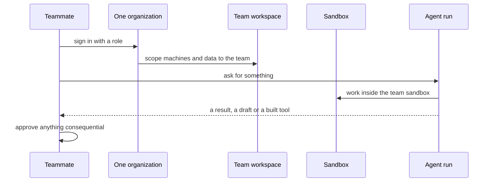

`~25 min` `TypeScript` `Python`

> **您正在构建的内容**：为您的团队的智能体、应用程序和数据提供一处。
>
> **您将使用的原语**：沙箱、智能体和利用、部署（Docker 主机）

## 你正在构建什么

团队向智能体询问、构建和交付的唯一地方

每个人都是一个组织的成员；每个团队都有自己的工作空间，其中包含机器、部署和数据，智能体根据团队的权限进行操作。

您将使用的基元：沙箱·智能体和利用·部署（App Engine）

- 与从事公司工作的智能体聊天
- 每个团队一个工作空间
- 构建和运行内部工具的智能体
- 访问控制和审核日志

这是一种模式，而不是某种产品的复制品。从[相关的 MIOSA 指南](/docs/guides/internal-business-os)开始，构建具有上述功能的最小版本。

## MIOSA 需要什么

每一行都是在开始之前创建的一件事。该数字与使用它的步骤相匹配。

1. 组织和 API 密钥 - 确定每次调用的范围；工作人员只需要一把工作区钥匙即可。 - `miosa api-key create app-key --preset agent` [文档](/docs/platform/api-keys)
2. 沙箱 - 智能体在其中编写代码和运行命令的隔离 Linux 工作区。 - `miosa create app-box --template nextjs --wait` [Docs](/docs/develop/sandboxes)
3. 每个客户一个工作区 - 隔离每个客户的机器、部署和数据。 - `miosa workspace create customer-1` [文档](/docs/platform/white-label)
4. 品牌和白标 - 您的姓名和预览、部署和桌面上的 slug；顾客永远不会看到 MIOSA。 - `miosa org` [文档](/docs/platform/white-label)
5. 使用计量和计费 - 每个客户的使用情况，以及哪个帐户为新机器付费。 - `miosa org bill` [文档](/docs/platform/usage-and-billing)
6. 智能体和工具 - 将提示转化为工作：选择运行使用的工具和模型。 - `miosa agent harnesses` [文档](/docs/api-reference/agent-runs)
7. 部署 (App Engine) - 将应用程序发布到不可变的版本化 URL，并进行回滚。 - `miosa deploy create --from-sandbox app-box --name app --wait` [文档](/docs/docker-host/overview)

## 架构



## 它如何映射到 MIOSA

公司一个组织->MIOSA组织，以队友为成员（`miosa member add`）

每个团队一个工作区 -> `miosa workspace create`

正在工作的智能体 -> 智能体在沙箱中运行 (`miosa prompt`, client.runs) 流事件

审核 -> `miosa audit`

## 数据和存储

将应用程序数据保存在具有行级所有者（成员 ID 或团队）的托管 Postgres 中，并为智能体操作保留仅附加审核表。

## 授权和租赁

您的组织就是平台；客户永远不会获得 MIOSA 帐户，他们会登录您的产品。每个客户在入职时创建一个工作区，隔离他们的机器、运行和数据。

```bash
miosa workspace create team-ai-workspace-customer-1
```

标记每台机器并使用 `metadata` 中的客户 ID 运行，并且切勿跨客户查询。使用 GET /api/v1/usage 计量每个客户的使用情况，并使用 PUT /api/v1/bill-to (/docs/platform/usage-and-billing) 设置付款人。

## 智能体循环

运行框架：OSA 是 MIOSA 自己的运行框架，可与您连接的任何模型提供商配合使用，包括您自己的模型。

模型：人类（克劳德）。呼叫使用我自己的提供商密钥（`miosa connections add models`）； MIOSA 平台密钥从未被使用过。

会话：每个项目或对话一次聊天，因此智能体可以保留其上下文。沙箱上的第一个 `miosa prompt` 使用 `--new-chat` （打印聊天 ID）；之后的每个回合都会经过 `--chat <chat-id>`。 `--reuse chat` 每个聊天保留一台新计算机，以便文件保留。

流式传输：使用 `miosa run follow <run-id>` 或 client.runs.streamEvents(run.id) 跟踪运行，并使用 `miosa run steer` 和 `miosa run interrupt` 引导或停止运行。

智能体充当成员：每次运行都在 `metadata` 中携带请求成员的 ID，使用仅限于该成员或团队的凭据，并且不能超出该成员可以执行的操作。

## 步骤1. 在一个组织内为每个团队创建一个工作区，并邀请成员。
   ```bash
   miosa workspace create team-ai-workspace-ops
   ```
   ```bash
   miosa org invite dana@team-ai-workspace.com
   ```
   检查：一个团队的成员无法看到另一团队的机器。
2. 在每个团队工作区的沙箱中运行聊天后端和智能体运行程序。
   ```bash
   miosa create team-ai-workspace-box --template agent-node --wait
   ```
   检查：每个团队都有自己的后端。
3. 在团队的沙盒上通过聊天分派智能体工作，并使用运行元数据中的成员 ID。
   ```bash
   miosa prompt --sandbox team-ai-workspace-box --harness osa --model <anthropic-model-id> --chat <chat-id> "<request from the member>"
   ```
   检查：每次运行都会显示谁提出要求以及为哪个团队运行。
4. 控制访问：成员和角色，以及对智能体所做操作的审计跟踪。
   ```bash
   miosa member add dana@team-ai-workspace.com --role member
   ```
   ```bash
   miosa audit
   ```
   检查：被删除的成员将立即失去访问权限。
5. 发布内部UI。
   ```bash
   miosa deploy create --from-sandbox team-ai-workspace-box --name team-ai-workspace --dir /workspace --port 3000 --run-command "npm start" --wait
   ```
   检查：成员可以打开它，其他人不能。

## 限制和成本

连接器是真正的工作：为每个源系统的身份验证、速率限制和数据形状预算时间。

设置 `idle_timeout_sec` 以便未使用的团队沙箱暂停。

默认情况下首选只读访问权限；授予每个任务写入。

原型：将其保留在默认大小的一台计算机上，跳过不需要的副本和自定义主机名，并在完成后删除所有内容。

## 验收检查

成员只能看到其团队的数据和工具。

每个智能体操作都可归因于审核日志中的成员。

如果没有指南所述的批准，任何后果都不会发生。

每个客户都被隔离在自己的工作空间中，并且根据他们的使用情况进行计量。

它创建的所有内容都可以被删除，而不会留下任何运行的内容。

## 后续步骤

- [智能体提示生成器选择产品形状并将简介交给您的智能体。](/docs/build)
- [运行编码智能体 在云中运行 Claude Code、Codex 或 Cursor，或在其上构建产品。](/docs/build/run-agents)
- [比较 MIOSA MIOSA 与其他沙箱和智能体平台的比较。](/docs/compare)
- [您可以构建什么 MIOSA 支持的每个产品模式。](/docs/use-cases)
