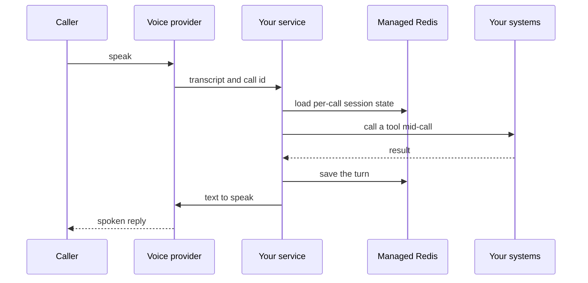

`~25 min` `TypeScript` `Python`

> **您正在构建的**：电话和网络语音智能体。
>
> **您将使用的原语**：沙箱、智能体和利用、Redis、部署（Docker 主机）

## 你正在构建什么

一个用于为电话和网络呼叫构建语音智能体的平台，由 Vapi 以 Vapi 为模型。

您配置助手（模型、语音、工具）；通过电话或网络打来电话，平台运行实时循环并调用您的工具。

您将使用的基元：沙箱·智能体和利用·Redis·部署（App Engine）

- 电话和网络语音智能体
- 带上你自己的模型和声音
- 称为通话中的工具
- 通话记录和文字记录

来源：[vapi.ai](https://vapi.ai/)。 Vapi 是其所有者的商标；本指南不隶属于他们，也不受他们认可。

## MIOSA 需要什么

每一行都是在开始之前创建的一件事。该数字与使用它的步骤相匹配。

1. 组织和 API 密钥 - 确定每次调用的范围；工作人员只需要一把工作区钥匙即可。 - `miosa api-key create app-key --preset agent` [文档](/docs/platform/api-keys)
2. 沙箱 - 智能体在其中编写代码和运行命令的隔离 Linux 工作区。 - `miosa create app-box --template nextjs --wait` [Docs](/docs/develop/sandboxes)
3. Redis - 托管缓存和会话存储，作为 REDIS_URL 注入。 - `miosa api POST /databases -d '{"name":"app-cache","engine":"redis"}'` [文档](/docs/data/redis)
4. 每个客户一个工作区 - 隔离每个客户的机器、部署和数据。 - `miosa workspace create customer-1` [文档](/docs/platform/white-label)
5. 品牌和白标签 - 您的名字和预览、部署和桌面上的 slug；顾客永远不会看到 MIOSA。 - `miosa org` [文档](/docs/platform/white-label)
6. 使用计量和计费 - 每个客户的使用情况，以及哪个帐户为新机器付费。 - `miosa org bill` [文档](/docs/platform/usage-and-billing)
7. 智能体和工具 - 将提示转化为工作：选择运行使用的工具和模型。 - `miosa agent harnesses` [文档](/docs/api-reference/agent-runs)
8. 部署 (App Engine) - 将应用程序发布到不可变的版本化 URL，并进行回滚。 - `miosa deploy create --from-sandbox app-box --name app --wait` [文档](/docs/docker-host/overview)

## 架构



## 它如何映射到 MIOSA

实时对话循环 -> 作为后台进程运行管道（语音转文本、LLM、文本转语音）的 MIOSA 沙箱

每次呼叫会话状态 -> 由呼叫 ID 键入的托管 Redis (`REDIS_URL`)

智能体可以在呼叫中调用的工具 -> 智能体在保存工具代码的沙箱中运行（`miosa prompt`、client.runs）流式传输事件

电话或 Web 客户端的稳定端点 -> MIOSA 部署 (`miosa deploy create`)、不可变且版本化

## 数据和存储

Redis 保存实时的每次调用会话状态（每次都会读取它，因此它必须很快）。成绩单和结果是持久的记录。

每次通话后将记录和结果写入您自己的持久存储中。

## 授权和租赁

您的组织就是平台；客户永远不会获得 MIOSA 帐户，他们会登录您的产品。每个客户在入职时创建一个工作区，隔离他们的机器、运行和数据。

```bash
miosa workspace create vapi-customer-1
```

标记每台机器并使用 `metadata` 中的客户 ID 运行，并且切勿跨客户查询。使用 GET /api/v1/usage 计量每个客户的使用情况，并使用 PUT /api/v1/bill-to (/docs/platform/usage-and-billing) 设置付款人。

## 智能体循环

运行框架：OSA 是 MIOSA 自己的运行框架，可与您连接的任何模型提供商配合使用，包括您自己的模型。

模型：人类（克劳德）。呼叫使用我自己的提供商密钥 (`miosa connections add models`)； MIOSA 平台密钥从未被使用过。

会话：每个项目或对话一次聊天，因此智能体可以保留其上下文。沙箱上的第一个 `miosa prompt` 使用 `--new-chat` （打印聊天 ID）；之后的每个回合都会经过 `--chat <chat-id>`。 `--reuse chat` 每个聊天保留一台新计算机，以便文件保留。

流式传输：使用 `miosa run follow <run-id>` 或 client.runs.streamEvents(run.id) 跟踪运行，并使用 `miosa run steer` 和 `miosa run interrupt` 引导或停止运行。

实时音频循环（语音到文本、模型、文本到语音）由您的语音提供商运行。您的一侧是大脑和双手：每轮的低延迟决策以及作用于您的系统的工具。

使用运行框架进行工具工作和呼叫后分析，而不是用于每个语音转弯：语音转弯必须在大约一秒钟内应答。

## 步骤1. 创建会话存储。
   ```bash
   miosa api POST /databases -d '{"name":"vapi-sessions","engine":"redis"}'
   ```
   检查：REDIS_URL可用；设置有 TTL 的密钥过期。
2. 创建运行智能体服务和工具处理程序的沙箱。
   ```bash
   miosa create vapi-box --template agent-node --wait
   ```
   检查：沙箱正在运行。
3. 带上电话和语音提供商。 MIOSA 不提供电话号码、语音转文本或语音模型：连接您自己的提供商密钥（ElevenLabs、Vapi、Retell、Twilio 或类似）并将其 Webhooks 指向您的部署。
   检查：提供商 Webhook 测试到达您的服务，并且密钥使用 Secrets API 存储，而不是存储在沙箱 `env` 中。
4. 实现智能体可以在呼叫中调用的工具（查找订单、预订时段）作为沙箱中的 HTTP 处理程序。将每个时间控制在一秒钟以内；对于缓慢的工作，异步确认并完成。
   ```bash
   miosa prompt --sandbox vapi-box --harness osa --model <anthropic-model-id> --chat <chat-id> "Handle tool call <name> with args <json>; reply with JSON only"
   ```
   检查：工具调用在延迟预算内返回，并且调用者不会听到长时间的静音。
5. 在 Redis 中保存每次呼叫的状态，通过带有 TTL 的呼叫 ID 进行键入（到目前为止的轮次、收集的字段、切换标志）。
   检查：断开并重新加入的呼叫将恢复其状态。
6. 发布webhook和工具端点；提供商需要一个公共的、稳定的 URL。
   ```bash
   miosa deploy create --from-sandbox vapi-box --name vapi --dir /workspace --port 3000 --run-command "npm start" --wait
   ```
   检查：public_url 回答提供商的健康检查。

## 限制和成本

延迟是产品：保持工具处理程序快速，保持沙箱温暖（不暂停），并将部署放在距离您的电话提供商最近的区域。

电话分钟数和语音模型由您的提供商计费，与 MIOSA 分开。

仅在呼叫者已被告知并同意的情况下对呼叫进行录音。

原型：将其保留在默认大小的一台计算机上，跳过不需要的副本和自定义主机名，并在完成后删除所有内容。

## 验收检查

测试呼叫完成：问候、工具呼叫和干净的挂断。

记录和结果被存储。

当智能体无法继续时，它会将其移交给人类。

每个客户都被隔离在自己的工作空间中，并且根据他们的使用情况进行计量。

它创建的所有内容都可以被删除，而不会留下任何运行的内容。

## 后续步骤

- [智能体提示构建器选择产品形状并将简介交给您的智能体。](/docs/build)
- [运行编码智能体 在云中运行 Claude Code、Codex 或 Cursor，或在其上构建产品。](/docs/build/run-agents)
- [比较 MIOSA MIOSA 与其他沙箱和智能体平台的比较。](/docs/compare)
- [您可以构建什么 MIOSA 支持的每个产品模式。](/docs/use-cases)
