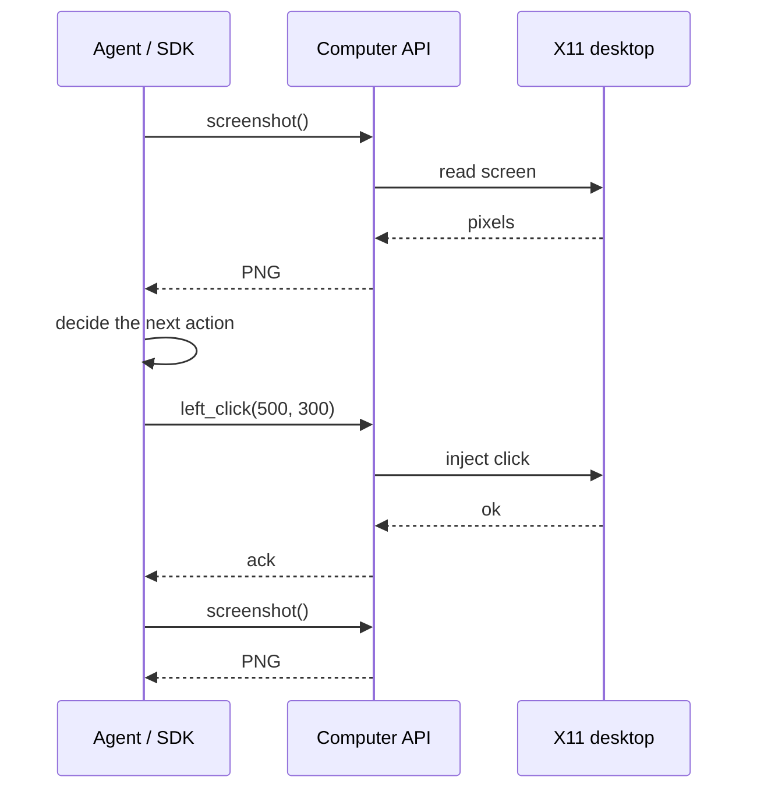

[计算机](/docs/computers/overview) 是一个耐用的云桌面：从 MIOSA microVM 实时传输的完整 Linux GUI。
**计算机使用**是感知-行动循环，让软件以人的方式操作桌面：查看屏幕，做出决定，采取一项行动，再看一遍。

当任务依赖于像素、登录的浏览器会话、桌面应用程序、可访问性树或人工接管智能体正在使用的同一台计算机时，请使用它。
对于代码执行和构建，请改用 [Sandbox](/docs/develop/sandboxes)。
如果您只需要一个浏览器，[浏览器使用](/docs/browser-use)在沙箱内运行，没有完整的桌面。

现在就做

运行您的第一个计算机使用循环

创建一台计算机，然后捕获，执行一次，然后再次捕获。

- [创建计算机](https://miosa.ai/computers/new)：（在新选项卡中打开 MIOSA 控制台）

miosa 计算机创建--尺寸小

使用 SDK 或 MCP 驱动桌面； CLI 涵盖生命周期、日志和端口。

下一篇 [电脑使用快速入门](/docs/computer-use/quickstart)

> **注意：规则**
>
> 如果用户或智能体必须查看和操作真实屏幕，请使用计算机。
> 如果工作负载仅需要 shell、文件系统、进程或预览端口，请使用沙箱。
> 如果只需要浏览器，请使用[浏览器使用](/docs/browser-use)。

## 计算机可以给你带来什么

- **实时 Linux 桌面**：带有 Firefox 和常见 Linux 应用程序的 Xfce 桌面，通过记录的 API 进行实时流式传输和控制。
- **控制 API**：屏幕截图、鼠标、键盘、滚动、剪贴板、窗口状态、辅助功能树以及 shell 和文件。
- **实时查看器**：登录的操作员打开同一正在运行的桌面，进行监视，并从自动化停止的位置接管。
- **智能体工具**：智能体工具和 MCP 客户端通过相同的控制 API 和相同的查看器驱动相同的桌面。

## 控制面

计算机使用可通过 Python SDK、TypeScript SDK、CLI、MCP 工具、REST API 和实时查看器进行。
选择与呼叫者匹配的表面。

|来电者 |使用 |示例|
|---|---|---|
| Python 智能体 | Python SDK | `computer.screenshot()` |
|节点应用程序 | TypeScript SDK | `await computer.leftClick(500, 500)` |
|码头运营商|命令行 | `miosa api GET /computers/cmp_123/desktop/screenshot > screen.png` |
| MCP智能体| MCP 工具 | `computer_screenshot`，然后 `computer_click` |
|自定义后端 |休息 API | `POST /api/v1/computers/{id}/desktop/click` |
|人工操作员 |现场观众|打开计算机桌面并掌控 |

> **提示：以观察开始每个循环**
>
> 首先捕获屏幕截图或阅读辅助功能树。
> 根据观察到的状态做出决定，执行一个操作，然后在执行下一个操作之前再次捕获。
> 这使得智能体立足于真实的桌面，而不是假设 UI 发生了变化。

## 感知-行动循环

感知、决定、行动一次、再次感知。
每个操作都是针对正在运行的计算机的同步、经过身份验证的请求。

## 现场观众

计算机桌面也是浏览器可以渲染的实时像素流。
平台工作区将其显示在 **桌面** 按钮后面；您自己的应用程序可以使用在后端创建的短期 URL 嵌入相同的流。

- 平台桌面按钮：登录的MIOSA用户，普通会话权限。
- 嵌入式流 URL：您的后端使用 MIOSA API 密钥创建一个短暂的桌面 URL。
- 原始外部桌面链接：直接查看者访问，由查看者密码控制。

操作员看到智能体正在使用的同一台机器，可以观看并接管输入。
有关 iframe 和令牌流，请参阅[嵌入和流式传输](/docs/computers/embedding)。

> **警告：不要公开 API 密钥**
>
> 在您的后端创建流 URL。
> 仅将短期 URL 发送到浏览器。
> 切勿将 MIOSA API 密钥放入前端代码中。

## 智能体运行框架使用

智能体运行框架驱动计算机的方式与任何其他客户端相同：它循环调用控制 API，并且可以无头运行或在实时查看器后面运行。

| 运行框架入口点 | 它有什么作用 |
|---|---|
| MCP 工具 | `computer_screenshot`、`computer_click`、`computer_type`、`computer_key`、`computer_scroll` 以及其余桌面工具，位于一个模型循环中。 |
|命令行 | `miosa computer` 涵盖创建、启动、屏幕截图、单击、键入、按键、a11y 树和执行。 |
|带有计算机使用工具集的 SDK | Python 和 TypeScript SDK 提供了一个计算机使用工具集，可将模型的操作映射到桌面方法上。 |
|虚拟机内智能体 (OSA) |可选，默认禁用；激活它以在计算机本身内部运行多步骤桌面任务。 |

由于查看器和运行框架共享一台机器，因此操作员可以在运行中打开实时桌面、观察并接管，而无需移动任何状态。

## 访问模型

|访问路径|谁使用它 |认证|
|---|---|---|
|平台桌面按钮|登录 MIOSA 用户 |正常 MIOSA 会话和工作区权限 |
|嵌入流 URL |您的应用程序后端和前端 |您的后端使用 MIOSA API 密钥创建一个短暂的 URL |
|原始外部桌面链接 |Emergent或直接查看者访问 |观众密码门 |

经过身份验证的平台链接和流 URL 不需要原始观看者密码。
仅对原始外部查看器链接使用 `viewer_password()` / `rotate_viewer_password()`。

## 相关

- **快速入门**：创建一台计算机，运行第一个感知-行为循环，并实时观看。
  [打开](/docs/computer-use/quickstart)
- **API 参考**：每个桌面端点及其真实路径、方法和字段。
  [打开](/docs/computer-use/api-reference)
- **SDK 示例**：带有可运行示例的 Python 和 TypeScript 方法名称。
  [打开](/docs/computer-use/sdk-examples)
- **限制**：延迟、坐标空间、大小和速率限制。
  [打开](/docs/computer-use/limits)

## 后续步骤

- [运行快速入门](/docs/computer-use/quickstart)：创建一台计算机并完成一个感知-动作循环。
- [阅读操作参考](/docs/computer-use/api-reference)：每个桌面端点及其路径、方法和字段。
- [复制 SDK 示例](/docs/computer-use/sdk-examples)：带有可运行代码的 Python 和 TypeScript 方法名称。
