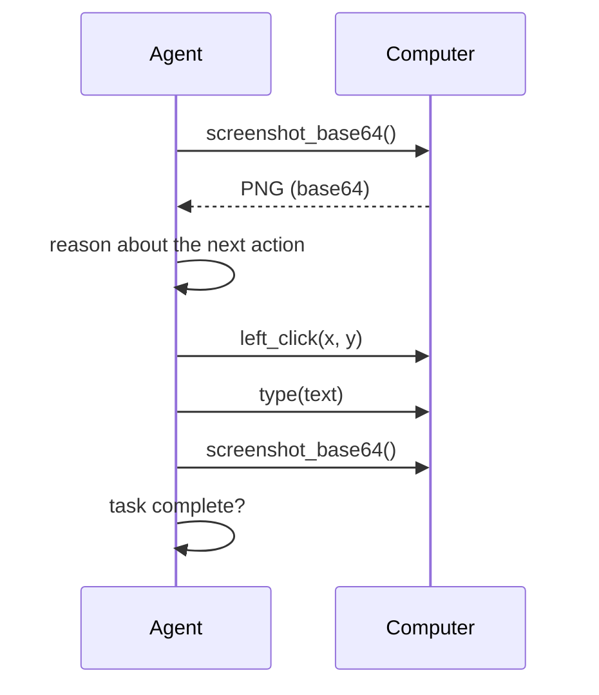

创建一台计算机，截取屏幕截图，执行一次，然后再次屏幕截图。
这是每个计算机使用智能体运行的循环，无论它是无头的还是有人监视的。

## 1. 创建并启动计算机

**Python**

```python
import miosa, os

client = miosa.Miosa(api_key=os.environ["MIOSA_API_KEY"])

computer = client.computers.create(name="agent-1", template_type="miosa-desktop", size="small")
computer.start()
```

**打字稿**

```typescript
import { Miosa } from "@miosa/sdk"

const miosa = new Miosa({ apiKey: process.env.MIOSA_API_KEY! })

const computer = await miosa.computers.create({
  name: "agent-1",
  template_type: "miosa-desktop",
  size: "small",
})
await computer.start()
```

一旦桌面运行并接受操作，`start()` 将返回。
计算机状态为 `provisioning`、`running`、`stopped`、`recovering`、`error` 或 `deleted`。

## 2.第一个循环

捕捉、决定、行动一次、再次捕捉。
不要连续发出多个盲目动作。

**Python**

```python
png = computer.screenshot()

# Decide from the screenshot, or read the accessibility tree for structured elements.
tree = computer.get_accessibility_tree()

computer.left_click(640, 480)
after = computer.screenshot()   # verify the UI changed
```

**打字稿**

```typescript
const png = await computer.screenshot()

const tree = await computer.desktop.accessibilityTree()

await computer.leftClick(640, 480)
const after = await computer.screenshot()
```

**休息**

```bash
curl https://api.miosa.ai/api/v1/computers/$CID/desktop/screenshot \
  -H "Authorization: Bearer $MIOSA_API_KEY" --output before.png

curl -X POST https://api.miosa.ai/api/v1/computers/$CID/desktop/click \
  -H "Authorization: Bearer $MIOSA_API_KEY" \
  -H "Content-Type: application/json" \
  -d '{"x": 640, "y": 480, "button": "left"}'
```

坐标是原点位于左上角的屏幕像素。
如果需要缩放模型的输出，请使用 `get_screen_size()` 读取当前分辨率。

> **提示：一项行动，一项观察**
>
> 在每个操作后进行屏幕截图的循环每一步速度较慢，但比一批猜测的操作可靠得多。
> 对于不需要像素的多步 shell 工作，优先选择 `bash()` 而不是长链 GUI 调用。

## 3.观看直播

可以向浏览器显示相同的运行桌面。
在平台上，打开计算机并使用桌面按钮。
在您自己的应用程序中，在后端创建一个短暂的流 URL 并将其嵌入。

**Python**

```python
urls = computer.urls()
print(urls["desktop_url"])   # pass this to your frontend, never your API key
```

**打字稿**

```typescript
const urls = await computer.urls()
// <iframe src={urls.desktop_url} sandbox="allow-same-origin allow-scripts" />
```

有关令牌流、iframe 策略和过期处理，请参阅[嵌入和流式传输](/docs/computers/embedding)。

## 4. 完整的智能体循环

```python
import anthropic, os
from miosa import Miosa

miosa_client  = Miosa(api_key=os.environ["MIOSA_API_KEY"])
claude_client = anthropic.Anthropic()

computer = miosa_client.computers.create(name="browser-agent", template_type="miosa-desktop", size="small")
computer.start()
computer.launch("firefox")

for _ in range(10):
    b64 = computer.screenshot_base64()

    response = claude_client.messages.create(
        model="claude-opus-4-5",
        max_tokens=1024,
        messages=[{
            "role": "user",
            "content": [
                {"type": "image", "source": {"type": "base64", "media_type": "image/png", "data": b64}},
                {"type": "text", "text": "Navigate to miosa.ai and screenshot the homepage."},
            ],
        }],
    )

    # Parse an action from the model output, then act once.
    text = response.content[0].text
    if "left_click" in text:
        computer.left_click(500, 500)
    elif "type" in text:
        computer.type("https://miosa.ai\n")

computer.stop()
```



## 下一步

- [API 参考](/docs/computer-use/api-reference) - 每个端点和字段。
- [SDK 示例](/docs/computer-use/sdk-examples) - 按组划分的 Python 和 TypeScript 方法。
- [限制](/docs/computer-use/limits) - 延迟、大小和速率限制。
