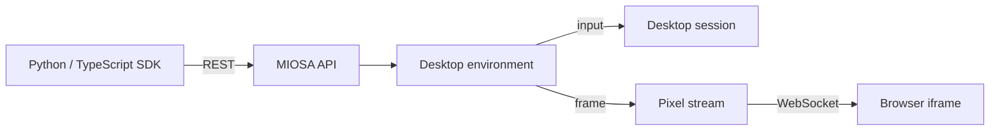

## 盒子里有什么

- **Xfce 桌面**，预装了 Firefox 和常见的 Linux 应用程序。
- **终端**，带有 `bash`、`python` 和标准 CLI 工具链。
- **持久存储**，因此文件和浏览器状态可以通过快照恢复保持停止/启动周期。
- **桌面流媒体**，因此平台或您的应用程序可以嵌入带有短期门票的实时屏幕。
- **桌面控制 API** 用于屏幕截图、单击、打字、滚动、剪贴板、窗口、辅助功能、shell 和文件。
- **OSA 智能体** 已预安装并默认禁用。
  当您想要自主执行桌面任务时激活它。

## 具体来说什么是计算机

|层| What it gives you |
|---|---|
| Desktop VM |具有浏览器、文件、包和用户状态的真实 Linux 图形会话 |
|永久磁盘|跨停止/启动周期的持久文件系统和浏览器配置文件 |
| Stream gateway |平台 UI 或嵌入式应用程序的实时桌面像素和输入转发 |
| Control API |屏幕截图、单击、打字、滚动、剪贴板、shell、文件、窗口和辅助功能 |
| Workspace attribution |附加到计算机的租户、工作区、用户、元数据和计费所有权 |
| Human takeover |已登录的操作员可以打开智能体正在使用的同一正在运行的桌面 |

计算机不是一次性的命令运行器。
它们是寿命长的台式机，可以恢复、检查、嵌入和控制。

## 它如何组合在一起

您的代码与 MIOSA API 对话。
MIOSA 将操作路由到桌面命令服务。
命令服务驱动 X11 会话并返回屏幕截图或操作确认。
对于嵌入视图，MIOSA 通过 WebSocket 将桌面流式传输到浏览器 iframe。

## 下一步

- [计算机概述](/docs/computers/overview)。
- [嵌入和流式传输](/docs/computers/embedding)。
- [计算机使用](/docs/computer-use)。
