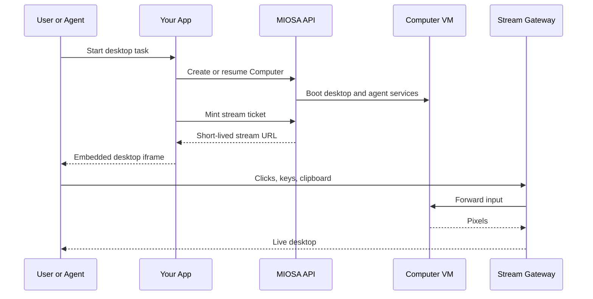

要在最终用户的浏览器中显示实时桌面会话，请嵌入 MIOSA 的桌面流。
将此用于“观看 AI 工作”UI、手动接管、内部支持工具和信息亭式应用程序。

## 访问模型

进入计算机桌面的方法有3种。
它们故意不同，因为它们保护不同的表面。

|访问路径 |谁使用它 |认证|
|---|---|---|
|平台桌面按钮|登录 MIOSA 用户 |正常 MIOSA 会话和工作区权限 |
|嵌入式流票 |您的应用程序后端和前端 |您的后端使用 MIOSA API 密钥创建一个短暂的 URL |
|原始外部桌面 URL |Emergent或直接查看者访问 |观众密码门 |

将嵌入用于您自己的 UI。
仅对原始外部桌面查看器链接使用 `viewer_password()` / `rotate_viewer_password()`。
经过身份验证的平台桌面链接和流门票不需要原始观看者密码。

> **警告：不要公开 API 密钥**
>
> 在您的后端创建流票。
> 仅将短期流 URL 发送到浏览器。
> 切勿将 MIOSA API 密钥放入前端代码中。

## 简单示例

**Python**

```python
import miosa, os

client = miosa.Miosa(api_key=os.environ["MIOSA_API_KEY"])

# Create and start a desktop computer
computer = client.computers.create(name="agent-1", template_type="miosa-desktop", size="small")
computer.start()

# Capture the screen, interact with it
png_bytes = computer.screenshot()
computer.left_click(640, 480)
computer.double_click(100, 200)
computer.type("hello world")
computer.key("Return")
computer.scroll("down", clicks=3)
computer.hotkey("ctrl", "c")
computer.bash("firefox &")
```

**打字稿**

```typescript
import { Miosa } from "@miosa/sdk"

const miosa = new Miosa({ apiKey: process.env.MIOSA_API_KEY! })

// Create and start a desktop computer
const computer = await miosa.computers.create({
  name: "agent-1",
  template_type: "miosa-desktop",
  size: "small",
})
await computer.start()

// Capture the screen, interact with it
const png = await computer.screenshot()
await computer.leftClick(640, 480)
await computer.doubleClick(100, 200)
await computer.type("hello world")
await computer.key("Return")
await computer.scroll("down", 3)
await computer.hotkey("ctrl", "c")
await computer.bash("firefox &")
```

## 流程
```text

1. Your backend asks MIOSA for signed Computer URLs or a stream token for a running computer
2. MIOSA returns a short-lived desktop URL or token
3. Your frontend renders an iframe with that URL
4. The user sees the live desktop; keyboard/mouse input is forwarded into the VM
```

## 操作员工作流程

大多数生产计算机流程如下所示：



计算机是有状态的机器。
流票只是对该机器的临时访问。
如果浏览器选项卡关闭，计算机将保持其状态，直到您停止或删除它。

## 获取嵌入 URL

**TypeScript（后端）**

```typescript
const urls = await computer.urls()
console.log(urls.desktop_url)
console.log(urls.expires_at)
```

**Python（后端）**

```python
urls = computer.urls()
print(urls["desktop_url"])
print(urls["expires_at"])
```

**curl**

```bash
curl https://api.miosa.ai/api/v1/computers/$CID/urls \
  -H "Authorization: Bearer $MIOSA_API_KEY"
```

回应：
```json
{
  "desktop_url": "https://agent-1.computer.miosa.ai/desktop/index.html?auth=...",
  "desktop_entry_url": "https://agent-1.computer.miosa.ai/desktop/index.html",
  "vnc_url": "https://agent-1.computer.miosa.ai/desktop/index.html?auth=...",
  "ws_url": "wss://agent-1.computer.miosa.ai/vnc/websockify?auth=...",
  "terminal_url": "wss://agent-1.computer.miosa.ai/ws/terminal/cmp_xxx",
  "token": "miosa_stream_...",
  "expires_at": 1783000000,
  "computer_id": "cmp_xxx"
}
```

`desktop_url` 是您嵌入的内容。
如果您需要构建自己的流 URL 或通过自定义网关智能体流，则会返回 `token`。

## 嵌入

**反应**

```jsx
<iframe
  src={streamUrl}
  sandbox="allow-same-origin allow-scripts allow-forms"
  className="w-full h-[600px] border-0 rounded-lg"
  allow="clipboard-read; clipboard-write"
/>
```

**HTML**

```html
<iframe
  src="https://agent-1.computer.miosa.ai/desktop/index.html?auth=..."
  sandbox="allow-same-origin allow-scripts allow-forms"
  style="width:100%; height:600px; border:0;"
  allow="clipboard-read; clipboard-write">
</iframe>
```

MIOSA 处理 iframe 内的像素流和输入转发。用户在 iframe 中单击或键入内容，这些事件就会转到桌面。

## 流式传输的内容

- **像素** - 针对桌面内容调整的编码视频。
- **光标位置** - 覆盖渲染的客户端。
- **音频** - 可选，默认关闭。如果您的应用程序需要，请传递 `?audio=1`。
- **剪贴板** - 双向，由 iframe 的 `allow="clipboard-read; clipboard-write"` 控制。

## 只读模式

对于“用户观看智能体”UI，最终用户不应与桌面交互：

使用您自己的应用程序权限来决定是渲染交互式 iframe 还是仅观看表面。
公共只读流令牌控制取决于计划，除非为您的租户启用，否则不应假设。

## 带宽

默认编解码器/比特率针对典型桌面内容进行调整，通常约为 500 Kbps 至 2 Mbps。
对于高动态内容，例如虚拟机内的视频播放，编解码器会进行调整，但期望更高的比特率。
流网关地理路由到用户最近的区域，以降低延迟。

## 终生

流 URL 是短暂的。
默认生命周期为 1 小时，最大生命周期取决于计划。
当令牌过期时，流将断开连接。
您的前端应该在此之前观看 `expires_at` 并重新铸造。

每台计算机有多个流 URL 就可以了。
多个浏览器可以同时观看同一个桌面。
他们都看到相同的像素。

## 自定义域/品牌流媒体

白标签客户可以配置品牌流域，以便最终用户在 iframe URL 中看到您的品牌。
DNS 和 TLS 流遵循与 [部署域](/docs/docker-host/domains) 相同的合同，但具有不同的路由目标。
联系支持人员以设置品牌流媒体。

## 白标桌面

计算机支持每租户桌面品牌。启动计算机后，推送壁纸并通过两次 SDK 调用应用它。壁纸在停止/启动周期中持续存在，因为它存储在虚拟机的快照文件系统中。

**Python**

```python
import miosa, os

client   = miosa.Miosa(api_key=os.environ["MIOSA_API_KEY"])
computer = client.computers.create(
    name="acme-agent",
    template_type="miosa-desktop",
    size="small",
    external_workspace_id="acme-corp",
)
computer.start()

# Push the tenant wallpaper from your server's filesystem
computer.write_file("/tmp/acme-wallpaper.png", open("assets/acme-bg.png", "rb").read())
computer.set_wallpaper("/tmp/acme-wallpaper.png")

# Optionally verify the DE
de = computer.get_desktop_environment()
print(de)   # {"name": "xfce4", "version": "4.18"}
```

**打字稿**

```typescript
import { Miosa } from "@miosa/sdk"
import fs from "fs"

const miosa    = new Miosa({ apiKey: process.env.MIOSA_API_KEY! })
const computer = await miosa.computers.create({
  name: "acme-agent",
  template_type: "miosa-desktop",
  size: "small",
  externalWorkspaceId: "acme-corp",
})
await computer.start()

// Push and apply the tenant wallpaper
const bg = fs.readFileSync("assets/acme-bg.png")
await computer.writeFile("/tmp/acme-wallpaper.png", bg)
await computer.setWallpaper("/tmp/acme-wallpaper.png")
```

> **提示：模板烘焙壁纸**
>
> 对于生产部署，将壁纸直接烘焙到自定义模板快照中，以便每台新计算机都能以正确的品牌启动。
> 无需启动后设置。
> 有关详细信息，请参阅模板文档。

## 光热发电流网关发出 `Content-Security-Policy` 允许从批准的来源嵌入流：

- 默认值：`*.miosa.app`、`*.miosa.ai`、`localhost:4000`。
- 对于白标：通过租户配置添加您的平台来源。

如果您的 iframe 未呈现，请检查父页面的 CSP 是否阻止 iframe，以及流网关 CSP 是否包含您的源。

## 审核

每个流 URL 发布都会发出一个审核事件：

- 计算机 ID
- 令牌前缀
- 颁发API密钥
- 外部归因

如果令牌泄漏，请在调查期间轮换用户会话或停止计算机。
默认情况下，流令牌是短暂的。

## 另请参阅

- [概述](/docs/computers/overview) - 您要嵌入的内容
- [计算机使用](/docs/computer-use) - 同一桌面的编程控制
- [浏览器令牌](/docs/platform/browser-tokens) - 沙盒预览的类似模式
