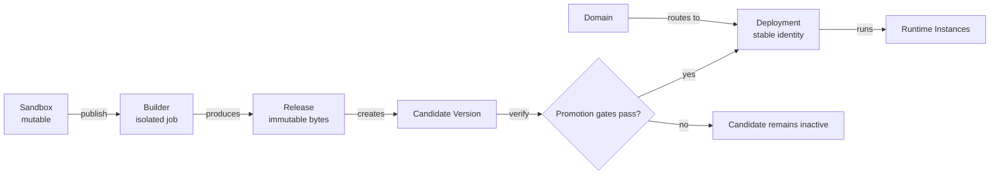

此页面是 MIOSA 的**生产端**：发布创建的资源及其关联方式。
对于所有权链和可变沙箱，请参阅[资源模型](/docs/concepts/resource-model)。

## Production resources

### Builder

**构建器**是一个发布操作的独立工作人员。
它冻结沙箱源，运行选定的构建管道，存储结果，然后退出。
稍后对沙箱的编辑无法更改该构建。

三种构建模式：

|模式|触发|输出|
|------|---------|--------|
|静态打包器| `/workspace` 只有静态文件 |从 MIOSA 的边缘提供 Tarball |
|自动检测 | 检测到 Node/Python/Ruby/Go 项目 | 由生产运行时提供的动态发布 |
| Dockerfile | `/workspace` 中存在 `Dockerfile` | 由生产运行时提供的动态发布 |

构建器是内部且短命的。
它的工作是使生产构建可重复，同时可变的沙箱仍然可用于继续工作。

### 发布

**发布**是由成功的构建器运行生成的不可变工件。
其内容由 SHA-256 摘要寻址并存储在沙箱外部。
相同的字节可以重复启动，放置在不同的主机上，并独立验证。

MIOSA 从不就地编辑发布。
发布更改的源会创建一个新版本。
该规则可防止 URL 以静默方式提供与其发布记录不匹配的字节。

两种形状：

- **静态发布** - 文件的 tarball（`index.html`、`app.js`、资产）。MIOSA 的边缘直接提供它们。不需要运行时实例。
- **动态发布** - 服务器应用工件。由生产运行时提供。

[发布参考 →](/docs/docker-host/releases)

### 运行时实例

**运行时实例**在生产中运行动态发布。
MIOSA 的调度程序会放置它，健康系统会检查它，当实际运行时不再与所需状态匹配时，协调器会替换它。

主要特性：

- **放置。** 调度程序使用容量、区域和策略选择兼容的主机。
- **扩展。** 多个实例可以服务同一版本。
- **恢复。** 失败的实例可以从不可变的版本中替换。
- **隔离。** 生产运行时与其他租户和构建沙箱隔离。

静态部署不需要运行时实例。
MIOSA 从边缘提供不可变文件。

[运行时实例参考 →](/docs/docker-host/runtime-instances)

### 域名

**域** 是路由到部署的活动版本的主机名。
部署拥有路由，因此新版本不需要新的面向客户的 URL。

- `my-app.my-workspace.miosa.app` - MIOSA 管理的后备 URL，即时，无需更改 DNS。
- `my-app.apps.yourplatform.com` - 生成的应用程序的租户部署域。
- `app.yourcustomer.com` - 您的客户带来的自定义域； MIOSA 通过 Let's Encrypt 自动配置 TLS 证书。

更改路由不会重建应用程序。
验证版本接收同一部署 URL 后面的流量的升级和回滚更改。

[域参考 →](/docs/docker-host/domains)

## The immutable publish pipeline

**部署**是生产应用程序的持久标识。
它拥有稳定的URL、版本历史、路由、环境配置和数据绑定。

**版本** 将一个部署连接到一个不可变的版本以及运行它所需的配置。
发布创建一个候选版本。
它不会仅仅因为构建完成而使该候选者存活。

升级必须证明候选者已经准备好，其所需的配置存在，其运行时是健康的，并且其路由服务于预期的工件。
只有到那时，MIOSA 才会更新 `active_version_id`。



生产过渡故意缩小：

1. 冻结沙箱的确切源。
2. 构建不可变的发布。
3. 创建候选版本。
4. 验证运行状况、路由、机密、数据绑定和声明的要求。
5. 提升那个确切的版本。
6. 证明公共 URL 提供它。
7. 保留以前的版本以供回滚。

对象关系在各个版本中保持稳定：

```mermaid
graph TD
  Proj["Project"]
  Dep["Deployment<br/>team-portal"]
  V17["Version 17<br/>(active)"]
  V16["Version 16<br/>(archived)"]
  V15["Version 15<br/>(archived)"]
  Rel["Release sha:abc"]
  RI["Runtime Instances"]
  D1["team-portal.miosa.app"]
  D2["example.net"]
  Proj --> Dep
  Dep -->|active_version_id| V17
  Dep --> V16
  Dep --> V15
  V17 --> Rel
  Rel --> RI
  Dep --> D1
  Dep --> D2
```回滚选择较早准备好的版本作为 `active_version_id`。
部署及其域不会更改身份。
对于动态应用程序，MIOSA 将流量路由到所选版本的健康实例，并淘汰不再属于活动状态的实例。

> **注意：健康的流程还不够**
>
> 仅当发布记录、运行工件、公共路由、所需绑定和声明的功能一致时，才会接受生产更新。
> 成功的构建本身只是一个候选。

```bash
miosa deploy create --from-sandbox <sandbox-id> \
  --name my-app \
  --dir /workspace \
  --type docker_deploy \
  --wait \
  --json
```

构建器、发布、运行时实例、域 - 完整的发布管道。
[部署概述→](/docs/docker-host/overview)

## 下一步

- [数据和绑定](/docs/concepts/data-and-bindings)：部署附加的持久资源。
- [部署概述](/docs/docker-host/overview)：部署部分中的完整管道。
- [核心概念](/docs/concepts)：一屏概述。
