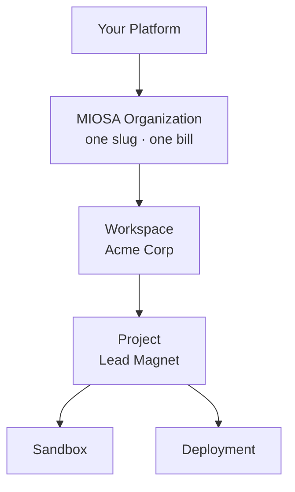

MIOSA 专为平台而设计 - 您在 MIOSA 之上构建产品，而您的客户永远不知道 MIOSA 的存在。

租赁模式：

- **每个客户平台一个 MIOSA 组织。** 一个平台帐户有一个组织 slug 和服务器端 `msk_*` 密钥。
- **下游客户的工作空间和项目。** 将 MIOSA 工作空间用于客户，将项目用于他们创建的应用程序、站点、文档和工作流程。
- **您的 ID 的外部归属。** 当您需要有关使用、审核和列表过滤器的数据库 ID 时，传递 `external_workspace_id`、`external_user_id` 和 `external_project_id`。
- **服务器端密钥，永远不会在浏览器中。** 对于浏览器端访问（嵌入预览、打开终端），您的后端会创建一个短暂的作用域令牌。 `msk_*` 密钥始终留在服务器端。


过滤器始终是组织范围的服务器端。您不能通过传递不同的工作区、项目或外部 ID 来跨组织。

白标租赁、浏览器令牌、归属和 API 密钥。
[平台 / 白标概览 →](/docs/platform/overview)

## 外部归因

**外部归属**是您将 MIOSA 资源映射到您自己的用户、项目和租户，而无需为其创建 MIOSA 帐户的方式。

每个支持创建的资源都接受三个不透明字符串字段：

|领域|目的|
|--------|---------|
| `external_user_id` |系统内拥有或触发此资源的最终用户 |
| `external_project_id` |该资源所属的数据库中的项目、文档或工作流程 |
| `metadata` |适用于您的平台所需的任何其他上下文的任意键值映射 |

MIOSA 从不解释或验证外部归因字段的内容。它们始终按原样存储。

```python
sandbox = client.sandboxes.create(
    template_id="miosa-sandbox",
    external_workspace_id="acme-co",
    external_user_id="alice@example.net",
    external_project_id="invoice-bot",
)
```

有关请求字段、列表过滤器和每个客户退款汇总，请参阅[所有权和归属](/docs/fundamentals/attribution)和[归属参考](/docs/platform/attribution)。

## 下一步

- [预览和共享令牌](/docs/concepts/tokens)：无需公开工作区密钥即可进行浏览器访问。
- [归因参考](/docs/platform/attribution)：完整的过滤器规范和计费划分。
- [核心概念](/docs/concepts)：一屏概述。
