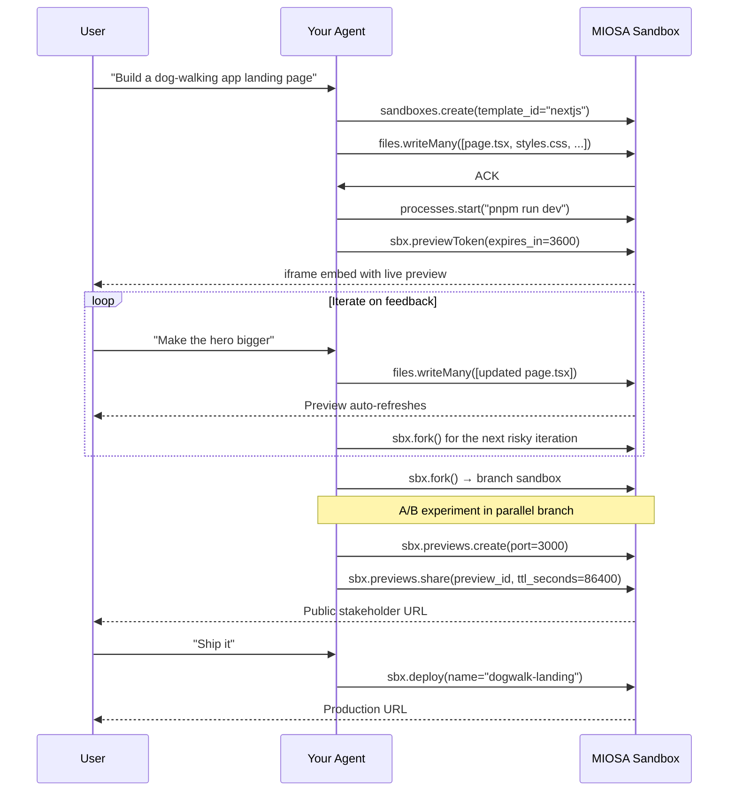

`~15 min` `Python` `TypeScript`

> **目标**：将 LLM 智能体连接到 MIOSA，以便它可以编写代码、启动实时开发服务器、通过实时预览迭代反馈、检查点进度、分支实验、与利益相关者共享、跟踪使用情况，最后通过单个用户提示发布到生产环境。
>
> **您将使用什么**：沙箱、进程、预览、快照、共享、部署、使用

## 你将构建什么

全生命周期函数 `agent_app_lifecycle(prompt)` ：

1. 使用 LLM 生成初始文件并以原子方式写入它们
2. 启动开发服务器并为 iframe 嵌入创建预览令牌
3. 迭代用户反馈：修补文件、监视文件树、预览自动刷新
4. 迭代之间的检查点，以便实验可以安全地分支
5. 分叉成并行分支进行 A/B 比较而不丢失工作版本
6. 创建可共享的公共 URL 供利益相关者审核
7. 跟踪使用情况，以便您可以向最终用户计费
8. 升级为不可变的生产部署

该模式与模型无关：MIOSA 是执行层，智能体循环是推理层。

## 流程图



## 先决条件

- MIOSA 工作区 API 密钥 (`msk_u_*`)。请参阅[API 密钥](/docs/platform/api-keys)。
- Anthropic API 密钥（或替换您首选的提供商）
- 节点 22+ 或 Python 3.11+

## 第 1 步：安装和配置

**Python**

```bash
pip install miosa anthropic
export MIOSA_API_KEY="msk_u_..."
export ANTHROPIC_API_KEY="sk-ant-..."
```

**打字稿**

```bash
npm install @miosa/sdk @anthropic-ai/sdk
export MIOSA_API_KEY="msk_u_..."
export ANTHROPIC_API_KEY="sk-ant-..."
```

## 步骤 2：启动沙箱并写入初始文件

创建一个 Next.js 沙箱。模板已经有 Node、pnpm 和脚手架，
所以跳过`npx create-next-app`。使用 `files.writeMany` 推送所有初始文件
在单个原子调用中。

**Python**

```python
import os
import anthropic
from miosa import Miosa

client = Miosa(api_key=os.environ["MIOSA_API_KEY"])
ai = anthropic.Anthropic(api_key=os.environ["ANTHROPIC_API_KEY"])

# Boot the sandbox
sbx = client.sandboxes.create(
    template_id="nextjs",
    timeout_sec=3600,
    external_user_id="user-42",   # attribute usage to your end-user
)

# Ask the LLM to generate the initial file set
def generate_files(prompt: str) -> list[dict]:
    msg = ai.messages.create(
        model="claude-opus-4-5",
        max_tokens=8096,
        system=(
            "You are a Next.js developer. "
            "Return a JSON array of {path, content} objects for every file you create. "
            "Paths are relative to /workspace. Content is the full file text. "
            "No explanation, just the JSON array."
        ),
        messages=[{"role": "user", "content": prompt}],
    )
    import json
    return json.loads(msg.content[0].text)

user_prompt = "Build a landing page for a dog-walking app with a hero, feature list, and CTA."
file_list = generate_files(user_prompt)

# Write all files atomically
result = sbx.files.write_many(file_list)
print(f"Written: {[f['path'] for f in result['written']]}")
```

**打字稿**

```typescript
import Anthropic from '@anthropic-ai/sdk';
import { Miosa } from '@miosa/sdk';

const client = new Miosa({ apiKey: process.env.MIOSA_API_KEY! });
const ai = new Anthropic({ apiKey: process.env.ANTHROPIC_API_KEY! });

// Boot the sandbox
const sbx = await client.sandboxes.create({
  templateId: 'nextjs',
  timeoutSec: 3600,
  externalUserId: 'user-42',
});

async function generateFiles(prompt: string): Promise<Array<{ path: string; content: string }>> {
  const msg = await ai.messages.create({
    model: 'claude-opus-4-5',
    max_tokens: 8096,
    system:
      'You are a Next.js developer. Return a JSON array of {path, content} objects for every file you create. ' +
      'Paths are relative to /workspace. Content is the full file text. No explanation, just the JSON array.',
    messages: [{ role: 'user', content: prompt }],
  });
  const block = msg.content[0];
  return JSON.parse(block.type === 'text' ? block.text : '[]');
}

const userPrompt = 'Build a landing page for a dog-walking app with a hero, feature list, and CTA.';
const fileList = await generateFiles(userPrompt);

// Write all files atomically
const result = await sbx.files.writeMany(fileList);
console.log('Written:', result.written.map(f => f.path));
```

## 步骤 3：启动开发服务器并公开预览

使用 `processes.start` 将开发服务器作为长时间运行的后台启动
过程。然后调用 `sbx.previewToken` 为您的前端获取一个短暂的令牌
在 iframe 中使用。不需要公共 URL，并且 `msk_*` 密钥不会到达
浏览器。

**Python**

```python
# Start the dev server as a long-running process
proc = sbx.processes.start(
    command="pnpm run dev --port 3000",
    name="nextjs-dev",
)
print(f"Dev server pid: {proc['pid']}")

# Mint a 1-hour preview token for iframe embed
token_info = sbx.preview_token(expires_in=3600)
print(f"Embed URL: {token_info['url']}")
# Send token_info['url'] to your frontend and use it as <iframe src="...">
```

**打字稿**

```typescript
// Start the dev server as a long-running process
// (processes is available via the SDK's raw API; Python-first feature)
// For TypeScript, exec with background flag while processes lands:
await sbx.exec('pnpm run dev --port 3000 &', { cwd: '/workspace' });

// Mint a 1-hour preview token for iframe embed
const tokenInfo = await sbx.previewToken(3600);
console.log('Embed URL:', tokenInfo.url);
// Send tokenInfo.url to your frontend and use as <iframe src="...">
```

> **提示**
>
> `previewToken` 返回嵌入在 URL 中的 `mp_` 前缀标记。它授予
> 在 TTL 持续时间内对沙箱的 HTTP 端口进行只读访问。刷新
> 在到期之前再次调用 `previewToken` ；新 URL 替换旧 URL
> iframe `src` 中的一个。

## 步骤 4：迭代反馈

当用户提供反馈时，生成补丁，使用 `writeMany` 编写补丁，并可以选择通过 SSE 观察文件树，以便您的 UI 可以反映更改的内容。由于开发服务器仍在运行，预览 iframe 会自动刷新。

**Python**

```python
def apply_feedback(sbx, current_prompt: str, feedback: str) -> list[dict]:
    """Generate a patch from LLM feedback and write it to the sandbox."""
    # Read the current file tree to give the LLM context
    tree = sbx.files.tree("/workspace", recursive=True)

    patch_prompt = (
        f"Original request: {current_prompt}\n\n"
        f"Current file tree:\n{tree}\n\n"
        f"User feedback: {feedback}\n\n"
        "Return a JSON array of {path, content} objects for ONLY the files that need to change."
    )

    msg = ai.messages.create(
        model="claude-opus-4-5",
        max_tokens=4096,
        system="You are a Next.js developer. Return only a JSON array of {path, content} objects. No explanation.",
        messages=[{"role": "user", "content": patch_prompt}],
    )
    import json
    changed_files = json.loads(msg.content[0].text)

    # Atomic write of changed files only
    result = sbx.files.write_many(changed_files)
    return result["written"]

# Example iteration
changed = apply_feedback(sbx, user_prompt, "Make the hero section taller and use a dark background")
print(f"Patched {len(changed)} files; preview refreshing automatically")
```

**打字稿**

```typescript
async function applyFeedback(
  sbx: typeof import('@miosa/sdk').Sandbox.prototype,
  currentPrompt: string,
  feedback: string,
): Promise<Array<{ path: string; size_bytes: number }>> {
  const tree = await sbx.files.tree('/workspace', 3);

  const patchPrompt =
    `Original request: ${currentPrompt}\n\n` +
    `Current file tree:\n${JSON.stringify(tree, null, 2)}\n\n` +
    `User feedback: ${feedback}\n\n` +
    'Return a JSON array of {path, content} objects for ONLY files that need to change.';

  const msg = await ai.messages.create({
    model: 'claude-opus-4-5',
    max_tokens: 4096,
    system: 'You are a Next.js developer. Return only a JSON array of {path, content}. No explanation.',
    messages: [{ role: 'user', content: patchPrompt }],
  });
  const block = msg.content[0];
  const changedFiles: Array<{ path: string; content: string }> = JSON.parse(
    block.type === 'text' ? block.text : '[]',
  );

  const result = await sbx.files.writeMany(changedFiles);
  return result.written;
}

const changed = await applyFeedback(sbx, userPrompt, 'Make the hero section taller with a dark background');
console.log(`Patched ${changed.length} files; preview refreshing automatically`);
```

### 通过 SSE 监视文件更改

如果您的后端需要将文件树差异实时推送到您的 UI：

**Python**

```python
# Subscribe to file change events (SSE; runs until cancelled)
for change in sbx.files.watch():
    # change = {"type": "modified"|"created"|"deleted", "path": "...", "size_bytes": N}
    print(f"[file] {change['type']}: {change['path']}")
    # Forward to your frontend over WebSocket or SSE
```

**打字稿**

```typescript
// Subscribe to file change events
for await (const change of sbx.files.watch()) {
  // change = { type: "modified" | "created" | "deleted", path: "...", size_bytes?: N }
  console.log(`[file] ${change.type}: ${change.path}`);
  // Forward to your frontend over WebSocket or SSE
}
```

## 步骤 5：保留已知良好的来源

保持第一个工作沙箱不变，并在下一次有风险的迭代之前分叉它。
Fork 在内部使用写时复制快照，并返回一个具有自己生命周期的新沙箱。

```bash
curl -X POST https://api.miosa.ai/api/v1/sandboxes/$SBX/fork \
  -H "Authorization: Bearer $MIOSA_API_KEY" \
  -H "Content-Type: application/json" \
  -H "Idempotency-Key: fork-v2-hero-large" \
  -d '{"timeout_sec":3600}'
```

在返回的沙箱中继续进行实验工作。
如果失败，则销毁该分支并再次分叉未更改的源。

## 第 6 步：进行实验

对沙箱进行分叉，为有风险或实验性的更改创建独立副本。原始沙箱不受影响。比较完成后销毁分支。

**Python**

```python
# Fork the current sandbox. This creates a new independent sandbox from live state.
branch = sbx.fork(name="branch-bolder-cta")
print(f"Branch sandbox: {branch.id}")

# Apply a different variant in the branch only
apply_feedback(branch, user_prompt, "Replace the CTA button with a neon green pill shape")

# Compare results, then destroy the losing branch
branch.delete()
print("Branch discarded")
```

**打字稿**

```typescript
// Fork the current sandbox
const branch = await sbx.fork({ name: 'branch-bolder-cta' });
console.log('Branch sandbox:', branch.id);

// Apply a different variant in the branch only
await applyFeedback(branch, userPrompt, 'Replace the CTA button with a neon green pill shape');

// Compare, then destroy the losing branch
await branch.delete();
console.log('Branch discarded');
```

## 步骤 7：与利益相关者分享

为正在运行的端口创建预览记录，然后铸造共享令牌。在您指定的 TTL 内，共享 URL 可公开访问（只读）。

**Python**

```python
# Create a preview pointing at the dev server
preview = sbx.previews.create(port=3000)
preview_id = preview["id"]

# Mint a 24-hour public share token
share = sbx.previews.share(preview_id, ttl_seconds=86400)
print(f"Stakeholder URL: {share['share_url']}")
# Anyone with this URL can view the live sandbox in a browser. No login is required.
```

**打字稿**

```typescript
// Create a preview pointing at the dev server
const preview = await sbx.previews.create(3000);
const previewId = String(preview.id ?? preview.preview_id ?? '');

// Mint a 24-hour public share token
const share = await sbx.previews.share(previewId, { ttl_seconds: 86400 });
console.log('Stakeholder URL:', share.share_url);
```

## 步骤 8：跟踪使用情况

归因于发起此会话的最终用户的查询使用情况。使用它来推动平台中的每用户计费。

**Python**

```python
# Pull usage for this end-user over the current period
report = client.usage.report(computer_id=sbx.id)
print(f"Sandbox usage; credits: {report.get('total_credits', 'n/a')}")

# Or roll up across all sandboxes for this user (Python-first)
# user_report = client.usage.report(external_user_id="user-42", group_by="external_user_id")
```

**打字稿**

```typescript
// Pull usage for this session
const report = await client.usage.report({ computer_id: sbx.id });
console.log(`Sandbox usage; credits: ${report.total_credits ?? 'n/a'}`);
```

## 步骤 9：升级到生产环境

当用户确认后，运行生产构建并部署。部署是
不可变的。如果不再需要沙箱，请在部署后销毁它。

**Python**

```python
# Run the production build first
build = sbx.exec("pnpm run build", cwd="/workspace")
if build.exit_code != 0:
    # Self-correction turn
    fixed_files = generate_files(
        f"Fix this Next.js build error and return only the affected files:\n{build.stderr}"
    )
    sbx.files.write_many(fixed_files)
    build = sbx.exec("pnpm run build", cwd="/workspace")
    if build.exit_code != 0:
        raise RuntimeError("Build failed after correction.")

# Keep the sandbox alive if the user wants persistence instead
# sbx.update(always_on=True)

# Or deploy to production and clean up
deployment = sbx.deploy(name="dogwalk-landing")

import time
while deployment.get("status") not in ("live", "failed"):
    time.sleep(2)
    deployment = client.deployments.get(deployment["id"])

if deployment.get("status") == "failed":
    raise RuntimeError(f"Deployment failed: {deployment.get('error')}")

print(f"Production URL: {deployment.get('url')}")

# Clean up the sandbox. The deployment is the durable artifact.
sbx.delete()
```

**打字稿**

```typescript
// Run the production build
let build = await sbx.exec('pnpm run build', { cwd: '/workspace' });
if (build.exitCode !== 0) {
  const fixedFiles = await generateFiles(
    `Fix this Next.js build error and return only the affected files:\n${build.stderr}`,
  );
  await sbx.files.writeMany(fixedFiles);
  build = await sbx.exec('pnpm run build', { cwd: '/workspace' });
  if (build.exitCode !== 0) throw new Error('Build failed after correction.');
}

// Keep the sandbox alive if the user wants persistence instead of deploying
// await sbx.update({ always_on: true });

// Or deploy to production
const deployment = await sbx.deploy({ name: 'dogwalk-landing' });

let dep = deployment;
while (dep.status !== 'live' && dep.status !== 'failed') {
  await new Promise(r => setTimeout(r, 2000));
  dep = await client.deployments.get(String(dep.id));
}

if (dep.status === 'failed') throw new Error(`Deployment failed: ${dep.error}`);
console.log('Production URL:', dep.url);

await sbx.delete();
```

## 你学到了什么- `files.writeMany` 在单个请求中自动推送多个文件。这比单独写入更快并且避免了部分状态。
- `processes.start` 使开发服务器在多个 `exec` 调用中保持活动状态。沙箱不必在迭代之间重新启动。
- `sbx.previewToken(expires_in)` 返回一个 iframe 安全 URL，没有 `msk_*` 键，因此直接嵌入到前端是安全的。
- `sbx.files.watch()` 是文件更改的 SSE 流，您可以将其转发到 UI 以进行实时文件树更新。
- `sbx.fork()` 保留源并从其当前运行状态创建一个独立分支。
- `sbx.fork()` 为 A/B 实验创建实时沙箱的完全独立的副本。没有共享状态，没有干扰。
- `sbx.previews.create(port)` + `sbx.previews.share(preview_id, ttl_seconds=86400)` 生成自动过期的公共利益相关者链接。
- `sbx.update(always_on=True)` 使沙箱在智能体会话结束后保持不变。当用户想要继续编辑时使用它。
- `sbx.deploy(name=...)` 产生一个不可变的版本；沙箱可以立即被摧毁。

## 相关

- [嵌入沙箱 iframe](/docs/cookbook/embed-sandbox-iframe)：服务器生成预览令牌；前端在 React、Vue、Svelte 或 vanilla iframe 中使用它。
- [快照和持久性](/docs/develop/snapshots)：深入研究检查点和分支比较模式。
- [每用户配额和计费](/docs/cookbook/per-user-quotas-billing)：限制最终用户、汇总每月使用情况并生成发票。
- [实时沙箱事件](/docs/cookbook/sandbox-events-realtime)：通过 webhooks 或 SSE 响应沙箱生命周期事件。
