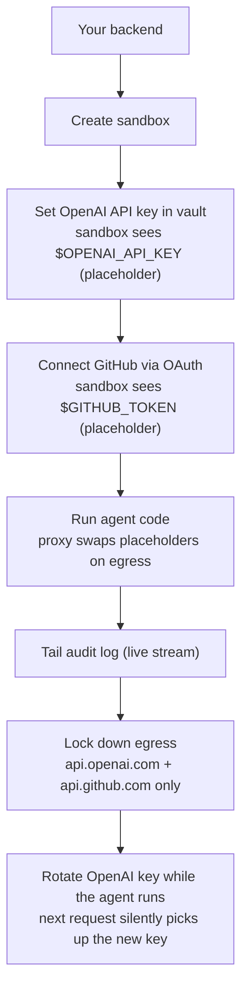

`~20 min` `Python` `TypeScript` `Go`

> **目标**：在 MIOSA 沙箱中构建一个客户支持 AI 智能体，调用 OpenAI 并读取 GitHub 问题。连接两个凭证的保管库管理的机密。实时观看审计跟踪。仅锁定这两台主机的出口。然后在智能体运行中时轮换 OpenAI 密钥 - 无需重新启动，无需重新部署。
>
> **您将使用什么**：沙箱、秘密、连接帐户、审核日志、网络白名单

## 你将构建什么



## 先决条件

- MIOSA API 密钥 (`msk_u_*`) - 请参阅 [API 密钥](/docs/platform/api-keys)
- OpenAI API 密钥 (`sk-proj-*`)
- GitHub 帐户（用于 OAuth 步骤）
- Python 3.11+ 或 Node 22+

## 步骤 1 - 安装和配置

**Python**

```bash
pip install miosa openai
export MIOSA_API_KEY="msk_u_..."
export MY_OPENAI_KEY="sk-proj-..."   # stored on your machine, not in the sandbox
```

**打字稿**

```bash
npm install @miosa/sdk openai
export MIOSA_API_KEY="msk_u_..."
export MY_OPENAI_KEY="sk-proj-..."
```

**去**

```bash
go get github.com/miosa-ai/miosa-go
export MIOSA_API_KEY="msk_u_..."
export MY_OPENAI_KEY="sk-proj-..."
```

## 步骤 2 - 创建沙箱

**Python**

```python
import os
from miosa import Miosa

client = Miosa(api_key=os.environ["MIOSA_API_KEY"])

sandbox = client.sandboxes.create(
    template_id="python-ds",
    timeout_sec=1800,   # 30 min for a long-running agent
)
print(f"Sandbox ready: {sandbox.id}")
```

**打字稿**

```typescript
import { Miosa } from '@miosa/sdk';

const client = new Miosa({ apiKey: process.env.MIOSA_API_KEY! });

const sandbox = await client.sandboxes.create({
  template: 'python-ds',
  timeoutSec: 1800,
});
console.log('Sandbox ready:', sandbox.id);
```

**去**

```go
package main

import (
    "context"
    "fmt"
    "os"
    miosa "github.com/miosa-ai/miosa-go"
)

func main() {
    ctx := context.Background()
    client := miosa.NewClient(os.Getenv("MIOSA_API_KEY"))

    sandbox, err := client.Sandboxes.Create(ctx, miosa.SandboxCreate{
        Template:   "python-ds",
        TimeoutSec: 1800,
    })
    if err != nil {
        panic(err)
    }
    fmt.Println("Sandbox ready:", sandbox.ID)
}
```

## 步骤 3 - 将 OpenAI 密钥添加到保管库

真正的密钥永远不会进入沙箱。沙箱只看到 MIOSA 智能体在退出时交换的不透明占位符。

**Python**

```python
sandbox.secrets.set(
    name="openai_key",
    value=os.environ["MY_OPENAI_KEY"],
    expose_as_env="OPENAI_API_KEY",
)
print("OpenAI secret saved.")
```

**打字稿**

```typescript
await sandbox.secrets.set({
  name: 'openai_key',
  value: process.env.MY_OPENAI_KEY!,
  exposeAsEnv: 'OPENAI_API_KEY',
});
console.log('OpenAI secret saved.');
```

**去**

```go
err = sandbox.Secrets.Set(ctx, miosa.SecretSet{
    Name:        "openai_key",
    Value:       os.Getenv("MY_OPENAI_KEY"),
    ExposeAsEnv: "OPENAI_API_KEY",
})
if err != nil {
    panic(err)
}
fmt.Println("OpenAI secret saved.")
```

验证其着陆：

**Python**

```python
result = sandbox.exec("echo $OPENAI_API_KEY")
print(result.stdout)
# → miosa-tok-7f2a8c1d4b2e6f0a...
# NOT the real key. Good.
```

**打字稿**

```typescript
const result = await sandbox.exec('echo $OPENAI_API_KEY');
console.log(result.stdout);
// → miosa-tok-7f2a8c1d4b2e6f0a...
```

**去**

```go
result, _ := sandbox.Exec(ctx, "echo $OPENAI_API_KEY", miosa.ExecOpts{})
fmt.Println(result.Stdout)
// → miosa-tok-7f2a8c1d4b2e6f0a...
```

## 步骤 4 - 通过 OAuth 连接 GitHub

**Python**

```python
flow = sandbox.secrets.connect(
    provider="github",
    expose_as_env="GITHUB_TOKEN",
    scopes=["repo", "read:user"],
)

# Open this URL in your browser (or send it to your end-user)
print("Authorize at:", flow.authorize_url)

# Block until the user completes the OAuth dance (up to 5 minutes)
flow.wait_for_completion(timeout=300)
print("GitHub connected.")
```

**打字稿**

```typescript
const flow = await sandbox.secrets.connect({
  provider: 'github',
  exposeAsEnv: 'GITHUB_TOKEN',
  scopes: ['repo', 'read:user'],
});

console.log('Authorize at:', flow.authorizeUrl);
await flow.waitForCompletion({ timeoutSec: 300 });
console.log('GitHub connected.');
```

**去**

```go
flow, err := sandbox.Secrets.Connect(ctx, miosa.OAuthConnect{
    Provider:    "github",
    ExposeAsEnv: "GITHUB_TOKEN",
    Scopes:      []string{"repo", "read:user"},
})
if err != nil {
    panic(err)
}
fmt.Println("Authorize at:", flow.AuthorizeURL)

if err := flow.WaitForCompletion(ctx, 300); err != nil {
    panic(err)
}
fmt.Println("GitHub connected.")
```

> **注意：最终用户 OAuth**
>
> 在白标产品中，您可以将 `flow.authorize_url` 发送给最终用户，而不是自己打开。有关完整模式，请参阅[白标签凭证](/docs/security/white-label)。

## 步骤 5 - 编写并运行智能体

现在编写一个简单的智能体，用于读取开放的 GitHub 问题并通过 OpenAI 起草回复。该代码使用这两个环境变量的方式与在裸机上完全相同 - 沙箱内没有特定于 MIOSA 的客户端代码。

**Python**

```python
agent_code = '''
import os, requests, json

GITHUB_TOKEN = os.environ["GITHUB_TOKEN"]
OPENAI_API_KEY = os.environ["OPENAI_API_KEY"]
REPO = "your-org/your-repo"

def get_open_issues():
    resp = requests.get(
        f"https://api.github.com/repos/{REPO}/issues",
        headers={"Authorization": f"Bearer {GITHUB_TOKEN}"},
        params={"state": "open", "per_page": 5},
    )
    resp.raise_for_status()
    return resp.json()

def draft_reply(issue_body: str) -> str:
    payload = {
        "model": "gpt-4o-mini",
        "messages": [
            {"role": "system", "content": "You are a helpful support agent. Draft a polite reply."},
            {"role": "user", "content": issue_body},
        ],
    }
    resp = requests.post(
        "https://api.openai.com/v1/chat/completions",
        headers={
            "Authorization": f"Bearer {OPENAI_API_KEY}",
            "Content-Type": "application/json",
        },
        json=payload,
    )
    resp.raise_for_status()
    return resp.json()["choices"][0]["message"]["content"]

issues = get_open_issues()
for issue in issues:
    reply = draft_reply(issue["body"] or "(no body)")
    print(f"Issue #{issue['number']}: {issue['title']}")
    print(f"Draft reply:\\n{reply}\\n---")
'''

sandbox.files.write("/workspace/agent.py", agent_code)
result = sandbox.exec("python /workspace/agent.py")
print(result.stdout)
```

**打字稿**

```typescript
const agentCode = `
import fetch from 'node-fetch';

const GITHUB_TOKEN = process.env.GITHUB_TOKEN!;
const OPENAI_API_KEY = process.env.OPENAI_API_KEY!;
const REPO = 'your-org/your-repo';

async function getOpenIssues() {
  const res = await fetch(
    \`https://api.github.com/repos/\${REPO}/issues?state=open&per_page=5\`,
    { headers: { Authorization: \`Bearer \${GITHUB_TOKEN}\` } },
  );
  return res.json() as Promise<Array<{ number: number; title: string; body: string }>>;
}

async function draftReply(issueBody: string): Promise<string> {
  const res = await fetch('https://api.openai.com/v1/chat/completions', {
    method: 'POST',
    headers: {
      Authorization: \`Bearer \${OPENAI_API_KEY}\`,
      'Content-Type': 'application/json',
    },
    body: JSON.stringify({
      model: 'gpt-4o-mini',
      messages: [
        { role: 'system', content: 'You are a helpful support agent. Draft a polite reply.' },
        { role: 'user', content: issueBody },
      ],
    }),
  });
  const data = await res.json() as { choices: Array<{ message: { content: string } }> };
  return data.choices[0].message.content;
}

const issues = await getOpenIssues();
for (const issue of issues) {
  const reply = await draftReply(issue.body || '(no body)');
  console.log(\`Issue #\${issue.number}: \${issue.title}\`);
  console.log(\`Draft reply:\\n\${reply}\\n---\`);
}
`;

await sandbox.files.write('/workspace/agent.ts', agentCode);
const result = await sandbox.exec('npx tsx /workspace/agent.ts');
console.log(result.stdout);
```

## 步骤 6 - 实时观看审核日志

在智能体运行时打开第二个进程（或第二个异步任务）以跟踪审核日志。当前版本中尚未启用出口审核捕获，因此流在发布之前为空。

**Python**

```python
import threading

def tail_audit():
    for event in sandbox.audit.tail():
        action = event.action
        host = event.host
        status = event.status_code
        transformed = ", ".join(event.request_transforms.get("secrets", {}).get("swapped", []))
        print(f"[audit] {action:8} {host} HTTP {status}  secrets={transformed or 'none'}")

t = threading.Thread(target=tail_audit, daemon=True)
t.start()

# Now run the agent
result = sandbox.exec("python /workspace/agent.py")
print(result.stdout)
```

**打字稿**

```typescript
// Tail audit in the background
(async () => {
  for await (const event of sandbox.audit.tail()) {
    const swapped = event.requestTransforms?.secrets?.swapped?.join(', ') ?? 'none';
    console.log(`[audit] ${event.action.padEnd(8)} ${event.host} HTTP ${event.statusCode}  secrets=${swapped}`);
  }
})();

// Run the agent
const result = await sandbox.exec('npx tsx /workspace/agent.ts');
console.log(result.stdout);
```

智能体运行时的预期输出：

```text
[audit] allow    api.github.com   HTTP 200  secrets=none
[audit] allow    api.openai.com   HTTP 200  secrets=openai_key
[audit] allow    api.github.com   HTTP 200  secrets=none
[audit] allow    api.openai.com   HTTP 200  secrets=openai_key
```

`secrets=openai_key` 列确认智能体在每次 OpenAI 调用时将占位符与真实密钥交换。

## 步骤 7 - 锁定网络

观察智能体实际调用的内容后，将其锁定到这两台主机。

**Python**

```python
sandbox.network.allow("api.openai.com")
sandbox.network.allow("api.github.com")
sandbox.network.lockdown()
print("Network locked. Only api.openai.com and api.github.com are reachable.")
```

**打字稿**

```typescript
await sandbox.network.allow('api.openai.com');
await sandbox.network.allow('api.github.com');
await sandbox.network.lockdown();
console.log('Network locked. Only api.openai.com and api.github.com are reachable.');
```

**去**

```go
sandbox.Network.Allow(ctx, "api.openai.com", miosa.AllowOpts{})
sandbox.Network.Allow(ctx, "api.github.com", miosa.AllowOpts{})
sandbox.Network.Lockdown(ctx)
fmt.Println("Network locked.")
```

再次运行智能体。它仍然有效。现在尝试达到其他目标：

```bash
# Inside the sandbox after lockdown:
curl -s https://pypi.org/simple/requests/
# → blocked: 403 MIOSA-Egress-Deny
```

> **警告：如果您的智能体在运行时安装软件包**
>
> `pip install` 和 `npm install` 到达不在您的允许列表中的软件包注册表。将所有内容预先安装到模板中，或者在锁定之前将 `pypi.org`、`files.pythonhosted.org` 和 `registry.npmjs.org` 添加到允许列表中。

## 奖励 - 在智能体运行时旋转 OpenAI 密钥

中途旋转而不重新启动任何东西。下一个请求将自动使用新密钥。

**Python**

```python
import os

# Start the agent in background
proc = sandbox.commands.run("python /workspace/agent.py", background=True)

# While it's running, rotate the key
import time
time.sleep(2)   # let the agent make a few calls first

sandbox.secrets.rotate(
    name="openai_key",
    new_value="sk-proj-newrotatedkey...",
)
print("Key rotated. The agent's next OpenAI call will use the new key transparently.")

# Wait for the agent to finish
result = proc.wait()
print(result.stdout)
```

**打字稿**

```typescript
// Start agent in background
const proc = sandbox.exec.stream('npx tsx /workspace/agent.ts', { cwd: '/workspace' });

// Rotate the key after 2 seconds
await new Promise(r => setTimeout(r, 2000));
await sandbox.secrets.rotate({
  name: 'openai_key',
  newValue: 'sk-proj-newrotatedkey...',
});
console.log('Key rotated. Next call picks up the new value automatically.');

const result = await proc.wait();
console.log(result.stdout);
```

智能体不会重新启动。 `$OPENAI_API_KEY` 中的占位符标记不会更改。智能体只需在下一个携带占位符的请求上开始查找新的实际值。

## 你学到了什么

- `sandbox.secrets.set` 将真实凭证完全保留在虚拟机之外。
- OAuth Connect 透明地处理令牌刷新 - 智能体中不需要重试逻辑。
- `sandbox.audit.tail()` 旨在提供具有秘密归属的出站呼叫实时流。当前版本中尚未启用出口审核捕获。
- `sandbox.network.lockdown()` 将沙箱强化到其所需的主机。
- `sandbox.secrets.rotate()` 在运行中更新实际值 - 占位符和智能体代码不受影响。

## 下一步

- [最终用户凭据和 OAuth](/docs/security/white-label)：标记 external_user_id、每个用户的范围凭据，并将审核嵌入到您自己的仪表板中。
- [网络白名单](/docs/security/network)：操作手册：仅审核→审查建议→锁定→处理待处理的请求。
- [秘密参考](/docs/security/secrets)：秘密库的完整 SDK 参考。
