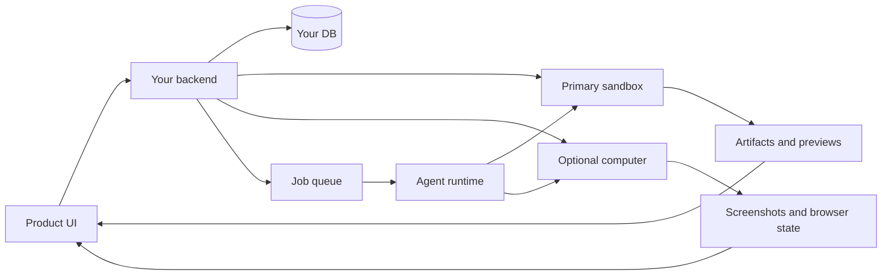

虚拟设备产品为用户和智能体提供了一台共享机器，可以保持
对话之间的状态。它可以保存文件、运行代码、保留浏览器上下文，
执行作业、连接到应用程序并生成工件。

这就是Nebula式设备背后的 MIOSA 模式，永远在线的运营商，
智能体工作区、浏览器自动化产品和人工智能公司工作室。

---

## 产品承诺

```text
"Give each workspace a persistent device where agents can work, remember files,
run apps, use a browser, and continue later."
```

用户应该体验到：

- 短暂超时后不会消失的工作区设备
- 可见文件和生成的工件
- 浏览器或预览面板
- 可恢复的智能体会话
- 可以在后台运行的作业
- 连接的工具和凭证
- 清晰的用途和积分
- 安全批准提示

---

## MIOSA 映射

|虚拟设备概念| MIOSA 原始 |
|---|---|
|设备|沙箱或计算机|
|会话之间的文件 |持久`/workspace`、计算机存储、快照|
|浏览器 |计算机浏览器或支持浏览器的运行时 |
|代码|沙箱执行和文件 |
|直播服务器|沙箱预览端口 |
|工作机会 |恢复设备的预定智能体运行 |
|共享工作空间 |工作区范围的设备策略 |
|连接的应用程序 |托管连接器和机密 |
|输出 |工件、预览、部署 |
|计费|按运行/设备/工具/存储分类的信用分类帐 |

---

## 架构



该产品拥有设备分配和策略。 MIOSA 拥有执行层。

---

## 数据模型

```sql
workspaces
  id
  primary_device_type
  primary_device_id
  credit_budget

workspace_devices
  id
  workspace_id
  miosa_device_type
  miosa_device_id
  name
  role
  status
  persistent
  latest_snapshot_id
  created_at
  updated_at

agent_sessions
  id
  workspace_id
  device_id
  runtime
  status
  last_prompt
  created_at
  updated_at

workspace_artifacts
  id
  workspace_id
  session_id
  path
  content_type
  preview_url
  download_url
  version
```

---

## 设备生命周期

默认情况下使用持久设备进行交互式工作。

```text
create workspace
  -> create primary sandbox
  -> install starter runtime/tools
  -> save first snapshot
  -> mark device ready

user sends prompt
  -> resume primary device
  -> start agent run
  -> stream events
  -> snapshot stable checkpoint

idle timeout
  -> stop compute
  -> preserve filesystem
  -> device remains resumable
```

销毁应该是明确的。超时应该停止计算并保留状态
正常的工作空间。

> **注意：默认情况下不要将主动工作设置为一次性**
>
> 对于智能体构建工作流程，较短的销毁超时会破坏信任。使用
> 持久性、快照、空闲警告和显式删除语义。

---

## 用户界面布局

推荐窗格：

|窗格|演出 |
|---|---|
|聊天/任务 |用户提示和辅助消息|
|活动 |工具调用、命令输出、浏览器操作 |
|文件|工作区文件树和更改的文件 |
|预览/浏览器 |实时服务器或计算机流 |
|文物|可下载的输出和版本 |
|工作机会 |已安排和正在运行的后台工作 |
|学分|当前余额和运行成本|
|批准|等待用户确认的危险行为 |

活动窗格应显示正在发生的工作。如果智能体编写代码，
用户应该看到文件更改和命令。如果使用浏览器，则用户
应该看到屏幕截图或流事件。

---

## CLI 形状

开发人员应该能够从 CLI 操作相同的产品：

```bash
miosa create company-workspace --template nextjs --wait
miosa device list

miosa agent run builder \
  --sandbox company-workspace \
  --no-follow

miosa run events <run-id>
miosa run files <run-id>
```

对于浏览器工作：

```bash
miosa computer create browser-qa --template miosa-desktop
miosa agent run builder \
  --computer browser-qa \
  --no-follow
```

---

## 工作和日程安排

当客服人员能够继续工作时，虚拟设备产品就会变得强大。

示例：

- 每日竞争对手研究
- 每周应用程序质量检查
- CRM丰富
- 支持收件箱分类
- 网站正常运行时间检查
- 自动生成报告
- 重复内容草稿

职位模型：

```sql
agent_jobs
  id
  workspace_id
  agent_id
  device_id
  schedule
  prompt_template
  status
  next_run_at
  budget_limit
```

作业应恢复分配的设备、运行提示、流式传输事件、保存
工件，并在空闲时停止设备。

---

## 连接工具

连接器将设备变成有用的工人：

|连接器|使用 |
|---|---|
| GitHub |问题、PR、回购上下文、代码审查 |
|松弛|通知、摘要、批准请求 |
|谷歌云端硬盘 |源文档和生成的文件 |
|邮箱 |经批准后草稿和收件箱分类|
|参考 |设计研究和产品 UI 参考 |
|自定义 API 密钥 |客户自己的提供商或 SaaS API |

连接器令牌的范围应限于工作区和操作。智能体人应
除非明确允许，否则不会接收租户管理密钥。

---

## 安全默认值

需要批准：

- 外部消息
- 生产部署
- 高成本的设备创建
- 大型车队运行
- 删除文件、快照、设备或部署
- 使用管理员凭据
- 购买域名或付费资源

始终记录：

- 谁问的
- 哪个智能体人采取行动
- 执行哪个设备
- 使用了哪个连接器
- 发生了什么变化
- 收取了哪些积分

---

## 构建清单1. 创建工作区记录。
2. 创建一个持久的主沙箱。
3. 存储 MIOSA 沙箱 ID。
4. 添加可见文件/工件窗格。
5. 添加运行事件流。
6. 添加 `agent start`、`agent task` 和 `agent events` 路径。
7. 添加连接器设置。
8.添加审批关卡。
9. 添加信用计量。
10.添加快照和恢复。
11. 添加可选计算机以进行浏览器工作。
12.添加部署/发布路径。

---

## 另请参阅

- [智能体设备](/docs/guides/agent-devices)：沙箱、计算机、本地设备、持久性和主设备策略。
- [智能体工作流程模式](/docs/guides/agent-workflow-patterns)：从一次性提示到智能体队列选择正确的工作流程。
- [智能体信用计量](/docs/platform/agent-credit-metering)：计量模型、设备、工具、存储和部署使用情况。
- [构建智能体公司平台](/docs/guides/build-agent-company)：将虚拟设备扩展到部门智能体和公司操作人员。
