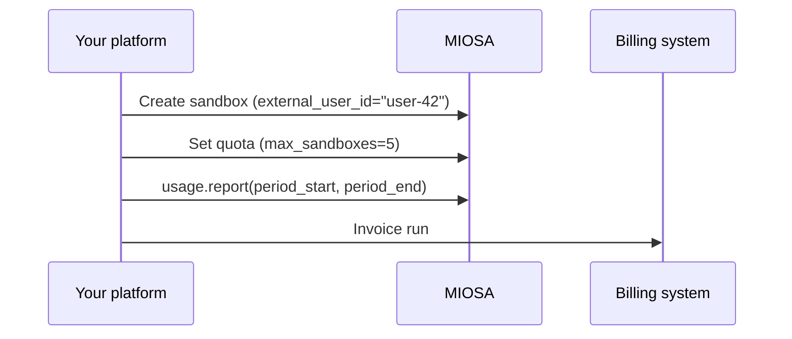

`~10 min` `Python` `TypeScript`

> **目标**：限制每个最终用户，以便他们无法耗尽您的 MIOSA 分配，然后提取每个用户的每月使用量汇总以生成准确的发票。
>
> **您将使用什么**：配额 API、使用 API

## 概述

每个使用 `external_user_id` 创建的沙箱都会自动归属。在此基础上构建了两个 API：

- **配额** - 每个 `external_user_id` 的硬上限：最大沙箱、最大并发、最大积分。
- **用法** - 基于时间段的计量汇总可通过 `computer_id` 查询、可过滤和分页。



## 开始之前 - 归因

配额和使用情况汇总的关键是 `external_user_id`，这是您在创建时在每个沙箱上标记的不透明标识符。 MIOSA 会自动将其传播到每个使用记录和审核事件，因此创建后无需单独的标记步骤。

[多租户 SaaS](/docs/cookbook/multi-tenant-saas) 中涵盖了端到端的归因：创建时标记、按租户过滤沙箱以及每个租户的使用情况。本食谱从那里开始，重点关注上限和发票。

## 步骤 1 - 设置每用户配额

在入职期间（或每当用户升级其计划时）调用 `client.quotas.set` 一次。限制立即对所有后续沙箱创建生效。

**Python**

```python
# Apply limits for a free-tier user
client.quotas.set(
    "user-42",
    max_sandboxes=3,       # total sandboxes this user can own
    max_concurrent=1,      # sandboxes in "running" state at once
    max_credit_cents=500,  # $5.00 cap per billing period
)

# Upgrade to a pro-tier user
client.quotas.set(
    "user-42",
    max_sandboxes=20,
    max_concurrent=5,
    max_credit_cents=5000,
)

# Remove limits (revert to tenant default)
client.quotas.delete("user-42")
```

**打字稿**

```typescript
// Quotas are Python-first in the current SDK  -  use the raw API:
// POST /api/v1/quotas/external/{external_user_id}
// with body: { max_sandboxes, max_concurrent, max_credit_cents }

// For Python-first access (recommended):
// client.quotas.set("user-42", { max_sandboxes: 3, max_concurrent: 1 })

// TypeScript workaround until the SDK ships quotas.set():
async function setQuota(
  userId: string,
  limits: { max_sandboxes?: number; max_concurrent?: number; max_credit_cents?: number },
) {
  const res = await fetch(
    `https://api.miosa.ai/api/v1/quotas/external/${encodeURIComponent(userId)}`,
    {
      method: 'PUT',
      headers: {
        Authorization: `Bearer ${process.env.MIOSA_API_KEY}`,
        'Content-Type': 'application/json',
      },
      body: JSON.stringify(limits),
    },
  );
  return res.json();
}

await setQuota('user-42', { max_sandboxes: 3, max_concurrent: 1, max_credit_cents: 500 });
```

> **注意**
>
> `max_credit_cents` 作为软上限强制执行 - 一旦用户在当前计费周期内消耗了该金额，API 就会拒绝创建新的沙箱。它不会在会话中终止正在运行的沙箱。

## 步骤 2 - 检查当前配额状态

在代表用户创建沙箱之前，请检查他们是否有空间。这可以让您看到友好的升级提示，而不是原始的 API 错误。

**Python**

```python
def check_quota(user_id: str) -> dict:
    quota = client.quotas.get(user_id)
    usage = quota.get("usage", {})

    current = usage.get("sandbox_count", 0)
    limit = quota.get("max_sandboxes") or float("inf")

    return {
        "can_create": current < limit,
        "sandbox_count": current,
        "max_sandboxes": quota.get("max_sandboxes"),
        "max_concurrent": quota.get("max_concurrent"),
        "max_credit_cents": quota.get("max_credit_cents"),
        "credit_cents_used": usage.get("credit_cents", 0),
    }

state = check_quota("user-42")
if not state["can_create"]:
    print(f"user-42 is at their sandbox limit ({state['max_sandboxes']}). Show upgrade prompt.")
else:
    sbx = client.sandboxes.create(template_id="miosa-sandbox", external_user_id="user-42")
```

**打字稿**

```typescript
async function checkQuota(userId: string) {
  const res = await fetch(
    `https://api.miosa.ai/api/v1/quotas/external/${encodeURIComponent(userId)}`,
    {
      headers: { Authorization: `Bearer ${process.env.MIOSA_API_KEY}` },
    },
  );
  const quota = await res.json();
  const usage = quota.usage ?? {};
  const current = usage.sandbox_count ?? 0;
  const limit = quota.max_sandboxes ?? Infinity;

  return {
    canCreate: current < limit,
    sandboxCount: current,
    maxSandboxes: quota.max_sandboxes,
    creditCentsUsed: usage.credit_cents ?? 0,
    maxCreditCents: quota.max_credit_cents,
  };
}

const state = await checkQuota('user-42');
if (!state.canCreate) {
  console.log(`user-42 is at their sandbox limit. Show upgrade prompt.`);
} else {
  const sbx = await client.sandboxes.create({ templateId: 'miosa-sandbox', externalUserId: 'user-42' });
}
```

## 步骤 3 - 每月发票汇总

在每个计费周期结束时，提取使用情况报告。该响应为您提供生成每个用户行项目所需的数据。

**Python**

```python
from datetime import date, timedelta

def get_monthly_usage_per_user(year: int, month: int) -> list[dict]:
    """Returns a list of {external_user_id, total_credits, ...} rows."""
    # Build period bounds
    period_start = date(year, month, 1).isoformat()
    if month == 12:
        period_end = date(year + 1, 1, 1).isoformat()
    else:
        period_end = date(year, month + 1, 1).isoformat()

    # report() returns a summary; sessions() gives per-sandbox detail
    sessions = client.usage.sessions()  # paginate if needed

    # Group by external_user_id manually (SDK-level grouping landing in next release)
    from collections import defaultdict
    by_user = defaultdict(float)
    for session in sessions:
        uid = session.get("external_user_id")
        if uid:
            by_user[uid] += session.get("credits_used", 0) or 0

    return [{"external_user_id": uid, "credits": credits} for uid, credits in by_user.items()]

# May 2026 invoice run
rows = get_monthly_usage_per_user(2026, 5)
for row in rows:
    print(f"  user={row['external_user_id']}  credits={row['credits']:.4f}")
```

**打字稿**

```typescript
async function getMonthlyUsagePerUser(year: number, month: number) {
  const periodStart = new Date(year, month - 1, 1).toISOString().split('T')[0];
  const periodEnd = new Date(year, month, 1).toISOString().split('T')[0];

  const sessions = await client.usage.sessions({ limit: 1000 });

  // Group by external_user_id
  const byUser = new Map<string, number>();
  for (const session of sessions) {
    const uid = String((session as any).external_user_id ?? '');
    if (uid) {
      byUser.set(uid, (byUser.get(uid) ?? 0) + Number((session as any).credits_used ?? 0));
    }
  }

  return Array.from(byUser.entries()).map(([userId, credits]) => ({ userId, credits }));
}

// May 2026 invoice run
const rows = await getMonthlyUsagePerUser(2026, 5);
for (const row of rows) {
  console.log(`  user=${row.userId}  credits=${row.credits.toFixed(4)}`);
}
```

## 连接到 Stripe（可选）

获得每个用户的信用总额后，将其映射到金钱并通过 Stripe 收费：

**Python**

```python
import stripe

stripe.api_key = os.environ["STRIPE_SECRET_KEY"]

CREDIT_TO_USD = 0.01  # one MIOSA credit is one US cent

def bill_user(stripe_customer_id: str, credits: float, period: str):
    """Create a Stripe invoice item and finalize."""
    amount_cents = int(credits * CREDIT_TO_USD * 100)
    if amount_cents < 50:
        return  # below Stripe minimum  -  carry over to next period

    stripe.InvoiceItem.create(
        customer=stripe_customer_id,
        amount=amount_cents,
        currency="usd",
        description=f"MIOSA sandbox usage  -  {period} ({credits:.2f} credits)",
    )
    invoice = stripe.Invoice.create(customer=stripe_customer_id, auto_advance=True)
    stripe.Invoice.finalize_invoice(invoice.id)
    print(f"Invoice {invoice.id} sent to {stripe_customer_id}")
```

**打字稿**

```typescript
import Stripe from 'stripe';

const stripe = new Stripe(process.env.STRIPE_SECRET_KEY!);
const CREDIT_TO_USD = 0.01; // one MIOSA credit is one US cent

async function billUser(stripeCustomerId: string, credits: number, period: string) {
  const amountCents = Math.round(credits * CREDIT_TO_USD * 100);
  if (amountCents < 50) return; // below Stripe minimum

  await stripe.invoiceItems.create({
    customer: stripeCustomerId,
    amount: amountCents,
    currency: 'usd',
    description: `MIOSA sandbox usage  -  ${period} (${credits.toFixed(2)} credits)`,
  });

  const invoice = await stripe.invoices.create({ customer: stripeCustomerId, auto_advance: true });
  await stripe.invoices.finalizeInvoice(invoice.id!);
  console.log(`Invoice ${invoice.id} sent to ${stripeCustomerId}`);
}
```

## 你学到了什么

- 使用 `external_user_id` 创建的每个沙箱都是可归因的 - 创建后不需要额外的标记步骤。
- `client.quotas.set(user_id, {...})` 对每个用户强制实施硬上限。在计划变更时调用它，而不是在每个请求时调用它。
- `client.quotas.get(user_id)` 在一次调用中返回限制和当前使用情况 - 将其用于主动升级提示。
- `client.usage.sessions()` 为您提供构建发票汇总所需的原始每会话计量行。
- 连接到 Stripe 的是一个薄适配器层 - MIOSA 为您提供积分；您决定美元汇率。

## 相关

- [多租户 SaaS](/docs/cookbook/multi-tenant-saas)：SaaS 环境中标记、过滤、预览共享令牌和每租户使用的完整演练。
- [实时沙箱事件](/docs/cookbook/sandbox-events-realtime)：监听沙箱生命周期事件以触发计费操作（例如，销毁时扣除信用）。
- [Quotas API 参考](/docs/api-reference/quotas)：Quotas API 的完整参数参考和强制语义。
