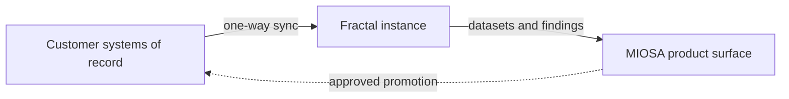

MIOSA 和 Fractal 运行专用的 Fractal 实例，用于大规模结构化数据和计算，为企业和政府提供安全和隔离。

> **注意：企业参与，而不是自助服务原语**
>
> Fractal 不像 Postgres、MySQL、Redis、Qdrant、Storage、Auth 或 Volumes 那样进行配置。生产 Fractal 实例的范围是 MIOSA 和 Fractal 企业参与，涵盖数据驻留、连接器形状、凭证、同步、审计、批准和操作模型。

---

## 适合谁

Fractal 适用于数据工作量大于应用程序数据库的组织：

- **企业和政府**团队拥有客户范围的结构化数据，不能让人工智能接近他们的记录系统。
- **受监管行业**：电力、天然气和水务、电信、金融服务、医疗保健、保险、物流、零售、石油和天然气以及公共部门。
- **非常大的数据集**：数百万条记录、账户、仪表、索赔、发票、交易或资产。
- **大容量计算**，每行都很简单，一旦每天运行数百万次，成本就很高。

如果您的数据适合 MIOSA Postgres 数据库，则不需要 Fractal。使用内置原语，并在人口、计算或隔离要求超出它们时再回来。

## 你得到什么

- **专用 Fractal 实例**：专用于您的数据和工作负载的 Fractal 实例，独立于共享应用程序数据库，且范围仅限于您的组织。
- **海量结构化数据**：客户端范围内的结构化记录以及对于应用程序数据库热路径来说太大的海量计算。
- **安全性和隔离**：私有数据平面。人工智能在分形孪生上读写；您的记录系统保持不变。
- **扩展**：实例随着人口和工作量的增长而增长，适用于企业和政府规模。
- **协调和审计**：跨源系统进行比较、评分和协调，并为每次运行提供证据和可审计的结果。
- **部署选项**：云、私有或面向政府的部署，根据您的居住和操作要求进行选择。

## 它如何与 MIOSA 配合

MIOSA 是产品和运营层。应用程序、智能体、部署、审查队列和审计跟踪连接到 Fractal 数据平面，因此您的客户可以看到一种品牌产品，而无需触及下面的数据管道。

- **MIOSA**：产品表面：应用程序、智能体、沙箱、计算机、部署、身份验证、审查、批准、审计、Webhooks。
- **分形实例**：企业数据基础：客户端范围的结构化数据、大容量计算、协调和私有数据平面。
- **客户系统**：权威记录、生产写入政策、驻留要求和最终源系统升级。



从左到右阅读：

1. 客户记录系统仍然是事实来源，数据以一种方式流入实例。
2. 分形将原始源数据和业务规则转化为显式企业模型：本体、分类和模式映射。
3. Fractal 实例针对该模型运行繁重的数据工作：大量计算、协调和派生数据集。
4. MIOSA 将这些输出转化为产品：应用程序、智能体、部署、审核队列、批准、报告和审计跟踪。
5. 促销回源受到控制和批准。智能体人提议；客户政策决定促销内容。

### 企业数据模型

第一项工作不是将智能体指向原始牌桌。第一项工作是将客户的世界映射到可用的数据模型中：业务实际运行的实体、关系、名称、标识符、计算、真实来源规则和审批规则。

| 模型层 | 示例 | 为什么这很重要 |
|---|---|---|
| **本体论** |客户、帐户、索赔、发票、仪表 |命名真实的业务对象|
| **分类** |产品系列、索赔类型、费率等级 |将数据分组为业务安全类别 |
| **架构映射** |源字段、ID、连接、单位 |将源系统连接到稳定的模型 |
| **计算定义** |定价、资格、对账 |使可重复的工作变得明确 |
| **治理规则** | 只读和仅限提议字段 | 防止智能体不受控制的写入 |

典型模型中的业务对象包括客户、帐户、索赔、发票、产品、仪表、资产、提供商和位置。分类涵盖产品系列、索赔类型、客户群、费率类别、区域和例外类别。治理规则将字段标记为只读、仅建议或写回需要批准，并为每个字段设置审核要求。

### 受控写回

支持分形的工作流程不应让人工智能直接写入生产系统。使用提议、审查、推广的形状：

```text
read scoped data
  -> run calculation or reconciliation
  -> produce finding or proposal with evidence
  -> route to human or policy approval
  -> promote through a controlled writeback service
  -> record audit outcome
```

### 连接器期望

不要从此页面假定公共连接器合同。产品设计的范围包括 MIOSA 和 Fractal，并定义：

- 数据集和租户身份；
- 数据驻留和网络路径；
- 限定范围的凭证或令牌交换；
- 只读、仅建议和需要批准的模式；
- 同步健康和新鲜感；
- 审核和事件移交；
- 写回所有权和回滚或补偿政策。

## Fractal 与 MIOSA Postgres、存储和卷的比较

使用内置原语来实现正常的应用程序状态。当人口、计算或隔离要求超出了 Fractal 实例的规模时，就可以使用 Fractal 实例。

|需要| MIOSA 内置 |分形实例 |
|---|---|---|
|应用程序本地关系状态| Postgres 或 MySQL |没有合适的工具 |
|缓存、队列、会话| Redis |没有合适的工具 |
|文件、报告、导出 |对象存储 |存储分形运行周围的工件 |
|沙箱的耐用磁盘 |卷 |没有合适的工具 |
| 嵌入和矢量搜索 | Qdrant | 索引 Fractal 输出 |
|最终用户身份验证 |项目授权 |门访问分形数据之前 |
|客户端范围内的结构化数据 |对于应用程序数据库来说太大 |专用分形实例 |
|大批量计算 |应用程序代码如果很小 |分形支持的计算 |
|跨来源调节 |应用程序代码如果很小 |分形支持的和解 |
|私有、隔离的数据平面 |不提供 |您环境中的分形实例 |
|让人工智能远离记录系统|不提供 |分形数字孪生，单向同步 |

## 部署选项

**云**

托管 MIOSA 产品表面，在合作伙伴数据平面中具有 Fractal 实例。您获得品牌应用程序和操作流程； Fractal 运行企业数据平面。

**私人**

Fractal 实例在您的环境或专用网络中运行，生产数据永远不会离开您的边界。 MIOSA 从产品表面与其连接。

**政府**

Fractal 发布面向政府的材料和政府联系路径。驻留、网络和采购要求直接与 MIOSA 和 Fractal 相关。

混合试点也很常见：在任何生产推广之前证明受限导出或范围数据集的工作流程。

## 开始使用

Fractal 支持的项目从企业架构对话开始，而不是连接器安装。通常的顺序：

1. **与我们交谈。** 描述工作流程、记录系统以及与您相关的数据。
2. **确定数据范围。** 决定实例看到的内容、运行的位置以及如何处理数据驻留。
3. **映射模型。** 定义映射工作流所需的本体、分类和模式。
4. **选择部署**以及同步、新鲜度以及读取、建议和写回模式。
5. **构建产品表面。** 围绕 Fractal 实例的应用程序、智能体、审核队列、报告和审计跟踪。
6. **用真实数据证明它。** 在将任何内容推回源头之前运行并行试点。> **注意：规划企业数据架构**
>
> 如需参与 MIOSA 和 Fractal，请联系 [enterprise@miosa.ai](mailto:enterprise@miosa.ai)。当客户需要私有数据平面规划、本地或客户控制的部署、源系统映射、本体和分类工作或受控写回时，请使用此功能。

## 常见问题解答

### Fractal 是像 Postgres 一样的 MIOSA 原语吗？

不。Postgres、MySQL、Redis、Qdrant、Storage、Auth 和 Volumes 是您从平台创建的自助服务原语。 Fractal 实例是一种企业参与，范围包括 MIOSA 和 Fractal。

### 我的数据必须离开我的环境吗？

不需要。私有部署将实例保留在您的环境或专用网络中。云部署将实例放在合作伙伴数据平面中。

### AI 可以写入我的生产系统吗？

不直接。数据以一种方式流入实例，人工智能在双胞胎上工作，并且只有通过经过明确批准的受控、可审计流程才能将结果返回到源。

### 这个目标的规模是多少？

数以百万计的记录、账户、仪表、索赔、发票、交易或资产以及计算每天重复数百万次。 Fractal 表示，其生产部署规模达到财富 500 强，涵盖公用事业、电信和金融服务领域。

### 你们发布认证吗？

此页面未列出认证。政府、国防和受监管的部署直接根据您的要求通过 MIOSA 和 Fractal 确定范围。

### 有公布的性能或价格数据吗？

Fractal 在其公共网站上发布了自己的数据，包括 100 倍的性能、降低 90% 的基础设施成本以及 90 天的并行部署。这些是 Fractal 的声明，而不是 MIOSA 测量结果。将它们视为试点的起点，而不是合同。

## Fractal 的公开声明和参考文献

Fractal 将合作伙伴端架构发布为同步数字孪生、记录系统的单向同步、受控促销回馈、局部性优化、商品硬件和行业特定部署。这些是 Fractal 自己的主张。

|参考|它涵盖什么 |
|---|---|
| [分形](https://fractalweb.app/) |数字孪生、结构化数据、性能和成本索赔。 |
| [分形如何工作](https://fractalweb.app/how) |双架构、单向同步、成果提升、90天试点。 |
| [为什么选择分形](https://fractalweb.app/why) |腐败风险、什么不起作用以及成本案例。 |
| [市场](https://fractalweb.app/markets) |公用事业、电信、金融、医疗保健、保险、政府。 |
| [关于](https://fractalweb.app/about) |起源、局部性优化、生产部署。 |
| [联系方式](https://fractalweb.app/contact) | Fractal 自己的摄入和调度流程。 |

## 常见的企业工作流程

|工作流程| MIOSA 角色 |分形角色|
|---|---|---|
|计费质量检查 |应用程序、审核、批准、审计 |计算和不匹配检测|
|索赔或收入调节|特工、证据 UI、工件 |跨记录对账 |
|产品变体分析 |工作流程UI、结果发布|大批量变体计算 |
|智能体执行力评估|编排、报告、审查 |结构化执行输出 |
|客户数据运营|白标产品、webhooks |客户端范围的结构化数据平面|

## 下一步

- [数据概述](/docs/data/overview)：托管数据库、存储、身份验证、Redis、Qdrant 和卷。
- [后端编排](/docs/integrations/backend-orchestration)：围绕 MIOSA 运行时构建服务器端控制平面。
- [白标 SaaS](/docs/platform/white-label)：在您自己的产品和域下公开 MIOSA 支持的体验。
