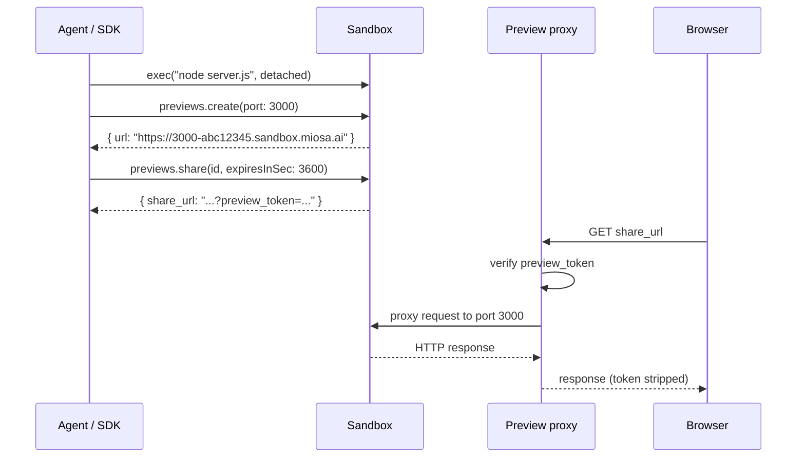
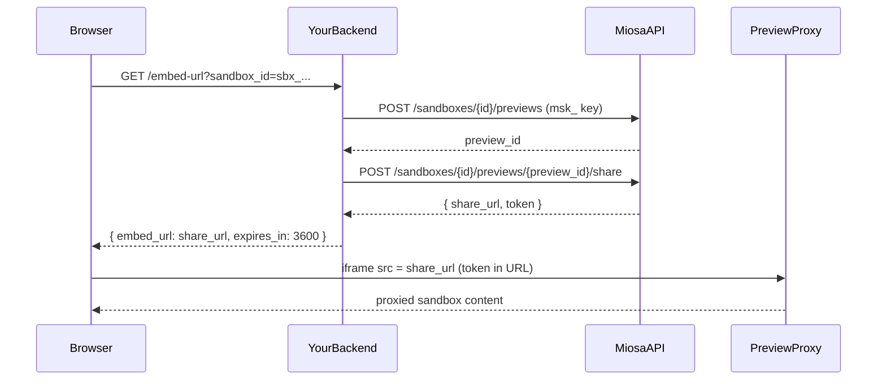

**预览**是路由到正在运行的沙箱内的端口的 URL。智能体编写代码，启动开发服务器，预览更新在浏览器中实时更新。这是人工智能应用程序构建器的构建循环。

## 快速创建

**打字稿**

```typescript
// Make sure something is listening on the port first
const preview = await sandbox.previews.create({
  port: 3000,
  visibility: "private",   // or "public"
})

console.log(preview.url)
// → https://3000-abc12345.sandbox.miosa.ai
```

**curl**

```bash
curl -X POST https://api.miosa.ai/api/v1/sandboxes/$SBX/previews \
  -H "Authorization: Bearer $MIOSA_API_KEY" \
  -d '{"port":3000,"visibility":"private"}'
```

URL 遵循模式 `https://{port}-{slug}.sandbox.miosa.ai`，其中 `{slug}` 是沙箱 UUID 的前 8 个字符。对于模板默认端口，URL 为 `https://{slug}.sandbox.miosa.ai`（无端口前缀）。对于白标平台，一旦设置 DNS 委派，这可以是 `https://{port}-{slug}.sandbox.{your-domain}`。

## 可见性

|模式|访问 |
|---|---|
| `public` |知道该 URL 的任何人都可以查看（并且受 IP 速率限制）。无需授权。 |
| `private` |需要经过身份验证的 MIOSA 会话或有效的共享令牌。 |

对于大多数白标用例，**始终使用 `private`**。然后铸造一个共享令牌以交给最终用户的浏览器。

## 分享代币

共享令牌是一种短暂的、有范围的凭证，可让特定浏览器访问私有预览，而无需暴露您的 MIOSA 工作区 API 密钥。

**打字稿**

```typescript
const share = await sandbox.previews.share(preview.id, {
  expiresInSec: 3600,  // 1 hour default; max varies by plan
})

console.log(share.share_url)
// → https://3000-abc12345.sandbox.miosa.ai?preview_token=<one-time raw token>

// In your end-user's frontend:
//   <iframe src={shareUrl} sandbox="allow-same-origin allow-scripts" />
```

**curl**

```bash
curl -X POST https://api.miosa.ai/api/v1/sandboxes/$SBX/previews/$PREVIEW/share \
  -H "Authorization: Bearer $MIOSA_API_KEY" \
  -d '{"ttl_seconds": 3600}'
```

回应：
```json
{
  "data": {
    "id": "preview_...",
    "share_token_prefix": "first12chars",
    "share_token_expires_at": "2026-05-14T19:30:00Z"
  },
  "preview_token": "miosa_pv_<one-time-raw-token>",
  "share_url": "https://3000-abc12345.sandbox.miosa.ai?preview_token=miosa_pv_<one-time-raw-token>"
}
```

> **注意：`preview_token` 返回一次**
>
> 原始 `preview_token` 值仅存在于创建共享响应中。如果您需要重新显示或重新创建一个新的，请将其保留在服务器端。预览的后续读取仅返回 `share_token_prefix`（用于匹配日志条目）和到期时间戳。

令牌可以通过两种方式传递：
- 作为 URL 中的 `?preview_token=...` 查询字符串（最常见；适用于 iframe）。
- 作为 `x-miosa-preview-token: &lt;token&gt;` HTTP 标头（当您控制请求时）。

MIOSA 的智能体在转发到您的沙箱应用程序之前会删除凭证 - 您的应用程序永远看不到令牌。智能体对请求进行身份验证，然后将干净的 HTTP 请求转发到沙盒上的开发服务器。

## iframe 嵌入

预览被设计为嵌入到 iframe 中：
```html
<iframe src="https://3000-abc12345.sandbox.miosa.ai?preview_token=miosa_pv_..."
        sandbox="allow-same-origin allow-scripts allow-forms"
        style="width:100%; height:600px; border:0;"></iframe>
```

默认情况下，预览智能体为 `*.sandbox.miosa.ai`、`*.miosa.ai` 和 `localhost:4000` 发出 CSP `frame-ancestors`。如需将白标签嵌入到您自己的域中，请联系支持人员 - 生产智能体 CSP 可按租户进行配置。

## 它是如何工作的


## 生命周期

令牌 TTL 到期后，活动状态将变为过期状态；删除时过期将被删除。

- `active` 当底层沙箱正在运行并且预览尚未被显式删除时。
- 一旦共享令牌 TTL（如果设置）过去，`expired`。
- `deleted` 当您删除它时，或在沙箱被破坏后短时间内自动。

在同一端口上重新创建预览会返回带有新段的新预览记录。旧的预览 URL 不会自动转移。

## 预览与部署 URL

| |预览 |部署 URL |
|---|---|---|
|它指向什么 |实时沙盒端口 |不可变的部署版本 |
|实时更新？ |是 - 沙箱中的编辑立即反映 |否 - 仅在回滚/重新升级时更改 |
|生命周期 |与沙箱绑定 |持久 |
|用途 |构建循环、共享进行中的工作 |生产流量 |

您不会将预览升级为部署。您从沙箱发布（沙箱生成具有自己的 URL 的部署版本）。预览会一直存在，直到沙箱消失。

## 滥用限制

公共预览受到边缘 IP 的严格速率限制。私人预览的每个共享代币的速率受到限制。如果您要嵌入高流量站点，请使用自定义域和专用租户计划 - 预览主机并非旨在服务生产流量。

## 为什么存在预览令牌

沙盒预览是在隔离的虚拟机内运行的实时 HTTP 服务。要将其嵌入到您的产品 UI 中，浏览器需要向 MIOSA 预览智能体发出经过身份验证的请求。

错误的方法 - 将您的 API 密钥传递到浏览器 - 会让任何用户调用 MIOSA API 作为您的帐户。预览令牌是正确的边界：范围为一个沙箱、一个端口和一个短 TTL。



## 服务器端薄荷流程

**Python**

```python
from miosa import Miosa

client = Miosa(api_key="msk_u_...")

# 1. Get or create a preview record for the port your app listens on.
previews = client.sandboxes.get("sbx_abc123").preview.list()
preview = next((p for p in previews if p["port"] == 3000), None)
if not preview:
    preview = client.sandboxes.get("sbx_abc123").preview.create(port=3000)

# 2. Mint a time-limited share token.
share = client.sandboxes.get("sbx_abc123").preview.share(
    preview["id"],
    ttl_seconds=3600,
)

embed_url = share["share_url"]   # pass this to the browser
```

**打字稿**

```typescript
import Miosa from "@miosa/sdk";

const client = new Miosa({ apiKey: "msk_u_..." });

// 1. Get or create a preview record for the port your app listens on.
const previews = await client.sandboxes.preview.list("sbx_abc123");
let preview = previews.find((p) => p.port === 3000);
if (!preview) {
  preview = await client.sandboxes.preview.create("sbx_abc123", { port: 3000 });
}

// 2. Mint a time-limited share token.
const share = await client.sandboxes.preview.share("sbx_abc123", preview.id, {
  ttlSeconds: 3600,
});

const embedUrl = share.shareUrl; // pass this to the browser
```

### TTL 策略

|使用案例 |推荐的 TTL |
|---|---|
|互动工作会议 | 3 600 秒（1 小时）- 用户返回时刷新 |
|简短演示或分享链接 | 900 秒（15 分钟）|
|明确到期的公开共享 |长达 86 400 秒（24 小时）|
|永久分享 |无 TTL - 使用不带到期时间的 `sandbox.share.create()`，手动管理吊销 |

当令牌过期时，iframe 会显示来自预览智能体的“会话过期”消息。您的 UI 应捕获 iframe 中的 `message` 事件并透明地重新生成令牌。

### Iframe 沙箱标志

```html
<iframe
  src="https://preview.example.com/p/sbx_abc123?preview_token=miosa_pv_..."
  allow="clipboard-read; clipboard-write"
  sandbox="allow-scripts allow-same-origin allow-forms allow-popups"
  style="width: 100%; height: 600px; border: none;"
  title="Design workspace"
></iframe>
```

|标志 |必需？ |原因 |
|---|---|---|
| `allow-scripts` |是的 |预览内容运行 JavaScript。 |
| `allow-same-origin` |是 |让预览代理可以设置会话 cookie。 |
| `allow-forms` |推荐|许多沙盒应用程序都会提交表单。 |
| `allow-popups` |可选|仅当您的沙盒应用程序打开新窗口时。 |
| `allow-downloads` |可选|仅当您的沙盒应用程序提供文件下载服务时。 |

不要添加 `allow-top-navigation` - 它会让沙箱内容重定向您的顶级页面。

### 令牌刷新

通过监听 iframe 中的 `message` 事件来检测过期：

```javascript
window.addEventListener("message", async (event) => {
  // The preview proxy emits this message when the token expires.
  if (event.data?.type === "miosa:preview:expired") {
    const res = await fetch(`/api/embed-url?sandbox_id=${sandboxId}`);
    const { embed_url } = await res.json();
    document.getElementById("sandbox-frame").src = embed_url;
  }
});
```

### 权限范围

当您为最终用户创建令牌时，请将其范围限制为他们所需的最低权限：

**Python**

```python
token = client.browser_tokens.create(
    workspace_id="550e8400-...",
    project_id="660e8400-...",
    external_user_id="user_42",
    permissions=["sandbox:read", "preview:read"],
    ttl_seconds=3600,
)
```

**打字稿**

```typescript
const token = await client.browserTokens.create({
  workspaceId: "550e8400-...",
  projectId: "660e8400-...",
  externalUserId: "user_42",
  permissions: ["sandbox:read", "preview:read"],
  ttlSeconds: 3600,
});
```

可用权限范围：

|范围 |授予权限 |
|---|---|
| `sandbox:read` |读取沙箱元数据和状态 |
| `sandbox:exec` |在沙箱内运行命令 |
| `preview:read` |嵌入并查看预览 |
| `preview:share` |创建公共共享链接 |
| `files:read` |阅读沙盒文件系统 |
| `files:write` |将文件写入沙箱 |

> **警告：切勿使用 sandbox:admin 铸造代币**
>
> 管理员范围的令牌可以删除沙箱并修改配置。为您的服务器端 API 密钥保留这些操作。

### 提前撤销

在预览令牌过期之前撤销预览令牌 - 例如，当用户注销或失去访问权限时：

**Python**

```python
client.sandboxes.get("sbx_abc123").preview.revoke_share(preview_id="prev_xyz")
```

**打字稿**

```typescript
await client.sandboxes.preview.revokeShare("sbx_abc123", "prev_xyz");
```

## 另请参阅

- [沙箱](/docs/develop/sandboxes) - 预览智能体什么
- [浏览器令牌](/docs/platform/browser-tokens) - 用于白标签嵌入的共享令牌模式
- [发布](/docs/docker-host/publishing) - 将可预览的沙箱转变为生产部署
