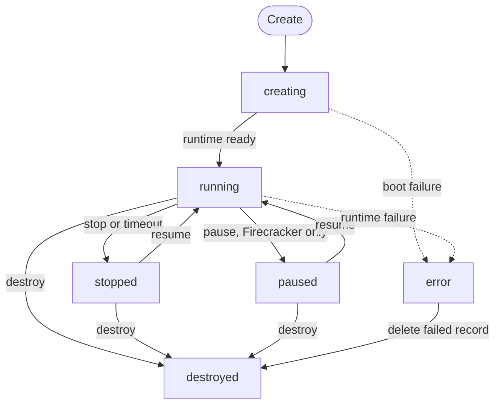
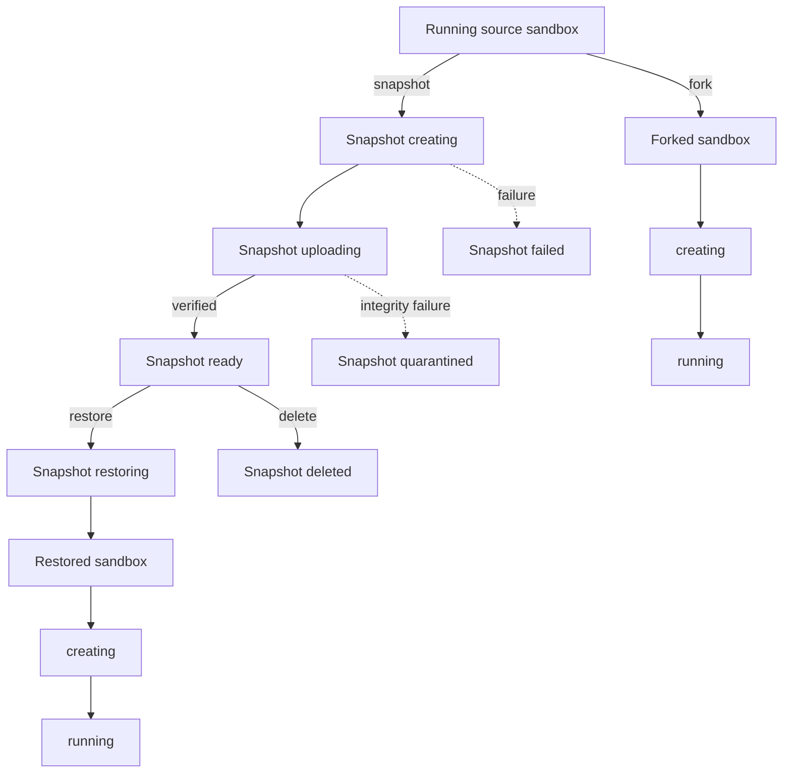

MIOSA 沙箱默认是持久的。
持久意味着沙箱在停止后仍然存在：沙箱记录和磁盘比单个运行会话的寿命更长，直到沙箱被破坏。
这并不意味着沙箱在失去主机后仍能幸存。 `durability` 字段表明这一点，并且它会报告 `local_only` 直到在运行时验证脱离主机复制。
SOMA 沙箱尚不支持持久性、暂停或快照。

## 沙箱状态生命周期

沙盒记录有六个公共状态。
`paused` 仅存在于通告暂停的运行时，即今天的 Firecracker。
快照和分叉是独立的资源和操作，而不是额外的沙箱状态。



|状态 |意义|
|---|---|
| `creating` |沙箱正在准备中，尚未准备好投入使用。 |
| `running` |计算处于活动状态，沙箱已准备好进行支持的操作。 |
| `stopped` |机器被释放，磁盘被保存。文件存活；进程则不然。 |
| `paused` |机器会在内存和进程完好无损的情况下悬挂在原地长达 30 分钟，然后它就像停止一样。仅限鞭炮。 |
| `error` |创建或运行时恢复失败。销毁或更换沙箱前请先检查失败原因。 |
| `destroyed` |沙箱和保存的工作区已永久释放。 |

> **注意：停止或暂停的沙箱仍然是同一个沙箱**
>
> 停止、暂停和恢复保留沙箱 ID 和磁盘。
> 恢复并分叉使用新 ID 创建不同的沙箱。

## 快照、恢复和分叉

快照是具有自己生命周期的持久检查点资源。
创建沙箱不会将沙箱更改为 `snapshot` 状态。
恢复和分叉都会生成一个新的沙箱，同时保持源沙箱不变。
将快照恢复到同一沙箱（恢复）尚不可用。
快照是根据生命周期事件（停止、暂停、分叉）并根据请求拍摄的。
不承诺定期自动快照。
SOMA 上尚不提供快照。

### 快照保留

- 最新的停止快照在沙箱的生命周期内保留。
- 命名快照将保留，直到您将其删除为止，具体取决于您的计划配额。
- 销毁沙箱会在 24 小时宽限期后删除其快照。
- 内存检查点在暂停 72 小时后过期。然后继续回退到磁盘。

### 快照作为模板

命名快照可以成为带有 `source: "snapshot:<id>"` 的新沙箱的源。
模板是有版本的并且每个版本都是不可变的。
在跨租户共享或分叉之前，快照会清除智能体凭据和机密。
每个分叉都有自己的机器 ID、SSH 主机密钥和会话密钥。



|运营|来源要求|结果 |来源改变？ |
|---|---|---|---|
|创建快照 |运行沙箱|快照依次经过 `creating`、`uploading`，然后是 `ready`，或以 `failed` 或 `quarantined` 结束。 |编号|
|恢复快照|准备好快照|从检查点配置一个新的沙箱。 |编号|
|分叉沙箱 |运行沙箱 | MIOSA 捕获写时复制检查点并配置新的沙箱。 |源经过短暂协调以进行捕获，然后继续运行。 |
|删除快照 |现有快照 |快照变成`deleted`；之前从中恢复的沙箱不受影响。 |编号|

### 快照状态

|状态 |意义|
|---|---|
| `creating` | MIOSA 正在捕获检查点文件。 |
| `uploading` | MIOSA 正在压缩、上传并最终确定检查点。 |
| `ready` |快照已通过验证，可以恢复。 |
| `restoring` |恢复作业正在使用检查点创建新的沙箱。 |
| `failed` |快照创建或还原遇到不可恢复的错误。 |
| `quarantined` |工件完整性验证失败，因此 MIOSA 不会恢复它。 |
| `deleted` |快照已被保留策略显式删除或删除。 |

## 停止、暂停和恢复当工作应该结束而不丢弃磁盘时，停止正在运行的持久沙箱。
Stop 保留文件、已安装的软件包和启用的服务。
它永远不会保持正在运行的进程。
Pause 是用于保持进程的单独、明确的动词，并且仅存在于 Firecracker 上。
暂停的沙箱最多会驻留 30 分钟，然后它的行为就像停止一样。
内存检查点是一个加速器，但事实并非如此：如果无法恢复，则恢复会回退到磁盘。
SOMA 今天没有停顿。
在停止或暂停的持久性沙箱上执行、文件操作和部署首先恢复它然后运行，预览请求将其唤醒并在 `503` 和 `Retry-After` 之前保持最多 10 秒。非持久性沙箱永远不会自动恢复，并且调用返回 `409`。当应用程序需要等待 `running` 状态时，显式恢复会更清晰。

```bash
curl -X POST https://api.miosa.ai/api/v1/sandboxes/$SBX/pause \
  -H "Authorization: Bearer $MIOSA_API_KEY"

curl -X POST https://api.miosa.ai/api/v1/sandboxes/$SBX/resume \
  -H "Authorization: Bearer $MIOSA_API_KEY" \
  -H "Idempotency-Key: resume-session-001"
```

当沙箱未运行时，暂停返回 `409`。
当沙箱未停止或暂停时，Resume 返回 `409`。
磁盘只能作为resume 或fork 的参数来增长，并且缩小磁盘的请求会被`409` 拒绝。

## 超时和持久化

`timeout_sec` 默认为 3600，接受 1 到 86400 之间的值。
超时是空闲锚定的：它从最后一个活动开始计算。
当它过期时，持久性沙箱将停止并保留其磁盘以供以后的会话使用，非持久性沙箱将被销毁。
`idle_timeout_sec: 0` 禁用空闲自动停止。如果未设置，则对于 2026 年 10 月 11 日或之后创建的帐户，默认为 `0` 或 `1800`（30 分钟）；停止的沙箱会在下一个请求时唤醒。
`always_on: true` 禁用超时和空闲超时强制执行，直到执行明确的生命周期操作为止，具体取决于租户策略。

将活动会话超时替换为扩展端点：

```bash
curl -X POST https://api.miosa.ai/api/v1/sandboxes/$SBX/extend \
  -H "Authorization: Bearer $MIOSA_API_KEY" \
  -H "Content-Type: application/json" \
  -d '{"timeout_sec": 7200}'
```

该值取代超时而不是增加时间。
省略请求正文将保留当前超时。

## 从快照分叉

Fork 从正在运行的沙箱的写时复制快照创建一个新的沙箱。
源未更改，响应是新创建的沙箱。
重试分叉请求时使用幂等性密钥。

```bash
curl -X POST https://api.miosa.ai/api/v1/sandboxes/$SBX/fork \
  -H "Authorization: Bearer $MIOSA_API_KEY" \
  -H "Content-Type: application/json" \
  -H "Idempotency-Key: fork-auth-experiment-001" \
  -d '{"timeout_sec": 3600}'
```

可选主体接受新沙箱的 `timeout_sec` 和 `template_id`。

> **注：公开快照合约**
>
> 除了快照支持的分叉、暂停和恢复之外，公共 V1 还公开独立的快照创建、列出、检查、删除和恢复操作。
> 快照 ID 是持久资源 ID，但快照仅捕获沙盒磁盘以及运行时公布的内存。
> 外部数据库、对象存储、连接器和第三方服务不会随之回滚。

```bash
miosa snapshot save <sandbox-id> "before migration" --json
miosa snapshot list <sandbox-id> --json
miosa snapshot info <snapshot-id> --json
miosa snapshot fork <snapshot-id> --json
miosa snapshot delete <snapshot-id> --json
```

## 什么幸存下来

MIOSA 的坚持涵盖四个不同的方面。它们不可互换：

|机制|它保留了什么 |范围 |
|---|---|---|
|停止和恢复 |沙箱记录和它的磁盘，在同一个沙箱id上；没有流程|一个沙箱 |
|暂停和恢复（仅限 Firecracker）|磁盘和正在运行的进程长达 30 分钟，在同一沙箱 ID 上 |一个沙箱 |
|快照和恢复|在某个时间点捕获的沙箱磁盘（和内存，如有广告），恢复到新的沙箱中 |一个沙箱，可复制 |
|卷 |连接到同一主机上兼容计算机的块设备 |主机绑定，计算机重新启动后仍然存在 |
|模板|沙箱启动的启动映像（内置或自定义）|跨沙箱共享 |

快照**不**保存的内容：外部数据库、对象存储桶、连接器以及沙箱与之通信的任何第三方服务。恢复检查点不会回滚这些检查点。将持久状态放入 [Postgres](/docs/data/postgres)、[Storage](/docs/data/storage) 或 [Volume](/docs/data/volumes) 中（如果它必须比恢复的寿命更长）。

## 在暂停、快照和分叉之间进行选择

| 你想要 | 使用 | 结果 |
|---|---|---|
| 停止为算力付费，之后回到同一个沙箱 | 停止，然后恢复 | 相同的沙箱 id、相同的磁盘、相同的文件；进程不会保留 |
| 在短暂的中断期间让进程保持存活（仅 Firecracker） | 暂停，然后在 30 分钟内恢复 | 相同的沙箱 id、相同的文件、相同的进程 |
| 保留一个已知良好状态以便回滚 | 快照，然后恢复 | 从检查点创建的新沙箱；源沙箱不受影响 |
| 将一个运行中的沙箱分支为独立实验 | 分叉 | 具有自己的 id、生命周期和超时的新沙箱 |
| 为许多沙箱复现相同的起点 | 模板 | 每个新沙箱共享的启动镜像 |

源沙箱可以在运行的同时进行分叉；分叉捕获写入时复制检查点。每个分支使用不同的幂等键，并使用相同的键重试分支。

## 故障恢复

- 如果分支损坏，则保持源不变，销毁失败的分支，并使用新的幂等密钥再次分叉。
- 如果源本身必须更改，请先分叉它并在新沙箱中进行更改。
- 当源应该保持可用于以后的工作而无需主动执行时，请停止该源。

## 托管和 BYOC 行为

MIOSA 管理的容量和支持的 BYOC 容量的生命周期合同相同。
应用程序发送沙箱参数，例如模板、大小和超时。
放置配置保留在沙箱请求之外，并且沙箱响应不会公开内部主机或提供程序字段。

- [沙箱](/docs/develop/sandboxes)：资源合同、创建参数、用法、文件、执行和预览。
- [托管和 BYOC](/docs/infrastructure/byoc/aws)：部署模型、私有预览状态和共享沙箱合约。
