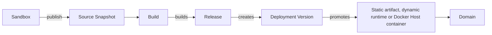
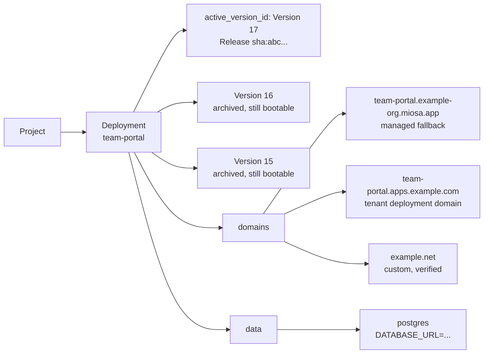

每次发布都会将沙箱变成稳定的生产应用程序，并由不可变版本、运行状况检查和 API 返回的公共 URL 提供支持。
本页解释了该流程背后的对象以及它们如何组合在一起。

## 部署管道

每个发布都遵循相同的路径：



1. **沙盒** - 您（或智能体）编写代码的可变环境。
2. **源快照** - 在发布时捕获的 `/workspace` 的不可变 tarball。沙箱可以不断变化；快照被冻结。
3. **构建** - MIOSA 从冻结源运行配置的构建/打包管道。
4. **发布** - 不可变的构建输出。静态：文件/资产。动态：具有命令、端口和运行状况检查的服务器应用程序工件。
5. **部署版本** - 历史记录中的行。 `version_number` 单调增加。每个版本都是永久可启动的。
6. **运行时** - 对于动态部署，MIOSA 启动生产运行时并对其进行运行状况检查。静态发布跳过这个； MIOSA 直接提供文件服务。 Docker Host 版本作为容器在工作区 Docker Host 上运行。
7. **域** - 路线。托管、工作区拥有、租户拥有或确切的自定义域。回滚是在不重建的情况下重新指向该路线。

## 静态与动态

| |静态|动态 | Docker 主机 |
|---|---|---|---|
|源形|仅 HTML / JS / CSS / 资源 |服务器端代码|许多小型工作区应用程序、渠道、API、客户端站点 |
|构建输出 |文件/资产 |服务器应用产物|来自发布工件的容器镜像 |
|生产运行时间|静态工件服务，无每个应用程序进程 | MIOSA动态运行时池|工作区 Docker 主机 |
|缩放 |即时文件服务 |调度程序管理所需的实例数量 |一台工作区主机上的多个应用程序容器 |
|回滚速度|秒|秒|更换容器几秒钟后就正常了 |
|最适合 |登陆页面、SPA、生成的 HTML、文档 | API、SSR、WebSocket、后台工作人员 |多应用程序工作区和白标签应用程序工厂 |

传递 `kind: "auto"` （或等效的 SDK），MIOSA 从您的发布输入中选择静态或动态路径。提供运行命令和端口使部署动态化。
当您明确希望应用程序在工作区 Docker Host 内运行时，请使用 Docker Host。

推荐的 CLI 路径是：

```bash
miosa deploy create --from-sandbox <sandbox-id> \
  --name <deployment> \
  --type docker_deploy \
  --wait \
  --json
```

每次发布时使用相同的 `--name`，以便 MIOSA 在相同的部署 ID 和 URL 后面创建一个新版本。

## 部署对象

**部署**是稳定的产品对象。
这就是世人所认为的“实时应用程序”。
它有一个名称、一个 slug、一个活动版本以及一个或多个指向它的域。



部署 URL **稳定**。新发布会更改它指向的版本，而不是 URL 本身。

## 什么被版本化

|事情|版本控制？ |
|---|---|
|来源快照|是的 - 发布时捕获的 tarball 的 sha256 |
|发布产物|是的-sha256的静态文件或动态服务器产物|
|部署版本 |是 - `version_number` 单调增加 |
|域 ↔ 版本映射 |是 - 保留更改历史记录 |
|运行时实例 |由调度程序根据所需计数进行管理；没有版本控制 |
|数据服务|无版本控制 - Postgres / Redis / 存储桶在部署中持续存在 |

回滚之所以有效，是因为每个版本都是不可变的并保留在存储中。将部署重新指向版本 14，MIOSA 再次为该已知良好的版本提供服务。

当候选版本构建并启动时，活动版本仍然有效。
MIOSA 仅在候选者通过所需检查后才更改生产流量。
如果候选版本失败，则活动版本保持不变。

> **注意：部署产品**
>
> 使用 `kind: "static"`、`kind: "dynamic"` 或 `kind: "auto"` 进行标准 MIOSA 部署。
> 当部署应成为工作区 Docker 主机上的容器时，请使用 Docker 主机。
> 为了兼容性，内部 API 值仍为 `docker_deploy`。

## 合同证明部署对象与生产流量正常运行的证明不同。
对于标准部署，证明意味着部署具有公共 URL，并且 MIOSA 可以路由到活动版本。
对于 Docker 主机部署，证明还需要工作区主机、持久应用程序目标、正在运行的容器路由和公共 URL 探测。

用途：

```bash
miosa deploy get <deployment-id> --json
miosa deploy requests <deployment-id>
```

## 另请参阅

- [发布](/docs/docker-host/publishing)：沙箱到版本的管道：源快照、构建模式和升级。
- [版本](/docs/docker-host/versions)：不可变的历史记录。列出、检查、升级和存档版本。
- [Docker Hosts](/docs/docker-host/hosts)：运行 Docker Host 容器的工作区主机。
