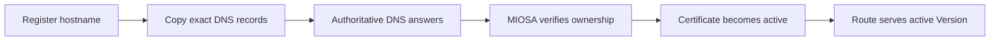

**域** 是路由到预览、部署、计算机或确切的自定义资源的主机名。对于生产部署，请始终使用 API 返回的 `public_url`。不要在 SDK、CLI 或前端中重建主机名。

## 域层

MIOSA 将这些层分开：

|层|网址形状 |目的|
|---|---|---|
|沙盒预览域 | `https://{port}-{sandbox_slug}.sandbox.{preview_domain}` |智能体/用户编辑时可变的实时预览 |
|租户部署域| `https://{deployment_slug}.{deployment_domain}` |生成的生产应用程序的品牌持久 URL |
|托管后备域 | `https://{deployment_slug}.{organization_slug}.miosa.app` |始终可用的 MIOSA 管理后备 |
|精确的自定义域 | `https://customer-owned.example.com` |客户选择的生产域附加到一个部署 |
|计算机自定义域 | `https://desktop.customer-owned.example.com` |附加到一台计算机服务的客户拥有的主机名 |

Lumen 是一家虚构公司，`example.com` 和 `example.net` 是保留的示例域。
用你自己的替换它们。

流明示例：

```text
Sandbox preview:   https://5173-abc123.sandbox.example.com
Deployment domain: https://lead-magnet.apps.example.com
Managed fallback:  https://lead-magnet.example-org.miosa.app
Custom domain:     https://portal.example.net
```

预览域并不意味着生产部署域。如果您希望两个表面都带有品牌标记，请配置两者。

## 租户部署域

租户部署域与预览域分开配置。后端解析 `settings["deployment_domain"]` 以获得持久应用程序 URL，并在未配置部署域时回退到 `{organization_slug}.miosa.app`。

部署域的公共租户级管理路由尚未公开。运营商可以配置租户设置； SDK 和 CLI 应将部署 `public_url` / `url` 视为权威。

推荐的白标 DNS：

| 记录类型 | 名称 | 值 | 用途 |
|---|---|---|---|
| `CNAME` | `*` | `proxy.miosa.ai` |预览域，包括沙箱端口预览 |
| `CNAME` | `*.apps` | `proxy.miosa.ai` |持久生成的应用程序 |

## 精确的自定义域

精确的自定义域将客户拥有的主机名附加到一个部署。
计划启用精确的自定义域：开发人员包括 3 个、Business 100 和 Enterprise 500，无需支持票证。使用所有三个上限的开发者计划从与任何其他上限相同的检查中获得 `PLAN_LIMIT_REACHED`。

|亲切 |示例| DNS 记录 |
|---|---|---|
|子域 | `app.example.net` | `CNAME` 到验证目标 |
|顶点| `example.net` | `A`/`AAAA`、`ALIAS`、`ANAME` 或扁平化 `CNAME` 取决于 DNS 提供商 |
|别名 | `www.example.net` | `CNAME` 到验证目标 |

## 附加流程

**打字稿**

```typescript
// 1. Register the exact domain. MIOSA returns DNS instructions.
const domain = await miosa.deployments.domains.add(deploymentId, {
  domain: "portal.example.net",
})

console.log(domain.dns_records)

// 2. After records are set, ask MIOSA to verify.
await miosa.deployments.domains.verify(deploymentId, domain.id)

// 3. Use the deployment public_url returned by the API.
const deployment = await miosa.deployments.get(deploymentId)
console.log(deployment.public_url)
```

**Python**

```python
from miosa import Miosa

miosa = Miosa(api_key="msk_u_...")

domain = miosa.deployments.domains(deployment_id).add(
    domain="portal.example.net",
)

for record in domain.get("dns_records", []):
    print(record["type"], record["name"], record["value"])

miosa.deployments.domains(deployment_id).verify(domain["id"])

deployment = miosa.deployments.get(deployment_id)
print(deployment["public_url"])
```

**curl**

```bash
curl -X POST https://api.miosa.ai/api/v1/deployments/$DEP/domains \
  -H "Authorization: Bearer $MIOSA_API_KEY" \
  -H "Content-Type: application/json" \
  -d '{"domain":"portal.example.net"}'

curl -X POST https://api.miosa.ai/api/v1/deployments/$DEP/domains/$DOMAIN_ID/verify \
  -H "Authorization: Bearer $MIOSA_API_KEY"
```

一旦经过验证且 TLS 处于活动状态，MIOSA 会将确切的域路由到部署的活动版本。确切的自定义域优先于租户部署域和 MIOSA 后备 URL。

## 重定向策略

对于 apex + www 域，设置重定向策略：

|政策 |结果 |
|---|---|
| `none` | apex 和 www 均独立服务 |
| `apex_to_www` | `example.net` 重定向到 `www.example.net` |
| `www_to_apex` | `www.example.net` 重定向到 `example.net` |

在附加时配置或稍后通过 `PATCH /deployments/:id/domains/:domain_id` 更新。

## 更改域的作用

更改域映射：

- 更新 MIOSA 的路由表。
- 几秒钟内生效。
- **不**重建应用程序。
- **不**涉及源沙箱。
- **不**要求用户更改部署 ID。

这就是回滚速度快的原因：只有部署的活动版本/路由发生变化。

## DNS 验证边缘情况

|情况|行为 |
|---|---|
| CNAME 指向错误的主机 |验证失败并显示 `dns_target_mismatch`。显示预期目标。 |
| TXT 记录尚未传播 |验证失败并显示 `dns_propagation_pending`。几分钟后重试。 |
|用户输入域名 |验证失败并显示 `dns_resolution_error`。域名仍处于待处理状态。 |
|域已附加到租户中的另一个部署 | `409 Conflict`。首先与其他部署分离。 |
|域附加到不同的租户 | `403 Forbidden`。联系支持人员进行转移。 |

## 提供者输入字段

DNS 提供商对相同字段进行不同的标记。

使用 MIOSA 返回的精确值，只翻译字段名称：

| MIOSA 指令 | 常见的提供商标签 | `*.apps.example.com` 的示例 |
|---|---|---|
| 记录类型 | 类型 | `CNAME` |
| 主机 | 名称、主机、别名 | `*.apps` |
| 目标 | 值、指向、目的地 | `proxy.miosa.ai` |
| TTL | TTL、缓存时间 | 自动或 300 秒 |

请勿在 DNS 目标中输入 `https://`、路径或尾部斜杠。

禁用提供商智能体，直到 MIOSA 报告所有权和 TLS 验证已完成。

## 验证序列



如果 DNS 解析但页面仍然失败，请继续执行 [Recovery Playbooks](/docs/operations/recovery)，而不是重复更改记录。

## 白标清单

对于像 Lumen 这样的平台：

1. 配置组织段 (`lumen`)。
2. 配置预览 DNS：`example.com` 上名为 `*` 的通配符 `CNAME`，指向 `proxy.miosa.ai`。
3. 配置租户部署DNS，例如`*.apps.example.com`。
4. 发布生成的应用程序并显示返回的部署`public_url`。
5. 仅当客户带来自己的域时才附加确切的客户域。

> **注意：当前 V1 规则**
>
> 预览域、部署域、计算机 URL 和确切的自定义域是独立的。使用后端为每个资源返回的 URL：`preview_url`、`desktop_url` 或部署 `public_url`。

## 在仪表板中设置自定义域

连接您自己的域 - 例如 `app.example.com` - 这样用户就可以登陆您的品牌，而不是 MIOSA 后备 URL。

转至 **设置 → 域**，然后单击 **+ 添加自定义域**。该向导将引导您完成三个步骤：

1. 输入您的域名（`app.example.com` - 无 `https://`，无尾随路径）。
2. 添加向您的域名提供商显示的 DNS 记录。
3. 单击**继续验证** - MIOSA 检查您的 DNS 并激活域。

您还可以在发送流量之前通过精确部署或计算机域 API 注册域； MIOSA 返回 DNS 记录和验证状态。

### 所需的 DNS 记录

对于通配符预览或应用程序域，将流量委托给 MIOSA：

| 字段 | 值 |
|---|---|
|类型 | `CNAME` |
| 主机 | `*`（通配符）|
| 值 | `proxy.miosa.ai` |
| TTL | `300` - `600` 秒 |
|智能体状态（仅限 Cloudflare）| **仅限 DNS** - 灰云 |

将 `yourdomain.com` 替换为您拥有的顶级域（例如，如果您的自定义域是 `app.example.com`，则为 `example.com`。

> **Apex 域**（无子域，例如直接 `example.com`）另外需要 A/ALIAS 记录 - 添加 `_miosa-verify.example.com TXT <token>`，如向导中所示。

> **警告：如果您使用 Cloudflare DNS，请务必注意**
>
> 如果您使用 Cloudflare 作为 DNS 提供商，请确保通配符 CNAME 将智能体状态设置为 **仅 DNS**（灰色云），而不是 **智能体**（橙色云）。智能体时，Cloudflare 会自行终止 TLS，并且 MIOSA 永远不会收到颁发证书的请求 - 您的沙箱 URL 将失败并出现 TLS 错误。其他 DNS 提供商（Route 53、Namecheap、GoDaddy、Porkbun）没有此问题。

### TLS 证书和传播

一旦 DNS 传播，就会自动配置证书。没有什么可上传的。首次浏览器访问时，您将看到有效的 `https://` 证书。

DNS 更改通常需要 **5-30 分钟**，但最长可能需要 48 小时，具体取决于提供商的 TTL 设置。

要检查当前传播状态：

```bash
dig *.yourdomain.com CNAME +short
```

预期结果是 `proxy.miosa.ai.`

配置和验证后，MIOSA 的路由器会确认主机名属于您的租户、工作区、项目、计算机或部署，颁发或重用 TLS 证书，并将请求路由到当前沙箱、计算机、标准部署或 Docker 主机容器。在 MIOSA 路由流量之前，会检查域所有权和租户范围。

## 路由域故障排除

**添加记录后验证立即失败** - DNS 传播不是即时的。等待几分钟，然后单击向导中的“**重试验证**”。向导在打开时每 5 秒轮询一次。**`dig` 显示正确的值，但验证仍然失败** - 某些 DNS 提供商添加额外的尾随点或空格。确保 CNAME 值恰好为 `proxy.miosa.ai`，没有多余字符。

**缓存刷新** - 如果记录仍然显示旧值，请刷新本地 DNS 缓存：

```bash
# macOS
sudo dscacheutil -flushcache; sudo killall -HUP mDNSResponder

# Linux (systemd-resolved)
sudo systemd-resolve --flush-caches
```

或者使用 [dnschecker.org](https://dnschecker.org/) 从中立的有利位置检查传播。

**我的沙箱 URL 返回 TLS 错误或证书警告** - DNS 尚未传播，或者（在 Cloudflare 上）智能体状态不是 **仅限 DNS**。使用 `dig +short "*.your-domain.com" CNAME` 确认记录（应为 `proxy.miosa.ai.`）。

**我的沙箱 URL 返回 502 或 503** - 您的沙箱未运行，或者没有 HTTP 服务器正在侦听您请求的端口。 DNS链正确；沙箱只需要服务流量。

**我的沙箱 URL 返回 400 或“URL 未连接”** - 该 slug 与您租户中的任何沙箱都不匹配。确认沙箱处于 `running` 状态，并且 slug（沙箱 UUID 的前 8 个十六进制字符）与主机名最左边的标签匹配。

## 品牌推广

连接您的域后，可在**设置→常规→品牌**中自定义应用程序名称、徽标、强调色和图标。域页面显示用户将看到的内容的实时预览。

## 断开连接

要停止使用自定义域：从 DNS 提供商中删除 CNAME，或在 MIOSA 中打开 **设置 → 域** 并单击 **断开连接**。断开连接后，下次请求`<slug>.<your-domain>`将无法颁发证书。缓存过期后，该域可绑定到不同的租户。

## 白标清单

- [发布](/docs/docker-host/publishing)：如何返回`public_url`
- [版本](/docs/docker-host/versions)：域名指向的内容
- [回滚](/docs/docker-host/rollback)：将部署重新指向旧版本
- [白标设置](/docs/platform/white-label)：平台的设置顺序
