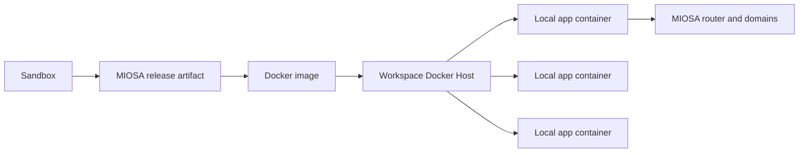
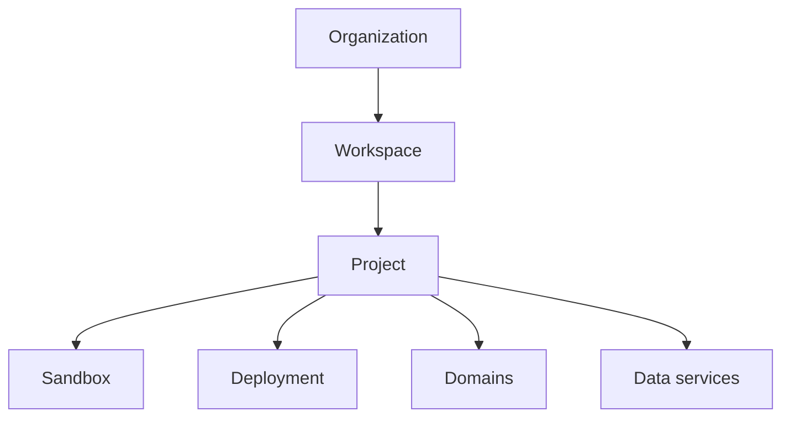

Docker Host 主机是运行 Docker Host 容器的始终在线的工作区 VM。
本页面介绍了主机模型、其生命周期、发布如何到达它以及 MIOSA 如何证明应用程序处于活动状态。

## 它是如何工作的



当为工作区启用 Docker Host 时，MIOSA 会为该工作区提供一个始终在线的 Docker Host VM。该主机运行：

1. 工作区的白标 Docker 主机门户。
2.私有Docker Host控制服务。
3. 从不可变的发布工件创建的一个或多个应用程序容器。

该部署仍然属于 MIOSA 组织、工作区、项目和部署记录。 Docker主机是执行能力，而不是授权边界。

Docker Host 不是普通动态运行时的标签。
对于 Docker 主机发布，MIOSA 必须等待工作区主机和专用智能体准备就绪，然后才能将部署标记为就绪。
如果主机不活动，发布响应将保持挂起状态，而不是回退到标准运行时池。

Docker Host 应用程序作为工作区主机上的独立容器启动。
MIOSA 持久记录每个应用程序目标，因此路由和恢复不依赖于瞬态进程状态。

## 主机生命周期

在发布客户应用程序之前创建或检查工作区主机：

```bash
miosa api POST /docker-deploy/hosts/ensure -d '{"workspace_id": "<workspace-id>"}'
miosa api GET /docker-deploy/hosts?workspace_id=<workspace-id>
```

主机在配置状态之间移动，直到 Docker 主机运行时可访问并通过运行状况检查。

|状态|意义|
| ---------------- | -------------------------------------------------------------------------------------------------- |
| `provisioning` | MIOSA 正在创建或启动工作区计算机。                                   |
| `bootstrapping` |正在安装门户和专用部署智能体。                            |
| `active` |主机健康并且可以接受 Docker Host 发布。                                |
| `failed` | MIOSA 无法配置或引导主机。修复报告的问题后重试。 |

每个启用的工作区通常有一个 Docker 主机。该主机可以运行许多应用程序容器，并且 MIOSA 仍然按组织、工作区、项目和部署单独核算部署。

## 默认 URL 行为

在附加自定义域之前，MIOSA 会返回托管 URL。
对于 OSA 租户中的部署，可能如下所示：

```text
https://my-app.osa.miosa.app
```

如果组织配置了自己的预览或部署域，工作区和项目部署可以改用该域：

```text
intake.example.com
program.example.net
```

发布/部署响应始终返回确切的 URL。不要在您的应用程序中构建它。
有效的 URL 层次结构是：

1.部署自定义域。
2.工作区部署域。
3. 租户部署域。
4. MIOSA 管理的租户 URL 位于 `https://<deployment-slug>.<tenant-slug>.miosa.app`。

## 工作空间和项目范围

Docker Host 遵循与沙箱和正常部署相同的 MIOSA 归因模型：



对于多租户产品，在创建工作区、项目、沙箱和部署时传递外部 ID。 MIOSA 存储用于计费、支持和客户映射的数据。

> **注：流明示例**
>
> Lumen 可以为每位客户或专家创建一个工作区。每个工作区可以有许多项目和许多沙箱创建的部署。这些部署可以保留在 Lumen 的托管域中，也可以移动到客户拥有的域，例如 `program.example.net`。

## 发布到 Docker 主机

当您希望沙箱工件在工作区 Docker 主机而不是标准动态运行时池上运行时，请使用 Docker 主机。

```bash
miosa deploy create --from-sandbox <sandbox-id> \
  --name my-app \
  --dir /workspace \
  --run-command "npm run start" \
  --port 3000 \
  --type docker_deploy \
  --wait \
  --wait-timeout 900s \
  --json
```

要发布新版本而不更改部署 URL，请重复使用相同的 `--name`。

平台流程为：

1. 将沙箱文件冻结为发布工件。
2. 确保工作区 Docker Host 处于活动状态。
3. 将版本上传到该工作区主机。
4. 将版本构建为 Docker 映像。
5. 将映像作为主机上的本地 Docker 容器运行。
6. 记录持久应用程序目标和运行时路径。
7. 将 MIOSA 路由注册到返回的主机端口。
8. 返回实时部署 URL。如果主机仍在配置中，API 将返回 `ready: false`，而不是通过标准运行时默默地为应用程序提供服务。

## 证明 Docker 主机部署

仅当所有这些都成立时，Docker 主机部署才处于活动状态：

|证明项目|所需状态 |
| ---------- | -------------- |
|部署行|存在并具有 `deployment_product: "docker_deploy"` |
|主机链接 | `docker_deploy_host_id` 指向工作区 Docker Host |
|主机健康 |主机处于活动状态并且可以访问 |
|应用目标|该部署有一个持久运行的 Docker Host 目标 |
|集装箱航线|活动目标有可达的容器路由 |
|公共网址 |对 `public_url` 的 HTTP 探测成功 |

用途：

```bash
miosa deploy get <deployment-id> --json
```

## 更新和恢复

每次发布都会创建一个候选版本。
MIOSA 保持当前健康版本的服务，直到候选版本被构建、启动、运行状况检查、路由和升级。
失败的候选版本不会取代实时版本。

主机维护可能会短暂中断该主机上的应用程序。
MIOSA 在主机更新时保留部署记录、发布工件、域、数据绑定和所需状态。
在主机返回活动服务之前，将对正在运行的部署进行协调和验证。

故意停止的部署仍处于停止状态。
MIOSA 不会将故意停车视为恢复目标。

维护后，检查部署的公共合同，对于 Docker Host，检查其运行的主机：

```bash
miosa deploy get <deployment-id> --json
miosa api GET /docker-deploy/hosts/<host-id>
```

## 运行时边界

Docker Host 使用两种不同的主机端服务：

|服务 |能见度|目的|
| -------- | -------------------------- | ------------------------------------------------- |
|门户|面向用户、白标 |显示工作区部署中心。            |
|智能体| MIOSA-仅专用网络|接收发布工件并启动容器。 |

切勿向浏览器或客户代码公开智能体 URL、Docker 套接字、主机 IP 或内部 API 密钥。 SDK、MCP 工具和客户应用程序应调用 MIOSA API； MIOSA 与工作区主机对话。

## 域名

域可以设置为多个级别：

|水平|示例|使用 |
| ------------ | --------------------------------------- | ------------------------------------------------------ |
|组织| `example.com` |默认客户预览/部署域 |
|工作空间 | `acme.example.com` |客户或专家工作区域 |
|部署| `program.example.net` |确切的应用程序/网站/渠道域 |

MIOSA 仍然验证 DNS、发出 TLS 并路由流量。 Docker 主机仅运行应用程序容器。

## 用户看到的内容

客户会看到 MIOSA 或您的白标产品语言。他们不应该看到提供商名称、原始主机 IP、Docker 套接字详细信息或内部智能体 URL。

## API 和 SDK

当您的应用程序需要在发布前准备工作区时，请使用 Docker Host API：

```text
GET  /api/v1/docker-deploy/hosts?workspace_id=<workspace-id>
POST /api/v1/docker-deploy/hosts/ensure
GET  /api/v1/docker-deploy/hosts/:id
```

TypeScript 和 Python SDK 公开相同的主机操作。 MCP 工具可供需要在发布前检查或确保工作区主机的智能体使用。

## 另请参阅

- [Docker Host templates](/docs/docker-host/templates)：使用 Dockerfile、Compose、命令和端口默认值来策划应用程序形状。
- [发布](/docs/docker-host/publishing)：将沙箱冻结为不可变的部署版本。
- [部署域](/docs/docker-host/domains)：将托管域和自定义域附加到部署。
- [白标签设置](/docs/platform/white-label)：配置组织品牌和域行为。
