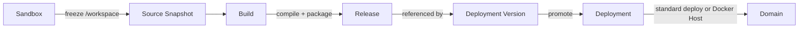
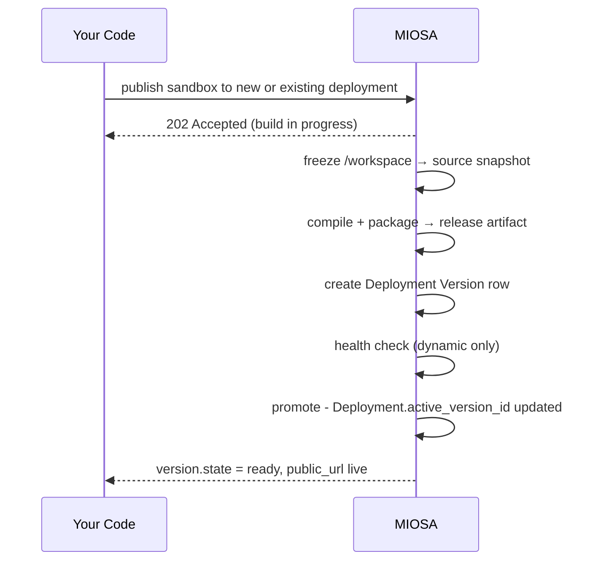

发布是指可变沙箱成为冻结的、可复制的工件，准备好为生产流量提供服务的时刻。
最终运行时可以是标准 MIOSA Deploy 或 Docker Host。
公共 URL 始终来自 MIOSA。

## 管道


1.沙盒/工作空间（可变；智能体或开发人员正在此处编辑）
2.源快照（tarball，sha256密钥，存储在对象存储中）
3. 构建（静态打包器、自动检测或显式命令）
4.发布（静态工件或动态服务器工件，sha256密钥）
5. 部署版本（指向发布的数据库行）
6.健康检查（动态；静态跳过此）
7. 升级（Deployment.active_version_id 已更新）
8. 证明（路由、运行时间和 URL 验证）

下面的序列显示了谁在每个步骤中执行操作：



您发出一个发布请求。
MIOSA 在内部完成所有这些工作，并在版本达到最终状态时返回结果。
对于 Docker Host，MIOSA 还确保工作区主机、启动应用程序容器并在部署被视为实时之前验证路由。

## 发布调用

**命令行界面**

从经过测试的沙箱创建部署：

```bash
miosa deploy create --from-sandbox <sandbox-id> \
  --name my-app \
  --dir /workspace \
  --type docker_deploy \
  --wait \
  --json
```

将下一个版本发布到同一部署：

```bash
miosa deploy create --from-sandbox <sandbox-id> \
  --name <deployment> \
  --dir /workspace \
  --type docker_deploy \
  --wait \
  --json
```

第二个命令保留部署 ID 和规范 URL。
它创建一个新的不可变候选者，并仅在验证成功后才对其进行提升。

**打字稿**

```typescript
const result = await miosa.deployments.publish(deploymentId, {
  sourceSandboxId: sandbox.id,
  kind: "auto",                       // "static" | "dynamic" | "auto"
  environment: "production",          // "production" | "staging" | etc.
  outputPath: "/workspace",
  buildCommand: "npm run build",      // optional; auto-detected if omitted
  runCommand: "npm start",            // dynamic deployments only
  port: 3000,                         // dynamic only
  healthCheckPath: "/_health",        // dynamic only
  externalWorkspaceId: "acct-123",
  externalUserId: "user-456",
  externalProjectId: "landing-page-789",
})

console.log(result.deployment.public_url)
console.log(result.version.kind, result.version.state)
```

**Python**

```python
from miosa import Miosa

miosa = Miosa(api_key="msk_u_...")

result = miosa.deployments.publish(
    deployment_id,
    source_sandbox_id=sandbox_id,
    kind="auto",              # "static" | "dynamic" | "auto"
    environment="production",
    output_path="/workspace",
    build_command="npm run build",   # optional; auto-detected if omitted
    run_command="npm start",         # dynamic only
    port=3000,                       # dynamic only
    health_check_path="/_health",    # dynamic only
    external_workspace_id="acct-123",
    external_user_id="user-456",
    external_project_id="landing-page-789",
)

print(result.deployment.public_url)
print(result.version.kind, result.version.state)
```

**curl**

```bash
curl -X POST https://api.miosa.ai/api/v1/deployments/$DEP/publish \
  -H "Authorization: Bearer $MIOSA_API_KEY" \
  -H "Idempotency-Key: $(uuidgen)" \
  -d '{
    "source_sandbox_id": "'$SBX'",
    "kind": "auto",
    "environment": "production",
    "output_path": "/workspace",
    "build_command": "npm run build",
    "run_command": "npm start",
    "port": 3000,
    "health_check_path": "/_health"
  }'
```

响应形状：
```json
{
  "data": {
    "deployment": {
      "id": "dep_...",
      "active_version_id": "ver_...",
      "state": "running",
      "public_url": "https://team-portal.apps.example.com"
    },
    "version": {
      "id": "ver_...",
      "kind": "static",
      "state": "ready",
      "artifact_sha256": "...",
      "source_sha256": "..."
    },
    "services": [
      { "id": "svc_...", "type": "static_web", "state": "healthy" }
    ],
    "promoted": true
  }
}
```

## 源快照

在构建器运行之前，MIOSA 会冻结沙箱源的快照。快照是 `/workspace` 的 tarball（或您指定的任何 `output_path`），不包括不需要传送的缓存目录：
```text

included:    application code, package manifests, lockfiles, public assets, config
excluded:    node_modules, .next/cache, dist (will be rebuilt), .git (unless needed),
             __pycache__, build/, target/
```

快照已存储并采用 sha256 密钥。版本记录存储 `source_sha256`，因此重试可以从完全相同的输入重建，而无需重新快照。

构建运行时，沙箱保持运行。您可以继续编辑。

## 构建模式

MIOSA 从源头选择构建模式。如果需要，您可以使用 `build_command` 覆盖。

|模式|触发|会发生什么 |
|---|---|---|
| **Dockerfile** | `Dockerfile` 存在于 `output_path` | MIOSA打造容器式服务器产物 |
| **自动检测** | `package.json` / `requirements.txt` / `pyproject.toml` / `go.mod` / `mix.exs` | MIOSA 选择安装/构建/启动默认值 |
| **静态打包器** |输出中仅包含静态文件（未检测到服务器入口点）|文件存储为静态版本 |
| **明确** |提供 `buildCommand` 和/或 `runCommand` | MIOSA 运行这些，然后打包 `output_path` | 中的所有内容。

> **注意：URL 规则**
>
> 不要在 SDK、CLI 或前端中构建生产 URL。从发布响应中读取 `data.deployment.public_url` 或 `data.url` 并显示该确切值。租户可以使用部署域、MIOSA 回退或确切的自定义域。

## Docker 主机发布

将 Docker Host 用于发布许多小型应用程序、渠道、铅磁铁、API 或客户端站点的工作区。
该应用程序作为工作区 Docker 主机上的容器运行，而 MIOSA 拥有路由、TLS、域、计费归属和部署记录。

```bash
miosa deploy create --from-sandbox <sandbox-id> \
  --name my-app \
  --dir /workspace \
  --run-command "npm run start" \
  --port 3000 \
  --type docker_deploy \
  --wait \
  --wait-timeout 900s \
  --json
```

对于更新，请重复使用部署 `--name`。
这针对的是现有部署，而不是创建另一个部署。

然后检查部署情况：

```bash
miosa deploy get <deployment-id> --json
miosa deploy requests <deployment-id>
```

命令名称和 API 路径仍然包含 `docker-deploy`，因为这是兼容性线值。
面向客户的产品语言是 Docker Host。

## 提升什么以及何时提升

静态发布在工件上传后立即进行推广 - 无需进行健康检查。

动态发布不会进行推广，直到：

1.构建成功。
2. 存储动态发布工件。
3. 安排了新的生产运行时间。
4. 运行状况检查 (`GET healthCheckPath`) 在配置的宽限期内返回 2xx（升级前默认运行状况为 30 秒）。如果运行状况检查失败，**先前版本将保持有效**，新版本将标记为 `failed`。没有流量发送到损坏的版本。您最后已知的优质作品将继续提供服务。

## 幂等性

每次发布时传递 `Idempotency-Key`。如果相同的密钥在保留窗口内发送两次，MIOSA 将返回原始结果而不重新构建。这使得重试变得安全——对于不稳定的网络连接和工作队列很有用。

## 故障模式

|失败|会发生什么 |恢复|
|---|---|---|
|构建命令退出非零 |版本标记为`failed`，日志已上传，生产不变|在沙盒中修复，重新发布 |
|健康检查始终不通过 |版本标记为 `failed`，运行时实例被拆除 |修复运行命令或healthCheckPath，重新发布 |
| Docker 主机未激活 |发布等待或返回未准备好 |运行`miosa api POST /docker-deploy/hosts/ensure`，然后再次发布 |
| Docker Host 应用程序行丢失 |部署不可路由 |使用 `--type docker_deploy --wait` 重新发布，然后再次检查 |
|源快照失败 |发布立即返回 5xx，没有创建版本行 |重试请求 |
|静态构建超出工件大小限制 |版本标记为 `failed` |减少资产或联系支持人员以提高限额 |
|两个发布者争夺同一部署 |第二个等待咨询锁；两者最终都按顺序成功|无 - 由我们的操作锁自动处理 |

## 另请参阅

- [版本](/docs/docker-host/versions) - 发布产生什么
- [发布](/docs/docker-host/releases) - 产物本身
- [运行时实例](/docs/docker-host/runtime-instances) - 用于动态部署
- [Docker Host](/docs/docker-host/docker-deploy) - 用于工作区应用程序容器
- [回滚](/docs/docker-host/rollback) - 当运行状况检查通过但应用程序损坏时
