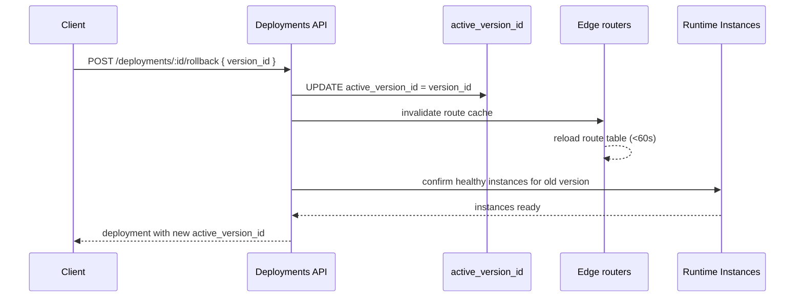

MIOSA 的回滚速度很快，因为无需重建任何内容。之前的版本仍在存储中。运行时实例启动速度很快。静态工件从对象存储中流式传输。整个操作是“更改一行，传播到边缘缓存”。

## 当你回滚时

- 新版本通过了健康检查，但应用程序在实际流量中被破坏（例如功能标志误触发）。
- 部署了错误的迁移。
- 你在分期中错过的回归。
- 敌对事件：在调查时快速恢复。

## 多快

|步骤|静态|动态 |
|---|---|---|
|更新活动版本 | `&lt;1s` | `&lt;1s` |
|边缘路由缓存刷新| `&lt;60s default` | `&lt;60s default` |
|新的运行时实例产生？ |不适用（没有每个应用程序进程）|仅当旧版本的实例被拆除时；调度程序引导替换|
|耗尽旧的运行时实例 |不适用 |仅在前滚时，而不在回滚时 |
| **总挂钟** | **秒** | **秒至约 1 分钟** |

如果旧版本的运行时实例仍然健康（最近前滚，旧实例尚未被拆除），动态回滚也是即时的：路由器切换后端而无需任何虚拟机启动。

## 回滚是如何工作的


## API

**打字稿**

```typescript
// Easy form: roll back to the previous version
await miosa.deployments.rollback(deploymentId)

// Explicit form: roll back to a specific version
await miosa.deployments.rollback(deploymentId, {
  versionId: "ver_01H...",
})
```

**Python**

```python
from miosa import Miosa

miosa = Miosa(api_key="msk_u_...")

# Easy form: roll back to the previous version
deployment = miosa.deployments.rollback(deployment_id)

# Explicit form: roll back to a specific version
deployment = miosa.deployments.rollback(
    deployment_id,
    version_id="ver_01H...",
)

print(deployment.active_version_id)
print(deployment.state)
```

**curl**

```bash
# Rollback to a specific version
curl -X POST https://api.miosa.ai/api/v1/deployments/$DEP/rollback \
  -H "Authorization: Bearer $MIOSA_API_KEY" \
  -H "Idempotency-Key: $(uuidgen)" \
  -d '{"version_id":"ver_01H..."}'
```

服务器行为：
```text

1. Validate target version_id belongs to this deployment
2. Validate target version state === "ready" (cannot rollback to failed)
3. Validate target version's release artifact still exists in storage
   (returns 410 Gone if GC'd)
4. UPDATE deployments SET active_version_id = $version_id
5. Invalidate edge route cache
6. For dynamic: confirm enough healthy instances for the old version; spawn if needed
7. Return the deployment with the new active_version_id
```

回应：
```json
{
  "data": {
    "id": "dep_...",
    "active_version_id": "ver_01H...",
    "state": "running",
    "public_url": "https://team-portal.example-org.miosa.app"
  }
}
```

## 选择回滚目标

使用 [Versions](/docs/docker-host/versions) API 检查候选者：
```typescript
const versions = await miosa.deployments.versions.list(deploymentId, {
  state: "ready",
  limit: 10,
})

// Find the last known good version
const target = versions.data.find(v => v.id !== deployment.active_version_id)
```

对于生产，选择前一个版本通常是正确的。对于事件，如果多个最新版本共享该错误，您可能需要进一步回溯。

## 回滚后向前滚动

回滚后，您回滚的版本仍处于 `ready` 状态（除非您明确存档它）。如果发现问题不在代码中，您可以稍后重新升级它：
```typescript
await miosa.deployments.versions.promote(deploymentId, originalVersionId)
```

这是常规促销，而不是回滚。路径是对称的。

## 回滚不能解决什么问题

|问题 |为什么回滚没有帮助|
|---|---|
|错误的数据库迁移 |数据库位于版本“外部”。单独回滚架构或从备份恢复。请参阅[Postgres](/docs/data/postgres)。 |
|错误的托管数据状态 |相同：数据服务在设计上会在版本更改时保持不变。 |
|外部服务配置漂移 | Stripe webhooks、OAuth 回调等：不是发布的一部分。 |
|已经提供的不良响应 |已经在您客户的浏览器/缓存中。单独清除缓存。 |

回滚修复代码；它不修复状态。规划迁移为向后兼容 (`expand → migrate → contract`)，以便旧版本在向前迁移后继续工作。

## 幂等性

回滚请求携带 `Idempotency-Key` 标头。保留窗口内的相同键将返回原始结果，而无需重新运行操作。这在重试风暴常见的事件中很重要。

## 审核

每次回滚都会发出一个审核事件：

- 上一个 `active_version_id`
- 目标version_id
- 执行该操作的用户/API 密钥
- `Idempotency-Key`
- 外部归因

审核事件可通过平台审核 API 进行查询，并根据租户的计划进行保留。

## 另请参阅

- [版本](/docs/docker-host/versions)：选择目标
- [域名](/docs/docker-host/domains)：重新指向的内容
- [运行时实例](/docs/docker-host/runtime-instances)：计算端发生了什么
- [发布](/docs/docker-host/releases)：为什么回滚目标的工件必须仍然存在
