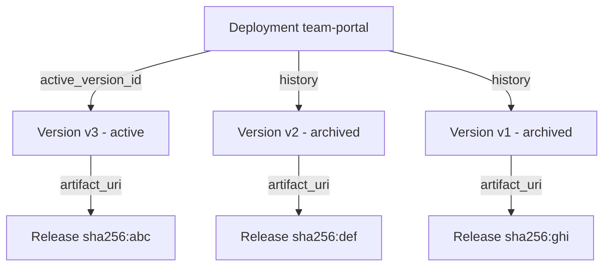

每次成功发布都会生成一个**部署版本**。版本是不可变的：源哈希、工件哈希、构建日志和运行时配置在创建时被冻结。版本编写后就永远不会改变。

部署、版本和发布的关系：



## 版本形状
```json
{
  "id": "ver_01H...",
  "deployment_id": "dep_01H...",
  "tenant_id": "...",
  "created_by": "user_...",
  "external_workspace_id": "acct-123",
  "external_user_id": "user-456",
  "external_project_id": "landing-page-789",
  "source_sandbox_id": "sbx_...",
  "build_id": "bld_...",
  "version_number": 17,
  "kind": "static",
  "state": "ready",
  "artifact_uri": "s3://miosa-releases/dep_.../ver_.../dist.tar.zst",
  "artifact_manifest": { "files": 42, "total_bytes": 184320, "entrypoint": "index.html" },
  "artifact_sha256": "a5e6f0c1...",
  "runtime_image": null,
  "runtime_command": null,
  "runtime_port": null,
  "health_check_path": null,
  "build_log_uri": "s3://miosa-logs/builds/bld_.../log.txt",
  "metadata": { },
  "promoted_at": "2026-05-14T18:20:00Z",
  "archived_at": null,
  "created_at": "2026-05-14T18:19:48Z",
  "updated_at": "2026-05-14T18:20:00Z"
}
```

对于动态版本，将填充 `runtime_image`、`runtime_command`、`runtime_port` 和 `health_check_path` 字段；对于静态，它们为空。

## 州

|状态 |意义|
|---|---|
| `created` |行存在，构建未开始 |
| `building` |建设进行中 |
| `ready` |构建成功，工件上传，可以推广 |
| `failed` |构建失败或健康检查未通过；不可晋升|
| `archived` |晋升出；仍可启动以进行回滚|

`state` 转换是单向的（事后没有 `ready → failed` ）；一旦版本为 `ready`，它就会保持可启动状态，直到显式垃圾收集为止。

## 端点
```http
GET    /api/v1/deployments/:id/versions
GET    /api/v1/deployments/:id/versions/:version_id
POST   /api/v1/deployments/:id/versions/:version_id/promote
POST   /api/v1/deployments/:id/rollback
```

### 列出版本

**打字稿**

```typescript
const versions = await miosa.deployments.versions.list(deploymentId, {
  limit: 50,
  state: "ready",
})

for (const v of versions.data) {
  console.log(v.version_number, v.kind, v.state, v.artifact_sha256.slice(0, 8))
}
```

**curl**

```bash
curl https://api.miosa.ai/api/v1/deployments/$DEP/versions?state=ready \
  -H "Authorization: Bearer $MIOSA_API_KEY"
```

### 提升特定版本

对于分阶段推出很有用：发布时不自动升级，准备好后手动升级。

**打字稿**

```typescript
const result = await miosa.deployments.versions.promote(deploymentId, versionId)
console.log(result.deployment.active_version_id) // === versionId
```

**curl**

```bash
curl -X POST https://api.miosa.ai/api/v1/deployments/$DEP/versions/$VER/promote \
  -H "Authorization: Bearer $MIOSA_API_KEY"
```

需要 `deployments:write` 范围。列出/显示需要`deployments:read`。

## 版本和外部归属

每个版本都从源沙箱或发布调用继承属性。按 `external_workspace_id` 过滤版本会显示您发布的任何外部工作区的所有版本，范围仅限于您的 MIOSA 租户。
```typescript
const acmeVersions = await miosa.deployments.versions.list(deploymentId, {
  externalWorkspaceId: "acme-team-123",
})
```

这就是白标平台如何在自己的 UI 中向每个最终客户公开“部署历史记录”视图。

## 版本保留多长时间？

`ready` 版本默认保留至少 30 天。早于该版本的存档版本有资格对其发布工件进行垃圾收集；版本行本身保留供审核。每个租户都可以配置长期存储策略。如果您需要不同的保留，请联系支持人员。

## 另请参阅

- [发布](/docs/docker-host/releases)：`artifact_uri`实际指向什么
- [回滚](/docs/docker-host/rollback)：重新指向旧的`ready`版本
- [发布](/docs/docker-host/publishing)：如何创建版本
