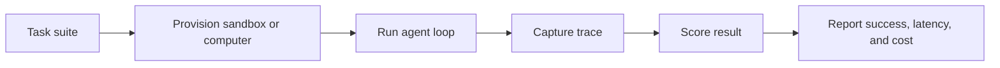

评估可以帮助您回答一个简单的问题：您的智能体实际上是否在真实的计算机或沙箱上完成工作，以及工作需要多长时间？

MIOSA 评估涵盖三个层面：

|层|它测量什么 |
|---|---|
| **沙箱工作流程** |创建、写入文件、运行命令、公开预览、发布和清理 |
| **桌面工作流程** |启动计算机，打开浏览器，屏幕截图，单击，键入，滚动，然后观察结果 |
| **智能体任务** |给智能体一个目标，收集跟踪，对最终状态是否与预期结果匹配进行评分 |

> **注意**
>
> 公共文档描述了测量模型、任务形状和面向客户的输出。内部跑步者、调度和评分实现是有意抽象的。

## 为什么评估很重要

对于应用程序构建器产品和计算机使用智能体来说，正常的 API 正常运行时间是不够的。您需要知道：

- 工作空间变得可用的速度有多快。
- 在座席执行操作之前桌面流是否已准备好。
- 屏幕截图和操作在实际任务中是否保持响应。
- 生成的应用程序是否可以从提示移动到预览再到发布。
- 模型、工具循环或提供者的更改是否可以提高任务的成功率。

## OSWorld 兼容的基准测试方向

OSWorld 是真实计算机环境中多模式智能体的公共基准。它定义了开放式工作流程中的真实桌面任务、设置状态、智能体交互和基于执行的评分。公共 OSWorld 网站描述了 369 个现实世界的计算机任务，其中 361 个任务在排除需要手动配置的 Google Drive 任​​务时常用。

MIOSA 使用相同的理念进行产品基准测试：

- 从已知的计算机状态开始。
- 通过屏幕截图和操作 API 运行任务。
- 捕捉每一个观察结果和行动。
- 尽可能使用确定性评估器对最终状态进行评分。
- 保存跟踪，以便可以重播和比较故障。

## 评估流程

## 桌面就绪指标

这些是我们跟踪 V1 质量的计算机桌面指标：

|公制|为什么这很重要 |
|---|---|
| **提供时间** |从创建请求到分配机器的时间。 |
| **桌面就绪** |桌面流接受真实连接之前的时间。 |
| **第一张截图** |客服人员可以观察屏幕之前的时间。 |
| **第一个行动** |接受单击、键入或按键事件之前的时间。 |
| **屏幕截图延迟** |任务期间重复屏幕截图的往返时间。 |
| **动作延迟** |单击、键入、滚动和按键事件的往返时间。 |
| **任务成功** |最终桌面状态是否与评估器匹配。 |
| **跟踪完整性** |是否捕获每个观察和动作以供重播。 |

## 沙箱工作流程指标

对于AI应用开发者来说，主要路径是：

1. 创建沙箱。
2.写入生成的文件。
3. 安装并运行应用程序。
4. 公开实时预览。
5. 迭代反馈。
6. 发布到持久部署。
7. 销毁或暂停工作区。

MIOSA 跟踪整个路径的时序和故障率，而不仅仅是孤立的端点延迟。

## 客户看到什么

- **运行摘要**：成功率、总时间、p50 和 p95 延迟、失败步骤和资源使用情况。
- **跟踪回放**：屏幕截图、命令、预览 URL、操作事件和最终结果状态。
- **提供商比较**：通过一种任务形状比较本地 MIOSA 计算机、BYOC 计算机和外部提供商。
- **回归检查**：在映像、SDK、智能体或提供商更改后重新运行相同的任务套件。

## V1 范围

|能力|状态 |
|---|---|
|桌面就绪基准|可作为 V1 质量目标。 |
| OSWorld 风格的任务评分 |正在硬化供合作伙伴使用。 |
|公开排行榜 |计划在跑步者和报告格式稳定后进行。 |

## 用例

- 验证 Lumen 铅磁铁构建器可以创建、预览和发布生成的应用程序。
- 将两个智能体提示与同一浏览器任务进行比较。
- 检查桌面图片变化是否影响首次截图时间。
- 证明全栈应用程序构建器在 SDK 或部署更改后仍然可以工作。

## 另请参阅- [基准](/docs/benchmarks)当前生产计时数据。
- [计算机](/docs/computers/overview) 用于桌面自动化。
- [计算运行位置](/docs/integrations/external-computers)用于 MIOSA 管理、OpenComputers 和 BYOC 容量。
- [提供商比较](/docs/integrations/comparison) 适用于更广泛的计算环境。
