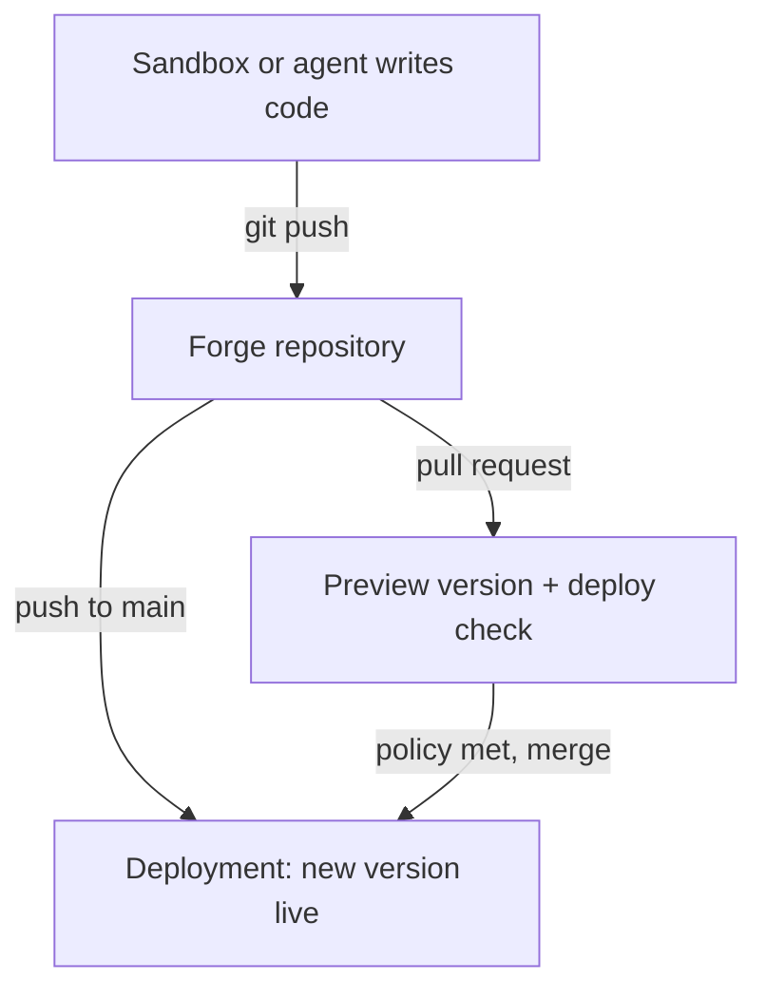

Forge 是 Git 托管，是 MIOSA 的一部分。
每个组织都有它，每个存储库都位于使用它的沙箱、智能体和部署旁边。

## 为什么 Forge 存在

MIOSA 上的大多数代码不是在笔记本电脑上输入的。
它是由您或 Optimal 之类的智能体在沙箱内编写的，沙箱完成后它需要去某个地方。
锻造就是那个地方。

- **一个帐户。** 您的 MIOSA API 密钥是您的 Git 凭证。没有单独的 Git 主机帐户，也没有可以复制的访问令牌。
- **从分支部署。** 将部署指向分支，每次推送都会构建并发布一个新版本。
- **每个拉取请求的预览。** 链接存储库上的每个拉取请求都有自己的预览版本和 `deploy` 检查。
- **您可以强制执行的合并规则。** 分支策略决定拉取请求在合并之前需要多少批准以及哪些检查。
- **智能体是一流的。** 在相同的权限下，可以通过 CLI、REST API 和 SDK 访问相同的存储库。

## 存储库可以为您提供什么

|面积 |你得到什么 |
|---|---|
| git | git通过 HTTPS 在 `https://forge.miosa.ai/<org>/<repo>.git` | 克隆、获取和推送
|拉请求 |打开、审查、评论、差异、关闭、重新打开和合并 |
|检查|针对提交报告的结果，并提供分支策略可能要求的证据 |
|分行政策 |所需的批准、独立审阅者、所需的检查、代码所有者 |
|发布 |带有注释和可下载资源的标签，包括源档案 |

默认情况下，存储库是私有的。
访问权限遵循组织的角色，每个存储库都可以向人员授予额外的角色。

## 从哪里开始

- [快速入门](/docs/forge/quickstart)：五分钟内创建一个存储库、一个推送和一个拉取请求。
- [拉取请求和检查](/docs/forge/pull-requests)：审查、检查、分支策略和合并。
- [来自沙箱](/docs/forge/sandboxes)：来自沙箱内部的纯`git push`。
- [智能体和 API](/docs/forge/agents)：从 SDK 和 REST API 进行锻造。
- [CLI 参考](/docs/forge/cli)：每个 `miosa forge` 命令都有一个示例。
- [限制和常见问题解答](/docs/forge/faq)：Forge 还没有做的事情。

> **注意：伪造权限**
>
> Forge 使用您的 MIOSA 登录名：`miosa login` 为 CLI 提供可以读写 Forge 的密钥。
> 您在 **API 密钥** 下自行创建的密钥需要 `forge:read` 和 `forge:write` 权限。
