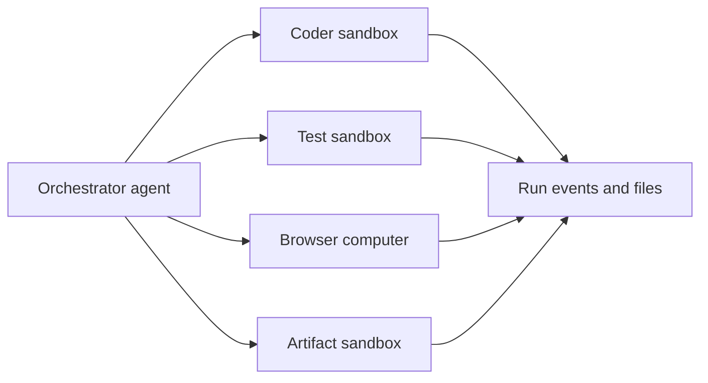

MIOSA 智能体是可以使用真正的云执行的工作人员。他们可以研究、
编写代码、运行命令、编辑文件、控制浏览器或桌面、调用
连接的应用程序、创建工件、开始预览并发布完成的应用程序。

这些是 Polsia 式自治汽车等产品背后的原语
公司运营者、联合创始人/联合创始人人工智能式商业智能体人，以及
Nebula式共享虚拟设备。

核心规则很简单：智能体应该在 MIOSA 设备内完成工作，
不仅在用户的笔记本电脑上，然后稍后上传结果。

现在就做

创建您的第一个智能体

一名指定工作人员提供说明、模型运行框架、工具和设备。

- [创建智能体](https://miosa.ai/agents/new)：（在新选项卡中打开 MIOSA 控制台）

miosa 智能体新审阅者 --harness claude-code --instructions “审查拉取请求并报告风险”

下一步 [配置智能体](/docs/guides/configure-agent)

```text
User request
  -> agent plans
  -> MIOSA device executes
  -> events stream back to the UI
  -> files, previews, artifacts, screenshots, or deployments are saved
```

---

## 内置工具包

|工具包|它有什么作用 |主要运行时 |
|---|---|---|
|网络研究|搜索、检索页面、总结来源、收集当前上下文 |智能体循环或沙箱|
|文件系统 |读取、写入、重命名、删除、列出和生成 `/workspace` | 中的文件沙箱或计算机|
|代码执行|运行 Bash、Python、Node、包管理器、测试、构建、linter |沙盒|
|直播服务器|启动开发服务器并公开预览 URL 以供审核 |沙盒|
|浏览器 |导航页面、单击、填写表单、提取数据、登录仪表板 |计算机或浏览器支持的沙箱 |
|桌面|屏幕截图、单击、键入、滚动、剪贴板、窗口、shell |电脑|
|媒体和文物|生成 PDF、DOCX、图像、图表、图表、HTML 报告、ZIP |沙盒|
|部署|将经过验证的工作区发布到 MIOSA Deploy 或 Docker Host |部署管道 |
|应用程序操作 | GitHub、Slack、Google、Refero 或租户提供的工具 |托管连接器 |
|子智能体授权|在子沙箱、计算机或本地工作人员之间拆分任务 |协调员|

> **提示：应用程序构建者的默认设置**
>
> 对于生成的应用程序，请在沙箱中启动。让智能体将文件写入
> `/workspace`，运行`npm install`，启动开发服务器，显示预览，修复
> 错误发生的地方，快照，然后发布。

---

## 实际使用的工具

### 网络研究

智能体商可以收集当前市场示例、检查文档、比较产品
流，并在编写代码之前将注释保存到工作区中。

```text
research/
  onboarding-patterns.md
  pricing-pages.md
  competitor-notes.md
```

### 在工作区设备上执行代码

智能体编写代码并在沙箱内运行。

```bash
miosa exec <sandbox-id> --cwd /workspace -- npm run test
miosa exec <sandbox-id> --cwd /workspace -- npm run build
```

UI 应该流式传输 stdout、stderr、退出状态和文件事件，而
命令运行。

### 浏览器自动化

当智能体需要真正的浏览器会话时使用计算机：

- 打开预览
- 登录仪表板
- 填写表格
- 单击按钮
- 捕获屏幕截图
- 验证响应式布局
- 从需要浏览器的页面中提取数据

### 产物生成

当智能体需要生成可下载的工作时使用沙箱：

- 提案
- DOCX/PDF 文件
- 推介材料
- CSV 导出
- 图表
- SVG/PNG 图表
- ZIP 捆绑包
- HTML 预览

生成的文件应保存为 MIOSA 工件，以便产品 UI 可以显示
它们位于具有版本历史记录的工件面板中。

### 应用程序操作

连接的应用程序成为工具。例如：

- GitHub 问题和拉取请求
- 松弛消息
- 谷歌云端硬盘文件
- Gmail 草稿
- Refero设计研究
- 租户提供的API

应用程序操作应使用托管连接器或范围内的租户凭据，而不是
粘贴到聊天中的秘密。

### 子智能体委托

一个协调器可以将工作委托给多个运行时工作人员：



将其用于大型工作、QA 扫描、并行测试、研究集群等
智能体公司产品。

---

## 设备执行

智能体针对设备运行。 MIOSA 具有三个设备类别：

|设备|当 | 时使用它保留状态 |
|---|---|---|
|沙盒工作者 |代码、文件、命令、预览、工件、发布准备 |是的，通过暂停/恢复和快照 |
|电脑|浏览器/桌面自动化、屏幕截图、视觉 QA、手动切换 |是的，通过持久性计算机存储 |
|本地设备|需要用户拥有的网络/文件/应用程序 |在用户的机器上 |Docker Host 不是智能体设备。它是经过一段时间后的持久托管目标
沙盒构建的应用程序已准备就绪。

有关完整模型，请参阅[智能体设备](/docs/guides/agent-devices)。

---

## 权限

权限决定智能体可以做什么。

|许可面|控制|
|---|---|
|能见度|私人智能体、工作区智能体或平台管理智能体|
|设备访问|智能体可以使用哪些沙箱、计算机、本地设备或池 |
|工具访问 |文件、执行、浏览器、部署、连接器、工件 |
|关联帐户 | OAuth 授权、API 密钥、托管连接器、租户提供的集成 |
|秘密曝光 |哪些环境变量被注入到运行时 |
|审批政策|哪些操作需要人工确认 |
|配额|最大子沙箱、计算机、运行时间、支出或并发数 |

凭证规则：

- 租户管理密钥保留在服务器端
- 浏览器代码永远不会收到 `msk_*` 键
- 沙箱接收范围内的运行时令牌
- 托管提供商令牌在 MIOSA 中保持加密状态
- 出口仅为其所属的提供者端点交换智能体占位符

---

## 要暴露的产品表面

如果您正在 MIOSA 上构建智能体平台，请向用户展示以下内容：

- 当前计划或任务图
- 工具调用发生时
- 命令输出
- 创建或编辑的文件
- 带有下载按钮的工件
- 浏览器屏幕截图和预览 URL
- 连接的帐户和丢失的凭据
- 风险行为的批准提示
- 快照、分叉和版本历史记录
- 部署状态和公共 URL
- 使用量、积分和运行时间成本

这是基元之上的产品层。用户应该明白
智能体正在真实设备中工作并产生持久的输出。

---

## 相关

- [配置智能体](/docs/guides/configure-agent)：设置指令、模型、工具、内存、设备、变量、触发器和审批策略。
- [智能体设备](/docs/guides/agent-devices)：了解沙箱、计算机、本地设备、主设备和设备选择。
- [托管连接器](/docs/guides/managed-connectors)：附加 MIOSA 管理或租户提供的提供商工具，而不暴露供应商令牌。
- [智能体编排](/docs/guides/agent-orchestration)：协调一个智能体、多个子智能体或大型设备池。
- [构建智能体公司平台](/docs/guides/build-agent-company)：将这些原语打包成Polsia、CoFounder或Nebula风格的产品。

## 后续步骤

- [配置智能体](/docs/guides/configure-agent)：说明、型号、工具、设备、内存和批准。
- [选择其设备](/docs/guides/agent-devices)：用于智能体工作的沙箱、计算机和本地设备。
- [集成您自己的智能体](/docs/guides/agent)：从您自己的智能体循环驱动 MIOSA 原语。
