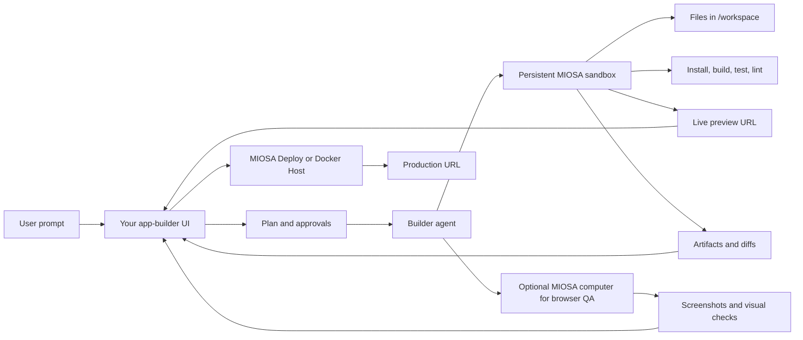
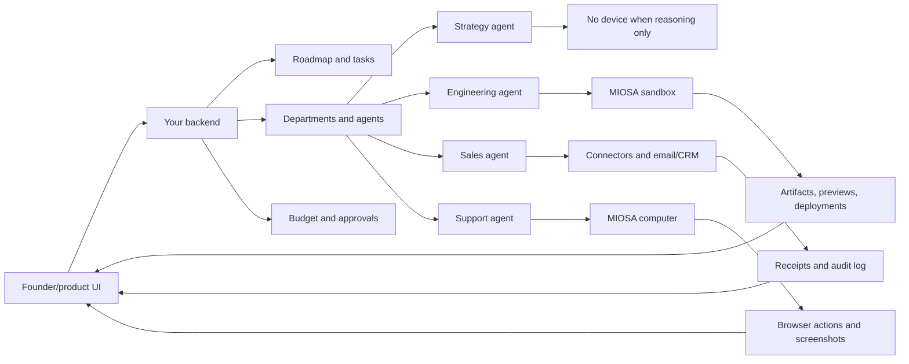

此页面映射公共应用程序构建者、智能体公司、虚拟设备和开放
工作空间产品到 MIOSA 实施模式。当你想要的时候使用它
构建一个产品，智能体可以在其中创建应用程序、运营业务、共享持久内容
设备、创建工件、运行浏览器工作、发布应用程序并继续工作
背景。

> **注意：参考，而非复制**
>
> 以下链接是产品架构和工作流程形状的参考。的
> 实现应使用 MIOSA 原语：智能体、设备、连接器、事件、
> 工件、快照、部署和积分。

---

## 参考链接

### 应用程序构建器和生成的软件产品

这些产品对于面向用户的循环是有用的参考：提示、计划、
生成文件、运行命令、显示预览、接受反馈、版本更改、
并发布。

|参考|链接 |学习什么 |
|---|---|---|
| Lovable | [lovable.dev](https://lovable.dev/) | 提示词到应用的流程、生成的 UI、托管预览、应用构建器 UX |
| Replit 智能体 | [replit.com/products/agent](https://replit.com/products/agent) |计划模式、应用程序生成、实时预览、部署、托管开发环境 |
| Replit Agent 文档 | [docs.replit.com](https://docs.replit.com/references/agent/overview) |智能体模式、用户指导、用户可以从自然语言构建什么 |
|螺栓| [bolt.new](https://bolt.new/) |浏览器原生全栈生成、文件树、预览、部署 |
| Bolt 开源 | [stackblitz/bolt.new](https://github.com/stackblitz/bolt.new) |开源提示、运行、编辑和部署 Web 开发智能体模式 |
| v0 | [v0.dev](https://v0.dev/) |从设计到代码的工作流程、组件生成、迭代循环 |
| Genspark Code | [Genspark Code](https://www.genspark.ai/helpcenter/ai-developer) | 面向没有编码经验的用户的自主应用生成 |
| Emergent | [Emergent AI App Builder](https://emergent.sh/ai-app-builder) | 用自然语言创建可投入生产的全栈 Web 和移动应用 |
| Blackbox AI | [Blackbox AI Builder](https://www.blackbox.ai/builder) | 覆盖前端、后端、数据库和部署的全栈生成 |

### 智能体公司、虚拟设备和商业运营商产品

|参考|链接 |学习什么 |
|---|---|---|
|联合创始人 | [coFounder.co](https://cofounder.co/) |公司部门、路线图任务、批准、托管服务、智能体、技能、集成 |
|联合创始人文档 | [docs.coFounder.co](https://docs.cofounder.co/) |工作空间、公司、任务、库、路线图、部门、智能体、技能、MCP、集成、发布 |
|联合创始人创始人指南| [PDF 指南](https://cofounder.co/guides/cofounder-founder-guide.pdf) |为创始人/公司操作系统启动、构建、销售和扩展操作循环 |
|波兰 | [polsia.com](https://polsia.com/) | 24/7 公司运营商定位：规划、编码、营销、运营 |
| Nebula | [nebula.gg](https://www.nebula.gg/landing) | 工作区智能体、设备、作业、小型应用（miniapps）、集成、浏览器和代码能力 |
| Nebula 文档 | [docs.nebula.gg](https://docs.nebula.gg/llms.txt) | 设备、虚拟/本地设备、智能体、作业、小型应用、渠道、集成、已连接帐户 |
|启发式| [github.com/Heuresis](https://github.com/Heuresis) |编码工作区、Markdown 业务系统、智能体团队、与运行时无关的模板 |
|启发式增长算子 | [增长运营机构](https://github.com/Heuresis/Growth-Operator-Agency) |作为智能体部门的基础、营销、培育、销售、启动、规模、合作伙伴关系 |
| Heuresis LinkedIn 机构 | [LinkedIn-Agency](https://github.com/Heuresis/LinkedIn-Agency) |代写、出境、资格、履行、高门票项目 |
| MIOSA 商务操作系统 | [Miosa-osa/BusinessOS](https://github.com/Miosa-osa/BusinessOS) |开源 MIOSA 业务工作区模板，包含桌面 UI、OSA 终端、项目、CRM、文档、日历、上下文和智能体模块 |
|智能体桌面存储库 | [智能体工作区-linux](https://github.com/agent-sh/agent-workspace-linux) |通过 MCP 实现 GUI/Web 自动化的独立桌面/浏览器工作区 |
|智能体协调器存储库 | [智能体协调员](https://github.com/AgentWrapper/agent-orchestrator) |并行编码智能体、隔离、反馈路由、状态跟踪、插件运行时 |
|多智能体列表 | [很棒的多智能体协调器](https://github.com/Agent-Analytics/awesome-multi-agent-orchestrators) |更广泛的编排环境和产品原语|

---

## 参考文献的共同点- **面向用户的智能体循环**：用户给出目标，智能体计划，执行工具调用，显示进度，
  接收反馈，并在不强迫用户使用原始基础设施的情况下恢复。
- **持久工作区**：智能体读取上下文、写入文件、保存工件和恢复的地方
  跨对话工作。
- **智能体名册**：工程、设计、营销、销售、支持、
  财务、运营、研究和管理工作流程。
- **任务系统**：工作被跟踪为任务、路线图项目、工作或带有状态的会话，
  所有者、输出、批准和历史记录。
- **连接工具**：集成、MCP 服务器、自定义 API、托管凭据、浏览器
  会议、电子邮件、CRM、GitHub、支付、文档和设计研究。
- **人工批准**：人工批准有风险的操作：发布、发送出站、更改
  计费、删除数据、使用管理员凭据或花费更多积分。
- **可见工作流**：产品显示命令、工具调用、浏览器操作、文件、工件、
  预览、日志和最终输出。

---

## 应用程序构建器架构

Genspark、Emergent、Blackbox AI、Lovable、Replit Agent、Bolt 和 v0 风格的产品不仅仅是代码
发电机。耐用的产品形状是一个智能体运行时，包裹在
持久构建工作区、可见事件流、文件/工件面板、
预览表面和发布路径。



| 应用构建器界面 | MIOSA 的基础能力 |
|---|---|
|项目工作区|持久沙箱、快照、文件、exec |
|文件树和编辑器|文件系统 API 和流式文件事件 |
|命令日志|流式执行事件 |
|预览窗格 |沙箱预览网址 |
|视觉质量保证 |具有浏览器、屏幕截图和单击/键入操作的计算机 |
|版本历史 |产品中的快照、工件、git 集成 |
|发布按钮| MIOSA 部署或 Docker 主机 |
| 公共应用 URL | 部署的 `public_url` 或工作区域域名 |
|使用量表|模型、沙箱运行时、计算机运行时、存储、部署的积分 |

关键规则是应在 MIOSA 内创建和修改代码
当产品是智能体构建器时，沙箱。用户的笔记本电脑或您的后端
可以编排，但实际的文件、安装、测试、预览服务器和
工件输出应位于指定的工作区中。

### 应用程序构建器实施清单

1. 为每个应用程序项目创建或恢复持久沙箱。
2. 将沙箱 ID 存储在您的应用程序/项目记录中。
3.流智能体推理总结、工具调用、文件写入、命令输出、
   预览准备情况和部署状态。
4. 在聊天旁边显示文件/工件面板。
5. 使用返回的预览 URL 显示实时预览帧。
6. 在有风险的重写之前和工作里程碑之后使用快照。
7. 仅当智能体必须目视检查、登录到浏览器计算机时才添加浏览器计算机
   网站、填写表格或进行人性化的质量检查。
8. 从 `/workspace` 发布到 MIOSA Deploy 或 Docker 主机。
9. 将部署 ID 和版本 ID 存储在应用程序/项目记录中。
10. 模型工作、沙箱运行时间、计算机运行时间、存储的费用学分，
    和部署/运行时使用。

---

## MIOSA 上的联合创始人式公司操作系统

联合创始人围绕公司工作空间、部门描述了该产品，
智能体、任务、路线图、共享库、技能、集成、托管服务、
发布和设置。 MIOSA 实现使用您的后端作为
公司控制平面和MIOSA作为执行基板。

```text
Company workspace
  -> roadmap and tasks
  -> departments
  -> agent roster
  -> shared library/context
  -> connected tools and secrets
  -> assigned MIOSA devices
  -> artifacts, previews, deployments, receipts
```

推荐映射：

| 联合创始人式理念 | MIOSA 实施 |
|---|---|
| 公司工作区 | 你的工作区记录加上持久沙箱/计算机 id |
| 部门 | 带范围、工具、预算和审批策略的智能体组 |
| 任务 | 带事件流和制品的智能体运行或会话 |
| 路线图 | 产品自有的任务图；选中的任务会分派给 MIOSA |
| 库 | 沙箱中的文件/制品加上你的产品数据库 |
| 技能 | 智能体指令、技能文件夹、MCP 工具、可复用的操作手册 |
| 托管服务 | MIOSA Deploy、Docker Host、数据服务、连接器授权 |
| 发布 | 从沙箱发布到部署或 Docker Host |
| 设置 | 模型、域名、收件箱、密钥、预算、设备策略 |

---

## MIOSA BusinessOS 参考

[BusinessOS](https://github.com/Miosa-osa/BusinessOS) 是 MIOSA 拥有的开放
该产品类别的参考。这是一个自托管的业务工作区
为智能体提供实际操作环境而不仅仅是一个模板
聊天线程。

使用 BusinessOS 作为具体示例来解释 MIOSA 如何为
客户自己的业务操作系统、智能体操作系统、内容操作系统或定制运营商产品。

| BusinessOS概念|产品课程| MIOSA平台映射|
|---|---|---|
|桌面环境|智能体和人类需要一个共享的工作场所 | MIOSA 计算机或包装沙箱/计算机的产品 UI |
|带有 OSA 的终端 |提示进入可以采取行动的智能体 |连接到 MIOSA CLI/API/MCP 的智能体运行时 |
|项目和任务|工作需求状态、所有者、截止日期和历史记录 |您的任务模型加上 MIOSA 运行 ID 和事件流 |
| 客户 / CRM | 智能体需要业务数据，而不是孤立的提示 | 你的应用数据库加上托管连接器 |
|文件和背景 |智能体内存应该是结构化且可搜索的 |文件、工件、向量、文档和上下文注入 |
|日历 |智能体商需要时间表和提醒|连接器拨款、预定作业、批准 |
|模块系统|通过添加工具来扩大工作空间 |由沙箱、计算机和 API 支持的自定义产品模块 |
| OSA 编排 | 一个提示可以路由到多个专业智能体 | MIOSA 智能体编排、子沙箱、子计算机、凭证（receipts）|

MIOSA 沙箱内推荐的 BusinessOS 风格运行时布局：

```text
/workspace
  /agents
    founder.md
    engineering.md
    sales.md
    support.md
  /context
    company.md
    customers.md
    policies.md
  /modules
    crm/
    docs/
    tasks/
    reports/
  /artifacts
    proposals/
    screenshots/
    exports/
  /runbooks
    launch.md
    support-triage.md
    weekly-review.md
```

BusinessOS 也是两种主要产品形态之间的桥梁：

- 对于应用程序构建器产品，BusinessOS 可以是生成的应用程序或模板
  智能体修改并部署；
- 对于智能体公司产品，BusinessOS可以是持续运行的
  智能体部门每天工作的工作空间。

---

## 创始人引导实施图

联合创始人指南围绕四个操作循环进行组织：启动、构建、
销售和规模化。在 MIOSA 产品中，每个环路都成为一组智能体、设备、
工件和批准。

### 开始循环

目的：将模糊的想法转化为具体的问题、市场、楔子、名称和
下一步。

|工作|智能体|设备|
|---|---|---|
|问题陈述|策略智能体|没有设备 |
|市场/楔形研究|研究智能体|如果需要抓取或生成工件，则使用沙箱 |
|客户访谈计划|研究或创始人智能体 |没有设备或沙箱 |
|姓名/域名/社交账号检查 |品牌智能体|电脑（如果需要浏览器登录/检查）|
|首次公开承诺|网站或产物智能体|沙盒|

输出：

- 问题简介
- 楔形市场定义
- 客户访谈清单
- 名称/域名候选名单
- 第一周计划
- 登陆页面草稿

### 构建循环

目的：从想法转向工作产品、存储库、部署、身份验证、数据库、
前端、测试和生产操作。

| 工作 | 智能体 | 设备 |
|---|---|---|
| MVP 规格 | 产品智能体 | 产物不需要设备或沙箱 |
| 仓库脚手架 | 工程智能体 | 沙箱 |
| 部署设置 | 工程/部署智能体 | 沙箱加部署 |
| 机密/环境文档 | 安全智能体 | 沙箱，绝不在聊天中泄露原始机密 |
| 认证/数据库 | 工程智能体 | 沙箱加数据服务 |
| 前端迭代 | 设计/工程智能体 | 沙箱加计算机，用于视觉 QA |
| 测试与 lint | QA 智能体 | 沙箱 |
| 生产调试 | 运维智能体 | 视问题而定使用沙箱/计算机 |

输出：

- 产品规格
- `/workspace` 中的存储库/文件
- 预览网址
- 测试/构建日志
- 部署网址
- 运行收据
- 问题/调试报告

### 卖出循环

目的：建立品牌、网站、ICP、竞争对手研究、销售工作流程、
出站、推介和营销循环。

|工作|智能体|设备|
|---|---|---|
|品牌故事和价值观|品牌智能体|没有设备 |
|网站生成|营销/工程智能体|沙盒|
| ICP及竞争对手图|研究智能体|研究工件的沙箱 |
|潜在客户名单 |销售智能体|沙箱；计算机如果经过身份验证的仪表板工作|
|外展顺序|销售智能体|连接器加批准|
| CRM 工作流程 |销售运营智能体|连接器/电脑|
|内容资产|营销智能体|沙盒|
|活动指标|营销运营智能体 |连接器/电脑|

输出：

- 品牌简介
- 网站/登陆页面
- ICP定义
- 竞争对手地图
- CRM管道
- 领先名单
- 电子邮件序列草稿
- 内容日历
- 营销报告

### 缩放循环

目的：改进已经有效的循环：分析、支持、单元
经济、扩张和运营节奏。

|工作|智能体|设备|
|---|---|---|
|分析仪器|工程/数据智能体|沙盒|
|漏斗/保留分析 |数据智能体|沙盒|
|支持知识库|支持智能体|沙箱产物工作区 |
|支持分诊 |支持智能体|经批准的连接器/计算机 |
|单位经济报告|财务智能体|沙盒|
|扩展分析|策略智能体|没有用于报告的设备或沙箱 |
|每周运营回顾|运营智能体|生成报告的沙箱 |

输出：

- 分析活动计划
- 漏斗报告
- 知识库
- 支持决策树
- 单位经济仪表板/报告
- 扩展备忘录
- 每周运营回顾

---

## 参考架构



---

## 可借用的开放回购模式

| 仓库 | 模式 | MIOSA 对应实现 |
|---|---|---|
| `Miosa-osa/BusinessOS` | 带 OSA 终端、模块、桌面 UI 和业务上下文的完整业务工作区模板 | 供构建智能体公司或内部运营产品的客户使用的 MIOSA 入门模板 |
| `stackblitz/bolt.new` | 基于浏览器的提示、运行、编辑、部署应用构建器 | 基于持久沙箱、预览、制品和部署的 MIOSA 应用构建器 UI |
| `agent-workspace-linux` | 通过 MCP 控制的独立隐藏桌面/浏览器 | 带可见流、暂停、权限和截图的 MIOSA 计算机或本地设备 |
| `agent-orchestrator` | 并行智能体、状态跟踪、插件、隔离、评审循环 | MIOSA 智能体会话、子设备、事件流、运行时适配器、审批 |
| Heuresis 模板 | 与运行时无关、包含智能体和决策规则的 Markdown 工作区 | 带 `SYSTEM.md`、`agents/`、`skills/`、`runbooks/`、`artifacts/` 的持久沙箱 |
| Nebula 设备 | 供智能体和队友共享的虚拟/本地设备 | 带主设备策略的 MIOSA 沙箱/计算机/本地设备 |

---

## 产品实施清单

1. 选择产品系列：应用构建器、工件工厂、智能体公司、
   虚拟设备、浏览器操作员或混合体。
2. 定义工作区、项目、应用程序和公司记录。
3. 当产品为运营商/公司时，定义部门和智能体名册
   产品。
4. 为代码、文件、工件和构建创建主要的持久沙箱。
5. 添加可选计算机用于浏览器、仪表板、屏幕截图和视觉 QA 工作。
6. 存储共享的公司背景和库工件。
7. 添加应用程序/项目任务和路线图模型。
8. 将提示发送到指定的智能体和设备。
9. 流式传输工具调用、文件、命令、屏幕截图、预览和工件。
10. 添加连接器授权和托管机密。
11.添加审批关卡。
12. 添加信用估算和分类帐条目。
13.添加快照、分叉和回滚。
14.为公共应用程序添加部署和Docker Host。
15. 添加支持、分析、营销和监控等经常性工作。
16. 为每个外部操作添加审核收据。

---

## 需要什么设备

并非每个智能体都需要沙箱或计算机。使用可以的最小运行时间
安全完成任务。

|任务|推荐运行时间 |为什么 |
|---|---|---|
|研究总结、销售文案、规划、头脑风暴 |仅模型或托管 OSA 运行 |不需要文件系统、浏览器登录、软件包安装或长时间运行状态 |
| 生成 DOCX/PDF/图像制品 | 沙箱 | 智能体需要库、文件、预览和可下载的输出 |
| 构建 Next.js 应用、运行测试、启动实时预览 | 持久沙箱 | 代码和依赖项必须跨会话存放在 `/workspace` 中 |
|对真实浏览器中的注册流程进行质量检查 |电脑|智能体需要 Chromium、点击、表单、屏幕截图和浏览器状态 |
|登录客户仪表板 |具有批准和范围连接器的计算机|浏览器/会话状态和危险操作需要可审计性 |
|运行 100 名智能体背景研究 |沙盒池或作业队列 |系统需要隔离、并发限制和可恢复状态 |
|控制用户拥有的计算机或专用网络资源 |本地设备/BYOC/OpenComputer |数据或网络访问不能离开客户的环境|

产品应该自动选择运行时，但用户应该看到哪个
设备正在工作。

---

## 另请参阅

- [构建智能体公司平台](/docs/guides/build-agent-company)：将产品打包为部门、智能体、持久设备、连接器、作业和审批。
- [智能体产品模型](/docs/guides/agent-product-model)：了解原语：智能体、设备、运行、工具、事件、工件和信用。
- [智能体设备选择](/docs/guides/agent-device-selection)：决定部门智能体何时不需要设备、沙箱、计算机、本地设备或部署。
- [智能体信用计量](/docs/platform/agent-credit-metering)：针对模型使用、设备运行时间、工具、存储和部署收取信用费用。
