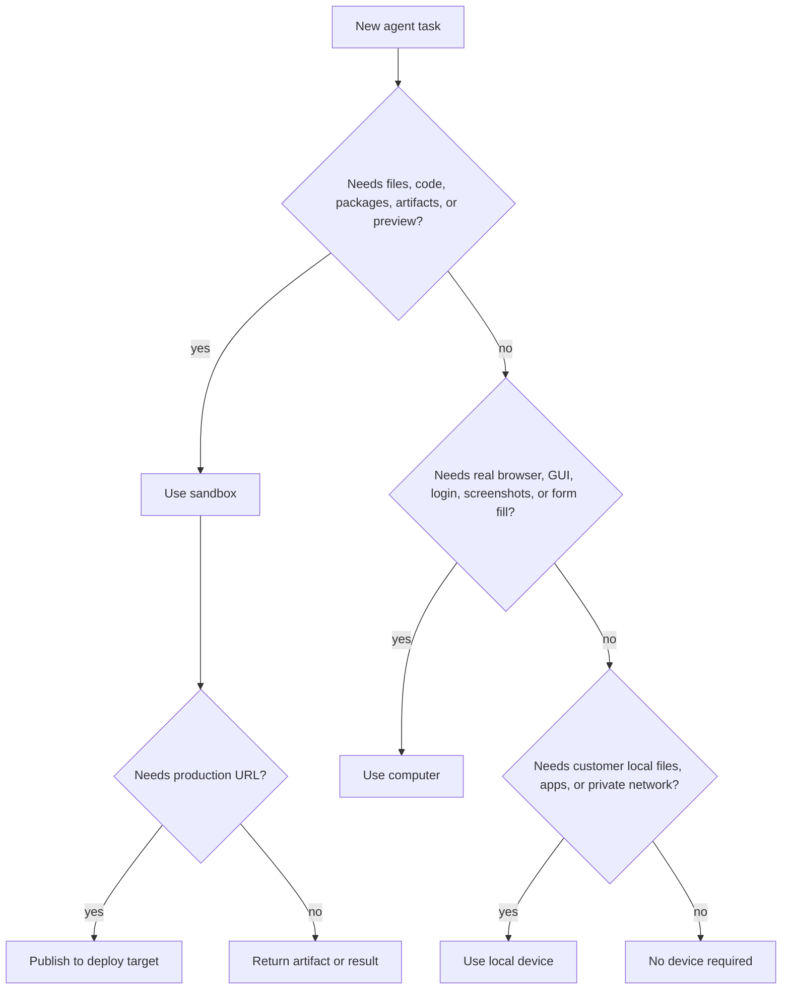

并非每个智能体都需要沙箱。正确的问题是：

```text
Does this agent need an execution environment, durable state, files, browser,
private network access, or deployable output?
```

如果答案是肯定的，请分配设备。如果答案是否定的，智能体可以运行
作为后端中的轻量级编排或推理步骤。

---

## 简短规则

|智能体任务|设备|
|---|---|
|纯推理、分类、路由、总结|无需任何设备 |
|编写文件、运行代码、安装包、生成工件 |沙盒|
|浏览网站、登录、点击按钮、截取截图 |计算机 |
|使用客户拥有的文件、应用程序、VPN 或专用网络 |本地设备|
|服务生产流量 |部署或 Docker 主机 |

> **注意：没有设备仍然是产品决定**
>
> 当智能体只需要模型推理时，可以在没有沙箱的情况下运行
> 后端提供的上下文。那样更便宜、更快。仅当以下情况时才给它一个设备：
> 这项工作需要一个。

---

## 当不需要设备时

对于只需要思考、分类、计划或转换的智能体，不要使用任何设备
文本已可用于您的后端。

示例：

- 将用户提示发送给正确的部门智能体
- 总结一个简短的文字记录
- 对支持票进行分类
- 根据提供的上下文起草一封简单的销售电子邮件
- 决定运行是否需要人工批准
- 选择最适合任务的设备
- 在不接触文件的情况下制定任务计划
- 使用数据库中已有的字段为线索评分

这项工作可以在产品后端或托管 MIOSA 智能体运行时中运行
无需创建沙箱。

计费通常仅针对模型/运行时使用情况。

---

## 当需要沙箱时

当智能体需要工作空间时，请使用沙箱。

示例：

- 编写或编辑代码
- 运行测试或构建
- 安装 npm、Python、Go 或系统包
- 生成 PDF、DOCX、图像、报告、CSV 或 ZIP
- 在会话之间保留文件
- 运行脚本或笔记本
- 启动开发服务器
- 公开预览 URL
- 快照或分叉状态
- 准备一个可部署的应用程序
- 运行爬虫、解析器或数据管道

当研究人员超越“阅读和总结”进入
诸如抓取、提取、转换、存储、制图或生成等工作
可下载的研究成果。

销售文案智能体在生成登陆页面、提案、
品牌资产、电子邮件序列文件、电子表格导出或版本化营销活动
文物。

---

## 当需要计算机时

当智能体需要真正的浏览器或桌面时，请使用计算机。

示例：

- 登录仪表板
- 测试注册或结账
- 单击 SaaS UI
- 填写表格
- 检查视觉布局
- 捕获屏幕截图
- 使用浏览器扩展
- 访问仅限桌面的工作流程
- 像人类一样验证预览

计算机比纯模型运行更昂贵，而且通常更昂贵
比轻量级沙箱工作。当浏览器或桌面状态很重要时使用它们。

---

## 当需要本地设备时

当智能体必须使用客户控制的资源时使用本地设备
不应该转移到云中。

示例：

- 本地文件无法上传
- 专用网络或VPN访问
- 安装的桌面应用程序
- 硬件连接的工作流程
- 本地凭证存储
- 客户控制的浏览器配置文件

本地设备应该是选择加入且可见的。用户应该知道哪个工作区，
智能体和会话可以访问他们的机器。

---

## 当需要部署时

部署不是智能体工作区。是发展后的持久目标
工作完成了。

|需要|目标|
|---|---|
|分享实时开发预览 |沙盒预览 |
|提供生产应用程序 | MIOSA 部署 |
|在一个工作区托管许多小型应用程序 | Docker 主机 |
|运行始终在线的智能体工作区 |持久沙箱或计算机，不部署|

Docker Host 是经过验证的应用程序容器运行的位置。不是智能体所在的地方
应该是编辑文件。

---

## 按智能体角色划分的示例

### 研究智能体

|研究任务 |设备 |
|---|---|
|总结提供的笔记 |没有设备 |
|搜索公共网络并写一个简短的答案 |没有设备或沙箱，取决于工具策略 |
|抓取许多页面并对结果进行重复数据删除 |沙盒|
|生成图表和 CSV 报告 |沙盒|
|登录私有的分析仪表板 |计算机 |
|使用仅限客户 VPN 的数据库 |本地设备|

### 销售文案智能体

|销售任务|设备|
|---|---|
|根据 CRM 字段起草邮件文案 |无需设备 |
|生成活动简介工件 |沙盒|
|建立登陆页面|沙盒|
|预览页面并做视觉 QA |沙盒 + 计算机 |
|通过 CRM/电子邮件工具发送营销活动 |经批准的连接器 |
|登录广告平台并配置广告活动 |经批准的计算机|

### 工程智能体

|工程任务|设备|
|---|---|
|解释粘贴到聊天中的堆栈跟踪 |没有设备 |
|编辑代码并运行测试 |沙盒|
|启动开发服务器 |沙盒|
|验证浏览器 UI |计算机 |
|发布生产应用 |批准后部署 |

### 支持智能体

|支持任务|设备|
|---|---|
|工单文本回复草稿 |没有设备 |
|搜索内部文档并给出答案 |没有设备或沙箱 |
|在 Web 管理后台中检查账户 |计算机 |
|生成客户导出文件 |沙盒|
|发送回复 |获得批准或政策的连接器 |

---

## 决策树



---

## 成本和性能指导

|选择|启动|成本|最适合 |
|---|---|---|---|
|没有设备 |最快|最低|路线、规划、总结 |
|沙盒|快|中等|代码、文件、工件、预览 |
|计算机 |较慢 |较高 |浏览器/桌面自动化 |
|本地设备|取决于用户机器 |继电器/模型/工具成本|私人资源|
|部署|构建/发布依赖|托管费用|耐用的生产应用程序 |

从可以安全完成工作的最便宜的运行时开始。升级为
仅当任务需要时才使用沙箱、计算机或本地设备。

---

## 后端路由策略

您的后端应该明确选择设备：

```typescript
type DeviceDecision = {
  required: boolean;
  deviceType?: "sandbox" | "computer" | "local";
  reason: string;
  needsApproval: boolean;
  estimatedCredits: number;
};
```

记录运行时的决定。如果由于使用了错误的设备而导致运行失败
选择后，恢复路径应说明要使用哪个设备类重试。

---

## 另请参阅

- [智能体产品模型](/docs/guides/agent-product-model)：智能体、设备、运行、事件和积分的规范词汇。
- [智能体设备](/docs/guides/agent-devices)：了解沙箱、计算机、本地设备、持久性和部署边界。
- [智能体工作流程模式](/docs/guides/agent-workflow-patterns)：将设备决策映射到简单和复杂的工作流程。
- [智能体信用计量](/docs/platform/agent-credit-metering)：了解每种设备选择的成本影响。
