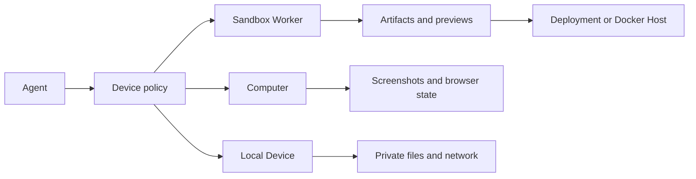

设备是智能体用来完成实际工作的机器。 MIOSA 有 3 个活跃的
设备类别和一个托管目标：

|类型 |产品含义 |
|---|---|
|沙盒工作者 |隔离代码/文件/构建/预览/工件工作区 |
|电脑|具有屏幕截图和输入 API 的持久云桌面/浏览器 |
|本地设备/BYOC/OpenComputer |配对用户拥有的主机，用于本地文件、应用程序、专用网络访问或客户拥有的容量 |
| Docker 主机 |开发完成后耐用的应用程序容器主机 |

Docker Host 不是智能体编辑代码的地方。这是经过验证的地方
沙箱构建的应用程序作为耐用容器运行。

---

## 选择设备

任务需要哪个运行时是它自己的决定。 [智能体设备选择](/docs/guides/agent-device-selection)涵盖决策规则、每个角色示例、决策树和成本指导。本页描述设备模型 - 每个设备类别是什么以及它们如何关联。

一次运行可以使用多个运行时。例如，沙箱可以构建
应用程序，计算机可以测试预览，OpenComputer可以调用私有
导出最终工件之前的内部服务。

---

## 设备如何关联



智能体可以在运行期间切换设备。例如，沙箱写了一个web
应用程序，计算机打开预览并目视检查，然后是沙箱
公布验证结果。

---

## 沙箱工作者

沙箱是编码智能体的正常运行时。

### 沙盒功能

- 持久`/workspace`
- 文件读/写/列表/删除
- Bash、Python、Node、包管理器
- 长期运行的开发服务器
- 公共预览 URL
- 快照和分叉
- 生成的工件
- 部署和 Docker Host 发布准备
- 范围环境变量和连接器

使用沙箱构建应用程序构建器、工件工厂、研究等产品
工作区、评估运行器和代码智能体。

---

## 电脑

计算机是一个完整的桌面/浏览器运行时。

### 计算机能力

- 屏幕截图
- 单击、键入、滚动、拖动
- 剪贴板
- 窗口控制
- 浏览器会话
- 视觉质量保证
- 终端和外壳
- 持久存储
- 可嵌入桌面流

当工作需要可视浏览器、GUI 自动化、手动时使用计算机
handoff 或仅限桌面的软件。

---

## 本地设备/BYOC/OpenComputer

本地设备是用户或租户拥有的配对计算机。在 MIOSA 文档中
您还将看到名为 BYOC 或 OpenComputers 的路径。

当智能体需要时使用它：

- 本地文件无法上传
- 专用网络访问
- 安装的桌面应用程序
- 不应离开计算机的本地凭据
- 客户控制的硬件
- 本地 GPU 或其他主机特定容量

本地设备功能强大，但应该选择加入。用户应该准确地看到
哪个工作区和智能体可以访问该设备。设备将出站连接到
MIOSA - 不需要入站端口。

---

## 主设备

每个工作区都应该有一个主要设备策略。智能体默认使用它
当任务未指定运行时时。

推荐的主要设备策略：

|工作空间类型 |首要政策|
|---|---|
|应用程序构建器 |沙盒工作者 |
|浏览器自动化工作区 |电脑|
|企业 RPA |计算机，具有 BYOC/OpenComputer 后备功能 |
|客户拥有的编码工作区 |持久沙箱|
|产物工厂|沙盒工作者 |

主设备可能会随着时间的推移而改变，但历史运行情况仍应如此
记录哪个设备实际执行每个操作。

---

## 坚持

智能体工作应该在正常停止后继续进行。

|运行时|预期行为 |
|---|---|
|持久沙箱 |超时停止计算并保留恢复状态 |
|非持久沙箱 |超时破坏状态 |
|电脑|停止/启动保留文件系统和桌面状态 |
| BYOC/OpenComputers |状态保留在客户拥有的主机上，除非任务将其导出 |
| Docker 主机 |应用程序将作为部署持续运行，直到停止或被替换 |

对于智能体构建工作流程，持久沙箱应该是默认值。使用
非持久性仅适用于文件系统应位于的一次性不受信任作业
被丢弃。

---

## 活动和超时

活动智能体工作应重置空闲时钟：- 执行调用
- 文件写入
- 终端输入
- 预览流量
- 浏览器/计算机操作
- 产物生成
- 部署发布
- 显式扩展调用

UI 和 CLI 应在设备暂停或销毁之前发出警告。长期运行
工作流程应在稳定的检查点创建快照。

---

## 设备权限

设备访问应该是明确的：

|许可|示例|
|---|---|
| `devices:use` |在指定的设备上运行命令或浏览器操作 |
| `devices:create` |创建子沙箱或计算机|
| `devices:destroy` |永久删除设备并保存状态 |
| `devices:connect-local` |配对或使用本地设备 |
| `devices:set-primary` |更改工作区默认设备策略 |
| `deployments:publish` |将工作空间输出提升为持久托管 |

高风险权限应由所有者/管理员角色或人工批准来控制。

---

## 构建虚拟设备产品

使用这些原语，您可以构建看起来像永远在线智能体的产品
工作区：

```text
Workspace
  -> primary sandbox for code and files
  -> optional computer for browser/desktop
  -> connected accounts and managed connectors
  -> jobs and schedules
  -> artifacts and previews
  -> deployment targets
```

这支持以下产品：

- 24/7 研究智能体
- 浏览器自动化工作者
- 人工智能应用程序构建者
- 联合创始人式的任务操作员
- 产物生成工作室
- 具有共享文件的智能体团队
- 客户拥有的编码工作区

对于 Lovable/Replit/Genspark 风格的应用程序构建者，将沙箱作为主要的
设备并连接计算机仅用于浏览器 QA 或登录密集型检查。对于一个
Nebula风格的虚拟设备，使主设备在UI中可见，以便用户
了解当前工作是否发生在沙箱、计算机或计算机中
客户拥有的 OpenComputer。

---

## 相关

- [沙箱](/docs/develop/sandboxes)：代码、文件、命令、预览、快照和发布准备。
- [计算机](/docs/computers/overview)：视觉任务的桌面和浏览器自动化。
- [智能体可以做什么](/docs/guides/agent-capabilities)：内置工具、应用程序操作、权限和产品界面。
- [Docker Host](/docs/docker-host/docker-deploy)：工作区 Docker Host 主机上的持久应用程序容器。
