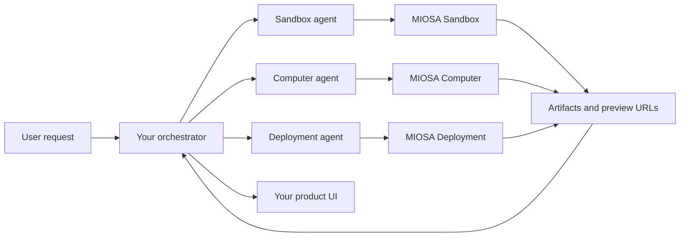
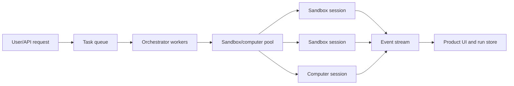

MIOSA 允许您构建智能体系统，其中不同的智能体使用正确的运行时
对于工作的每个部分。

- **沙盒智能体**编写代码、编辑文件、运行命令、构建包、
  生成工件并公开预览端口。
- **计算机智能体**使用真实的浏览器或桌面进行目视检查、点击、
  表单填写、屏幕截图、上传和人工交接。
- **部署智能体**将经过验证的沙箱工作区提升为生产环境
  部署或 Docker 主机应用程序。
- 您的**协调员**拥有任务图、模型调用、权限、重试、
  和面向用户的进度流。

智能体通过 MIOSA 管理的状态进行通信：文件、工件、事件、
预览 URL、屏幕截图、快照和部署记录。

如果您正在构建智能体公司产品，请将其视为平台层：
智能体是配置的工作人员，设备是执行基板，连接器
授予工具和事件/工件使工作对用户可见。参见
[MIOSA 智能体可以做什么](/docs/guides/agent-capabilities),
[配置智能体](/docs/guides/configure-agent)，以及
[智能体设备](/docs/guides/agent-devices)，了解其产品模型，然后再
扩展编排层。

对于端到端的产品蓝图，包括Polsia式的公司运营商，
联合创始人（coFounder.co）式的部门智能体、Nebula式的虚拟设备、
Heuresis 风格的编码工作区，以及向设备分派提示，请参阅
[建立智能体公司平台](/docs/guides/build-agent-company)。

---

## 规模模型：从一个智能体到数千个智能体

相同的原语适用于一个智能体、一百个智能体或数千个智能体
智能体，但编排形式发生了变化。

|规模|推荐形状|
|---|---|
| 1-10 名智能体商 |直接智能体循环根据需要创建/恢复沙箱 |
| 10-100 名智能体 |具有沙箱池和每个工作空间限制的队列支持编排器 |
| 100-1,000 名智能体商 |分片作业队列、区域沙箱池、范围令牌、显式并发控制 |
| 1,000+ 智能体商 | 专用租户容量、速率限制合约、批量 API、事件聚合和背压 |

不要因为有10000个逻辑沙箱就启动10000个独立沙箱
智能体。大多数产品应区分：

- **逻辑智能体**：应用程序中的模型/工具循环或任务工作人员。
- **运行时会话**：执行实际工作的沙箱或计算机。
- **工作空间**：持久文件系统、秘密、快照、使用情况和
  归因边界。

许多逻辑智能体可以共享一个队列，并从池中借用运行时会话。
只有执行活动代码/浏览器工作的智能体才需要运行沙箱或
那一刻的电脑。

---

---

## 心理模型

协调器不应该让每个智能体共享一台混乱的机器。相反，
每个运行时都会做它擅长的工作，并发出下一个运行时的持久输出
智能体可以消费。

---

---

## 运行时选择

|工作 |运行时|为什么 |
|---|---|---|
|编写应用程序代码 |沙盒|具有文件和执行功能的快速无头 Linux 工作区 |
|安装依赖项 |沙盒| 依赖状态保留在 `/workspace` 和快照中 |
|运行测试/构建 |沙盒| 确定性的命令执行和流式输出 |
|提供预览 |沙盒|将应用程序端口公开为预览 URL |
|检查浏览器 UI |电脑|真实浏览器、截图、鼠标、键盘|
|测试注册/登录流程 |电脑| Cookie、弹出窗口、OAuth、上传和视觉状态 |
|生成 PDF/DOCX/图像 |沙盒| Python/Node 生成器生成工件 |
|使用私有本地系统 | BYOC/OpenComputers | 数据、网络、应用或本地 GPU 容量保留在客户主机上 |
|发布生产应用 |部署或 Docker 主机 |稳定的URL、版本、回滚、路由 |

> **注意：沙箱和计算机是不同的产品**
>
> 不要把沙箱和计算机混为一谈。沙箱是为了
> 无头代码和工件。计算机用于 GUI/浏览器工作。编排是
> 让他们合作的层。

---

---

## 通信原语

使用显式的交接，而不是隐藏的共享内存。

|原语 |生产者 |消费者 |示例 |
|---|---|---|---|
|文件 |沙盒智能体|沙盒智能体、部署智能体 | `/workspace/app/page.tsx` |
|产物|沙盒智能体 |用户，另一个智能体 | `proposal.pdf`、`chart.png` |
|预览 URL |沙盒智能体 |计算机智能体、用户 | `https://3000-...sandbox.miosa.ai` |
|截图 |计算机智能体 |编排器、LLM |浏览器 QA 发现 |
|事件 |任意运行时 | UI、编排器 | stdout、stderr、文件已更改、预览已就绪 |
|快照|沙盒|沙盒智能体|危险重构前的检查点 |
|部署 |部署智能体 |用户、支持 |持久的生产 URL |

编排器应该将这些存储为运行状态，以便前端可以重放什么
发生了，下一个智能体有一个干净的输入。

---

---

## 队列和池架构

对于大规模编排，请在 MIOSA 运行时前面放置一个队列。

队列拥有背压。运行时池拥有容量。协调者
拥有任务分配。 MIOSA 拥有隔离执行。

在以下情况下使用此模式：

- 数千个用户任务可能会同时到达
- 智能体的工作量很大
- 你需要限制支出
- 你需要每个客户的公平性
- 您需要可靠的重试和死信队列
- 用户需要实时进度，无需直接轮询每个运行时

---

---

## 何时使用 ADK 与您自己的协调器

当您需要 MIOSA 的内置工具目录和
简单的智能体循环。

当您需要时构建您自己的编排器：

- 多个智能体具有不同的职责
- 产品特定的 UI 事件
- 自定义审批步骤
- 后台作业和重试
- 每个用户的配额和计费
- 白标归因
- 产品层中持久的运行历史记录

协调器是您的产品层。 MIOSA 是运行时层。

---

---

## 另请参阅

- [编排模式](/docs/guides/agent-orchestration/patterns)：提示调度、持久运行组、子智能体、沙箱托管的编排器和权限。
- [编排示例](/docs/guides/agent-orchestration/examples)：工作流程：具有浏览器 QA 的应用程序构建器、沙箱优先代码智能体、最小编排器形状。
