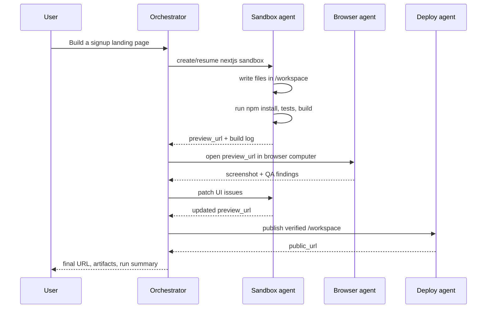

显示实际协调模式的具体流程，从具有浏览器 QA 的完整应用程序构建器到最小的编排器形状及其提供的 UI。

---

## 示例：带有浏览器 QA 的应用程序构建器



这就是人工智能应用程序构建器产品背后的模式。用户看到一项任务，但是
编排器将其划分为代码、浏览器和部署智能体。

---

---

## 沙箱优先的代码智能体

代码智能体应该在沙箱内构建，而不是在本地构建
仅在最后上传。

```text
get_or_create persistent sandbox
write files under /workspace
run install/build/test inside sandbox
start preview server
stream stdout/stderr to product UI
snapshot after meaningful progress
publish when verified
```

这是使 MIOSA 对于编码智能体有用的循环。

---

---

## 计算机 QA 智能体

当输出需要视觉/浏览器检查时使用计算机智能体。

```text
open preview URL
capture screenshot
click through navigation
fill a form
test login or signup
capture errors
return screenshot and findings to orchestrator
```

浏览器智能体不应直接编辑代码。它报告了调查结果。的
沙箱智能体修补代码。

---

---

## 最小协调器形状

**打字稿**

```typescript
type RuntimeHandoff =
  | { type: "file"; path: string }
  | { type: "preview"; url: string; port: number }
  | { type: "artifact"; path: string; mimeType?: string }
  | { type: "screenshot"; computerId: string; url: string }
  | { type: "deployment"; url: string; deploymentId: string };

type AgentStep = {
  id: string;
  agent: "sandbox" | "computer" | "deploy";
  status: "queued" | "running" | "succeeded" | "failed";
  input: Record<string, unknown>;
  output?: RuntimeHandoff[];
};
```

**Python**

```python
from typing import Literal, TypedDict

class RuntimeHandoff(TypedDict, total=False):
    type: Literal["file", "preview", "artifact", "screenshot", "deployment"]
    path: str
    url: str
    port: int
    deployment_id: str

class AgentStep(TypedDict, total=False):
    id: str
    agent: Literal["sandbox", "computer", "deploy"]
    status: Literal["queued", "running", "succeeded", "failed"]
    input: dict
    output: list[RuntimeHandoff]
```

---

---

## 产品UI模式

精心策划的 MIOSA 产品通常具有三个面板：

|面板|演出 |
|---|---|
|聊天/任务流 |推理总结、工具调用、命令输出、状态更新 |
|工作区/预览 |实时沙箱预览、电脑桌面、屏幕截图、日志 |
|文物|生成的文件、屏幕截图、PDF、DOCX、ZIP、部署 URL |

良好的进展事件包括：

- 计划已创建
- 沙箱创建或恢复
- 文件写入
- 命令开始
- 标准输出/标准错误块
- 命令完成
- 预览就绪
- 捕获的屏幕截图
- 产物创建
- 部署开始
- 部署准备就绪

---

---

## 另请参阅

- [智能体编排](/docs/guides/agent-orchestration)：概念：规模模型、运行时选择、通信原语以及队列和池架构。
- [编排模式](/docs/guides/agent-orchestration/patterns)：提示调度、持久运行组、子智能体和权限。
