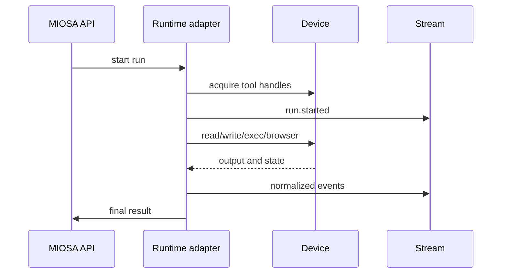

智能体运行有两个单独的选择：

1. **哪个运行时思考和行动？**
2. **哪个设备执行工作？**

运行时可以是 OSA、Codex、Claude Code、Pi、Hermes、Gemini CLI、OpenCode、
或定制智能体运行框架。该设备可以是沙箱、计算机或本地
设备。

```text
MIOSA Agent = runtime, model, instructions, tools, policy
MIOSA Device = sandbox, computer, or local machine where actions happen
```

---

## 路由合约

```typescript
type RuntimeRoute = {
  runtime: "osa" | "codex" | "claude-code" | "pi" | "hermes" | "gemini-cli" | "opencode" | "custom";
  model?: string;
  deviceType: "sandbox" | "computer" | "local";
  deviceId: string;
  cwd?: string;
  prompt: string;
  tools: string[];
  connectors: string[];
  approvalPolicy: "auto" | "confirm-risky" | "manual";
};
```

运行时接收：

- 提示
- 系统指令
- 设备工具手柄
- 连接器手柄
- 允许的环境变量
- 审批政策
- 预算信封

设备执行：

- 文件操作
- 命令
- 浏览器操作
- 屏幕截图
- 预览服务器
- 产物生成
- 部署准备

---

## 运行时选择

|运行时|用它来 |笔记|
|---|---|---|
| OSA | MIOSA-原生总智能体、白标流程、托管产品|默认平台运行时 |
|法典|代码繁重的沙箱工作、存储库编辑、测试、CLI 原生开发工作流程 |最适合软件工程循环 |
|克劳德·代码 | Claude Code 是客户首选工具的代码和工件工作流程 |需要非交互式会话支持 |
|圆周率 |智能体利用实验和 AI SDK 兼容的流 |当客户生态系统需要 Pi 时很有用 |
|爱马仕 |专业客户智能体运行时间|视为运行时适配器 |
| Gemini CLI / OpenCode / 自定义 |客户提供的运行时 |必须满足 MIOSA 事件/工具协议 |

> **注意：运行时适配器规则**
>
> 每个运行时都应适应相同的 MIOSA 事件流。前端应该
> 不需要为每个智能体运行时自定义渲染逻辑。

---

## 设备选择

|设备|运行时拟合|
|---|---|
|沙盒| OSA、Codex、Claude Code、Hermes、定制代码智能体 |
|电脑| OSA、Claude Code、浏览器/桌面操作员、QA 智能体 |
|本地设备|客户控制的运行时、专用网络工作、本地文件工作流程 |

推荐默认值：

- 应用程序构建器：沙箱
- 产物生成：沙箱
- 网络质量检查：计算机
- 仪表板自动化：计算机
- 私营企业任务：本地设备
- 广泛智能体公司产品：主沙箱加可选计算机

---

## 非交互优先

交互式 TUI 对人类很有用。他们不应该是唯一可靠的
平台的执行路径。

生产级运行时会话应支持：

- `--prompt`或提示文件输入
- `--detach`
- JSON输出
- 可重新连接的事件流
- 明确的模型选择
- 干净取消/停止
- 输入错误
- 不依赖 tmux 来确保正确性

这就是 CLI 工具和产品底层之间的区别。

---

## 运行时适配器生命周期



适配器负责将运行时特定的行为转换为
MIOSA 的通用协议。

示例：

|运行时事件 | MIOSA 活动 |
|---|---|
|工具调用开始 | `tool.started` |
|外壳输出 | `command.output` |
|文件编辑 | `file.changed` |
|浏览器截图| `browser.screenshot` |
|产物已保存 | `artifact.created` |
|需要人工确认| `approval.required` |
|模型/工具故障 | `run.failed` |

---

## 型号可用性

运行时绝不应该默默地默认为不可用的模型。产品
必须在开始会话之前验证模型可用性。

推荐行为：

1. 列出运行时的可用模型。
2. 选择工作区默认值（如果有效）。
3. 如果已配置，则回退到运行时默认值。
4. 如果不可用，则返回带有有效模型选项的键入错误。

坏：

```text
Unknown model "x"
```

好：

```json
{
  "code": "MODEL_UNAVAILABLE",
  "message": "claude-opus-4-7 is not available for this workspace.",
  "available_models": ["claude-sonnet-4.6", "claude-opus-4.6"],
  "recovery": "Retry with --model claude-sonnet-4.6."
}
```

---

## 凭证注入

运行时通常需要提供者凭据。安全模型是：

- 用户或管理员将凭据存储在 MIOSA 中
- 运行时接收范围句柄，而不是原始平台管理密钥
- 沙箱仅接收该工作区批准的环境变量
- 出口交换仅针对预期提供者端点的托管占位符
- 所有凭证的使用都会发出审核事件

示例：

```text
workspace stores ANTHROPIC_API_KEY
  -> agent policy allows Claude Code runtime
  -> sandbox session receives scoped runtime secret
  -> runtime can call provider
  -> UI never shows raw key
```

对于托管连接器，例如 Refero、GitHub、Slack、Google 或租户 API，
与普通环境变量相比，更喜欢连接器令牌交换。

---

## 另请参阅- [智能体产品模型](/docs/guides/agent-product-model)：智能体、设备、运行、事件和计费的核心词汇。
- [智能体工作流程模式](/docs/guides/agent-workflow-patterns)：提示调度和会话的简单到复杂的示例。
- [托管连接器](/docs/guides/managed-connectors)：提供工具和凭据，而不会将提供商令牌泄露给浏览器。
- [智能体设备](/docs/guides/agent-devices)：决定何时使用沙箱、计算机、本地设备或部署目标。
