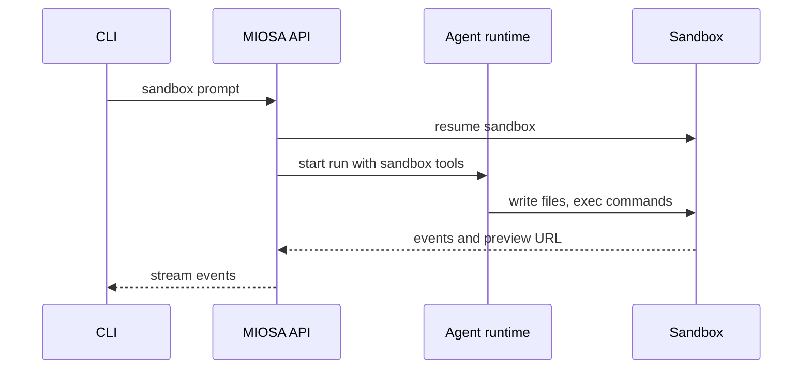
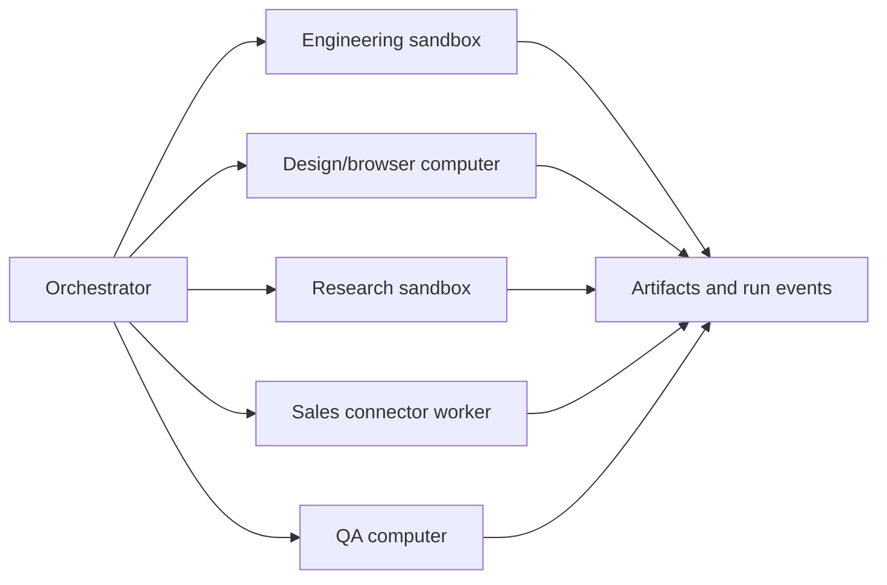

MIOSA 工作流程可以从一个提示扩展到一支长期运行的智能体队伍。
相同的原语适用于每个级别：

```text
prompt -> agent runtime -> assigned device -> event stream -> durable output
```

使用此页面为您的产品选择正确的工作流程。

---

## 模式 1：一击跑

使用它进行快速检查、小脚本、检查、摘要和运行状况
测试。

```bash
miosa prompt --sandbox <sandbox-id> "check if the preview server is healthy"
```

预期行为：

1. CLI 向 MIOSA 发送提示符。
2. MIOSA 验证目标沙箱。
3.运行时执行一个短任务。
4. CLI 打印答案和任何结构化输出。
5. 积分按模型使用和设备时间收取。

当用户不需要长期会话时使用此选项。

---

## 模式 2：提示进入沙箱

当智能体应该编码、生成工件、运行测试或启动
预览。

```bash
miosa prompt --sandbox <sandbox-id> \
  --harness codex \
  "Build a Next.js landing page, run it on port 3000, and fix any errors."
```

智能体应在 `/workspace` 内工作：

- 写入文件
- 安装依赖项
- 运行测试
- 启动开发服务器
- 检查错误
- 保存文物
- 快照检查点
- 批准后发布



> **提示：不要默认上传**
>
> 上传本地存储库对于导入和同步很有用。它不应该是唯一的
> 智能体工作流程。正常的智能体构建器路径是让智能体创建并
> 修改沙箱内的文件。

---

## 模式 3：提示进入计算机

当任务需要真实的浏览器、GUI、登录流程或视觉 QA 时，请使用此选项。

```bash
miosa prompt \
  --computer <computer-id> \
  --harness claude-code \
  "Open the app preview, test signup, capture screenshots, and report issues."
```

计算机设备可以：

- 打开网址
- 单击按钮
- 输入表格
- 滚动
- 登录仪表板
- 检查用户界面状态
- 截图
- 使用终端或桌面应用程序

在沙箱创建预览后使用计算机，或作为主要运行时
浏览器密集型自动化产品。

---

## 模式 4：分离的智能体会话

用于在第一条命令返回之后仍要继续的任务。

```bash
miosa agent run builder \
  --sandbox <sandbox-id> \
  --no-follow \
  --json
```

然后检查并继续该会话：

```bash
miosa run events <run-id>
miosa run steer "Now add authentication and update the README." --sandbox <sandbox-id>
miosa run files <run-id>
miosa run stop <run-id>
```

分离的会话不应需要终端 UI 来保持运行。 TUI 是
视图，而不是执行模型。

分离运行要求：

- 立即返回运行 ID（`--no-follow`）
- 事件可通过 API 和 CLI 获取
- 可重新连接的流
- 可持久保存的对话记录（`miosa run messages`）
- 与运行关联的工件（`miosa run files`）
- 干净的停止/取消（`miosa run stop`）
- 类型化的故障状态
- 清晰的信用使用情况

---

## 模式 5：应用程序构建器循环

用于 Lovable、Replit、v0 或 Lumen 风格的应用生成。

```text
User prompt
  -> create/resume sandbox
  -> agent edits files in /workspace
  -> run install/build/test
  -> start preview
  -> stream files and preview URL to UI
  -> user asks for edits
  -> agent patches same sandbox
  -> snapshot stable state
  -> publish to deployment
```

推荐用户界面：

- 聊天
- 文件树
- 命令日志
- 预览框架
- 文物面板
- 部署状态
- 版本历史
- 信用使用

推荐的后端记录：

```sql
projects
  current_sandbox_id
  current_deployment_id
  latest_snapshot_id

agent_runs
  project_id
  sandbox_id
  prompt
  status
  idempotency_key
```

---

## Pattern 6: artifact workspace

将其用于克劳德桌面式工作，其中智能体创建文档，
图像、图表或数据文件。

示例：

- 提案
- DOCX 文件
- PDF
- 推介材料
- 图表
- 品牌资产
- CSV 报告
- HTML 预览
- ZIP 捆绑包

流程：

```text
prompt -> sandbox -> generate file -> render/validate -> artifact -> version
```

用户界面应显示：

- 实时的文本/代码生成
- 生成的文件卡
- 预览窗格
- 下载按钮
- 修订历史
- 工件上附加的“进行更改”提示

---

## Pattern 7: browser operator

用于 Nebula 风格的浏览器操作或类似 RPA 的工作流程。

```text
prompt -> computer -> browser session -> screenshots/events -> report/action
```

示例：

- 填写入职表格
- 验证结帐
- 检查管理员仪表板
- 抓取已认证的数据
- 测试浏览器用户界面
- 对预览运行视觉 QA

在以下操作前应要求人工批准：

- 提交外部表单
- 发送消息
- 花钱
- 删除数据
- 更改账户设置
- 使用管理员凭据

---

## Pattern 8: orchestrated agent team

用于 Cofounder（cofounder.co）、Polsia、Agentfounder 或内部
运营商产品。



协调者应该：

- 把提示拆分成任务
- 分配设备和运行时
- 执行预算和审批
- 流式传输每个孩子的跑步情况
- 合并工件
- 对高风险操作请求人工批准
- 产出一份最终状态

仅当子设备能带来真正的杠杆时才使用它们。并非每个任务都需要
新沙箱。

---

## Pattern 9: agent fleet

当产品要启动数十、数百或数千个工作者时使用此模式。

示例：

- 大型测试矩阵
- 铅富集
- 网站审核
- 浏览器质量检查扫描
- 基准运行
- 研究爬行
- 并行的代码迁移

机群要求：

| 要求 | 为什么重要 |
|---|---|
| 队列 | 避免无限制地创建设备 |
| 幂等性 | 重试时不会产生重复资源 |
| 预算上限 | 阻止支出失控 |
| 并发限制 | 保护用户套餐和平台容量 |
| 子运行事件 | 无需打开每个 worker 就能看到进度 |
| 聚合 | 将输出合并成一份报告 |
| 取消 | 快速停止整个机群 |
| 部分结果 | 失败后保留有用的工作 |

---

## 选择模式

|用户要求 |使用 |
|---|---|
|快查 |一击跑|
|生成代码 |沙盒提示 |
|测试浏览器流程 |电脑提示|
|断开连接后继续工作 |独立会话 |
| 构建并预览应用 | 应用构建器循环 |
|制作文档/图像/报告 |工件工作区 |
|运营网站/仪表板 |浏览器运营商 |
|经营公司/项目 |精心策划的智能体团队|
| 扩展大量 worker | 智能体机群 |

---

## 另请参阅

- [智能体产品模型](/docs/guides/agent-product-model)：智能体、设备、运行、事件、工件和信用的规范词汇。
- [运行时路由](/docs/guides/agent-runtime-routing)：将提示路由到 OSA、Codex、Claude Code、Hermes、Pi 或自定义运行时。
- [虚拟设备产品](/docs/cookbook/build-virtual-device-product)：使用文件、浏览器、作业和工件构建Nebula风格的持久工作空间。
- [后端编排](/docs/integrations/backend-orchestration)：构建将提示分派到 MIOSA 设备的产品后端。
