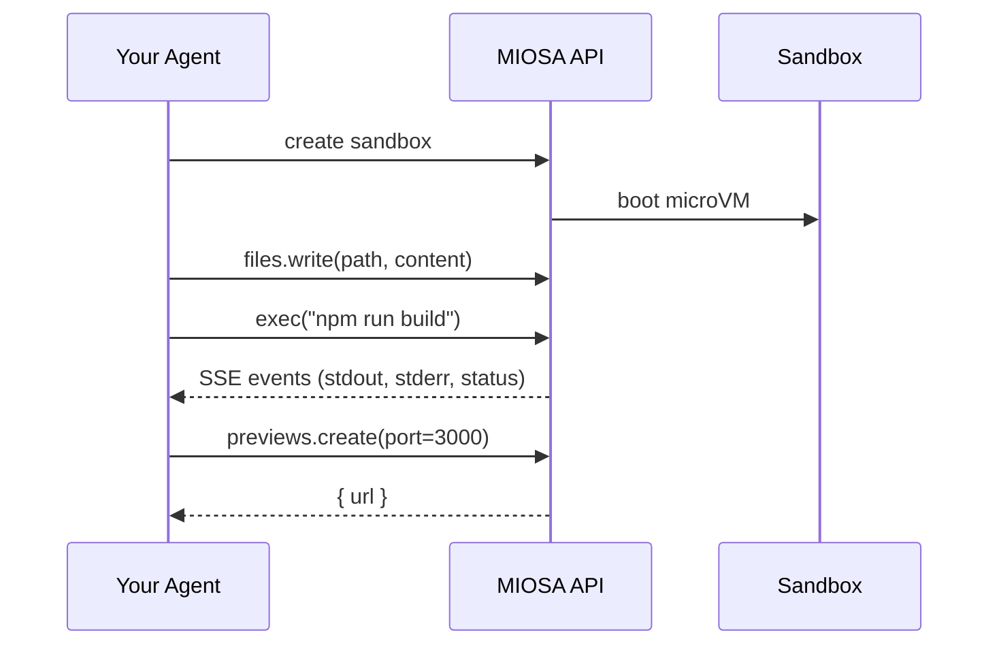

MIOSA 提供底层：沙箱、计算机、文件 I/O、执行、预览、
和快照。您提供智能体循环：LLM 调用、屏幕截图解码、
规划、轮流管理。本指南展示了如何将两者连接在一起。

如果您正在围绕智能体设计产品表面，请从
[MIOSA 智能体可以做什么](/docs/guides/agent-capabilities),
[配置智能体](/docs/guides/configure-agent)，以及
[智能体设备](/docs/guides/agent-devices)。此页面重点介绍
选择智能体和设备策略后，将进行集成循环。

---

## 模式



您的智能体代码拥有循环：选择 LLM、格式化工具调用、
解释结果，并决定何时停止。 MIOSA 执行您的操作
智能体请求并流回结果。

---

## 沙盒集成

沙箱是代码生成智能体的首选基础。智能体
通过 MIOSA 写入文件、运行构建命令并打开预览 URL
基元。

**Python**

```python
import miosa

client = miosa.Miosa(api_key="msk_u_...")

# Boot a sandbox with a Next.js environment
sbx = client.sandboxes.create("nextjs")

# Agent writes the code it generated
sbx.files.write("/workspace/app/page.tsx", agent_generated_code)

# Run the build
result = sbx.exec("npm run build")
if result.exit_code != 0:
    # Feed stderr back to the agent so it can debug
    agent.feedback(result.stderr)
else:
    # Open a live preview
    preview = sbx.previews.create(port=3000)
    print(f"Preview: {preview.url}")
```

**打字稿**

```typescript
import { Miosa } from '@miosa/sdk';

const client = new Miosa({ apiKey: 'msk_u_...' });

// Boot a sandbox
const sbx = await client.sandboxes.create({ templateId: 'nextjs' });

// Agent writes the generated file
await sbx.files.write('/workspace/app/page.tsx', agentGeneratedCode);

// Run the build
const result = await sbx.exec('npm run build');
if (result.exitCode !== 0) {
  agent.feedback(result.stderr);
} else {
  const preview = await sbx.previews.create(3000);
  console.log('Preview:', preview.url);
}
```

沙箱在回合之间持续存在。第 1 次写入的文件仍然存在
第 5 轮，因此智能体无需在每次调用时重新发送上下文。

---

## 计算机集成

计算机是完整的 Linux 桌面虚拟机，具有屏幕截图、单击、键入和键盘 API。当您的智能体需要操作图形界面时使用它们。

**Python**

```python
import miosa

client = miosa.Miosa(api_key="msk_u_...")

computer = client.computers.create(template_type="ubuntu-desktop")
computer.start()

# Screenshot → reason → act loop (your agent drives this)
while not done:
    png = computer.screenshot()
    action = agent.next_action(png)

    if action.type == "click":
        computer.left_click(action.x, action.y)
    elif action.type == "type":
        computer.type(action.text)
    elif action.type == "key":
        computer.key(action.combo)  # e.g. "ctrl+t", "enter"
    elif action.type == "scroll":
        computer.scroll(action.direction, x=action.x, y=action.y)
    elif action.type == "done":
        done = True

computer.stop()
```

**打字稿**

```typescript
import { Miosa } from '@miosa/sdk';

const client = new Miosa({ apiKey: 'msk_u_...' });

const computer = await client.computers.create({ template_type: 'ubuntu-desktop' });
await computer.start();

let done = false;
while (!done) {
  const png = await computer.screenshot();
  const action = await agent.nextAction(png);

  switch (action.type) {
    case 'click':
      await computer.leftClick(action.x, action.y);
      break;
    case 'type':
      await computer.typeText(action.text);
      break;
    case 'key':
      await computer.key(action.combo);
      break;
    case 'done':
      done = true;
      break;
  }
}

await computer.stop();
```

---

## 状态跟踪

您的智能体代码负责保存回合历史记录、屏幕截图和
决定。 MIOSA 执行离散动作；它不维护智能体循环
或代表您进行对话状态。

> **注意**
>
> MIOSA 路线图上包含具有内置轮次历史记录和 LLM 编排的托管智能体循环。如今，状态管理位于您的应用程序层中。

最小转弯日志模式：

```python
turns = []

while not done:
    png = computer.screenshot()
    action = agent.next_action(png, history=turns)
    turns.append({"screenshot": png, "action": action})

    # Execute action on the computer...
```

---

## 审批流程

如果您的工作流程需要在执行操作之前进行人工审核，您的智能体
暂停并询问用户。 MIOSA 不会限制行动；所有批准逻辑都有效
在您的应用程序中。

```python
action = agent.next_action(png)

if action.requires_approval:
    approved = ask_user(f"Approve: {action.description}?")
    if not approved:
        agent.cancel(action)
        continue

computer.left_click(action.x, action.y)
```

---

## 流媒体事件

订阅沙箱或计算机事件流以接收实时进度，无需轮询：

**Python**

```python
# Sandbox events
for event in sbx.events.stream():
    if event.type == "sandbox.exec.stdout":
        print(event.data["line"])
    elif event.type == "sandbox.exec.completed":
        print(f"Exit code: {event.data['exit_code']}")
        break

# Computer events
for event in computer.events.stream():
    if event.type == "computer.stopped":
        print("Computer stopped:", event.data["reason"])
        break
```

**打字稿**

```typescript
// Sandbox events
for await (const event of sbx.events.stream()) {
  if (event.type === 'sandbox.exec.stdout') {
    process.stdout.write(event.data.line);
  } else if (event.type === 'sandbox.exec.completed') {
    console.log('Exit code:', event.data.exit_code);
    break;
  }
}
```

有关完整的事件目录，请参阅[事件 (SSE) 参考 →](/docs/api-reference/events)。

---

## 最佳实践

- **针对 MIOSA 设备运行智能体。** 对于代码和工件任务，请编写
  文件直接写入 `/workspace` 并在沙箱内运行命令。使用
  用于编排的本地计算机，而不是作为最终应用程序构建的位置。
- **在每个操作上使用 `Idempotency-Key`。** 如果您的智能体重试失败的请求，幂等性密钥可防止重复执行。生成与您的回合 ID 相关的密钥：`"turn-{turn_number}-{action_type}"`。
- **在智能体循环中设置 `max_turns`。** 失控的智能体循环可能会耗尽积分。设置一个硬性的上限，并向用户清晰地展示故障。
- **记录屏幕截图和决策。** 保留每个回合的屏幕截图和所采取的操作。当智能体做出错误决定时，此记录可让您重播和诊断，而无需重新运行整个任务。
- **在稳定检查点分叉。** 保留原始运行的沙箱作为已知良好的源，并使用 `POST /sandboxes/{id}/fork` 在独立分支中进行危险工作。
- **在执行代码任务时，优先选择沙箱执行而不是计算机桌面。** 通过沙箱 API 进行的文件 I/O 和 shell 命令比在桌面上的终端窗口中键入更可靠、更快速。

---

## 示例

- **代码生成智能体**：端到端生成和部署静态站点的智能体。

  [在 GitHub 上查看 →](https://github.com/Miosa-osa/miosa/tree/main/examples/agent-builds-static-app)
- **SDK 参考**：适用于沙箱和计算机的完整 Python 和 TypeScript SDK 方法签名。

  [SDK参考→](/docs/sdks/typescript)
