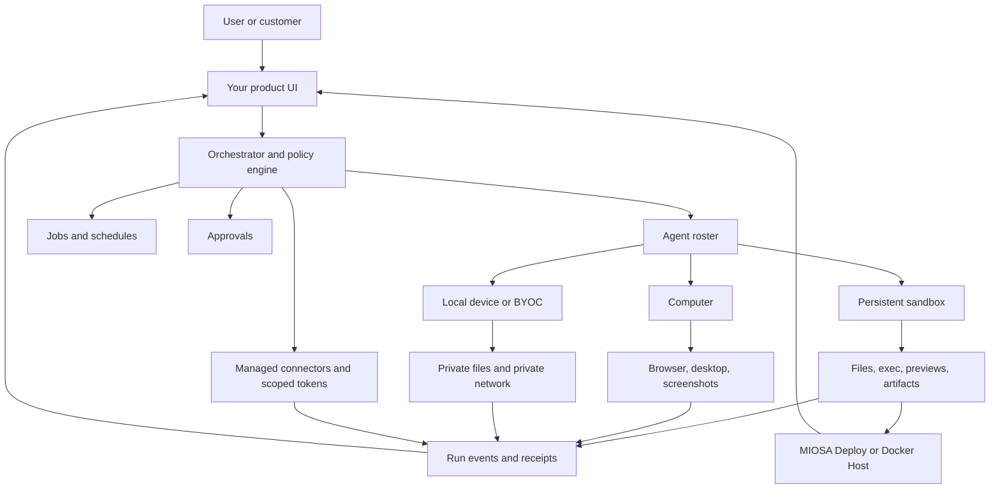
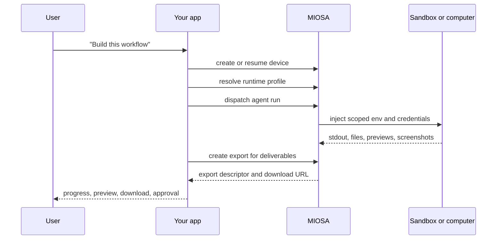

您可以使用 MIOSA 构建自己的产品，与 **Genspark**、**Emergent**、**Blackbox AI**、**Lovable**、**Replit Agent**、**Polsia**、**CoFounder** 或 **Nebula** 属于同一类别。

您的产品拥有品牌、客户体验、提示、模型路由、计费和工作流程。
MIOSA 提供执行层：沙箱、计算机、文件、命令、预览、工件、快照、连接器、事件、数据服务和不可变部署。

> **注意：是的，您可以构建自己的版本**
>
> 本指南将产品类别映射到具体的 MIOSA 资源。
> 它涵盖提示应用程序构建器、自主公司运营商、智能体工作区和持久虚拟设备产品。
> 请参阅 [Agent 产品参考图 ](/docs/guides/agent-company-reference-map) 了解要研究的参考产品，然后在此处构建您自己的实施和品牌。

---

## 参考架构



协调器是您的产品层。它决定运行哪个智能体、什么模型
或利用运行框架为其供电、它可以使用哪些设备、哪些凭证可用，
何时请求批准，以及如何向用户显示进度。

MIOSA 是运行时层。它执行工作并记录输出。

---

## 实施清单

从一个工作区和一名智能体开始，然后扩展到团队或数千人
工人。

|步骤| MIOSA 原始 |在您的产品中构建什么 |
|---|---|---|
| 1. 创建工作区 |工作区或白标签工作区 |客户/公司边界 |
| 2. 配置凭据 |托管机密和连接器 |提供商密钥、OAuth 安装、MCP/工具访问 |
| 3. 创建运行时配置文件 |智能体运行时配置文件 |默认运行框架、工具、非秘密环境、策略 |
| 4. 创建主设备 |持久沙箱或计算机|共享执行工作区 |
| 5. 发货提示|智能体运行|发送到所选设备的一项任务 |
| 6. 直播进度 |事件、标准输出、屏幕截图、预览 |用户可见的活动提要 |
| 7. 导出输出|沙盒文件导出 |可下载的 PDF、HTML、zip、屏幕截图、应用程序文件夹 |
| 8.快照状态|沙盒快照或计算机持久化 |恢复而不丢失文件/依赖项 |
| 9. 发布 | MIOSA 部署或 Docker 主机 |稳定的面向客户的 URL |
| 10. 规模|队列、池、组、配额 |许多逻辑智能体共享受控的运行时容量|

重要的规则是智能体身份、运行时配置文件、设备、凭证、
和工件是单独的记录。这种分离可以让您更换 OSA
对于 Claude Code，将任务从沙箱移动到计算机，或者给一个工作区一个
无需重写产品即可使用不同的提供商密钥。



这是 Polsia 式运算符的最小工作版本，
联合创始人式的部门智能体，或者Nebula式的虚拟设备。

---

## 后端模块形状

将这些模块在您的产品后端中保持独立。太早将它们结合起来是
是什么导致智能体产品难以调试。

```typescript
type AgentRuntime =
  | "osa"
  | "codex"
  | "claude-code"
  | "pi"
  | "hermes"
  | "gemini-cli"
  | "opencode"
  | "custom";

type AgentDevice =
  | { type: "sandbox"; id: string; cwd: "/workspace" | string }
  | { type: "computer"; id: string }
  | { type: "local"; id: string };

type AgentRunRequest = {
  workspaceId: string;
  agentId: string;
  runtime: AgentRuntime;
  device: AgentDevice;
  prompt: string;
  connectors: string[];
  approvalPolicy: "auto" | "confirm-risky" | "manual";
};
```

|模块|接口 |隐藏在其背后的实现|
|---|---|---|
|协调员| `dispatch(runRequest)` |选择运行时、设备、队列、重试策略、批准 |
|运行时适配器| `start(prompt)`、`send(task)`、`stop()` | OSA、Codex、Claude Code、Pi、Hermes 或定制运行框架 |
|设备适配器| `exec`、`writeFile`、`readFile`、`preview`、`snapshot` | MIOSA 沙箱、计算机、本地设备 |
|连接器经纪人| `getToken(connector, subject, scopes)` |提供商身份验证、刷新、出口限制、审核 |
|事件流 | `subscribe(runId)` |工具调用、标准输出、文件写入、屏幕截图、工件、批准 |
|产物商店 | `putArtifact`、`versionArtifact` | PDF、DOCX、图像、zip、屏幕截图、生成的应用程序 |
|部署桥| `publish(version)` | MIOSA 部署、Docker 主机、域、回滚 |

前端不应该在每个运行时都出现特殊情况。它应该呈现相同的效果
事件契约，无论后端是否使用 OSA、Codex、Claude Code、
Pi、Hermes 或客户自有的运行框架。

## 产品映射

### 建立你自己的 Polsia 风格的运营商

当产品承诺是：“描述业务。智能体商保留
建造、研究、销售和改进它。”

使用此 MIOSA 形状：

| 层 | MIOSA 的选择 |
|---|---|
|默认设备 |持久沙箱 |
|浏览器工作|需要真正的浏览器或仪表板登录时的计算机 |
|长时间运行的工作 |恢复持久沙箱的计划作业 |
|可交付成果 |工件、预览、部署 URL、报告 |
|生产应用程序 | MIOSA 部署或 Docker 主机 |
|证书 |托管连接器和作用域运行时令牌 |
|用户界面|任务流、计划、文件、工件、预览、批准 |

任务流程示例：

```text
User: Build a landing page and start outbound research.
Orchestrator:
  1. Resume the company workspace sandbox.
  2. Agent writes Next.js files in /workspace.
  3. Agent starts preview on port 3000.
  4. Computer agent opens the preview and captures screenshots.
  5. Research agent writes lead notes and campaign copy.
  6. User approves publish.
  7. Deploy agent publishes the app and stores the URL.
```

### 打造属于你自己的联合创始人/联合创始人人工智能风格的公司操作系统

当产品承诺是：“用专门的人员来管理公司部门时，请使用此选项
智能体人和人类的批准。”

从这个智能体名册开始：

|部门智能体|设备和工具|
|---|---|
|工程|沙盒文件、执行、预览、部署 |
|设计| Refero 托管连接器、浏览器屏幕截图、工件 |
|营销|网络研究、文件、连接的电子邮件/CRM 工具 |
|销售|浏览器/计算机、CRM 连接器、出站前审批 |
|金融|连接会计或电子表格工具，严格审批 |
|支持|浏览器/计算机、帮助台连接器、内存、批准 |
|运营|作业、日程安排、报告、审核日志 |

人工批准属于协调器层：

- 发布生产应用程序
- 发送外部消息
- 购买域名或花费积分
- 创建高成本的子设备
- 删除数据、快照、部署或客户文件
- 使用管理员级别的凭据

### 构建你自己的Nebula式虚拟设备

当产品承诺是：“智能体和人类共享持久的
包含文件、代码、浏览器、作业和连接的应用程序的工作区。”

使用此 MIOSA 设备模型：

|Nebula式概念| MIOSA 实施 |
|---|---|
|虚拟设备|持久沙箱或计算机|
|本地设备|配对客户拥有的设备 |
|会话之间的文件 |沙箱 `/workspace`、快照、计算机存储 |
|代码执行|沙盒执行和流输出 |
|浏览器 |计算机浏览器自动化和屏幕截图|
|直播服务器|沙箱预览网址 |
|工作机会 |恢复设备的计划协调器任务 |
|成员之间共享 |工作区范围的设备策略和审核日志|
|小程序 |生成的应用程序从沙盒发布到 MIOSA Deploy 或 Docker Host |

关键的设计决策是**主要设备策略**。每个工作区应
了解默认情况下智能体会到达哪些沙箱、计算机或本地设备。

### 构建 Heuresis 风格的编码工作区

当产品承诺是：“将公司的运营知识转变为
任何智能体运行时都可以执行的文件夹。”

使用此工作区文件夹合同：

```text
/workspace
  SYSTEM.md
  company.yaml
  agents/
    founder.md
    engineering.md
    marketing.md
    sales.md
    support.md
  skills/
    write-proposal/
      SKILL.md
      references/
    qualify-lead/
      SKILL.md
    build-landing-page/
      SKILL.md
  runbooks/
  artifacts/
  receipts/
```

|层|目的|
|---|---|
| `SYSTEM.md` |所选智能体运行时读取的启动文件 |
| `company.yaml` |商业事实、优惠、ICP、定价、品牌、限制 |
| `agents/` |每个角色一个文件：范围、权限、标准、升级路径 |
| `skills/` |生成命名资产的可重用功能 |
| `runbooks/` |可重复的操作程序|
| `artifacts/` |用户可以检查和下载生成的文件 |
| `receipts/` |决策、输出、批准和审计跟踪 |

MIOSA 是该工作区实际运行的地方。编码公司位于
持久沙箱。所选的运行时，例如 OSA、Codex、Claude Code、
Gemini CLI、OpenCode、光标、Aider、Windsurf、OpenClaw、Qwen 代码、Kimi 代码、
或自定义运行框架，读取工作区并在 `/workspace` 内执行。

这为客户提供了一个可移植的公司操作系统，而 MIOSA 仍然拥有
安全执行、持久性、事件、配额、连接器和部署
路径。

---

## 实现路径

### 1. 选择运行时形状

不要将一个智能体运行时硬编码到平台中。将运行时设置为打开
智能体或工作区。

| 运行时选项 | 最佳使用 |
|---|---|
| OSA | MIOSA-原生智能体及平台运营|
| Codex | 仓库工作、代码库编辑、终端驱动的工程 |
| Claude Code | 使用工具和 MCP 进行智能体编码 |
| Gemini CLI | 替代编码和研究循环 |
| OpenCode、Cursor、Aider、Windsurf | 用户选择的编码运行框架 |
| OpenClaw | 多智能体编排大脑与编码工具相结合 |
| Qwen Code、Kimi Code | 型号/供应商特定代码智能体 |
|定制|您自己的运行框架、提示格式、队列或模型路由器 |

运行时应该接收相同的工作区合约：范围内的 MIOSA 令牌，
分配的设备、允许的连接器和 `/workspace` 文件。

### 2. 将提示发送到设备中

产品必须能够向指定的运行时发送提示并保留
在那里工作的智能体人。这是核心工作流程。

```text
prompt
  -> route to agent runtime
  -> run inside assigned sandbox/computer/local device
  -> stream events back to product UI
  -> persist files, artifacts, screenshots, previews, and deployment records
```

当智能体应该编码、生成工件或运行时使用沙箱提示
`/workspace` 内的命令：

```bash
miosa prompt --sandbox <sandbox-id> \
  --harness claude-code \
  --json \
  "Build the landing page, run tests, start the preview, and leave the files in /workspace"
```

当任务需要桌面或浏览器时，使用计算机智能体提示：

```bash
miosa prompt --computer <computer-id> \
  --harness claude-code \
  "Open the preview, test signup, capture screenshots, and report visual issues"
```

将后续工作发送到同一正在运行的计算机智能体会话中：

```bash
miosa run steer \
  "Re-check the mobile nav after the sandbox agent patches it" \
  --computer <computer-id>
```

在产品后端，将其建模为一份调度合同：

```typescript
type DevicePromptDispatch = {
  deviceType: "sandbox" | "computer" | "local";
  deviceId: string;
  runtime: "osa" | "codex" | "claude-code" | "gemini-cli" | "opencode" | "custom";
  prompt: string;
  cwd?: string;
  connectors?: string[];
  approvalPolicy?: "auto" | "confirm-risky" | "manual";
};
```

UI 不应该关心提示是否通过 OSA、Codex、Claude Code、
Hermes、OpenCode 或自定义运行框架。它应该显示相同的运行流：
工具调用、命令输出、文件写入、屏幕截图、工件、批准和
最终网址。

> **注：当前调度状态**
>
> 可通过 `miosa prompt`、`--sandbox` 或
> `--computer` 适用于 MIOSA 管理的设备。对于客户拥有的 OpenComputers 主机，
> 通过 `miosa api POST /opencomputers/hosts/<id>/agent/dispatch` 调度。
> 计算机会话 API 仍然适合长时间运行的浏览器或桌面
> 对话。保持产品级运行模型稳定，以便每个目标都能
> 共享一个 UI。

### 3. 创建或恢复工作区运行时

对代码和文件使用持久沙箱。仅在执行任务时使用计算机
需要真实的浏览器、桌面或屏幕截图循环。

```bash
miosa create customer-workspace \
  --template nextjs \
  --ttl 1h \
  --wait \
  --json
```

然后在沙箱内运行工作：

```bash
miosa exec <sandbox-id> -- sh -lc "cd /workspace && npm install"
miosa exec <sandbox-id> -- sh -lc "cd /workspace && npm run build"
```

### 4. 让智能体在设备内部写入

智能体应该编辑 `/workspace` 中的文件，而不是在本地构建所有内容
最后上传完成的存储库。

```text
bad:
  local agent builds repo on laptop
  upload after the fact
  remote sandbox only previews the result

good:
  agent writes files into sandbox
  sandbox installs dependencies
  sandbox runs tests/builds
  sandbox serves preview
  user sees events and artifacts as work happens
```

### 5. 将进度传输到产品 UI 中

向用户显示工作表面：

- 计划已创建
- 设备创建或恢复
- 文件写入
- 命令开始
- 标准输出/标准错误块
- 预览就绪
- 捕获的屏幕截图
- 生成的工件
- 需要批准
- 部署准备就绪

这就是“智能体人失踪”和“智能体人失踪”的区别
在真实的机器上工作。”

### 6. 安全连接连接器和机密

使用托管连接器、作用域令牌和运行时变量。请勿粘贴
提供商密钥进入聊天。

```text
Tenant key
  -> stays server-side
  -> mints scoped runtime token
  -> sandbox receives only the scoped token
  -> managed provider token is brokered only to the allowed provider endpoint
```

这就是平台如何提供托管设计研究连接器，同时
仍然可以防止任意令牌泄露。

### 7. 保存检查点并发布

使用快照和版本化部署：

```text
checkpoint after dependencies install
checkpoint after first working preview
checkpoint before risky refactor
publish after tests and browser QA
rollback through deployment versions
```

对于一个工作区中的许多小型客户应用程序，发布到
[Docker 主机](/docs/docker-host/docker-deploy)。对于正常的生产应用程序，
通过 MIOSA Deploy 发布。

---

## 你的前端应该显示什么

|表面|目的|
|---|---|
|聊天或任务流 |用户请求、智能体状态、工具调用、命令输出 |
|设备面板 |沙盒预览、电脑桌面、日志、截图|
|文件面板 |工作区文件、差异、生成的代码、可编辑工件 |
|文物面板| PDF、DOCX、图像、ZIP、屏幕截图、下载 |
|审批小组|等待人类确认的危险行为|
|职位面板 |预定和后台工作|
|部署面板 |公共 URL、版本、回滚、域 |
|使用面板 |积分、运行时间、沙箱/计算机成本 |

这就是如何让 MIOSA 感觉像一个智能体工作区，而不仅仅是一个 API。

---

## 架构规则1. **不要将沙箱和计算机合并为一个模糊的概念。** 沙箱
   适用于无头代码、文件、预览和工件。计算机是用于 GUI 的
   和浏览器自动化。
2. **将持久性设置为智能体工作的默认设置。** 空闲计算可以停止，但是
   工作区状态应该通过快照或持久存储来保存。
3. **使用范围运行时凭据。** 租户管理密钥保留在服务器端。
4. **将编排器视为您的产品。** MIOSA 执行；你的产品
   决定角色、提示、权限、重试、批准和 UI。
5. **暴露运行事件。** 用户需要查看代码、命令、文件、预览、
   工件、屏幕截图并在发生时进行部署。
6. **将提示发送到指定的设备。** 用户提示应成为
   沙箱/计算机/本地设备运行，而不是独立的仅本地脚本。
7. **将开发与托管分开。** 智能体在沙箱中构建，
   电脑。完成的应用程序在部署或 Docker 主机上运行。
8. **保持运行时可替换。** 工作空间应该可由 OSA 执行，
   Codex、Claude Code、OpenCode、Aider、OpenClaw 或没有的自定义运行时
   重写客户的公司知识。

---

## 另请参阅

- [MIOSA 智能体可以做什么](/docs/guides/agent-capabilities)：内置工具包、应用程序操作、权限、工件和产品表面。
- [智能体设备](/docs/guides/agent-devices)：沙箱、计算机、本地设备、持久性和主设备策略。
- [智能体编排](/docs/guides/agent-orchestration)：协调一个智能体、多个智能体、队列、子智能体和设备池。
- [托管连接器](/docs/guides/managed-connectors)：提供托管提供商工具而不暴露提供商机密。
