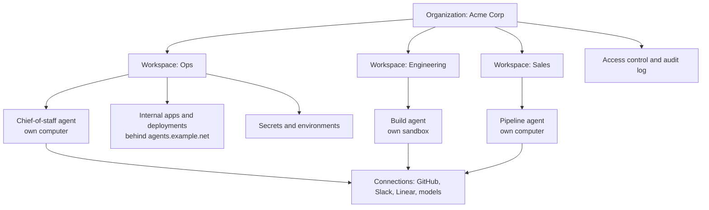

有些公司建立智能体产品来销售。其他人为自己搭建一个平台，并在其上运营公司。本指南是第二本。

你没有启动这个。它不是一个产品。它是团队的智能体、应用程序、数据和工作流程共同存在的内部表面，并且每个团队成员和每个智能体都拥有自己的机器。

如果您正在构建一个向客户销售的平台，请阅读[平台构建者指南](/docs/platform/overview)。

## 这是给谁的

- **一家拥有团队的公司。** 运营、工程、销售、支持、财务。每个团队都有一个工作空间。每个队友和每个特工都有一台机器。
- **运行客户工作的智能体机构。** 每个客户都成为一个工作空间，因此一个平台可以容纳每个客户的智能体、应用程序和支出，而不会混合它们。

两种情况的形状相同：一个组织，多个工作空间，每个工人一台机器。

## 它是什么

一个内部平台，其中：

- 每个 **智能体** 都有自己的 MIOSA 计算机或沙箱，具有自己的文件系统、网络和进程树。
- 每个**团队成员**都可以从一个仪表板访问这些智能体、他们的应用程序和共享数据。
- 公司的**工具**（GitHub、Slack、Linear、您的模型提供商）可通过 Connections (OAuth) 和 MIOSA 管理的连接器访问，而不是复制粘贴的 API 密钥。
- **秘密和环境**是集中管理的，因此新机器从它应该拥有的东西开始。
- 内部应用程序和**部署**在公司域后面运行。
- **访问、支出和审计跟踪**在一个地方进行管理。

## 架构



### 组织和工作空间

组织就是公司。它支付一切费用并拥有余额。工作空间按团队、每个客户端或每个功能对计算机、部署和数据进行分组。

```bash
miosa workspace create Ops
miosa workspace create Engineering
miosa workspace list
miosa workspace inventory ops
```

每个资源都可以在工作空间内创建，因此 `miosa create ops-box --workspace ops` 永远不会混合团队。只需一条命令即可完成工作区范围内的使用情况和库存：

```bash
miosa workspace stats ops
miosa workspace usage ops
```

### 每个智能体一台机器

智能体需要在某个地方写入文件、安装包、运行命令和预览应用程序。那是一个沙箱。需要可见桌面、浏览器或 GUI 应用程序的智能体需要一台计算机。

```bash
# A code agent's workspace
miosa create ops-agent --template miosa-sandbox --workspace ops --env prod --wait

# A persistent desktop for a browsing agent
miosa computer create chief-of-staff-desktop --env prod
```

每个都有自己的文件系统、网络和进程树。使用[智能体设备选择](/docs/guides/agent-device-selection)来决定给定角色需要哪一个。

### 连接公司的工具

连接是智能体和机器用来联系外部世界的方式：模型提供者、应用程序和工具服务器。 MIOSA 自己的模型密钥永远不会为您的智能体提供动力，因此每次运行都使用您的连接。

```bash
# Model provider with an API key (read from stdin, never from an argument)
miosa connections add models anthropic --key-stdin <<< "$ANTHROPIC_API_KEY"

# Or sign in with a subscription inside a named machine
miosa connections add models claude --sandbox ops-agent

# Company apps over OAuth
miosa connections add apps github
miosa connections add apps slack
miosa connections add apps linear

# A remote MCP tool server
miosa connections add tools --name docs --url https://mcp.internal.example.net/sse

miosa connections list --kind apps
```

对于 MIOSA 已经智能体的工具，请使用 [托管连接器](/docs/guides/managed-connectors)，这样队友就不必交出供应商令牌。

### 秘密和环境

环境是新机器继承的模板：克隆哪些存储库、注入哪些变量和秘密文件以及机器可以使用哪些连接。每次保存都会创建一个新的不可变版本，并且机器会保留它开始时的版本，直到您升级它。

```bash
miosa env new prod
miosa env set --env prod --from-file .env
miosa env file put --env prod backend/.env ./backend.env
miosa env repo add --env prod acme/internal-tools --branch main
miosa env default prod
```

值永远不会作为参数传递。以交互方式设置它们，通过标准输入通过管道传输它们，或加载 `.env` 文件。

### 访问控制、SSO 和审核日志

每个组织的成员资格有四种角色：所有者、管理员、成员和查看者。只有所有者和管理员才能更改成员身份。

```bash
miosa member add dana@example.net --role admin
miosa member role user_123 --role viewer
miosa workspace members ops
```

- **RBAC.** 为每个团队提供所需的角色，并将 API 密钥范围限定为工作区和预设，以便 CI 作业只能触及其应有的内容：`miosa api-key create ci-deploy --preset ci --workspace-id <workspace-id>`。
- **服务帐户。** 为每个内部集成提供自己的身份，而不是共享密钥：`miosa service-account new ci-bot`，然后是 `miosa service-account key new ci-bot`。
- **SSO/SAML。** 组织单点登录 (SAML) 可用，包括对成员强制执行 SSO。成员资格是按具有角色的组织划分的，成员使用 MIOSA 帐户或范围密钥登录。
- **审核日志。** 记录每个 API 操作，最新的在前：`miosa audit`、`miosa audit --workspace-id <workspace-id>` 或 `miosa audit --type sandbox.created`。

### 公司域背后的内部部署

智能体构建的应用程序可以从沙箱端口预览，然后持久部署在公司域后面。

```bash
miosa process start ops-agent -- python -m http.server 8080
miosa preview create ops-agent 8080 --name ops-dashboard
miosa preview share ops-agent <preview-id> --ttl 1h

miosa deploy list
miosa deploy domain-add ops-dashboard agents.example.net
miosa deploy rollback ops-dashboard --to <version-id>
```

预览是队友查看正在进行的工作的方式。他们将部署添加为书签。

## 起点

您可以从今天开始使用两个开源存储库。

- [BusinessOS](https://github.com/Miosa-osa/BusinessOS)：开源商业操作系统：一个应用程序中的项目、CRM、文档、日历、终端和 AI 智能体。阿帕奇-2.0。这是获取您的团队实际使用的平台 shell 的最快方法。
- [OSA](https://github.com/Miosa-osa/OSA)：在这些机器内运行的开源智能体。将其指向 MIOSA 计算机或沙箱，它就会写入文件、运行命令并构建应用程序。

您不必使用 OSA。任何可以在机器内部运行的工具都可以工作：**Claude Code**、**Codex** 或自定义运行时。 MIOSA 的 `miosa agent` 命令将运行框架、指令、模型及其运行的机器包装到一个版本化定义中。

## 分步演练

这是 Acme Corp 正在构建其内部平台。运营团队有一名参谋长智能体，一切都在 `agents.example.net` 后面。

### 第 1 步：创建组织表面

```bash
miosa workspace create Ops
miosa workspace create Engineering
miosa env new prod
miosa env default prod
```

为平台后端创建一个服务器 API 密钥，并为每个集成创建一个范围密钥：

```bash
miosa api-key create acme-platform --preset cli
miosa api-key create ci-deploy --preset ci --workspace-id <ops-workspace-id>
```

### 第 2 步：为运营团队提供一台机器

```bash
miosa create ops-agent --template miosa-sandbox --workspace ops --env prod --wait --ttl 8h
miosa computer create ops-desktop --env prod
miosa computer urls ops-desktop
```

### 第 3 步：连接团队已使用的工具

```bash
miosa connections add models claude --sandbox ops-agent
miosa connections add apps github
miosa connections add apps slack
miosa connections add apps linear
miosa connections add tools --name docs --url https://mcp.internal.example.net/sse
```

### 步骤 4：定义参谋长智能体

智能体是一个保存的、版本化的定义：运行框架、模型、指令、它运行的机器以及它可以做什么。

```bash
miosa agent new chief-of-staff \
  --harness claude-code \
  --model sonnet \
  --instructions-file agents/chief-of-staff.md \
  --workspace-id <ops-workspace-id>

miosa agent run chief-of-staff "Draft this week's ops summary from Slack and Linear" --sandbox ops-agent
```

每次运行都会使用您的模型连接之一。每当指令发生变化时，就发布一个新的不可变版本，因此运行始终可以证明它使用的是哪个版本：

```bash
miosa agent publish chief-of-staff --instructions-file agents/chief-of-staff.md
```

### 第 5 步：发布内部应用程序

智能体在其机器内编写一个应用程序，您预览它，然后将其部署在公司域后面。

```bash
miosa preview create ops-agent 8080 --name ops-dashboard
miosa preview share ops-agent <preview-id> --ttl 1h
miosa deploy domain-add ops-dashboard agents.example.net
```

### 第 6 步：添加其他团队

工程人员获得构建沙箱，销售人员获得管道计算机。相同的模式，不同的工作空间：

```bash
miosa create build-agent --template nextjs --workspace engineering --env prod --wait
miosa computer create pipeline-desktop --env prod
miosa agent new builder --harness claude-code --workspace-id <engineering-workspace-id>
miosa agent run builder "Set up the release checklist repo" --sandbox build-agent
```

### 步骤 7：将相同的命令连接到 SDK 或 API

CLI 是基于 API 的瘦客户端。您的内部门户所做的任何事情都可以通过 SDK 进行。

**打字稿**

```typescript
import { Miosa } from "@miosa/sdk"

const miosa = new Miosa({ apiKey: process.env.MIOSA_API_KEY! })

// One workspace per team
await miosa.workspaces.create({ name: "Ops", slug: "ops" })

// A machine for the agent, inside that workspace
const sandbox = await miosa.sandboxes.create({
  templateId: "miosa-sandbox",
  workspaceSlug: "ops",
})

// Dispatch a run onto that machine
const run = await miosa.agentRuns.run({
  prompt: "Draft this week's ops summary",
  targetKind: "sandbox",
  targetId: sandbox.id,
})

console.log(run.id)
```

**Python**

```python
import miosa, os

client = miosa.Miosa(api_key=os.environ["MIOSA_API_KEY"])

client.workspaces.create(name="Ops", slug="ops")

sandbox = client.sandboxes.create(
    template_id="miosa-sandbox",
    workspace_slug="ops",
)

run = client.agent_runs.run(
    prompt="Draft this week's ops summary",
    target_kind="sandbox",
    target_id=sandbox.id,
)

print(run["id"])
```

## 示例场景

### Acme Corp：配备首席智能体的运营团队

Acme 运营着一个组织。 `ops` 工作区拥有一台持久计算机和一个参谋长智能体。智能体通过 Connections 读取 Slack 和 Linear，起草每周摘要，并将其放入共享文档应用程序中。当队友需要新的内部工具时，同一个智能体会在其沙箱中构建它并将其部署到 `agents.example.net`。财务在期末检查 `miosa workspace usage ops`。

### Northwind Agency：每个客户的工作区

Northwind 是一家负责客户工作的机构。每个客户都是一个工作区：`northwind-agency` 为智能体机构本身，加上每个客户一个。每个客户的智能体和应用程序都位于自己的工作空间内，因此客户之间没有任何交叉，并且智能体机构的仪表板报告每个客户的使用情况。品牌预览和部署域来自该机构自己的域 `northwind.studio`。

## 安全和治理清单

**身份和访问**

- 一个组织，每个成员的角色（`owner`、`admin`、`member`、`viewer`）。
- 每个团队或客户的工作空间，以及每个团队或客户的正确角色。
- 每个集成一个范围内的 API 密钥，绑定到工作区和预设。
- 每个自动集成的服务帐户，而不是共享的个人密钥。
- 提供组织 SSO (SAML)，包括强制 SSO；在配置 MIOSA 帐户之前，请像对待任何其他企业身份一样对待它。

**秘密**

- 在环境中保存秘密，版本化且不可变，而不是在存储库中。
- 将秘密文件放入环境中，以便机器在启动时接收它们。
- 按计划轮换钥匙；定期轮换平台密钥。

**运行时**

- 每个智能体一台机器，从不跨团队共享。
- 设置 TTL 和空闲超时，以便空闲机器暂停而不是计费。
- 使用[网络策略](/docs/security/network)限制出站流量并检查[出口审核](/docs/security/audit-log)。

**治理**

- 定期查看 `miosa audit`，并按工作空间或事件类型进行过滤。
- 使用 `miosa org caps` 限制每个成员的支出和并发。
- 将 `workspace_id` 和 `project_id` 存储在您自己的 ID 旁边，以便协调使用、审核和计费。

## 后续步骤

- [设备选择](/docs/guides/agent-device-selection)：每个角色需要哪个运行时：沙箱、计算机或本地设备。
- [配置智能体](/docs/guides/configure-agent)：运行框架、模型、说明、连接以及智能体可以执行的操作。
- [连接和托管连接器](/docs/guides/managed-connectors)：无需客户端提供的供应商令牌即可智能体提供程序访问。
- [环境](/docs/cli/environments)：新机器继承的存储库、变量和秘密文件。
- [审核日志](/docs/security/audit-log)：每个用户和每个工作区的每个出站呼叫和 API 操作。
- [所有权和归属](/docs/platform/attribution)：工作空间、项目和您自己的外部 ID。

## 参考

- [BusinessOS](https://github.com/Miosa-osa/BusinessOS) (Apache-2.0)
- [OSA](https://github.com/Miosa-osa/OSA)
- [工作区 API](/docs/api-reference/workspaces)
- [智能体 CLI](/docs/cli/agents)
- [连接和秘密](/docs/security/secrets)
