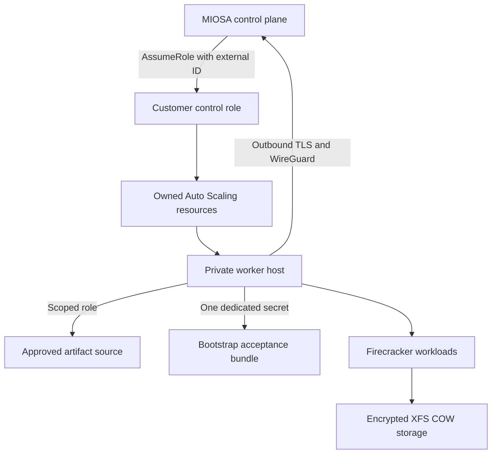

AWS 路径使用客户审查的 Terraform 或 CloudFormation 来创建私有的、有范围的工作人员基础。

`Activation gated`
`Terraform and CloudFormation validated`

## 包装粉底

当前的 AWS 包定义：

- 客户特定的外部 ID 信任边界。
- 最低权限的工作实例配置文件。
- 至少跨两个可用区的私有子网。
- 仅出口安全组，没有入站规则。
- 不可变的启动模板版本。
- 加密根和 XFS 写时复制卷。
- 故障关闭的 Auto Scaling 生命周期挂钩。
- 每次主机尝试都有一个专用的、版本化的引导程序秘密。
- 不可变的运行时清单具有精确的 SHA-256 验证。

## 安全架构

撤销跨账户角色是客户控制平面的终止开关。

辅助角色无法管理 EC2、Auto Scaling、IAM 或不相关的存储。

主机不接收公共 IP，也不接受入站安全组流量。

## 准备状态是失败关闭的

Terraform 和 CloudFormation 完成不会使工作线程变得可调度。

打包机队从零运力开始。

启用激活后，每个启动的主机必须保留在 Auto Scaling 生命周期挂钩后面，直到 MIOSA 验证：

1. 预期的不可变图像和运行时生成。
2. 加密根和写时复制设备映射。
3. 嵌套虚拟化和`/dev/kvm`。
4. 快照恢复支持。
5. 出站控制平面和 WireGuard 可达性。
6. 新的经过身份验证的主机会话。
7.一位真客开机冒烟。
8.调度程序能力广告。

超时放弃启动而不是承认不明确的主机。

## 当前到期日

Terraform、CloudFormation、引导程序、运行时工件和控制平面合约在存储库 CI 中实现和验证。

一般生产激活仍然受到限制，因为容量包有意创建零活动主机，并且实时提供商突变需要经过认证的 AWS/KVM 金丝雀。

> **注意：不要将 AWS BYOC 描述为普遍可用**
>
> 当前的公共合同是架构和受控的入职准备。
> 生产布局必须保持禁用状态，直到验收门得到认证并为组织启用。

## 客户将控制什么

- AWS 账户和所选区域。
- VPC、私有子网、路由和端点。
- 客户 IAM 审核和撤销。
- KMS 和云存储选择。
- 提供商配额和提供商计费。
- Terraform 状态或 CloudFormation 堆栈。
- 最终安置启用。

- [自带云架构](/docs/infrastructure/byoc/overview)：返回完整的控制平面和客户云模型。

## 客户主机上的沙箱运行时边界

MIOSA 管理的沙箱在 MIOSA 运营的容量上运行。
AWS BYOC 将符合条件的沙箱放置在客户 AWS 环境中接受的主机上，同时保留公共沙箱 API 和资源合同。

> **注意：私人预览**
>
> AWS BYOC 沙箱容量是封闭的私有预览。
> 目录条目和 API 访问并不能证明客户主机已通过验收或已启用放置。

每个客户主机都运行独立的 `miosa_host` 运行时。
客户主机不运行控制平面计算服务。
该服务保留在 MIOSA 控制平面内，执行准入、策略评估、目录解析、调度、生命周期协调和使用情况统计。

主机发起到 MIOSA 控制平面的出站会话。
控制平面可以撤销该会话并隔离主机，以便断开连接、被替换或过时的​​主机进程无法继续接收放置。
客户主机上不需要入站控制平面侦听器。

公共沙箱 API 不会公开客户主机 ID、提供商实例字段、放置记录、网络地址、凭据或会话防护详细信息。

### 认证工件

BYOC 沙箱仅从针对所选公共模板进行认证的不可变工件生成启动。
`GET /api/v1/templates` 中的模板和大小标识客户可见的配置，而不是可变的主机路径或提供程序映像。主机必须具有所需的经过认证的生成，并通过工件完整性和运行时兼容性检查，然后才能接受放置。
当该生成丢失时，MIOSA 不会默默地替换未经认证的本地映像。

### 安置前主持人接受

注册主机并不使其可调度。
MIOSA 必须先接受主机，然后才能在其上放置任何沙箱。

验收验证预览环境所需的条件，包括：

- 兼容的`miosa_host`和控制平面协议版本。
- 所需的硬件虚拟化和主机容量。
- 存储和网络先决条件。
- 经认证的工件生成的可用性和完整性。
- 与当代击剑一代进行健康的出境训练。
- 沙箱执行所需的运行时准备情况检查。

当这些条件之一不再成立时，可以撤回接受。
撤回或受隔离的主机在再次通过接受之前不会收到新的安置。

### 配置与请求参数

环境配置决定租户可以使用哪些接受的主机、模板、资源合同、策略和限制。
该配置是在普通沙箱创建请求之外建立的。

每个沙箱请求仅选择公共工作负载行为：`template_id`、`size`、`timeout_sec`、`idle_timeout_sec`、`always_on` 和 `persistent`。

使用 `GET /api/v1/templates` 作为目录源。
仅选择为所选模板列出的尺寸，如 `fast_ready` 或 `cold_boot_only`，并在不需要其他支持的尺寸时使用该模板的 `default_size`。
`cold_boot_only` 有效，但速度较慢； `missing` 不可用。
当所选模板将其通告为就绪时，默认的 `small` 资源合同为 2 个 vCPU、4096 MiB RAM 和 10240 MiB 磁盘。

### 责任边界

| 领域 | 客户责任 | MIOSA 责任 |
|---|---|---|
| AWS 环境 | 账户所有权、主机容量、网络出口、客户 IAM，以及由客户控制的基础设施策略 | 记录所需的连通性要求，并拒绝不满足验收条件的环境 |
| 主机运维 | 保持已验证主机及其运行环境可用，并处于约定的配置范围内 | 提供并协调 `miosa_host`、会话隔离（session fencing）、运行时兼容性检查和验收状态 |
| 制品 | 维护已验证主机所需的存储和访问前提条件 | 发布不可变的已认证代次，并在所需代次缺失或无效时阻止放置 |
| 沙箱控制 | 选择公共模板、大小、生命周期和持久化参数 | 解析带版本的资源契约、执行策略、仅调度到已验证主机上，并协调生命周期操作 |
| 隔离与访问 | 控制客户 AWS 边界以及对客户基础设施的访问 | 强制实施沙箱隔离，避免通过公共 API 暴露内部主机或提供商细节 |
| 使用记录 | 需要时与客户基础设施记录核对用量 | 报告公共用量测量值，并保留不可用或过时测量值的语义 |

### 可用性和限制

BYOC 并不意味着有保证的沙箱数量、启动率或地理范围。
实际可用性受到可接受的客户容量、经过认证的工件准备情况、租户策略和当前目录状态的限制。
MIOSA 仅在针对适用环境进行验证后才会发布测量限制。

托管和接受的 BYOC 沙箱使用相同的客户可见生命周期操作，包括扩展、暂停、恢复、分叉、使用和销毁。
有关请求示例，请参阅[沙箱](/docs/develop/sandboxes)；有关生命周期行为，请参阅[快照和持久性](/docs/develop/snapshots)。
