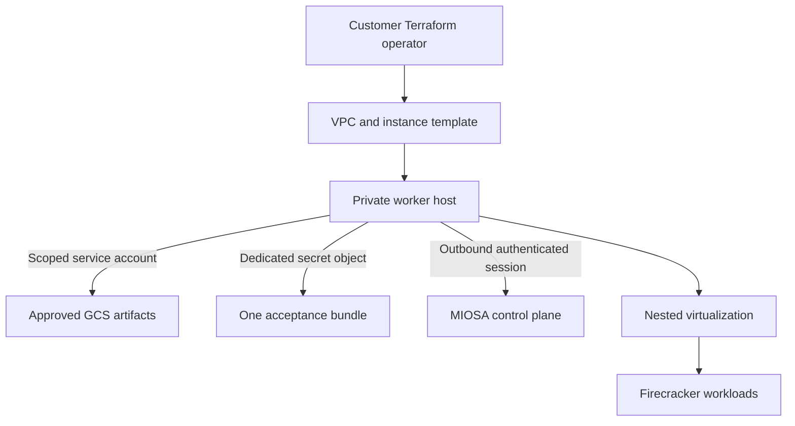

Google Cloud 路径使用客户拥有的 Terraform 来创建私有工作基础和可重用实例模板。

`Activation gated`
`Terraform foundation validated`

## 包装粉底

当前的 GCP 包定义：

- 有范围的工作人员服务帐户。
- IAM 绑定已批准的工件、遥测和一个引导密钥。
- VPC、子网和防火墙规则。
- 可重复使用的 Compute Engine 实例模板。
- 可选的 GCS 工件访问。
- 不可变的清单和校验和输入。
- 每次配置尝试都有一个专用的 Secret Manager 对象。
- 将每个资源绑定到其 MIOSA 区域和租户的标签。

该模块本身不会创建运行实例。

## 安全架构

客户的 Terraform 主体创建声明的基础设施。

运行时工作线程没有获得广泛的 Compute Engine 管理权限。

每个工作人员必须在同一项目中使用专用的引导秘密对象。

## GCP 特定接受

实例模板必须启用嵌套虚拟化。

MIOSA 必须在工作线程内部证明 `/dev/kvm` 才能被调度。

GCP 性能和密度必须独立测量，而不是复制 AWS 假设。

提供程序运行状态只是云观察。

这并不能证明 MIOSA 运行时、存储、来宾启动和出站会话已准备就绪。

## 当前到期日

GCP Terraform、引导程序和主机接受合约在存储库 CI 中实施和验证。

该模块创建可重用的实例模板，而不是活动的工作队列。

GCP 仍然是一条同等路径，直到它完成 AWS 所需的相同的真实嵌套虚拟化和验收证明。

> **注意：请勿将 GCP BYOC 描述为普遍可用**
>
> 当前的公共合同是架构和受控的入职准备。
> 生产布局必须保持禁用状态，直到真正的提供商金丝雀通过并且明确启用组织为止。

## 客户将控制什么

- GCP 项目、地区和专区。
- VPC、子网、路由和出口。
- Terraform 执行身份和状态。
- 工人服务帐户审查。
- 云 KMS、GCS 和 Secret Manager 策略。
- 提供商配额和提供商计费。
- 最终安置启用。

- [自带云架构](/docs/infrastructure/byoc/overview)：返回完整的控制平面和客户云模型。
