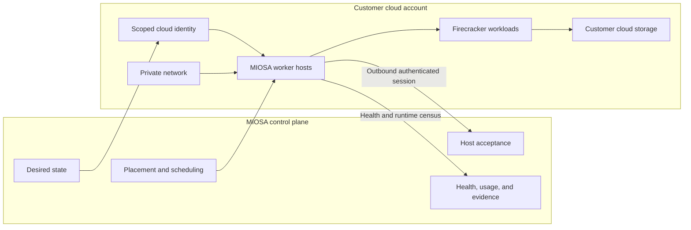
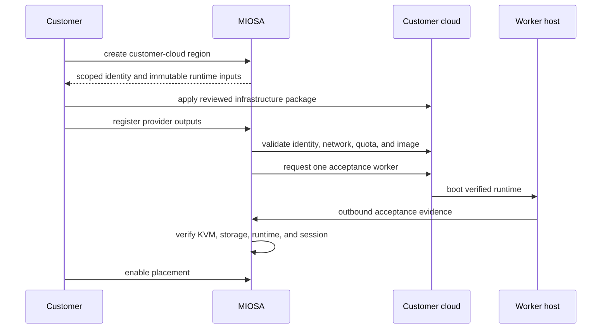

自带云让组织可以利用自己的 AWS 账户或 GCP 项目内的基础设施为其产品提供支持。

MIOSA 仍然是编排和产品控制平面。

对于您自己的办公室、实验室或数据中心中的服务器，请使用[通过 OpenComputers](/docs/opencomputers) 的本地服务器。
通过 OpenComputers 连接现有服务器或云 VM 不会配置受管理的 BYOC 工作区域。
在这里，**BYOC** 始终意味着 **自带云**。

`Activation gated`
`Infrastructure packages built`

## 选择基础架构模型

- **MIOSA 管理**：MIOSA 负责计算、网络、主机生命周期、容量和放置。
- [OpenComputers](/docs/opencomputers)：通过出站智能体会话连接单个工作站或拥有的服务器。
- **自带云**：在客户 AWS 账户或 Google Cloud 项目内安装受管理的 MIOSA 工作区域。
- **混合放置**：将受管理的工作负载保留在客户基础设施中，并仅在策略允许的情况下使用其他容量。

OpenComputers 和 Bring Your Own Cloud 是不同的产品。

OpenComputers 连接各个机器。

自带云创建了一个受管理的云容量区域，该区域仍然由 MIOSA 控制平面进行编排。

## 控制平面和客户云

客户控制云帐户、网络、身份策略、提供商资源和提供商账单。

MIOSA 控制所需的容量、工作负载放置、不可变的运行时生成、接受、调度、消耗和协调。

## 什么在哪里运行

|层| MIOSA 控制平面 |客户云|
|---|---|---|
|组织和工作空间政策 |是的 |没有 |
|所需容量和位置 |是的 |由工人能力反映|
|提供商 IAM 和网络 |验证和精心策划|创建并拥有 |
|工人主机|观察和安排|已执行并计费|
|爆竹工作负载 |请求并跟踪 |执行|
|主机运行时工件 |已识别并验证 |下载并安装 |
|客户数据存储|受应用程序约束 |客户精选|
|验收证据|已记录|主持人出品|

## 提供商支持

- **Amazon Web Services**：Terraform 和 CloudFormation 包定义私有多可用区工作基础、范围 IAM、不可变模板和故障关闭接受。

  [AWS架构→](/docs/infrastructure/byoc/aws)
- **Google Cloud**：Terraform 定义服务帐户、网络、防火墙、实例模板、工件访问和接受移交。

  [Google Cloud 架构 →](/docs/infrastructure/byoc/gcp)

## 客户加入路径

基础设施建设并不能让一个地区生机勃勃。

仅在提供商预检、一位真实主机接受、记录证据和明确启用后才开始放置。

> **注意：为什么激活是门控的**
>
> 包故意失败关闭，直到每个实例的接受序列通过真正的提供商金丝雀认证。
> 云提供商状态（例如 EC2 正在运行）永远不足以声明 MIOSA 主机已准备就绪。

## BYOC 与 OpenComputers 的比较

| |自带云 |OpenComputers |
|---|---|---|
|单位|受控云区域或主机池 |个人拥有的机器|
|供应| Terraform 或 CloudFormation |智能体安装|
|网络|客户 VPC 或子网 |现有主机网络|
|身份|云 IAM 和实例身份 | MIOSA主机注册|
|产能 |供应商车队 |互联机器 |
|最适合 |企业云边界|本地和拥有的硬件|

- [审查责任边界](/docs/infrastructure/shared-responsibility)：了解身份、网络、数据、运行时、升级和事件所有权。

## 提供商基金会

|供应商|当前套餐 |当前边界|
|---|---|---|
|亚马逊AWS | Terraform 和 CloudFormation |专用网络、范围身份、不可变主机模板、工件输入和故障关闭接受 |
|谷歌云|地形 |独立的无钥匙执行器和工作人员身份、网络、防火墙、不可变的主机映像、工件访问和验收移交 |> **注意：激活门控**
>
> AWS 和 Google Cloud 软件包已存在，但一般生产激活仍然取决于真实的提供商金丝雀和每个主机的验收证据。
> 云提供商状态本身并不能使 MIOSA 主机成为可调度的。

## 激活顺序

1. 在 MIOSA 中创建客户云区域。
2. 将审核后的提供商包应用到客户帐户或项目中。
3. 使用 MIOSA 注册提供程序输出。
4. 运行身份、网络、配额、映像和工件预检。
5、开机验收工1名。
6. 验证 KVM、存储、运行时生成、经过身份验证的会话和工作负载执行。
7. 记录证据。
8. 为将使用池的每种工作负载类型记录单独的沙箱、计算机和部署验证收据。
9. 显式启用放置。

基础设施建设并不能让一个地区生机勃勃。

仅在完全验收合同通过后才开始安置。

## 共同责任

|责任|客户|MIOSA |云提供商 |
|---|---|---|---|
|帐户或项目所有权 |拥有 |验证访问 |主机帐户服务 |
| IAM 和网络政策 |批准并拥有 |请求范围能力 |强制执行|
|工人运行时 |供应能力|版本、验证和协调 |运行基础设施 |
|工作负载安置|制定政策|时间表和记录|提供计算|
|提供商计费 |支付 |单独报告 MIOSA 使用情况 |票据资源|
|主机健康 |收到事件 |验证运行时普查和验收 |报告基础设施状态 |

## 产品合同

您的产品不应该需要为每个提供商提供不同的工作流程。

MIOSA 解决目标、检查政策和能力、调度工作并报告状态和证据形式。

将 OpenComputers 用于个人拥有的计算机。

将客户云区域用于 AWS 或 Google Cloud 容量的受管池。

当客户不需要云帐户边界时，使用 MIOSA 管理的计算。
