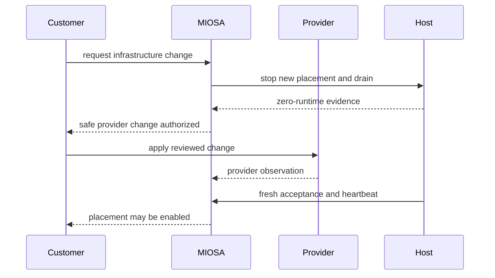

基础设施所有权改变了每一层的运营者。

产品应该在放置工作负载之前使这些边界可见。

OpenComputers 包括本地服务器以及工作站和其他现有的客户控制的机器。
客户操作连接的机器及其本地环境； MIOSA 运营连接的控制平面服务。

## 责任矩阵

|责任| MIOSA 管理 | OpenComputers，包括本地 |自带云 |
|---|---|---|---|
|控制平面服务 |MIOSA |MIOSA |MIOSA |
| Physical hardware or cloud account |MIOSA |客户|客户|
| Site power, cooling, and physical access | MIOSA 或其提供商 | Customer or its hosting provider |云提供商 |
|主机操作系统|MIOSA |客户|通过认证图像和客户帐户共享 |
|主机容量|MIOSA |客户|客户供应商资源，MIOSA理想状态|
|网络周边|MIOSA |客户主机网络| Customer VPC or subnetwork |
|运行时生成|MIOSA | Customer-approved agent update | MIOSA 签名生成、客户审核安装 |
|工作负载安置| MIOSA 政策 |连接主机内的 MIOSA 策略 | MIOSA policy within enabled customer pools |
|提供商计费 |MIOSA | Customer hardware and network |客户云账单|
|应用数据和备份策略|应用程序所有者 |应用程序所有者，包括本地磁盘和服务 |应用程序所有者 |
|消耗和工作负载证明 |MIOSA | MIOSA plus 主机可用性 | MIOSA plus provider observation |

## MIOSA 职责

- 维持所需的状态和放置策略。
- 发出范围内的、重试安全的操作。
- 验证不可变的运行时生成。
- 记录主人接受证据。
- Require fresh host sessions before placement.
- 协调提供者和运行时偏差。
- 在授权拆卸之前耗尽工作负载。
- 报告运行状况、容量、使用情况和下一步操作。

## 客户责任

- 选择基础设施所有权模式。
- 对于本地主机，维护物理安全、电源、冷却、硬件、操作系统更新、磁盘和网络可用性。
- 设置连接智能体的权限并监控其服务和出站连接。
- 检查哪些命令输出、工件、桌面流和模型请求可能会离开您的场所。
- 查看云 IAM、网络和基础设施包。
- 维护云配额、计费和组织策略。
- 保护 Terraform 状态和配置身份。
- 选择数据存储、保留、备份和恢复策略。
- 批准放置到客户云区域。
- 当信任关系应该结束时撤销访问权限。
- 协调破坏性云变化与 MIOSA 耗尽状态。

## 云提供商的责任

- 运营底层云服务。
- 强制执行已配置的提供商身份和网络策略。
- Report provider state and billing.
- 提供客户请求的计算、存储和网络原语。

## On-premises maintenance

在重新启动或断开本地服务器连接之前，请停止新工作并检查仍在其上运行的作业和本地服务。
在重试之前确认中断操作的结果。
维护后，在该主机上使用一个小命令验证连接性和所需的功能。
脱机状态并不能证明本地进程已停止或工作已转移到另一台计算机。

有关执行和数据边界，请参阅 [OpenComputers](/docs/opencomputers)。

## 受管理的工作池更改顺序

不要因为主机的生存时间已过期或其提供者记录看起来已过时而终止主机。

终止需要确切的所有权以及新的消耗、零运行时间和会话撤销证据。

> **注意：健康的提供商尚未准备好 MIOSA**
>
> 正在运行的虚拟机是不够的。
> 运行时、存储、经过身份验证的会话、来宾引导、功能广告和放置范围也必须一致。

- [客户基础设施概述](/docs/infrastructure/overview)：比较 MIOSA 管理的计算、本地服务器、OpenComputers 和客户云区域。
