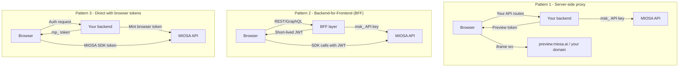

MIOSA 为您提供完整的计算和预览基础架构。您拥有产品、品牌和用户关系。您的客户永远不会看到“MIOSA”。

本节涵盖了在 MIOSA 之上交付白标 SaaS 所需的一切：每用户配置、自定义域、安全 iframe 嵌入、Webhooks、使用计量和滥用控制。

---

## 核心构建块

- [后端编排](/docs/integrations/backend-orchestration)：构建服务器端控制平面以进行提示调度、设备分配、事件流、工件存储和配额执行。
- [Fractal 企业数据](/docs/data/fractal)：为大规模结构化数据和计算运行专用的 Fractal 实例，为企业和政府提供安全和隔离。
- [白标签 SaaS 演练](/docs/platform/white-label)：配置客户拥有的沙箱、嵌入预览、使用品牌域以及向用户滚动使用。
- [预览令牌](/docs/develop/previews)：将 API 密钥保留在服务器端，同时安全地嵌入沙箱预览和面向客户的运行时界面。
- [示例应用程序](/docs/integrations/examples)：克隆参考产品模式并使其适应您自己的后端和前端。

---

## 白标租户可以获得什么

|能力|这对您的产品意味着什么 |
|---|---|
| **每个用户的隔离沙箱** |每个客户项目都在自己的 microVM 中运行，具有自己的文件系统、网络和进程树。 |
| **自定义预览域** |沙盒预览从 `*.example.com` 而不是 `*.sandbox.miosa.ai` 提供。 |
| **短暂的预览令牌** |创建服务器端令牌，将其传递给浏览器 - 切勿在客户端暴露您的 API 密钥。 |
| **Webhook 生命周期事件** |在您自己的 HTTPS 端点接收 `sandbox.running`、`sandbox.destroyed` 等。 |
| **用户使用情况汇总** |查询与您自己的 `external_user_id` 相关的计算使用情况，以进行按席位计费。 |
| **每用户配额** |设置每个用户的最大沙箱、最大 CPU 或最大运行时间，以防止支出失控。 |
| **品牌失败页面** |预览中的 502 和 404 错误显示您的徽标，而不是 MIOSA 的徽标。 |
| **完整的文件系统和终端访问** |使用 SDK 在 UI 中公开文件树、终端或运行按钮 - 无需进入 MIOSA 的 shell。 |

---

## 架构模式

三种部署模式涵盖了绝大多数集成。所有这三个都将您的 `msk_*` API 密钥保存在服务器端。

### 模式 1 - 服务器端智能体（推荐大多数团队使用）

您的后端拥有所有 MIOSA 调用。浏览器仅从您的 API 接收短暂的预览 URL。这是最简单的模式，也是 `whitelabel-saas` 示例中使用的模式。

**何时使用：** 您已经有一个后端。您希望对每个用户可以执行的操作进行最严格的控制。浏览器中不需要 SDK。

### 模式 2 - 后端换前端 (BFF)

薄 BFF 层对用户进行身份验证，解析其 MIOSA 工作区/项目 ID，并返回短暂的 JWT。然后浏览器使用该令牌直接调用 MIOSA。

**何时使用：** 高容量预览密集型产品，通过后端每次终端击键来回都会增加延迟。

### 模式 3 - 直接使用浏览器令牌

您的后端会铸造一个作用域浏览器令牌 (`mp_...`) 一次。浏览器直接使用 `@miosa/sdk` 和该标记来进行文件读取、执行调用和预览嵌入。

**何时使用：** 浏览器需要低延迟直接访问沙箱的交互式编码工具或 IDE。

---

## 新集成商的五分钟路径

1. [一次性设置](/docs/platform/white-label) - 注册您的域名、设置品牌、配置网络钩子
2. [为每个用户配置一个沙箱](/docs/platform/white-label) - `client.sandboxes.create(external_user_id=...)`
3. [嵌入预览](/docs/platform/white-label) - 在服务器端创建一个令牌，在您的 UI 中放置一个 `<iframe>`
4. [处理生命周期事件](/docs/platform/white-label) - 对`sandbox.running`、`sandbox.destroyed`做出反应
5. [按用户计费](/docs/platform/white-label) - 查询使用情况与您的`external_user_id`相关

---

## 示例应用程序

您可以在本地克隆和运行四个全栈示例：

- **whitelabel-saas (Python + Flask)**：规范的白标签演练。 Lumen - 一种白标 SaaS - 为每个客户项目提供沙箱，在 iframe 中嵌入预览，并验证生命周期 Webhook。[演练→](/docs/platform/white-label)
- **whitelabel-react-saas (React + Express)**：带有 Express BFF 的 React 前端。展示如何在服务器端创建浏览器令牌并直接从浏览器使用 TypeScript SDK 进行实时终端访问。

  [示例库 →](/docs/integrations/examples)
- **whitelabel-nextjs-marketplace (Next.js)**：Next.js App Router 市场，每个卖家都会为其店面获得一个独立的沙箱。使用路由处理程序进行令牌铸造，使用服务器组件进行使用情况显示。

  [示例库→](/docs/integrations/examples)
- **whitelabel-vue-tutor (Vue 3 + Express)**：交互式编码导师。每节课都在一个新的沙箱中运行。演示配额执行、公共共享链接和文件树 SDK 原语。

  [示例库→](/docs/integrations/examples)

---

## 另请参阅

- [计算运行位置](/docs/integrations/external-computers)：MIOSA 管理、OpenComputers 和 BYOC
- [预览令牌 - 身份验证深入研究](/docs/develop/previews)
- [Webhooks 参考](/docs/integrations/webhooks)
- [白标设置（域名、品牌）](/docs/platform/white-label)
- [外部归属](/docs/platform/attribution)
- [使用和计费](/docs/platform/usage-and-billing)
