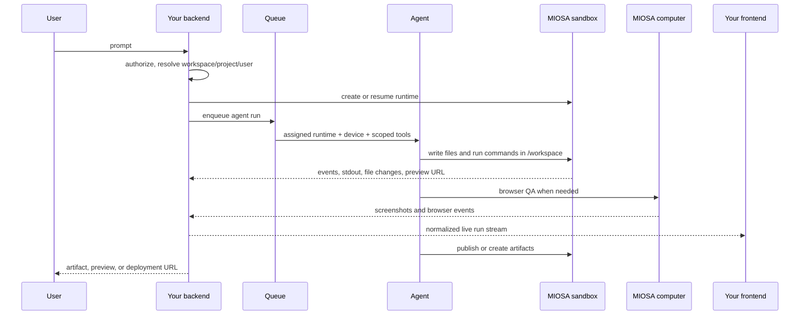

您的后端是基于 MIOSA 构建的产品的控制平面。它拥有用户
会话、产品权限、计费策略、模型路由、智能体名册、
连接器拨款和批准规则。 MIOSA 拥有执行基板：
沙箱、计算机、文件、执行、预览、工件、事件、快照和
部署。

当您构建应用程序构建器、工件等产品时，请使用本指南
工作空间、Polsia 风格的运营商、联合创始人 / 联合创始人 AI 风格的公司
智能体、Nebula式虚拟设备或 Heuresis 式编码工作区。

> **注意：将密钥保存在服务器端**
>
> 使用后端的租户或工作区 API 密钥。浏览器应该接收
> 短期浏览器令牌、预览令牌或您自己的会话绑定智能体
> 回应。不要将 `msk_*` 键放入客户端代码中。

---

## 后端职责

- **解决所有权**：将您的帐户、工作区、用户、项目、文档或应用程序记录映射到 MIOSA
  创建资源之前的所有权字段。
- **选择运行时**：将工作路由到代码/文件的沙箱、浏览器/桌面的计算机或
  当需要客户拥有的硬件时，本地设备。
- **调度提示**：将用户的任务发送到选定的智能体运行时和分配的设备。
  智能体应该在该设备内部工作，而不是在本地构建并稍后上传。
- **流进度**：标准化工具调用、命令输出、文件写入、屏幕截图、预览
  将准备情况、工件、批准和最终 URL 整合到一个产品事件流中。
- **持久输出**：存储 MIOSA 资源 ID、工件 ID、快照 ID、部署 ID、
  连接器授予 ID，并在您自己的产品记录旁边请求 ID。
- **执行策略**：在智能体之前应用配额、预算、审批、网络和连接器规则
  可以花费积分、发送消息、发布应用程序或使用敏感凭据。

---

## 参考流程



重要的边界很简单：你的后端编排；智能体执行
MIOSA 设备内。

---

## 即时派遣合同

将每个智能体运行建模为分派到指定设备的提示。

```typescript
type DevicePromptDispatch = {
  tenantId: string;
  workspaceId: string;
  projectId?: string;
  userId: string;
  deviceType: "sandbox" | "computer" | "local";
  deviceId: string;
  runtime: "osa" | "codex" | "claude-code" | "hermes" | "gemini-cli" | "opencode" | "custom";
  prompt: string;
  cwd?: string;
  connectors?: string[];
  approvalPolicy: "auto" | "confirm-risky" | "manual";
  idempotencyKey: string;
};
```

即使运行时间不同，输出流也应使用一种形状：

|活动 |用它来 |
|---|---|
| `run.started` |后端接受提示并分配设备 |
| `tool.started` / `tool.completed` |智能体工具调用、MCP 调用、连接器调用 |
| `command.output` |来自沙箱或计算机命令的 stdout/stderr |
| `file.changed` |创建、编辑、重命名或删除的文件 |
| `preview.ready` |实时服务器 URL 已准备就绪 |
| `artifact.created` | PDF、DOCX、图像、HTML、ZIP、报告、屏幕截图或生成的代码输出 |
| `approval.required` |智能体人想做一些敏感的事情 |
| `deployment.ready` |稳定的公共应用程序 URL 可用 |
| `run.failed` |带有请求 ID 和恢复路径的键入失败 |

---

## 后端资源模型

存储您的产品 ID 和 MIOSA ID。不得强迫用户或智能体商
重试后发现部分状态。

```sql
agent_runs
  id
  tenant_id
  workspace_id
  project_id
  user_id
  prompt
  runtime
  device_type
  device_id
  sandbox_id
  computer_id
  deployment_id
  status
  idempotency_key
  created_at
  updated_at

agent_run_events
  id
  run_id
  type
  payload_json
  request_id
  created_at

agent_artifacts
  id
  run_id
  miosa_artifact_id
  path
  content_type
  size_bytes
  preview_url
  download_url
  created_at
```

对于生成的应用程序产品，还存储当前的持久沙箱和最新的
每个项目的部署：

```sql
projects
  id
  current_sandbox_id
  current_computer_id
  current_deployment_id
  primary_device_type
  primary_device_id
```

---

## SDK 形状

使用与您的后端匹配的 SDK 语言。产品逻辑是一样的
每种语言。

- [TypeScript 后端](/docs/sdks/typescript)：节点、Next.js 路由处理程序、队列、AI SDK 运行框架和产品后端。
- [Python 后端](/docs/sdks/python)：FastAPI、Django、Flask、数据作业、工件生成和 Python 智能体循环。
- [Go backend](/docs/sdks/go)：高并发编排服务、worker、队列和控制平面。
- [Elixir 后端](/docs/sdks/elixir)：Phoenix 控制平面、LiveView 进度流、队列和长时间运行的编排。

最小后端循环：

```text
1. Authenticate your user.
2. Resolve their workspace/project/user attribution.
3. Create or resume a sandbox/computer.
4. Dispatch the prompt into that device.
5. Stream events back to your UI.
6. Store artifacts, snapshots, previews, and deployments.
7. Enforce budget, quota, connector, and approval policy.
```

---

## 恢复规则

生产后端需要从部分进度中恢复。

|失败 |后端行为 |
|---|---|
|创建成功，上传失败 |返回沙箱id并重试命令；不隐藏部分资源|
|智能体运行时崩溃 |保留设备和事件；让用户重试同一工作区 |
|预览失败 |表面日志和过程状态；不自动删除文件|
|沙盒已停止 |当持久性可用时从快照恢复或分叉 |
|超出预算|停止新工作并展示使用来源 |
|缺少连接器授权 |返回连接帐户操作，而不是通用 500 |
|发布失败 |保留沙箱预览并发布工件以进行重试 |

对突变使用幂等键，这样重试就不会创建重复的沙箱，
部署或应用程序记录。

---

## 另请参阅

- [构建智能体公司平台](/docs/guides/build-agent-company)：Polsia、CoFounder、Nebula 和 Heuresis 式系统的产品架构。
- [智能体编排](/docs/guides/agent-orchestration)：从一个智能体扩展到数千个智能体，包括队列、设备、子智能体和事件。
- [API 参考](/docs/api-reference)：沙箱、计算机、文件、执行、事件和部署的低级 REST 端点。
- [白标 SaaS 演练](/docs/platform/white-label)：客户归因、预览令牌、自定义域和品牌产品流。
