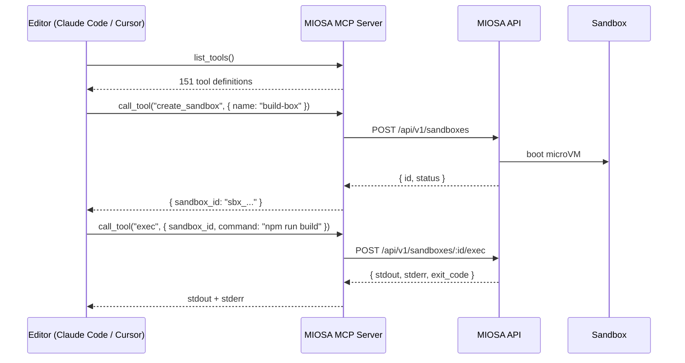

本页介绍了 MCP 服务器的工作原理、完整的客户端配置矩阵、工作使用示例、故障排除和安全指南。安装路径请参见[安装并验证](/docs/mcp/install)；有关确切的工具列表，请参阅[工具参考](/docs/mcp/tools)。

## 它是如何工作的



MCP 服务器是一个瘦无状态智能体。您的 API 密钥会随每个请求一起传送；服务器从不存储凭据。

当客户端发送 `initialize` 时，服务器返回一个 `instructions` 字段，其中包含工作流程指南 - MIOSA 资源类型、生命周期约定和推荐工具模式的简洁描述。像 Claude Code 这样的 MCP 感知客户端会在会话开始时将其呈现给模型，因此智能体无需额外提示即可了解平台。

---

## 配置

### 克劳德·代码

添加到`~/.claude/mcp.json`：

**托管（零安装）**

```json
{
  "mcpServers": {
    "miosa": {
      "url": "https://api.miosa.ai/api/v1/mcp",
      "headers": {
        "Authorization": "Bearer msk_u_..."
      }
    }
  }
}
```

无需本地流程。重新启动Claude Code，145个MIOSA工具立即出现。

**Python 服务器**

```json
{
  "mcpServers": {
    "miosa": {
      "command": "miosa-mcp",
      "env": {
        "MIOSA_API_KEY": "msk_u_..."
      }
    }
  }
}
```

**TypeScript CLI**

```json
{
  "mcpServers": {
    "miosa": {
      "command": "npx",
      "args": ["@miosa/cli", "mcp", "serve"],
      "env": {
        "MIOSA_API_KEY": "msk_u_..."
      }
    }
  }
}
```

### 光标

打开 **光标 → 设置 → MCP** 并添加：

**托管（零安装）**

```json
{
  "miosa": {
    "url": "https://api.miosa.ai/api/v1/mcp",
    "headers": {
      "Authorization": "Bearer msk_u_..."
    }
  }
}
```

**Python 服务器**

```json
{
  "miosa": {
    "command": "miosa-mcp",
    "env": { "MIOSA_API_KEY": "msk_u_..." }
  }
}
```

**TypeScript CLI**

```json
{
  "miosa": {
    "command": "npx",
    "args": ["@miosa/cli", "mcp", "serve"],
    "env": { "MIOSA_API_KEY": "msk_u_..." }
  }
}
```

### 风帆冲浪

在`~/.codeium/windsurf/mcp_config.json`中：

**托管（零安装）**

```json
{
  "mcpServers": {
    "miosa": {
      "url": "https://api.miosa.ai/api/v1/mcp",
      "headers": {
        "Authorization": "Bearer msk_u_..."
      }
    }
  }
}
```

**Python 服务器**

```json
{
  "mcpServers": {
    "miosa": {
      "command": "miosa-mcp",
      "env": {
        "MIOSA_API_KEY": "msk_u_..."
      }
    }
  }
}
```

**TypeScript CLI**

```json
{
  "mcpServers": {
    "miosa": {
      "command": "npx",
      "args": ["@miosa/cli", "mcp", "serve"],
      "env": {
        "MIOSA_API_KEY": "msk_u_..."
      }
    }
  }
}
```

重新加载风帆冲浪。级联面板中提供了工具。

### 环境变量参考（仅限本地服务器）

|变量|必填 |默认 |描述 |
|---|---|---|---|
| `MIOSA_API_KEY` |是的 |  - |您的 `msk_u_...` 键 |
| `MIOSA_API_URL` |没有 | `https://api.miosa.ai` |覆盖自托管或暂存 |
| `MIOSA_DEFAULT_TEMPLATE` |没有 | `miosa-sandbox` | `sandbox_create` 省略 `template_id` | 时使用的模板
| `MIOSA_TIMEOUT_MS` |没有 | `30000` |每个请求的 HTTP 超时（以毫秒为单位）|
| `MIOSA_LOG_LEVEL` |没有 | `warn` | `debug`、`info`、`warn`、`error` |

---

## 使用示例

### 创建计算机并截图

```yaml
You: Create a Linux desktop and take a screenshot of whatever is on screen.
```

助手调用 `computer_create({ template_type: "miosa-desktop", size: "small" })`，等待其启动，调用 `desktop_screenshot()`，并描述它所看到的内容。然后它可以调用 `desktop_click`、`desktop_type` 和 `desktop_launch` 进行交互。

---

### 将沙箱部署到生产环境

```yaml
You: Build the Next.js app in the sandbox and deploy it to a permanent URL.
```

助理调用 `sandbox_exec({ command: "npm run build" })`，确认 `exit_code: 0`，然后调用 `deployment_publish({ sourceSandboxId: "sbx_...", kind: "static", outputPath: "/workspace/.next/out" })` 并返回实时 URL。

---

### 设置 cron 作业

```yaml
You: Create a cron job that runs a health check script every 5 minutes.
```

助理呼叫 `cron_create({ name: "health-check", schedule: "*/5 * * * *", command: "bash /workspace/health-check.sh", computer_id: "computer_..." })`。要立即触发它进行冒烟测试，它会调用 `cron_run_now({ cron_id: "cron_..." })`。

---

### 创建数据库并获取凭据

```yaml
You: Provision a Postgres database and give me the connection string for my app.
```

助手调用 `database_create({ name: "my-app-db", region: "us-east" })`，轮询 `database_get` 直到状态为 `running`，然后调用 `database_credentials({ id: "db_..." })` 并返回连接字符串。它还可以调用 `deployment_env_set` 将 `DATABASE_URL` 直接注入到部署中。

---

## 故障排除

> **提示：调试模式（本地服务器）**
>
> 设置 `MIOSA_LOG_LEVEL=debug` 以查看 MCP 服务器发送到 MIOSA API 的每个请求和响应。对于诊断身份验证或超时问题很有用。

**`401 Unauthorized` 在托管 MCP 上** - 确认 `Authorization` 标头值以 `Bearer msk_u_` 开头（不仅仅是密钥）。检查仪表板 → 设置 → API 密钥下的密钥是否处于活动状态。

**`MIOSA_API_KEY is not set`（本地服务器）** - MCP 配置中缺少环境变量。确认 `env` 块存在于客户端的 MCP JSON 中，并且密钥以 `msk_u_` 开头。

**工具调用超时** - 沙盒启动在第一次调用时需要 2-8 秒。如果您的客户端 MCP 超时较短，请增加 `MIOSA_TIMEOUT_MS`。克劳德码默认为30秒；光标默认值为 10 秒。

**`403 Forbidden`** - 您的密钥有效，但缺少所需的范围。检查 [API 密钥](/docs/platform/api-keys) 以确认密钥具有您正在调用的工具所需的范围。

**`No tools appear in Cursor`** - 光标要求 MCP 配置是有效的 JSON。运行 `node -e "JSON.parse(require('fs').readFileSync('cursor-mcp.json','utf8'))"` 进行验证。

---

## 安全考虑- 将 `MIOSA_API_KEY` 存储在客户端的秘密存储中，而不是存储在提交给 git 的 `.env` 文件中。
- 对 MCP 使用**范围密钥**：仅授予您的工作流程需要的范围。切勿使用管理密钥进行编辑器集成。
- 托管 MCP 端点和本地 MCP 服务器均仅发出出站 HTTPS 请求。两者都不打开入站端口。
- 通过 MCP 创建的资源与直接 API 调用受到相同的租户范围授权。 MCP 服务器无法访问其他租户的资源。

---

---

## 另请参阅

- [安装并验证](/docs/mcp/install)：选择托管端点或本地 stdio 包并设置组织上下文。
- [工具参考](/docs/mcp/tools)：MCP 服务器注册的每个工具，按系列分组。
