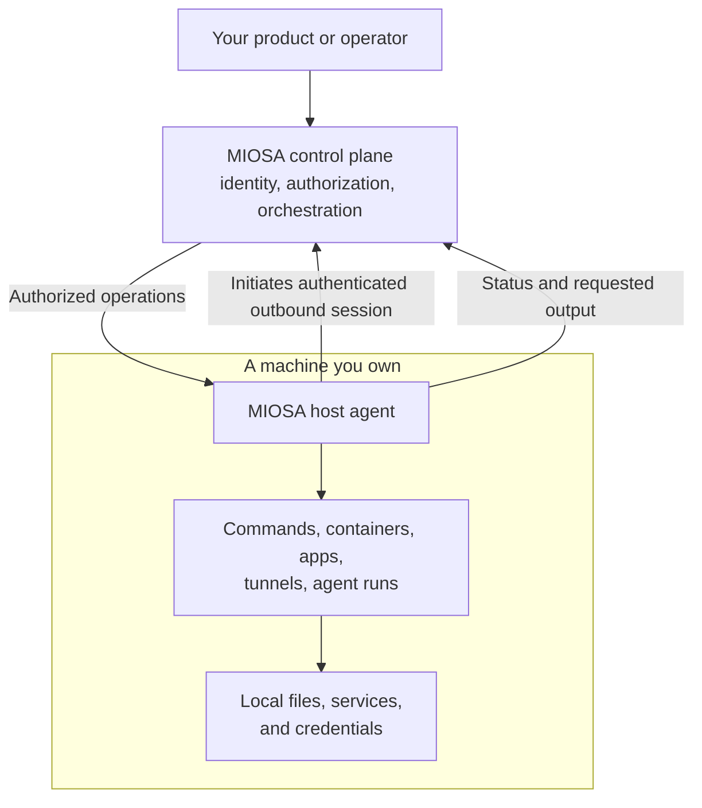

**OpenComputers** 将您已经拥有的计算机连接到 MIOSA。
您可以在工作站、GPU 盒、本地服务器或托管提供商的现有服务器上安装 MIOSA Host Agent。
智能体打开经过身份验证的出站会话，然后 MIOSA 将该计算机作为 **主机** 进行管理。

主机是您组织中的一台机器。
您保留硬件、操作系统以及智能体可能达到的目标的决定。
MIOSA 提供身份、授权、编排和远程操作界面：命令、容器、专用网络、CI 运行程序、计划备份、隧道和智能体工作。

现在就做

连接您的第一台主机

注册您拥有的机器。您的第一次成功是在该主机上完成了命令。

- [连接主机](https://miosa.ai/cloud/connect/opencomputers)：（在新选项卡中打开 MIOSA 控制台）

miosa主机注册工作室--linux平台

打印一次主机 ID 和主机密钥。首先在机器上安装智能体。

下一步 [连接您的第一个主机，一步一步](/docs/opencomputers/connect)

> **注：主机、OpenComputer、设备**
>
> **主机**是一台注册的机器。 **OpenComputer** 是作为 MIOSA 资源的机器 - UI 和 [OpenComputers API](/docs/api-reference/open-computers) 中使用的术语。 **设备** 是可以在其上运行命令的任何运行时 MIOSA，包括沙箱或托管计算机。

## 何时使用 OpenComputers

当工作必须在您控制的硬件上运行或您已经具备能力时，请选择 OpenComputers。

|你需要|使用 |为什么 |
|---|---|---|
|在您已经拥有或租用的硬件上运行 |OpenComputers |智能体在该机器上的操作系统权限内运行命令。 |
|您可以流式传输的桌面或浏览器会话 | [托管计算机](/docs/computers/overview) |由 MIOSA 提供和运营，并提供现成的桌面合同。 |
|隔离的、一次性的代码执行 | [沙箱](/docs/develop/sandboxes) |每个沙箱都有一个新的 microVM，无需维护主机。 |
|您自己的 AWS 账户或 Google Cloud 项目内的受管工作人员池 | [BYOC](/docs/infrastructure/byoc/overview) |云工作者能力的单独入职路径。 |

相同的MIOSA接口并不意味着每个主机都支持所有操作。
主机上的直接执行以主机用户的身份运行，并且主机仅通告其智能体报告的功能。
明确选择主机并检查您的工作流程所需的功能。

## MIOSA 管理什么



| 层 | 谁在运营？ |
|---|---|
|主机、操作系统、磁盘、电源、网络|您或您的托管提供商|
|主机智能体服务及其操作系统用户和权限 |您安装并运行它； MIOSA 提供签名智能体更新 |
| 组织、API、授权、编排、审计 | MIOSA |
|智能体可以访问的本地文件、服务和凭据 |您，受智能体用户的权限限制|
|命令、状态、输出、工件、桌面流、模型请求 |可能会作为工作流程的一部分通过 MIOSA |

连接主机不会在您的场所安装 MIOSA 平台，也不会将主机变成沙箱工作池、Docker Host 主机或 BYOC 区域。
有关完整的边界矩阵，请参阅[共同责任](/docs/infrastructure/shared-responsibility)。

## OpenComputers 界面

| 面积 | 你得到什么 | 指南 |
|---|---|---|
|主持人 |注册机器、检查状态、功能、指标、服务和作业 | [主机和功能](/docs/opencomputers/hosts) |
|命令和文件 |在一台主机或组的每个成员上运行命令；读写文件| [主机和功能](/docs/opencomputers/hosts) |
|集装箱 |运行图像、流日志和统计数据并保持撰写项目 | [容器](/docs/opencomputers/containers) |
|网格|跨多台主机的私有加密 WireGuard 网络 | [网格](/docs/opencomputers/meshes) |
| GitHub Actions 跑步者 |为一个存储库注册的自托管运行器 | [GitHub Actions 跑步者](/docs/opencomputers/gha-runners) |
|备份|目录的计划快照，可分叉到任何主机上 | [备份和快照](/docs/opencomputers/backups) |
|隧道 |在 MIOSA 管理的地址公开主机端口 | [隧道和公开服务](/docs/opencomputers/tunnels) |
|设备|跨每种运行时类型的一个 id 寻址表面 | [设备](/docs/opencomputers/devices) |
|应用程序、集群、组、秘密 |安装目录应用程序，跨主机、目标组、范围机密提供模型 | [主机和功能](/docs/opencomputers/hosts) |

## 连接主机

```bash
miosa host register studio --platform linux   # prints the host key once
miosa host list
miosa host get <host>
```

`register` 创建主机记录并打印一次**主机密钥**。
将该密钥交给机器上的智能体；它与您的平台 API 密钥不同。

按照 [连接您的第一个主机 ](/docs/opencomputers/connect) 进行安装、注册和验证演练。

## 相关

- [连接您的第一个主机](/docs/opencomputers/connect)：安装智能体、注册计算机并在该主机上完成命令。
- [主机和功能](/docs/opencomputers/hosts)：检查主机、在一台机器或一组机器上运行命令以及读取文件。
- [安全模型](/docs/opencomputers/security)：出站会话授予 MIOSA 的内容和不授予的内容。
- [API 和 CLI 参考 ](/docs/opencomputers/reference)：OpenComputers 的每个端点、命令和 SDK 表面。

- [CLI：您自己的主机](/docs/cli/platform#your-own-hosts)：完整的 miosa 主机和 miosa 设备命令参考。

- [基础设施选项](/docs/infrastructure/overview)：比较托管计算、连接的计算机、BYOC 和外部提供商。

## 后续步骤

- [连接您的第一个主机](/docs/opencomputers/connect)：安装智能体、注册计算机并在其上运行命令。
- [管理主机](/docs/opencomputers/hosts)：检查功能、运行命令和读取文件。
- [查看安全模型](/docs/opencomputers/security)：出站会话授予什么权限，不授予什么权限。
