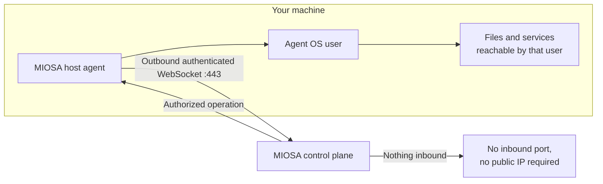

OpenComputers 反转了管理连接的通常方向。
您机器上的智能体拨出至 MIOSA； MIOSA 从不拨入。
这个单一的设计决策决定了这里的大部分内容是可能的和不可能的。



## MIOSA 可以做什么

- 通过智能体已打开的会话发送授权操作：命令、文件读取或写入、容器操作、备份或隧道拨号。
- 读取主机报告的状态：平台、架构、功能、运行时、标签、心跳、智能体版本和作业历史记录。
- 将入站 HTTP 请求路由到现有会话，但仅通过[您创建的隧道](/docs/opencomputers/tunnels)，并且仅当请求满足该隧道的访问模式时。

## MIOSA 不能做什么

- 自发地打开与您的计算机的连接。没有入站管理端口，也不需要公共 IP。
- 以比智能体自己的操作系统用户更高的权限进行操作。直接执行以该用户身份运行，并具有该用户的文件系统权限和网络覆盖范围。
- 查看智能体用户无法读取的文件或用户无法访问的服务。
- 更换您的操作系统控件。智能体不是沙箱、虚拟机管理程序或监狱。

> **注意：直接主机执行不是隔离的**
>
> 在主机上运行命令会在主机自己的环境中执行，而不是在隔离的 microVM 中执行。
> 单独注册并不会使主机成为沙箱工作池或 Docker Host 主机。
> 如果您需要隔离，请将工作放在 [沙箱](/docs/develop/sandboxes) 中而不是主机上。

## 凭证

存在两种凭证，它们有不同的工作，并且不可互换。

|资质证书 |谁使用它 |终身|
|---|---|---|
| **主机密钥** |机器上的智能体，来自`osa opencomputers login`|报名时返还一次；可撤销|
| **平台 API 密钥** |您的终端、后端或 SDK |在 [API 密钥](/docs/platform/api-keys) | 中管理

主机还保留一个 Ed25519 身份文件 `~/.osa/open_computers.ed25519`，它固定机器的身份。
在智能体升级过程中保留该文件。
如果丢失，请撤销主机并注册新主机，而不是复制另一台机器的身份或禁用验证。

您可以在不接触主机的情况下检查主机密钥是否仍然有效：

```bash
curl --fail-with-body -sS \
  -X POST "https://api.miosa.ai/api/v1/opencomputers/hosts/registration-status" \
  -H "Content-Type: application/json" \
  -d '{"host_key":"<host-key>"}'
```

它回答 `{connected, state, host}`，`410` 表示已撤销的密钥，`401` 表示无效密钥。

## 授权

操作是在控制平面上授权的，并且每条记录都是租户范围内的。

- 发送到主机的命令需要 `opencomputers:write` 范围。
- 主机运行时注册、注册和认证使用 `cloud:read` 和 `cloud:write`。
- 主机列表、文件、容器、隧道、网格、备份和机密依赖于 API 管道的组织授权和工作区成员身份，每个处理程序通过租户范围的查找来解析资源。

来自其他组织的主机 ID 不会解析为任何内容，不会解析为其他人的计算机。

## 秘密

主机和租户秘密是加密的键值对。
列表调用返回名称、描述和 ID，而不是值。

```bash
miosa host secret set <host> GITHUB_TOKEN --key-stdin < token.txt
miosa host secret list <host>
```

REST 显示端点 `POST /api/v1/opencomputers/hosts/{id}/secrets/{secret_id}/reveal` 是读回值的唯一方法，并且每个调用都会被审核记录。

## 审核日志

每个与授权相关的操作都会记录在 OpenComputers 审核日志中。

```bash
curl --fail-with-body -sS "https://api.miosa.ai/api/v1/opencomputers/audit?limit=50" \
  -H "Authorization: Bearer $MIOSA_API_KEY"
```

|端点|它有什么作用 |
|---|---|
| `GET /opencomputers/audit` |光标分页事件；按 `kind`、`host_id`、`actor`、`from` 和 `to` 过滤 |
| `GET /opencomputers/audit/export` |与 JSON 或 CSV 相同的数据，最多 5000 行 |
| `GET /opencomputers/audit/verify` |验证完整性链并报告最后的良好索引 |
| `GET /opencomputers/audit/:id` |一场活动 |
| `GET /opencomputers/audit/live` |SSE实时动态 |

按计划运行 `verify`：它会回答存储的审核历史记录是否完​​整，这使得日志在事件发生后变得有用。

## 网络钩子

OpenComputers Webhook 将事件 POST 到您的端点，并在创建 Webhook 时返回的签名密钥下，在原始正文上使用 HMAC-SHA256 签名。

```bash
curl --fail-with-body -sS -X POST "https://api.miosa.ai/api/v1/opencomputers/webhooks" \
  -H "Authorization: Bearer $MIOSA_API_KEY" \
  -H "Content-Type: application/json" \
  -d '{"name":"host-alerts","url":"https://example.com/hooks/miosa","events":["host.disconnected"]}'
```在解析它们之前，请验证您收到的确切字节的签名。
`GET .../webhooks/{id}/deliveries` 显示最近的尝试，`POST .../webhooks/{id}/test` 根据需要发送一次。
有关一般交付合同，请参阅 [Webhooks](/docs/integrations/webhooks)。

## 数据边界

在您的机器上执行可以使执行保持在您的机器上。
这并不意味着每个字节都留在那里。

|数据|它旅行到哪里|
|---|---|
|命令及其参数 |发送了会话；该命令记录在audit | 中
|命令输出和您请求的文件内容 |作为工作流程的一部分通过 MIOSA 返回 |
|备份块|上传至 MIOSA 存储，静态加密 |
|桌面和终端流|会话开放时通过 MIOSA 路由 |
|来自智能体运行的模型请求 |发送到您配置的模型端点，该端点可能是第三方 |

设置智能体的权限、隧道访问模式和模型端点以匹配您愿意移动的数据。
要更全面地处理硬件所有权和连接性，请参阅[共同责任](/docs/infrastructure/shared-responsibility)。

## 撤销和拆除

```bash
miosa host rm <host> --yes
```

撤销主机会立即终止其身份验证的能力。
它不会删除机器的文件，也不会停止已经在机器上运行的进程。
在撤销或退役主机之前，请停止新工作，检查其[作业](/docs/opencomputers/hosts#run-a-command)，并确认正在进行的任何操作的结果。

- [连接您的第一个主机](/docs/opencomputers/connect)：安装、注册和验证计算机。

- [共同责任](/docs/infrastructure/shared-responsibility)：谁操作硬件、操作系统、网络和控制平面。
