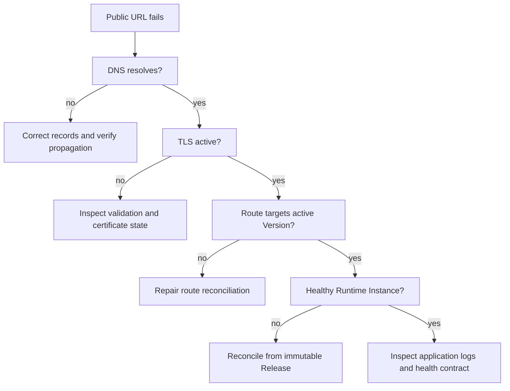

当客户可见的工作流程不健康时，请使用这些手册。

在改变任何内容之前进行诊断，保留最后一个已知的良好版本，并一次进行一个有限的恢复更改。

## 前五分钟

1. 解析确切的组织、工作空间、项目和受影响的资源。
2. 记录公共 URL、部署 ID、活动版本 ID 和当前运行状况。
3. 从运行时外部测试公共路由。
4. 单独的构建、运行时、路由、DNS 和 TLS 故障。
5. 保留之前准备好的版本和任何操作或幂等性 ID。

## 部署已关闭

|检查 |健康证明 |恢复|
|---|---|---|
|活动版本 |确切的预期版本 ID |升级最后一个验证就绪的版本 |
|产物|运行摘要匹配发布|从不可变版本替换运行时 |
|运行时|所需实例已准备就绪 |协调或替换失败的实例 |
|路线 |公共 URL 达到有效版本 |运行时就绪后协调路由 |
|应用 |健康端点成功 |修复配置或发布更正的版本 |

不要重建旧版本来恢复它。

回滚应选择已验证的版本，同时保留部署和域标识。

## 域名仍处于待处理状态

1. 复制 MIOSA 返回的确切记录类型、主机、目标和所有权令牌。
2. 删除同一主机名下的冲突记录。
3. 禁用 DNS 智能体，直到所有权验证完成。
4. 查询权威DNS提供商，然后查询公共解析器。
5. 仅在预期答案可见后重试验证。

对于诸如 `*.apps.example.com` 之类的通配符，大多数提供商期望主机字段 `*.apps`，而不是完整的主机名。

对于 apex 主机名，请在不允许使用正常 CNAME 时使用提供商支持的 ALIAS、ANAME 或扁平化 CNAME 行为。

## TLS 未激活

- 确认 DNS 已解析为 MIOSA 验证目标。
- 确认主机名仅附加到一个组织和部署。
- 检查限制性 CAA 记录是否阻止证书颁发机构。
- 保持智能体禁用，直到验证和证书配置完成。
- 不要重复分离并重新附加主机名，因为这会重新启动验证。

## Docker Host主机不健康

1. 确认主机记录指向预期的设备和组织。
2. 确认设备智能体、Docker 引擎和所需的持久存储均正常。
3. 确认不可变版本可用于设备。
4. 在开始另一部署操作之前检查上一次部署操作。
5. 协调所需的部署，而不是创建重复的部署。

> **注意：避免重复构建**
>
> 如果请求超时，首先判断远程构建是否仍在运行。
> 使用记录的操作 ID 或幂等密钥进行恢复，而不是再次提交相同的构建。

## 沙盒预览失败

- 确认沙箱正在运行。
- 确认应用程序侦听 `0.0.0.0`，而不仅仅是 `localhost`。
- 确认请求的预览端口与应用程序端口匹配。
- 确认开发过程仍然有效。
- 仅在证明沙箱进程和端口正常后重新创建预览。

## 升级证据

提供资源 ID、UTC 时间戳、操作 ID、预期和观察到的状态、公共主机名和经过编辑的错误输出的支持。

切勿包含 API 密钥、cookie、数据库凭据、私人来源、客户个人数据或原始环境文件。

## 另请参阅

- [部署域](/docs/docker-host/domains)
- [回滚](/docs/docker-host/rollback)
- [Docker 主机主机](/docs/docker-host/docker-deploy)
- [已知限制](/docs/known-limitations)
