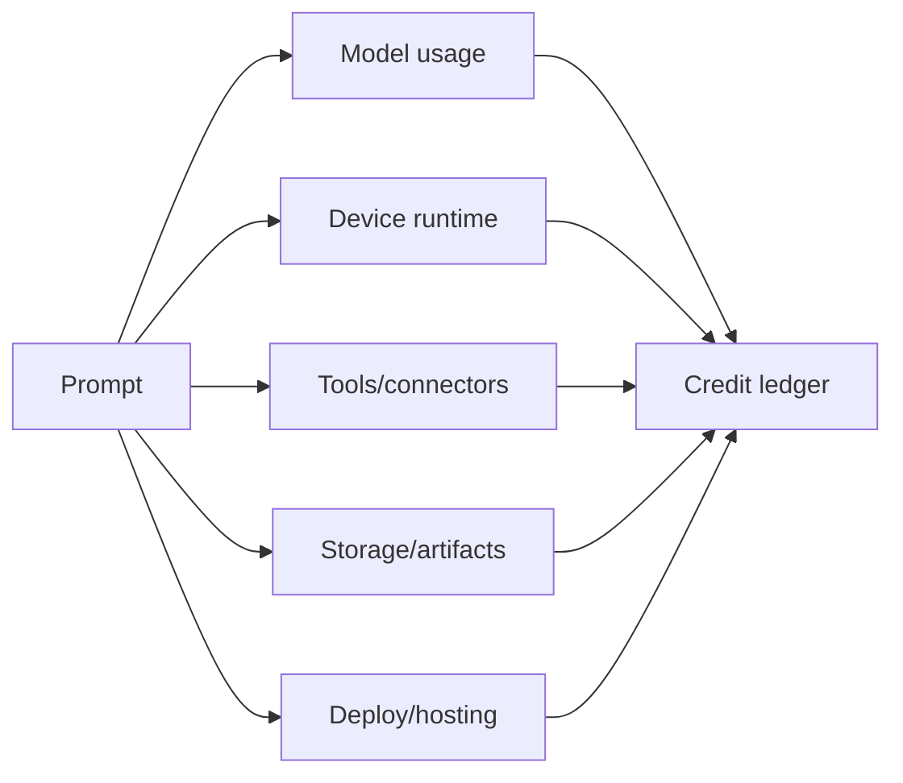

积分是 MIOSA 上智能体工作的商业模式。用户不会孤立地购买
“一个沙箱”或“一次模型调用”。他们购买的是积分，用来驱动智能体
在设备上完成有用的工作。

```text
credits = model usage + device runtime + tools + storage + deployments
```

在构建计费、配额、用量页面、工作区预算
或白标积分系统时，请使用本页。

---

## 计量范围

| 范围 | 示例 | 计费时机 |
|---|---|---|
| 模型/运行时 | OSA、Codex、Claude Code、Hermes、自定义模型调用 | 智能体推理和工具规划期间 |
| 沙箱运行时 | 沙箱运行时的 CPU/RAM | 执行、预览、安装、构建期间 |
| 计算机运行时 | 云桌面/浏览器时间 | 浏览器/桌面会话活跃期间 |
| 本地中继 | 安全中继、流式传输、隧道、控制通道 | 已配对的本地设备通过 MIOSA 连接期间 |
| 工具调用 | 浏览器操作、网络搜索、Refero、连接器令牌请求 | 按调用或按运行分配 |
| 存储 | 快照、产物、日志、持久文件 | 按大小和保留时长 |
| 部署托管 | MIOSA Deploy、Docker Host、域名、常开应用运行时 | 已部署或常开期间 |

> **注意：一个账本**
>
> 即使每个子系统都记录内部指标，面向客户的计费也应
> 落入一个积分账本，并带有工作区、用户、运行、智能体和设备上下文。

---

## 账本结构

```sql
credit_ledger
  id
  tenant_id
  workspace_id
  project_id
  user_id
  agent_id
  run_id
  device_type
  device_id
  category
  units
  unit_price_credits
  credits
  metadata_json
  created_at
```

建议的类别：

```text
model
device_runtime
tool
connector
storage
deployment
network
adjustment
grant
refund
```

每条账本记录都应可追溯到一次运行、请求 ID 或生命周期事件。

---

## 运行级成本模型



每次智能体运行都应提供：

| 字段 | 用途 |
|---|---|
| `estimated_credits` | 在开始高成本工作前显示 |
| `reserved_credits` | 防止运行中途超出预算 |
| `credits_used` | 最终收费 |
| `credit_breakdown` | 说明模型/设备/工具/存储/部署的拆分 |
| `budget_remaining` | 让 UI 在下一步操作前发出警告 |

---

## 简单示例

### 一次性健康检查

```text
User runs: miosa run "check preview"

Charges:
  model: small
  device_runtime: seconds
  storage: none
  deploy: none
```

### 沙箱应用生成

```text
User asks: "Build a Next.js marketing page."

Charges:
  model: planning and code generation
  sandbox_runtime: install, build, preview
  storage: files, logs, snapshot
  deployment: only if user publishes
```

### 浏览器自动化

```text
User asks: "Log in and test checkout."

Charges:
  model: browser planning
  computer_runtime: browser session
  tool: screenshots and browser actions
  storage: screenshots/report artifact
```

### 智能体公司工作流

```text
User asks: "Launch this company campaign."

Charges:
  parent model run
  child model runs
  multiple sandboxes/computers
  connectors
  artifacts
  optional deployment
```

---

## 预算策略

工作区所有者应能够设置：

- 每月积分预算
- 每次运行的最大积分
- 每个智能体的每日预算
- 最大并发沙箱数
- 最大并发计算机数
- 最大子智能体数
- 最大连接器支出
- 审批阈值
- 强制停止阈值

建议的审批关卡：

| 操作 | 关卡 |
|---|---|
| 使用超过运行预算 | 请求审批 |
| 创建大量子设备 | 请求审批 |
| 启动常开部署 | 请求审批 |
| 使用付费连接器 | 请求审批或使用预配置策略 |
| 发送外部消息 | 请求审批 |
| 删除快照/产物 | 请求审批 |

---

## 白标产品中的积分

白标产品可以通过两种方式呈现积分：

| 模式 | 含义 |
|---|---|
| 直通 | 最终客户直接看到 MIOSA 积分用量 |
| 封装 | 您的产品显示自己的单位，后端映射到 MIOSA 积分 |

对于 Lumen 风格的产品，后端应同时存储两者：

```sql
customer_usage_events
  external_workspace_id
  external_user_id
  external_project_id
  miosa_run_id
  miosa_credits
  customer_units
```

这样您的应用可以显示产品特定的余额，同时仍能与
MIOSA 计费对账。

---

## 积分事件

发出事件，让 UI 可以实时更新：

| 事件 | 时机 |
|---|---|
| `credits.estimated` | 运行、发布或昂贵的连接器操作之前 |
| `credits.reserved` | 为一次运行预留预算 |
| `credits.charged` | 账本记录已提交 |
| `credits.refunded` | 失败或取消的工作已退款 |
| `credits.low_balance` | 工作区余额低于阈值 |
| `credits.limit_reached` | 运行被套餐或预算阻止 |

CLI 应报告相同的数据：

```bash
miosa billing balance
miosa workspace usage <slug>
miosa run usage <run-id>
miosa whoami --json
```

---

## 失败处理

计费应保守且可解释。

| 失败情况 | 预期计费行为 |
|---|---|
| 运行在开始前被拒绝 | 不收费 |
| 设备已创建但智能体在工作前失败 | 收取最低设备时间或按策略退款 |
| 资源创建后上传/导入失败 | 返回部分资源 ID 和恢复命令 |
| 用户取消 | 收取已完成工作的费用，停止后续计费 |
| 平台错误 | 尽可能退还有影响的用量 |
| 连接器/提供商错误 | 仅收取提供商已完成的工作 |

始终在计费支持视图中包含请求 ID 和运行 ID。

---

## 另请参阅

- [用量与计费](/docs/platform/usage-and-billing)：工作区计费、套餐限制和平台用量层面。
- [智能体产品模型](/docs/guides/agent-product-model)：积分所计量的产品原语。
- [智能体工作流模式](/docs/guides/agent-workflow-patterns)：不同工作流如何消耗积分。
- [API 参考：用量汇总](/docs/api-reference/usage-rollup)：为仪表板和报告查询用量摘要。
