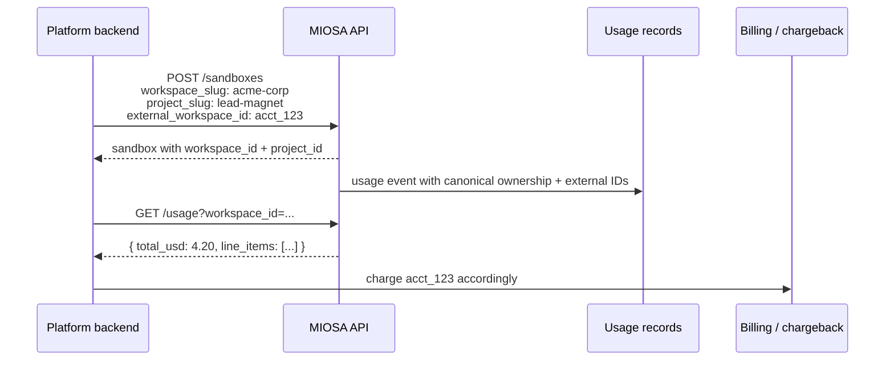

资源所有权决定 MIOSA 将资源放在哪里。外部归属则让你的平台把该资源映射回自己的数据库。

- `workspace_id` 和 `project_id` 是 MIOSA 的规范所有权。它们会影响路由、权限、仪表盘分组、用量以及资源出现的位置。
- `external_workspace_id`、`external_user_id` 和 `external_project_id` 是来自你平台的不透明字符串。它们会被复制到用量、审计和子资源中，用于对账。

## 所有权字段

| 字段 | 含义 | 示例 |
|---|---|---|
| `workspace_id` | 现有的 MIOSA 工作区 UUID | `"550e8400-e29b-41d4-a716-446655440000"` |
| `workspace_slug` | 现有或自动创建的工作区 slug | `"acme-corp"` |
| `workspace_name` | 自动创建工作区时使用的显示名称 | `"Acme Corp"` |
| `project_id` | 现有的 MIOSA 项目 UUID | `"660e8400-e29b-41d4-a716-446655440001"` |
| `project_slug` | 工作区内现有或自动创建的项目 slug | `"lead-magnet"` |
| `project_name` | 自动创建项目时使用的显示名称 | `"Lead Magnet"` |

如果未提供工作区选择器，MIOSA 会使用该组织的默认工作区。如果未提供项目选择器，MIOSA 会在该工作区内使用或创建一个 `default` 项目。

当你传入 `external_workspace_id` 或 `external_project_id` 而没有规范 ID/slug 时，MIOSA 会解析匹配的工作区/项目，或为此组织创建一个。响应中包含 `workspace_id` 和 `project_id`；请保存这些 ID，并在后续调用中尽量使用它们。

## 归属字段

| 字段 | 含义 | 示例 |
|---|---|---|
| `external_workspace_id` | 你的客户/工作区/账户 ID | `"acct_123"` |
| `external_user_id` | 该客户下你的最终用户 ID | `"user-456"` |
| `external_project_id` | 该工作区下你的项目 ID | `"project_789"` |

三者都是可选的，以文本形式存储，并限定在已认证的 MIOSA 组织内。它们从不授予任何访问权限。

## 流转方式


## 每次创建时

在创建请求的请求体中传入所有权和归属信息：

**沙箱**

```typescript
await miosa.sandboxes.create({
  templateId: "miosa-sandbox",
  workspaceSlug: "acme-corp",
  workspaceName: "Acme Corp",
  projectSlug: "lead-magnet",
  projectName: "Lead Magnet",
  externalWorkspaceId: "acct_123",
  externalUserId: "user-456",
  externalProjectId: "project_789",
})
```

**计算机**

```typescript
await miosa.computers.create({
  template_type: "ubuntu-desktop",
  workspaceId: "550e8400-e29b-41d4-a716-446655440000",
  projectId: "660e8400-e29b-41d4-a716-446655440001",
  externalWorkspaceId: "acct_123",
  externalUserId: "user-456",
  externalProjectId: "records_portal",
})
```

**部署**

```typescript
await miosa.deployments.publish(deploymentId, {
  sourceSandboxId: sandbox.id,
  workspaceId: sandbox.workspaceId,
  projectId: sandbox.projectId,
  externalWorkspaceId: "acct_123",
  externalUserId: "user-456",
  externalProjectId: "project_789",
})
```

**自定义域名**

```typescript
await miosa.deployments.domains.add(deploymentId, {
  domain: "program.example.net",
  externalWorkspaceId: "acct_123",
  externalUserId: "user-456",
})
```

规范所有权和归属信息会存储在资源行上，也会写入该资源产生的每一条事件 / 审计 / 用量记录。

## 按所有权或归属筛选

列表端点接受规范所有权筛选器和外部归属筛选器：
```http
GET /api/v1/sandboxes?workspace_id=550e8400-e29b-41d4-a716-446655440000
GET /api/v1/sandboxes?project_id=660e8400-e29b-41d4-a716-446655440001
GET /api/v1/computers?external_project_id=records_portal&status=running
GET /api/v1/deployments?external_user_id=user-456
GET /api/v1/deployments/:id/domains?external_project_id=project_789
```

筛选在服务端按组织限定范围。另一个 MIOSA 组织即使猜中相同的 `workspace_id`、`project_id`、slug 或外部 ID，也读不到你的资源。

## 继承

当资源派生自另一个资源时，所有权和归属默认会被继承：

- 沙箱到预览
- 沙箱到部署
- 部署到构建、版本、服务、发布、运行时实例和域名
- 项目到数据库、存储桶、卷、函数、定时任务、认证和集成
- 计算机到自定义域名、用量记录和审计事件

```typescript
const sandbox = await miosa.sandboxes.create({
  workspaceSlug: "acme-corp",
  projectSlug: "lead-magnet",
  externalWorkspaceId: "acct_123",
  externalUserId: "user-456",
})

const deployment = await miosa.deployments.publish(deploymentId, {
  sourceSandboxId: sandbox.id,
})

console.log(deployment.workspace_id) // same as sandbox.workspace_id
console.log(deployment.project_id) // same as sandbox.project_id
```

在派生资源请求中显式传入的值会覆盖继承的外部 ID。规范的项目/工作区 ID 仍必须属于已认证的组织。

## 授权、所有权与归属的区别

关键区别：

- **授权**对应 MIOSA 组织，由服务端根据你的 API 密钥或 JWT 推导。
- **所有权**由 `workspace_id` 和 `project_id` 表示。它控制资源所在的位置，但必须属于已认证的组织。
- **归属**由 `external_*` 字段表示。它从不授予任何权限，只用于组织内部的分组和筛选。

> **注意：切勿用外部 ID 做访问控制**
>
> 如果你在自己的应用中构建授权，请先检查已认证的应用用户和 MIOSA 组织。将 `external_*` 视为用于计费、展示和对账的标签。

## 存储与索引

所有权和归属信息存储在以下位置：

- **资源表**：计算机、沙箱、沙箱预览、部署、部署版本、部署构建、部署环境、部署服务、部署发布、运行时实例、服务绑定、自定义域名、数据库、存储桶、卷、边缘函数、定时任务、预览环境、项目认证和项目集成。
- **事件表**：用量计量、用量记录、沙箱运行时事件和审计事件。

所有权筛选器按 `tenant_id`、`workspace_id` 和 `project_id` 建立索引。归属筛选器按 `tenant_id` 加上外部 ID 字段建立索引。

## 哪些字段该用、哪些该留空

- 当你已经保存了 MIOSA ID 时，使用 `workspace_id` / `project_id`。
- 在需要人类可读的集成代码时，使用 `workspace_slug` / `project_slug`。
- 当你自己的数据库已经有客户/项目 ID 时，使用 `external_workspace_id` 和 `external_project_id`。
- 当某个最终用户触发了操作时，使用 `external_user_id`。

对于白标平台，最佳默认做法是传入规范所有权以及全部三个外部 ID。

## 另请参阅

- [概览](/docs/platform/overview)  -  白标模式
- [API 密钥](/docs/platform/api-keys)  -  将请求与组织关联的凭证
- [浏览器令牌](/docs/platform/browser-tokens)  -  用于面向最终用户的访问
- [白标设置](/docs/platform/white-label)  -  域名、品牌和设置顺序
- [用量与计费](/docs/platform/usage-and-billing)  -  按工作区/项目分摊费用
