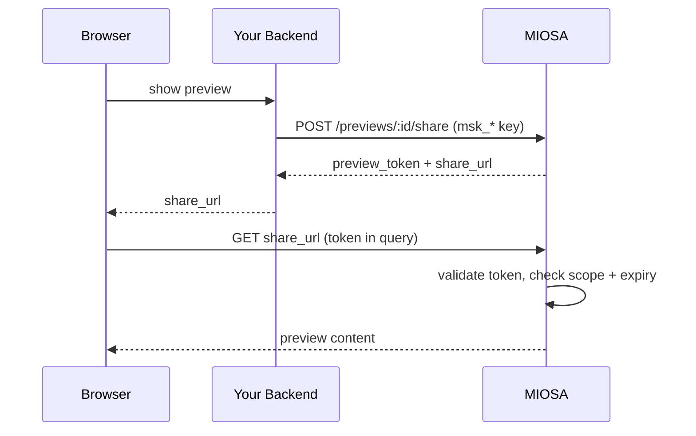

当最终用户的浏览器需要直接访问 MIOSA 时——预览沙箱、打开终端、上传文件——请在服务端签发短期浏览器令牌，只把令牌交给浏览器。工作区 API 密钥（`msk_*`）绝不离开你的后端。

## 签发流程



## 模式

令牌绑定到资源（一个预览）、生命周期短（可配置，默认 1 小时），且除签发时指定的资源外，绝不授予任何其他访问权限。

## 预览分享令牌（主要类型）

这是最常见的面向浏览器的流程。

**TypeScript（后端）**

```typescript
// Inside your authenticated request handler
const share = await miosa.sandboxes.previews.share(previewId, {
  expiresInSec: 3600,
})

res.json({
  share_url: share.share_url,
  expires_at: share.data.share_token_expires_at,
})
```

**cURL**

```bash
curl -X POST https://api.miosa.ai/api/v1/sandboxes/$SBX/previews/$PREVIEW/share \
  -H "Authorization: Bearer $MIOSA_API_KEY" \
  -d '{"ttl_seconds": 3600}'
```

响应：
```json
{
  "data": {
    "id": "preview_...",
    "share_token_prefix": "first12chars",
    "share_token_expires_at": "2026-05-14T19:30:00Z"
  },
  "preview_token": "miosa_pv_<one-time-raw-token>",
  "share_url": "https://5173-abc12345.sandbox.miosa.ai?preview_token=miosa_pv_<one-time-raw-token>"
}
```

前端：
```jsx
// React example
<iframe
  src={shareUrl}
  sandbox="allow-same-origin allow-scripts allow-forms"
  className="w-full h-[600px] border-0"
/>
```

令牌在 MIOSA 的边缘智能体处对请求进行认证。智能体会在转发到沙箱上的开发服务器之前剥离凭证——你的应用代码永远不会看到它。

## 令牌格式

| 使用场景 | 传递位置 | 有效期 |
|---|---|---|
| 预览分享 | `?preview_token=...` 查询字符串 | 可配置（默认 1 小时，最长 7 天） |
| 终端会话 | `wss://...?token=...` WebSocket 查询参数 | 通常为 5–30 分钟 |
| 上传会话 | `Authorization: Bearer miosa_up_...` | 数分钟 |
| 通用资源令牌 | 待定 | 按资源限定范围 |

所有格式都是由 MIOSA 签名的 JWT。负载包含资源 ID、作用域、过期时间和智能体验证的 HMAC。你可以在客户端解码以检查过期时间，但无法伪造。

## 有效期与过期
```typescript
const share = await miosa.previews.share(previewId, {
  expiresInSec: 3600, // 1 hour
})
```

分享令牌默认有效期为 1 小时，可设置为 60 秒至 7 天。TTL 越长，令牌泄露时的风险越大；用于浏览器嵌入时，通常为 1–3 小时。

过期后，预览会返回 401。你的前端应：

1. 监听 `share.data.share_token_expires_at`。
2. 在过期前重新调用后端签发新令牌。
3. 使用新的 `share_url` 重新加载 iframe。

## 重新签发与撤销

一个预览可以同时拥有**多个有效的分享令牌**。签发新令牌不会使之前的令牌失效。

要撤销某个预览的所有令牌，请调用：
```http
DELETE /api/v1/sandboxes/:id/previews/:preview_id/share
```

这会立即使该预览的所有未过期分享令牌失效。适用于“我不小心在外部分享了它，立刻切断所有浏览器访问”的场景。

## CSP 与嵌入

MIOSA 的预览智能体会发出 `Content-Security-Policy` 响应头，允许预览在特定来源下作为 iframe 嵌入。默认情况下包括：

- `*.miosa.app`
- `*.miosa.ai`
- `localhost:4000`（用于 MIOSA 前端的本地开发）

对于白标嵌入（你的平台在 `app.example.com` 上托管并嵌入 MIOSA 预览），CSP 需要包含你的来源。请联系支持团队按租户配置智能体 CSP。

## 审计

每次签发令牌都会产生一个审计事件：
```json
{
  "action": "preview.share_token.issued",
  "resource_id": "preview_...",
  "actor": "api_key:msk_u_...",
  "metadata": {
    "workspace_id": "550e8400-e29b-41d4-a716-446655440000",
    "project_id": "660e8400-e29b-41d4-a716-446655440001",
    "external_workspace_id": "acct_123",
    "external_user_id": "user-456",
    "expires_at": "2026-05-14T19:30:00Z",
    "token_prefix": "miosa_pv_xyz"
  }
}
```

`token_prefix` 让你无需存储原始令牌，就能将审计事件与日志条目关联起来。

## 浏览器令牌不能做的事

- 不能调用 MIOSA API（sandboxes.create、deployments.publish 等）。它们仅用于智能体访问。
- 不能提权到其他资源。`preview_A` 的预览令牌无法读取 `preview_B`。
- 不能跨租户。
- 不能在过期后继续使用。被撤销或过期的令牌会永久失效。

如果你需要更广泛的浏览器端访问权限（例如最终用户登录的开发控制台），请改用完整的 MIOSA 用户会话（JWT）。请参阅[身份验证](/docs/authentication)。

> **注意：不要将 `preview_token` 写入日志或分析工具**
>
> 原始令牌可授予 iframe 访问权限。应像对待会话 Cookie 一样对待它——不要记录到服务端日志，也不要传给分析工具。`share_token_prefix` 可以安全记录。

## 另请参阅

- [预览](/docs/develop/previews)——这些令牌授予访问权限的资源
- [API 密钥](/docs/platform/api-keys)——后端用于签发的服务端凭证
- [归属](/docs/platform/attribution)——审计事件中记录的内容
