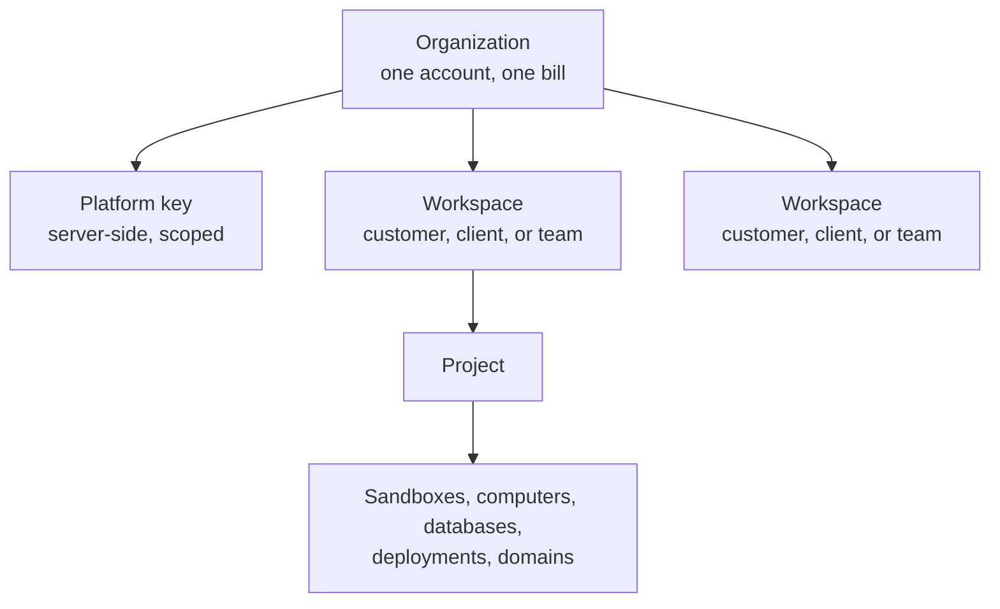
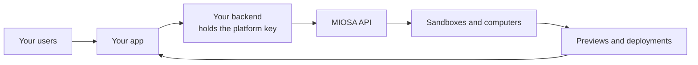

本指南先介绍每个平台共用的唯一模型，然后逐一说明三种具体形态：

MIOSA 上的每个平台都共用同一个模型。
本页展示该模型以及三种具体形态：白标 SaaS、智能体机构和内部团队。

## 模型

每种形态都基于同样的四个概念。

1. **组织。** 你在 MIOSA 上的账户。它拥有密钥、余额和唯一账单。
2. **工作区。** 组织内部的一个边界。每个客户、委托方或团队各一个。
3. **项目。** 某人在工作区内构建的东西。沙箱、计算机、数据库、部署和域名都属于某个项目。
4. **你自己的 ID。** 来自你数据库的不透明 `external_*` 字符串，会复制到每个资源、用量事件和审计条目上，以便与你自己的记录对账。



工作区和项目决定路由、权限、仪表板分组和用量。
你的 `external_*` ID 只是标签。
即使另一个组织知道相同的 slug 或外部 ID，也无法读取你的资源。

## 你的后端就是平台

你的用户从不直接与 MIOSA 通信。
你的后端负责通信。



后端承担五项职责：

1. 将你的每个用户或客户映射到 MIOSA 工作区和项目。
2. 为他们创建沙箱、计算机、部署、数据库和域名。
3. 为预览和终端签发短期[浏览器令牌](/docs/platform/browser-tokens)。
4. 查询用量以进行成本分摊。
5. 验证 webhook 签名。

浏览器始终只会看到预览 URL 以及限定范围、会过期的令牌。

> **注意：硬性规则**
>
> 切勿将 `msk_*` 密钥放入浏览器。像对待 Stripe 密钥一样对待它：仅限服务端、定期轮换并接受审计。

## 为组织命名

组织 slug 在创建时由组织名称生成一次，之后无法更改。
在你绑定自己的域名之前，它会出现在 MIOSA 托管的 URL 中，因此请在用户创建任何内容之前设置好。
请参阅[品牌与域名设置](/docs/platform/white-label#1-organization-identity)。

## 打上你的品牌

品牌化分为三层，每层单独配置。

| 层级 | 控制内容 | 位置 |
|---|---|---|
| 预览域名 | 使用 `5173-sbx01j9x.sandbox.example.com` 而不是 MIOSA URL | [预览域名](/docs/platform/white-label#4-organization-preview-domain) |
| 部署域名 | 已发布应用使用 `lead-magnet.apps.example.com` | [部署域名](/docs/platform/white-label#5-deployment-domain) |
| 精确自定义域名 | 在单个部署或计算机上使用 `program.example.net` | [自定义域名](/docs/platform/white-label#6-resource-custom-domains) |

精确域名优先于部署域名，部署域名优先于 MIOSA 回退域名（`lead-magnet.example-org.miosa.app`）。
租户品牌还控制徽标、壁纸、支持 URL，以及是否显示“Powered by MIOSA”。
始终展示返回的 `public_url`，不要自行拼接主机名。

## Lumen：一个白标 SaaS

Lumen 是一家虚构公司，`example.com` 和 `example.net` 是保留的示例域名，并非真实域名。
Lumen 销售一款智能体产品。
其客户在 `example.com` 上注册，描述一个应用，然后获得运行中的预览和部署。
他们从不会看到 MIOSA。

- **组织：** `Lumen`，Lumen 后端上有一个平台密钥。
- **每个客户一个工作区：** Acme Corp 对应 `acme-corp`，Northwind Agency 对应 `northwind-agency`。
- **域名：** 预览位于 `*.sandbox.example.com`，部署位于 `*.apps.example.com`，并在客户要求时使用其自有的 `program.example.net`。
- **计费：** Lumen 读取按 `external_workspace_id` 分组的用量，并按每个客户自己的价格收费。

```text
Organization: Lumen
  Workspace: Acme Corp
    Project: Summer lead magnet   ->  program.example.net
  Workspace: Northwind Agency
    Project: Booking portal
```

## Northwind Agency：客户项目

智能体机构不销售产品。
它交付工作成果，并希望每个客户彼此隔离、每个客户的成本清晰可见。

- **组织：** `Northwind Agency`，一个为所有费用付款的账户。
- **每个客户一个工作区。** 某个客户的机器、数据库、部署和支出绝不会与另一个客户混在一起。
- **每次合作一个项目。** 一个网站、一个预订门户、一个活动页面。
- **交付：** 每个完成的项目都会部署并绑定到客户自己的域名；在评审期间，预览 URL 上会显示智能体机构的名称。
- **成本：** 按工作区查询用量，并将其计入客户的发票或服务费报告。

Northwind 可以用 CLI 和仪表板在自己的组织上运行这套方案。
只有当它让客户自行登录并迭代时，才需要平台组件（密钥、浏览器令牌、每用户配额）。

## Acme Corp：一个内部平台

Acme Corp 并不打算发布任何东西。
它希望其团队和智能体在一个公司拥有的平台上工作。

- **组织：** `Acme Corp`。它负责付款、拥有余额，并设定谁可以做什么。
- **每个团队一个工作区：** Ops、Engineering、Sales。每个团队的机器和应用都位于其中。
- **每个智能体一台机器。** 代码智能体获得一个沙箱，浏览智能体获得一台计算机。两者都有各自独立的文件系统和网络。
- **连接与密钥**集中管理，因此新机器启动时恰好具备应有的配置，队友无需粘贴供应商令牌。
- **域名：** 内部应用运行在公司主机名（如 `agents.example.net`）之后。

```bash
miosa workspace create Ops
miosa create ops-agent --template miosa-sandbox --workspace ops --env prod --wait
miosa workspace usage ops
```

这里没有白标层，没有最终用户浏览器令牌，也没有转售计费。
本指南中的其他内容仍然适用，尤其是用于自动化的限定范围密钥和按工作区统计的用量。
包含连接、环境和访问控制的完整演练见[为你的团队构建内部 Business OS](/docs/guides/internal-business-os)。

## 生产检查清单

**安全**

- 密钥只存在于你的后端，从机密存储中注入。定期轮换。
- 绝不要用它为最终用户的请求签名。应改为签发限定范围的浏览器令牌。
- 对每次投递验证 webhook 签名。
- 将你自己的用户数据库作为授权的唯一事实来源。MIOSA 的所有权关系用于路由和分组。

**隔离与配额**

- 每个最终用户一台机器。
- 设置每用户限制，避免单个账户耗尽组织容量：[配额](/docs/api-reference/quotas)。
- 限制并发数和运行时长，并设置空闲超时，让闲置机器暂停。

**滥用**

- 在开通资源之前，应用你自己的注册检查、速率限制和条款。
- 使用[网络策略](/docs/security/network)限制出站流量，并查看[审计日志](/docs/security/audit-log)，留意意外主机。

**计费**

- 首次创建时，将 `workspace_id` 和 `project_id` 与你自己的 ID 一并持久化。
- 每个周期查询用量，并执行你自己的支出上限。
