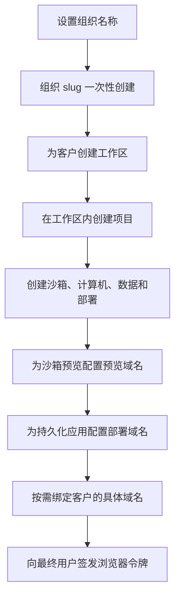

MIOSA 可以运行在您的产品和客户域名背后。关键是按以下顺序操作：先设置组织身份，为下游客户创建工作区/项目，分别配置预览域名和部署域名，最后在客户需要使用自己的主机名时绑定精确的自定义域名。

---

## 设置流程


## 1. 组织身份

每个账户都需要一个真实的组织名称。MIOSA 会根据该名称生成组织 slug，并且 slug 在设置完成后永久保留。请在允许用户创建资源之前完成此操作。

示例：

| 组织名称 | 组织 slug | 默认托管部署 URL |
|---|---|---|
| `Lumen` | `lumen` | `https://lead-magnet.example-org.miosa.app` |

如果新创建的账户仍使用 `org-...` 之类的临时设置 slug，或 slug 与组织名称不匹配，请先要求完成设置，再允许其进入常规应用导航。

```http
GET /api/v1/platform/tenants/current
Authorization: Bearer msk_u_...
```

如果需要完成设置，请用最终的组织名称更新租户：
```http
PUT /api/v1/tenants/{tenant_id}
Authorization: Bearer msk_u_...
Content-Type: application/json

{
  "name": "Lumen"
}
```

API 会根据 `name` 规范化 slug。如果同时提供了 `slug`，它必须与规范化后的组织名称一致。设置完成后，`name` 和 `slug` 均不可更改。

> **注意：slug 只能设置一次**
>
> 在绑定自定义域名之前，MIOSA 托管的 URL 会一直使用组织 slug。请把设置页面的提示写清楚：“创建您的组织名称。这会生成永久的 MIOSA slug，且只能设置一次。”

## 2. 工作区与项目

对于白标平台，请用工作区表示下游客户，用项目表示他们构建的内容。

Lumen 是虚构公司，`example.com` 和 `example.net` 是保留的示例域名。请替换为您自己的域名。

Lumen 示例：

```yaml
Organization: Lumen
  Workspace: Acme Corp
    Project: Summer lead magnet
      Sandboxes: generated app previews
      Databases: form submissions
      Deployment: production lead magnet
      Domain: program.example.net
  Workspace: Northwind Agency
    Project: Booking portal
```

可直接创建工作区和项目，也可让资源创建调用通过 `workspace_slug` / `project_slug` 或 `external_workspace_id` / `external_project_id` 自动解析它们。

```http
POST /api/v1/sandboxes
Content-Type: application/json

{
  "template_id": "miosa-sandbox",
  "workspace_slug": "acme-corp",
  "workspace_name": "Acme Corp",
  "project_slug": "summer-lead-magnet",
  "project_name": "Summer Lead Magnet",
  "external_workspace_id": "acct_123",
  "external_user_id": "user-456",
  "external_project_id": "project_789"
}
```

响应中会包含 `workspace_id` 和 `project_id`。请保存这些 ID，供后续调用使用。

## 3. URL 层级

白标生产环境包含多个相互独立的 URL 层级，请勿混用：

| 资源 | 默认 URL 形式 |
|---|---|
| 沙箱预览 | `https://{port}-{sandbox_slug}.sandbox.{preview_domain}` |
| 计算机桌面 | `https://{computer_slug}.computer.miosa.ai/desktop/index.html` |
| 持久化部署 | `https://{deployment_slug}.{deployment_domain}` |
| 部署兜底 URL | `https://{deployment_slug}.{organization_slug}.miosa.app` |
| 精确的自定义域名 | `https://customer-owned.example.com` |

以 Lumen 为例，名为 `Lead Magnet` 的部署默认会得到类似下面的 URL：

```text
https://lead-magnet.example-org.miosa.app
```

兜底 URL 始终可用。如果租户配置了部署域名，部署响应会改为返回带品牌的 URL。SDK、CLI 和前端应展示响应中的 `public_url` / `url`，不要自行拼接主机名。

## 4. 组织预览域名

当生成的沙箱预览 URL 应使用您组织的域名而不是 MIOSA 兜底域名时，请设置租户预览域名。

示例：

```http
PUT /api/v1/tenant/preview-domain
Content-Type: application/json

{
  "preview_domain": "example.com"
}
```

DNS：

| 记录类型 | 名称 | 值 |
|---|---|---|
| `CNAME` | `*` | `proxy.miosa.ai` |

DNS 传播完成后：

```http
GET /api/v1/tenant/preview-domain/verify
```

随后，沙箱预览 URL 将使用：

```text
https://5173-sbx01j9x.sandbox.example.com
```

## 5. 部署域名

当已发布的应用应使用您的品牌生产 URL 基础域名时，请设置租户部署域名。

推荐的 Lumen 设置：

```text
*.example.com       CNAME proxy.miosa.ai   (preview domain: record name `*`)
*.apps.example.com  CNAME proxy.miosa.ai   (deployment domain)
```

生成的 URL 将类似：

| 入口 | 示例 |
|---|---|
| 沙箱预览 | `https://5173-sbx01j9x.sandbox.example.com` |
| 持久化部署 | `https://lead-magnet.apps.example.com` |
| 托管兜底 URL | `https://lead-magnet.example-org.miosa.app` |

当前 V1 说明：面向公众的租户预览域名路由已开放。租户部署域名解析已在后端设置和路由中实现；面向公众的租户级管理路由仍由运维人员管理。您的客户端代码应使用部署响应返回的 `public_url`。

## 6. 资源自定义域名

当项目、部署或计算机需要自己的公开 URL 时，请绑定精确的自定义域名。

示例：

- `example.net` 用于网站部署
- `program.example.net` 用于获客页面
- `app.example.net` 用于应用
- `preview.example.net` 用于客户专属预览入口

部署：

```http
POST /api/v1/deployments/{deployment_id}/domains
Content-Type: application/json

{
  "domain": "program.example.net"
}
```

计算机：

```http
POST /api/v1/computers/{computer_id}/domains
Content-Type: application/json

{
  "domain": "desktop.example.net"
}
```

域名响应会返回 DNS 说明和验证状态。精确的资源域名优先于 MIOSA 托管 URL。

## 7. 域名优先级

当 MIOSA 渲染或路由 URL 时，可按以下模型理解：

| 优先级 | 来源 | 示例 |
|---|---|---|
| 1 | 精确的资源域名 | `program.example.net` |
| 2 | 租户部署域名 | `lead-magnet.apps.example.com` |
| 3 | MIOSA 托管兜底 URL | `lead-magnet.example-org.miosa.app` |

沙箱预览域名与部署域名相互独立，计算机桌面 URL 也与二者不同。绑定精确的资源自定义域名后，仍以该域名优先。

## 8. 品牌配置

租户品牌配置控制产品 UI、桌面壁纸、Logo、支持 URL，以及是否显示“Powered by MIOSA”。

```http
PUT /api/v1/tenant/branding
Content-Type: application/json

{
  "custom_app_name": "Lumen",
  "custom_logo_url": "https://example.com/logo-dark.png",
  "support_url": "https://help.example.com",
  "desktop_wallpaper_url": "https://example.com/wallpaper.png",
  "powered_by_visible": false
}
```

壁纸要求：

| 属性 | 值 |
|---|---|
| 格式 | PNG 或 JPEG |
| 尺寸 | 建议 1920 x 1080 |
| 文件大小 | 最大 5 MB |

## 9. 浏览器令牌

请勿在浏览器中暴露 `msk_*` API 密钥。您的后端应负责创建沙箱、部署和域名，再为最终用户签发限定范围的浏览器令牌。

```typescript
const token = await client.browserTokens.create({
  workspaceId: "550e8400-e29b-41d4-a716-446655440000",
  projectId: "660e8400-e29b-41d4-a716-446655440001",
  externalWorkspaceId: "acct_123",
  externalUserId: "user-456",
  permissions: ["sandbox:read", "sandbox:exec", "preview:read"],
  ttlSeconds: 3600,
})
```

## 完整设置清单

- [ ] 如果账户仍使用临时 slug 或没有组织名称，要求先完成组织设置。
- [ ] 说明组织名称会一次性生成永久的 MIOSA slug。
- [ ] 为下游客户创建或自动解析工作区。
- [ ] 为每个应用、网站、获客页面、文档或工作流创建或自动解析项目。
- [ ] 保存创建响应中的 `workspace_id` 和 `project_id`。
- [ ] 在 DNS 配置完成前，使用返回的 MIOSA 兜底 URL。
- [ ] 如果沙箱预览需要使用您的域名，请配置预览域名。
- [ ] 如果生成的应用默认需要使用您的域名，请配置部署域名。
- [ ] 当客户希望使用自己的 URL 时，为部署或计算机绑定精确的自定义域名。
- [ ] 应用租户品牌配置和支持链接。
- [ ] 仅从您的后端签发浏览器令牌。

---

## 端到端演练：按用户预配

本演练将构建一个设计工具 SaaS，每个客户都拥有隔离的工作区，并且永远不会看到 MIOSA 品牌。

### 按用户预配

为每个客户项目创建一个沙箱。传入您自己的 ID，以便后续查询、筛选这些资源并对其计费。

**Python**

```python
import re

def slug_from_name(name: str) -> str:
    return re.sub(r"[^a-z0-9]+", "-", name.lower()).strip("-")[:60] or "project"

sandbox = client.sandboxes.create(
    template_id="miosa-sandbox",
    name=slug_from_name("Brand Refresh 2026"),   # "brand-refresh-2026"
    external_user_id="user_42",                  # your customer's ID
    external_project_id="proj_lumen_1",    # your project's ID
    metadata={
        "customer_id": "user_42",
        "project_name": "Brand Refresh 2026",
        "source": "lumen-whitelabel",
    },
)

print(sandbox.id)     # "sbx_01hzq5pnmpgt6vdwp0r8d23c5n"
print(sandbox.state)  # "provisioning"  -  becomes "running" in ~2 seconds
```

**TypeScript**

```typescript
function slugFromName(name: string): string {
  return name.toLowerCase().replace(/[^a-z0-9]+/g, "-").replace(/^-|-$/g, "").slice(0, 60) || "project";
}

const sandbox = await client.sandboxes.create({
  templateId: "miosa-sandbox",
  name: slugFromName("Brand Refresh 2026"),   // "brand-refresh-2026"
  externalUserId: "user_42",                 // your customer's ID
  externalProjectId: "proj_lumen_1",   // your project's ID
  metadata: {
    customerId: "user_42",
    projectName: "Brand Refresh 2026",
    source: "lumen-whitelabel",
  },
});

console.log(sandbox.id);     // "sbx_01hzq5pnmpgt6vdwp0r8d23c5n"
console.log(sandbox.state);  // "provisioning"  -  becomes "running" in ~2s
```

**字段参考：**

| 字段 | 用途 | 示例 |
|---|---|---|
| `external_user_id` | 客户在您系统中的稳定标识符。用于用量汇总、配额检查和筛选。 | `"user_42"` |
| `external_project_id` | 项目在某个客户下的标识符。 | `"proj_lumen_1"` |
| `name` | 适合用于 URL 的 slug；在设置自定义域名之前，它会出现在预览 URL 中。 | `"brand-refresh-2026"` |
| `metadata` | 任意键值对，会在 Webhook 负载和 API 响应中返回。 | `&#123;"source": "lumen"&#125;` |

### 易读 URL

注册预览域名后，沙箱预览默认使用 `*.sandbox.{preview_domain}`。若要让每个沙箱拥有易读的子域名，可在创建后更新 slug：

**Python**

```python
client.sandboxes.update("sbx_01hzq5...", slug="brand-refresh-2026")
# Preview URL becomes:
# https://3000-brand-refresh-2026.sandbox.example.com
```

**TypeScript**

```typescript
await client.sandboxes.update("sbx_01hzq5...", { slug: "brand-refresh-2026" });
// Preview URL becomes:
// https://3000-brand-refresh-2026.sandbox.example.com
```

Slug 必须在工作区内唯一。如果 slug 已被占用，MIOSA 会返回 `409` 冲突。

### 创建后自定义

可随时更新沙箱设置，无需重新创建虚拟机：

**Python**

```python
client.sandboxes.update(
    "sbx_01hzq5...",
    slug="brand-refresh-2026",    # pretty URL slug
    timeout_sec=7200,             # idle timeout (2 hours)
    always_on=False,              # allow idle-pause
    metadata={"phase": "v2"},     # merge into existing metadata
)
```

**TypeScript**

```typescript
await client.sandboxes.update("sbx_01hzq5...", {
  slug: "brand-refresh-2026",
  timeoutSec: 7200,
  alwaysOn: false,
  metadata: { phase: "v2" },
});
```

### 按用户计费

按 `external_user_id` 查询计算用量。可用于按席位计费、用量仪表盘或成本分摊报表。

**Python**

```python
usage = client.usage.get(
    external_user_id="user_42",
    period_start="2026-05-01T00:00:00Z",
    period_end="2026-06-01T00:00:00Z",
)

print(usage["compute_seconds"])  # total sandbox-seconds
print(usage["sandbox_count"])    # distinct sandboxes created
print(usage["cost_usd"])         # dollar amount for billing
```

**TypeScript**

```typescript
const usage = await client.usage.get({
  externalUserId: "user_42",
  periodStart: "2026-05-01T00:00:00Z",
  periodEnd: "2026-06-01T00:00:00Z",
});

console.log(usage.computeSeconds); // total sandbox-seconds
console.log(usage.sandboxCount);   // distinct sandboxes created
console.log(usage.costUsd);        // dollar amount for billing
```

### 按用户配额

防止单个客户耗尽您的全部计算预算。可在工作区或项目层级设置配额，也可在您自己的 API 层强制执行：

**Python**

```python
# List sandboxes for this user and reject if at the limit.
SANDBOX_LIMIT_PER_USER = 5

existing = client.sandboxes.list(external_user_id="user_42", state="running")
if len(existing) >= SANDBOX_LIMIT_PER_USER:
    return jsonify({"error": "sandbox limit reached"}), 429
```

**TypeScript**

```typescript
const SANDBOX_LIMIT_PER_USER = 5;

const existing = await client.sandboxes.list({
  externalUserId: "user_42",
  state: "running",
});
if (existing.length >= SANDBOX_LIMIT_PER_USER) {
  return res.status(429).json({ error: "sandbox limit reached" });
}
```

### 取消时清理

客户取消账户后，销毁其所有沙箱：

**Python**

```python
sandboxes = client.sandboxes.list(external_user_id="user_42")
for sandbox in sandboxes:
    client.sandboxes.delete(sandbox["id"])
    print(f"Destroyed {sandbox['id']}")
```

**TypeScript**

```typescript
const sandboxes = await client.sandboxes.list({ externalUserId: "user_42" });
for (const sandbox of sandboxes) {
  await client.sandboxes.delete(sandbox.id);
  console.log(`Destroyed ${sandbox.id}`);
}
```

## 最终用户 UI 组件

使用由 MIOSA SDK 驱动的文件浏览、终端和运行按钮组件，为您的用户带来原生产品体验。这三种组件都需要具备相应权限范围的浏览器令牌（参见[预览权限范围](/docs/develop/previews#permission-scoping)）。

### 文件树

```typescript
import Miosa from "@miosa/sdk";

const client = new Miosa({ apiKey: browserToken }); // mp_ token from your backend

async function loadFileTree(sandboxId: string, path = "/workspace") {
  const entries = await client.files.list(sandboxId, path);
  return entries.map((e) => ({
    name: e.name,
    type: e.type,   // "file" | "directory"
    path: e.path,
    size: e.size,
  }));
}
```

### 终端

```typescript
// Stream terminal output as an async iterable.
const stream = client.exec.stream(sandboxId, "bash", {
  cols: 80,
  rows: 24,
});

for await (const chunk of stream) {
  terminalEmulator.write(chunk.data);
}
```

### 运行按钮

```typescript
// One-shot exec with streaming output.
const result = await client.exec.run(sandboxId, "npm test", {
  workingDir: "/workspace",
  timeoutMs: 30_000,
});

console.log(result.stdout);
console.log(result.exitCode); // 0 = pass
```

## 端到端检查清单

- [ ] 设置品牌：`product_name`、`logo_url`、`support_email`
- [ ] 注册预览域名并添加 DNS CNAME 记录
- [ ] 验证 DNS 传播
- [ ] 注册 Webhook，并将密钥保存在您的环境中
- [ ] 使用 `external_user_id`、`external_project_id` 和 `metadata` 创建沙箱
- [ ] 仅在服务端生成预览令牌  -  切勿向浏览器暴露 `msk_*`
- [ ] 对每次 Webhook 投递验证 HMAC-SHA256
- [ ] 拒绝过期的 Webhook 时间戳（>5 分钟）
- [ ] 按 `event.id` 对 Webhook 事件去重
- [ ] 按 `external_user_id` 查询用量用于计费
- [ ] 创建沙箱前强制执行每用户沙箱配额
- [ ] 取消时销毁沙箱

## 另请参阅

- **所有权与归属**：工作区/项目所有权，以及用于成本分摊和筛选的外部 ID。

  [归属参考 →](/docs/platform/attribution)
- **自定义域名**：域名 API、DNS 记录和验证响应。

  [自定义域名 →](/docs/api-reference/custom-domains)
- **工作区**：工作区的创建、更新、设置和用量。

  [工作区 →](/docs/api-reference/workspaces)
- **项目**：项目的创建、更新和工作区范围限定。

  [项目 →](/docs/api-reference/projects)
