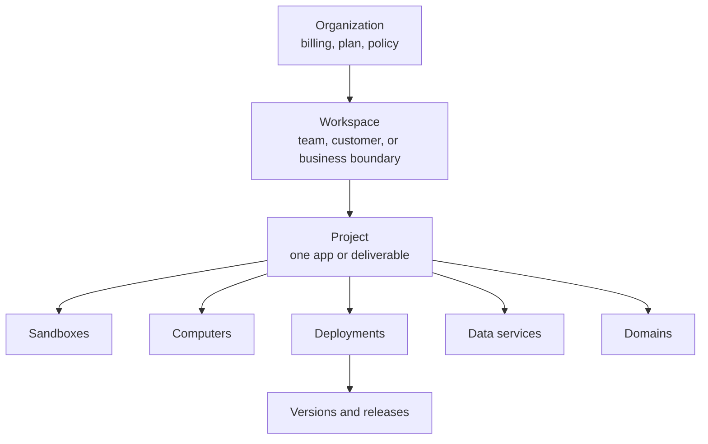

项目记录本身只保存身份和归属信息：

| 字段 | 用途 |
|---|---|
| `id` | 规范 UUID。首次解析后请保存此值。 |
| `tenant_id` | 拥有该项目的组织。 |
| `workspace_id` | 项目所在的工作区。必需。 |
| `name` | 显示名称，1 到 120 个字符。 |
| `slug` | URL 安全的键，1 到 80 个字符，每个工作区内唯一。省略时根据名称派生。 |
| `description` | 可选自由文本。 |
| `metadata` | 任意键值映射。 |
| `is_default` | 该工作区的默认项目为 true。客户端无法设置此字段。 |
| `external_project_id` | 你自己的项目 ID，每个组织内唯一。仅用于归属。 |
| `external_workspace_id` | 你自己的工作区 ID，继承自工作区。仅用于归属。 |

## 项目所处的位置



> **注意：项目不是另一种运行时**
>
> 沙箱、计算机或运行时实例负责执行工作。
> 项目为这些资源提供归属和组织结构。

每个工作区还有一个**默认项目**，按需创建并标记为 `is_default`。它是在没有显式指定项目时创建的资源的归属地，且既不能删除也不能移动。

## 项目中包含什么

资源通过规范的 `project_id` 列关联到项目，大多数资源还带有 `workspace_id` 和你的 `external_project_id`。
创建资源的调用可以为你解析项目：传入 `project_id`、`project_slug`、`project_name` 或 `external_project_id`，MIOSA 会在插入资源之前解析或创建项目。

| 资源 | 是否属于项目 | 说明 |
|---|---|---|
| 沙箱 | 是 | 可变的开发环境。带有 `project_id` 和 `workspace_id`。 |
| 沙箱预览 | 是 | 为沙箱生成的预览 URL。 |
| 计算机 | 是 | 桌面运行时。带有 `project_id`；计算机没有 `workspace_id` 列。 |
| 部署 | 是 | 持久的生产身份。它拥有版本、发布、服务、环境、构建、运行时实例和预览环境，而这些子资源的每一个都带有相同的 `project_id`。 |
| 托管数据库 | 是 | 项目级作用域，没有工作区列。创建项目时会自动预配一个。 |
| 数据库 | 是 | 附加到沙箱的数据库。 |
| 托管服务 | 是 | 项目级作用域，没有工作区列。 |
| 存储桶 | 是 | S3 兼容的对象存储。 |
| 卷 | 是 | 持久文件系统。创建项目时会自动创建一个 `/data` 卷。 |
| 自定义域名 | 是 | 附加到沙箱、计算机或部署的精确主机名。 |
| 边缘函数 | 是 | 在边缘运行的代码。 |
| Cron 任务 | 是 | 定时执行。 |
| 工作流 | 是 | 带有 `project_id`，没有工作区列。 |
| 项目认证 | 是 | 为单个沙箱或部署提供的内置认证，带有加密的 JWT 密钥。 |
| 项目集成 | 是 | 提供商凭证，例如 Stripe、Resend 和 Twilio。 |
| 运行时环境变量 | 是 | `scope` 为 `tenant`、`workspace` 或 `project`。值在静态存储时加密。 |
| 智能体定义和运行时配置文件 | 是 | 限定在项目范围内的智能体配置。 |
| 使用量计量 | 是 | 资源计量所依据的计费维度。 |
| 运行 | 是 | 项目删除时会分离：`project_id` 置为 null，运行本身不会被删除。 |
| 项目成员 | 是 | 项目删除时级联删除。 |
| 产品关联 | 是 | 产品将一个工作区内的一个或多个项目归为一组。 |
| 审计、使用量和平台事件 | 仅归属 | 不可变的历史记录。它保留记录时所属的项目，永远不会被重写。 |
| 工作区 | 否 | 父级边界。一个项目恰好属于一个工作区。 |
| 组织 | 否 | 位于项目之上两级。它拥有计费和策略。 |

要查看单个项目的实时计数、健康汇总、最近部署和关联仓库，请调用 `GET /api/v1/projects/{id}/summary`。

## 项目、工作区还是组织？

| 需求 | 使用 |
|---|---|
| 独立的公司计费和策略 | 组织 |
| 独立的团队、客户或业务边界 | 工作区 |
| 将一个应用及其资源归为一组 | 项目 |
| 开发可变的源代码 | 沙箱 |
| 运行一个稳定的生产应用 | 部署 |
| 保留持久的交互式桌面 | 计算机 |

当应用需要独立的部署历史、域名、环境或用量归属时，请创建独立的项目。

不要为每次构建、预览或发布都创建一个新项目。
预览和发布属于项目内的部署，而不属于新项目。

## 域名

预览域名是组织级设置，而不是每个项目单独设置。
租户预览域名会为整个组织生成的预览链接提供白标；精确的自定义主机名则附加到单个部署或计算机。

生效顺序为：

```text
Exact deployment/computer hostname
  -> Organization preview domain
  -> MIOSA-managed fallback
```

请始终显示 MIOSA 返回的 URL，而不要根据 slug 重新拼装。

每个自定义域名记录在指向的资源之外，还带有 `project_id` 和 `workspace_id`，因此主机名的作用域和归属方式与资源一致。

## 将你自己的平台映射到项目

| 你的平台 | MIOSA |
|---|---|
| 公司账户 | 组织 |
| 客户或团队 | 工作区 |
| 应用、站点、文档或产品 | 项目 |
| 可编辑的构建环境 | 沙箱 |
| 线上应用 | 部署 |

三个示例：

| 平台 | 形态 | 原因 |
|---|---|---|
| Lumen | 每个客户应用一个项目，放在一个工作区内 | 每个应用都有自己的部署历史、域名和用量条目，而整个平台仍归属于一个计费账户。 |
| Acme Corp | 每个内部工具一个项目，每个部门一个工作区 | 工具共享公司的组织和策略，但用量和成员分别汇总。 |
| Northwind Agency | 每个客户一个工作区，每个交付物一个项目 | 客户边界是工作区，因此隔离客户不会渗入到按交付物划分的项目中。 |

首次解析后，请保存规范的 `workspace_id` 和 `project_id`。
使用 `external_workspace_id`、`external_project_id` 和 `external_user_id` 进行关联，而不要用它们替代 MIOSA 的归属信息。
